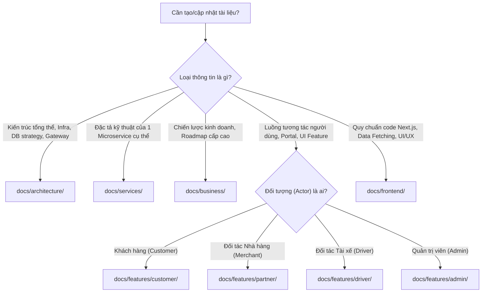
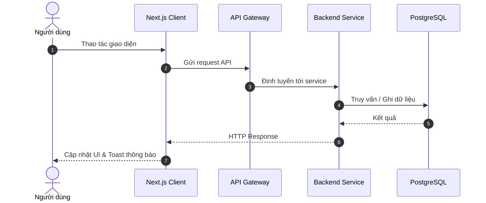

# Quy Chuẩn Viết Tài Liệu Dự Án (Documentation Policy)

Tài liệu này định nghĩa các quy tắc và quy chuẩn bắt buộc dành cho **AI Agents** và **Kỹ sư phát triển** khi tạo mới, cập nhật hoặc tổ chức tài liệu trong thư mục `docs/` của dự án Food Delivery.

---

## 1. NGUYÊN TẮC CỐT LÕI (CORE PRINCIPLES)

1. **Nguồn Chân Lý Duy Nhất (Single Source of Truth - SSOT)**:
   - Mọi quyết định kiến trúc, danh sách API, schema cơ sở dữ liệu và luồng nghiệp vụ phải được ghi nhận chính xác tại `docs/`.
   - Không được để xảy ra tình trạng "code chạy một đằng, docs viết một nẻo".
2. **Docs Song Hành Cùng Code (Docs-as-Code)**:
   - Bất kỳ thay đổi nào về API, Schema, hoặc Business Flow trong code **BẮT BUỘC** phải đi kèm việc cập nhật tài liệu trong cùng phiên làm việc.
3. **Cấu Trúc Phân Cấp Rõ Ràng (Strict Hierarchy)**:
   - Mọi tài liệu phải được đặt đúng thư mục phân cấp theo đối tượng và phạm vi, không đặt file lộn xộn ở thư mục gốc hoặc sai chuyên mục.

---

## 2. KHI NÀO AGENT BẮT BUỘC PHẢI VIẾT / CẬP NHẬT DOCS?

Agent phải kích hoạt kỹ năng này và cập nhật tài liệu khi gặp một trong các tình huống sau:

| Tình huống code | Hành động tài liệu bắt buộc | Thư mục đích |
| :--- | :--- | :--- |
| **Thêm microservice mới** | Tạo mới file đặc tả service và cập nhật bảng ma trận service | `docs/services/<service-name>.md` & `docs/services/README.md` |
| **Thêm/sửa API endpoint** | Cập nhật bảng REST API hoặc Internal API của service tương ứng | `docs/services/<service-name>.md` |
| **Thêm/sửa bảng Database** | Cập nhật phần Database Schema của service và tài liệu chiến lược DB | `docs/services/<service-name>.md` & `docs/architecture/database-schema-strategy.md` |
| **Thêm/sửa sự kiện SNS/SQS** | Cập nhật mục Messaging/Events trong service và kiến trúc realtime | `docs/services/<service-name>.md` & `docs/architecture/realtime-registration-flow.md` |
| **Phát triển luồng tính năng mới** | Tạo hoặc cập nhật tài liệu đặc tả tính năng phân theo Actor | `docs/features/<customer\|partner\|driver\|admin>/<feature-name>.md` |
| **Thay đổi kiến trúc / Hạ tầng** | Cập nhật tài liệu kiến trúc tương ứng | `docs/architecture/<topic>.md` & `docs/architecture/README.md` |
| **Thay đổi Pattern Frontend** | Cập nhật hướng dẫn kỹ thuật frontend | `docs/frontend/<topic>.md` |

---

## 3. BẢN ĐỒ PHÂN LOẠI TÀI LIỆU (TAXONOMY & ROUTING)

Khi cần tạo một tài liệu mới, Agent hãy áp dụng cây quyết định sau để chọn đúng thư mục:



### Quy ước đặt tên file và thư mục:
- **Kebab-case bắt buộc**: Sử dụng chữ thường, phân cách bằng dấu gạch ngang (ví dụ: `driver-registration-flow.md`, `payment-service.md`).
- **Tuyệt đối không dùng dấu gạch dưới (`_`)** hay PascalCase / camelCase cho tên file tài liệu.
- Đuôi mở rộng luôn là `.md`.

---

## 4. BỘ TEMPLATE CHUẨN THEO TỪNG LOẠI TÀI LIỆU

Agent **PHẢI** tuân thủ cấu trúc khung sườn (template) dưới đây khi khởi tạo tài liệu mới:

### Template 1: Microservice Specification (`docs/services/<service-name>.md`)

```markdown
# <Tên Microservice> (<Mục đích ngắn gọn>)

## 1. Tổng Quan & Trách Nhiệm
- Mô tả mục đích chính của microservice.
- Phạm vi nghiệp vụ chịu trách nhiệm (Boundaries).
- Port lắng nghe (Container port & Host port).

## 2. Tính Năng Cốt Lõi
1. **Tính năng A**: Mô tả nghiệp vụ.
2. **Tính năng B**: Mô tả nghiệp vụ.

## 3. Danh Sách API (RESTful)

### A. Public / Client-Facing APIs (Qua API Gateway)
| Endpoint | Method | Auth Guard | Mô tả | Request Body | Response Codes |
| :--- | :---: | :---: | :--- | :--- | :--- |
| `/api/v1/<service>/...` | `GET/POST` | `JwtAuthGuard` | Diễn giải | `{ ... }` | `200`, `400`, `401` |

### B. Internal APIs (Chỉ giao tiếp nội bộ Docker)
| Endpoint | Method | Service Gọi | Mục đích |
| :--- | :---: | :--- | :--- |
| `/internal/<service>/...` | `GET/POST` | `order-service` | Diễn giải |

## 4. Cơ Chế Sự Kiện (Event-Driven Messaging)
- **SNS Published Topics**: Tên Topic, loại payload sự kiện.
- **SQS Consumed Queues**: Tên Queue, cách xử lý sự kiện (Handler).

## 5. Database Schema (`schema_<service>`)
- Liệt kê các bảng Master (`m_`) và Transaction (`t_`).
- Bảng mô tả chi tiết các cột, kiểu dữ liệu, khóa chính UUID, ràng buộc logic.

## 6. Kiểm Thử & Chạy Thử
- Lệnh chạy test đơn vị / tích hợp (Vitest hoặc Jest).
```

---

### Template 2: Feature / User Flow Specification (`docs/features/<actor>/<feature>.md`)

```markdown
# <Tên Tính Năng> (<Tên Tiếng Anh>)

Tài liệu mô tả chi tiết luồng nghiệp vụ và trải nghiệm người dùng của tính năng <Tên tính năng>.

---

## 1. Bối Cảnh & Nguyên Tắc Nghiệp Vụ (Business Rules)
- Đối tượng sử dụng (Actors): Khách hàng, Quán ăn, Tài xế, hoặc Admin.
- Các quy tắc ràng buộc (Constraints & Policies) bắt buộc phải thỏa mãn.
- Ràng buộc quan hệ dữ liệu (VD: 1-1, chặn đăng ký lần 2).

## 2. Sơ Đồ Luồng Tương Tác (Mermaid Sequence)


## 3. Giao Diện Người Dùng & Các Trạng Thái (UI States)
- Đường dẫn ứng dụng: `/duong-dan`
- Các trạng thái hiển thị:
  - Trạng thái khởi tạo (Initial / Idle)
  - Trạng thái tải dữ liệu (Skeleton / Loading)
  - Trạng thái thành công (Success)
  - Trạng thái lỗi & ngoại lệ (Error / Empty / Retry)

## 4. Xử Lý Các Trường Hợp Biên (Edge Cases)
- Mất kết nối mạng / Timeout.
- Dữ liệu bị thay đổi đồng thời (Race condition).
- Người dùng không có quyền truy cập (Forbidden / Unauthorized).
```

---

### Template 3: Architecture & Technical Solution (`docs/architecture/<topic>.md`)

```markdown
# 🏗️ <Tiêu Đề Giải Pháp Kiến Trúc>

Tài liệu mô tả thiết kế kỹ thuật, giải pháp kiến trúc và các cân nhắc kỹ thuật cho <Chủ đề>.

---

## 1. Bối Cảnh & Vấn Đề (Context & Problem Statement)
- Vấn đề gặp phải là gì? Tại sao cần giải pháp này?
- Các yêu cầu phi chức năng: Hiệu năng, Tính sẵn sàng, Bảo mật, Mở rộng.

## 2. Sơ Đồ Thiết Kế Hệ Thống (Architecture Diagram)
```mermaid
graph TD
    %% Sơ đồ cấu trúc các thành phần
```

## 3. Luồng Dữ Liệu Chi Tiết (Data Flow & Protocols)
- Giao thức sử dụng (HTTP, gRPC, WebSocket, SNS/SQS).
- Định dạng dữ liệu và serialization.

## 4. Đánh Giá Trade-offs & Quyết Định Kỹ Thuật
- **Lý do chọn phương án A**: Ưu điểm.
- **Nhược điểm chấp nhận được**: Cách khắc phục.
- **Các phương án đã bị từ chối**: Lý do từ chối.
```

---

## 5. QUY CHUẨN NỘI DUNG VÀ TRÌNH BÀY (MARKDOWN STYLING)

1. **Ngôn ngữ viết**:
   - Sử dụng **Tiếng Việt** chuẩn xác làm ngôn ngữ dẫn dắt, giải thích và chú thích.
   - Giữ nguyên các **thuật ngữ chuyên ngành bằng Tiếng Anh** (ví dụ: *Event-Driven, Double-Entry Bookkeeping, Idempotency, Append-Only, Outbox Pattern, Soft Delete, Server Components*).
2. **Sử dụng Sơ Đồ Mermaid**:
   - Khi mô tả luồng giao tiếp giữa nhiều bên, BẮT BUỘC dùng sơ đồ Mermaid (`sequenceDiagram` hoặc `graph TD`).
   - Sơ đồ Mermaid phải có `autonumber` (đối với Sequence) để dễ đối soát bước thực hiện.
3. **Bảng Biểu (Markdown Tables)**:
   - Các danh sách API, Schema DB, và Ma trận so sánh BẮT BUỘC trình bày dạng bảng có căn lề rõ ràng.
4. **Hộp Cảnh Báo Chuẩn GitHub (Callouts)**:
   - Sử dụng hợp lý các alert block:
     ```markdown
     > [!NOTE]
     > Thông tin bổ sung, bối cảnh triển khai.
     
     > [!TIP]
     > Mẹo tối ưu hiệu năng hoặc khuyến nghị thực hành tốt.

     > [!IMPORTANT]
     > Yêu cầu cốt lõi bắt buộc tuân thủ.

     > [!WARNING]
     > Cảnh báo rủi ro dữ liệu, phá vỡ tính tương thích hoặc bẫy thường gặp.
     ```
5. **Liên Kết Markdown (Clickable Links)**:
   - Khi nhắc đến tài liệu khác, BẮT BUỘC tạo liên kết tương đối hợp lệ (Relative Markdown Links), ví dụ: `[`docs/services/payment-service.md`](./payment-service.md)`.
   - Tuyệt đối không để liên kết chết (broken links).

---

## 6. QUY TRÌNH ĐỒNG BỘ TÀI LIỆU (SYNCHRONIZATION CHECKLIST)

Khi Agent tạo mới hoặc di chuyển bất kỳ tài liệu nào trong `docs/`, Agent **PHẢI** thực hiện đủ 4 bước đồng bộ sau:

1. **Bước 1: Viết/Cập nhật file tài liệu chi tiết** theo đúng template chuẩn.
2. **Bước 2: Cập nhật file `README.md` của thư mục chứa tài liệu đó**:
   - Bổ sung tên file, mô tả tóm tắt 1 dòng và link điều hướng vào bảng danh sách.
3. **Bước 3: Cập nhật Master Index `docs/README.md`**:
   - Đảm bảo cây thư mục và danh mục tra cứu bao gồm tài liệu mới.
4. **Bước 4: Cập nhật Root `README.md` (nếu liên quan tới phạm vi toàn dự án)**:
   - Nếu tài liệu mô tả một Service mới hoặc một Phase quan trọng trên lộ trình, cập nhật mục tương ứng tại `README.md` ở thư mục gốc.

---

## 7. PRE-FLIGHT CHECKLIST TRƯỚC KHI HOÀN THÀNH TASK

Trước khi trả về kết quả cho User, Agent hãy tự rà soát:

- [ ] File mới được đặt đúng thư mục phân cấp theo đối tượng (`architecture/`, `services/`, `business/`, `features/<actor>/`, `frontend/`).
- [ ] Tên file tuân thủ định dạng `kebab-case.md`.
- [ ] Không có file tài liệu nào bị trùng lặp nội dung hoặc mâu thuẫn với file khác.
- [ ] Mọi bảng REST API đều có đủ Method, Endpoint, Auth Guard và Response status code.
- [ ] Mọi bảng Database đều tuân thủ tiền tố `m_` (Master) hoặc `t_` (Transaction) và khóa chính UUID.
- [ ] Đã cập nhật bảng mục lục tại thư mục con tương ứng và `docs/README.md`.
- [ ] Tất cả các link liên kết chéo (`[text](./path.md)`) đều hoạt động chính xác, không gãy vỡ.
