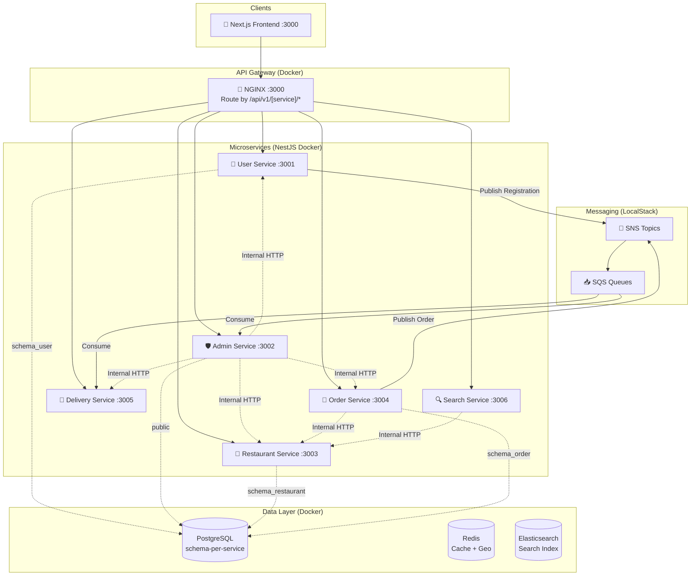

# 🍔 Food Delivery System (Microservices Architecture)

Dự án cá nhân xây dựng hệ thống đặt đồ ăn (Food Delivery) theo kiến trúc **Microservices + Event-Driven**. Bám sát các tiêu chuẩn thực tế trên môi trường Cloud.

**Tech Stack:**
- **Frontend:** Next.js + TypeScript + Tailwind CSS (App Router)
- **Backend:** Node.js + NestJS + TypeScript (Monorepo Microservices Workspace)
- **Database & Cache:** PostgreSQL (Schema-per-service) + Redis + Elasticsearch
- **Messaging:** Amazon SNS/SQS (LocalStack trên dev)
- **Infrastructure:** Docker Compose (Full Stack) + NGINX (API Gateway)

---

## 🏗️ Kiến Trúc Hệ Thống



> 📖 **Xem kiến trúc chi tiết:** [`docs/architecture/system-architecture.md`](./docs/architecture/system-architecture.md)

---

## 🛣️ Lộ Trình Phát Triển (Đã Hoàn Thành Migration)

Chúng ta đã hoàn tất việc chia tách dự án từ Monolith sang Microservices chuẩn mực:

- **Phase 1: Cấu trúc thư mục (Monorepo)** ✅
  - Chuyển source code sang `apps/` và `libs/`
  - Tách DB Schema Isolation (`schema-per-service`)
- **Phase 2: Xoá Cross-module Dependency** ✅
  - Loại bỏ các `@InjectRepository` gọi chéo
- **Phase 3: Internal API Endpoints** ✅
  - Sử dụng REST API (fetch) để giao tiếp nội bộ thay vì TypeORM trực tiếp
- **Phase 4: Event Contract Library** ✅
  - Đóng gói giao thức sự kiện (Event Types) vào `libs/events/` để gửi nhận SQS/SNS
- **Phase 5: Docker Compose Full Stack** ✅
  - Tạo `Dockerfile` chuẩn cho toàn bộ 6 service
  - Triển khai full stack bằng Docker Network
- **Phase 6: API Gateway** ✅
  - Triển khai NGINX làm Reverse Proxy (`gateway/nginx.conf`)
- **Phase 7: Kênh Đối Tác / Quản Lý Nhà Hàng (Merchant Portal)** ✅
  - Bật/tắt mở bán nhận đơn theo thời gian thực (`is_active`)
  - Quản lý thực đơn: CRUD món ăn, điều chỉnh giá bán, bật/tắt còn món (`is_available`), phân loại danh mục (`m_category`) và gán nhãn tags (`m_tag`)
  - Tích hợp bảo vệ giỏ hàng và đặt món tại `order-service` khi quán đóng cửa
  - Giao diện quản lý chuyên nghiệp tại `/partner/restaurant`
- **Phase 8: Đối Tác Tài Xế & Chuẩn Hóa Quan Hệ DB 1-1 (Issue #49)** ✅
  - Hỗ trợ luồng đăng ký tài xế chuyên biệt tại `/register/driver` và Cổng đối tác tại `/register`
  - Tái sử dụng trọn vẹn hạ tầng Event-Driven (SNS/SQS) và WebSockets realtime từ luồng nhà hàng
  - Chặn đăng ký lần 2 báo lỗi HTTP 409 Conflict (1 User tối đa 1 Nhà hàng và 1 Tài xế, cho phép nộp lại khi bị từ chối)
  - Chuẩn hóa quan hệ 1-1: Thiết lập ràng buộc `UNIQUE` trên `m_restaurant.owner_id` và `m_driver_profile.user_id`
  - Tích hợp xét duyệt tài xế và kích hoạt hồ sơ tự động tại Admin Portal (`/admin/approvals`)

---

## 🚀 Khởi Động Hệ Thống (Local Development)

### Cách 1: Chạy Full Stack trên Docker (Recommended cho Test)
Chỉ với 1 lệnh, toàn bộ hạ tầng và 6 microservices + API Gateway sẽ được khởi chạy độc lập:

```bash
docker compose up -d --build
```
*API Gateway sẽ mở tại: `http://localhost:3000`*

### Cách 2: Chạy Local Development (Hot-reload từng Service)
Nếu bạn muốn code và xem thay đổi ngay lập tức trên máy:
```bash
# 1. Khởi động hạ tầng (DB, Redis, Localstack) - Lưu ý comment các service backend trong file docker-compose nếu bị trùng port
docker compose up -d db redis localstack elasticsearch

# 2. Chạy lần lượt các microservice cần thiết trong terminal riêng:
cd backend
npx nest start user-service --watch
npx nest start admin-service --watch
# ...
```

---

## 📁 Cấu Trúc Thư Mục Mới

```
FoodDelivery/
├── frontend/               # Next.js App
├── backend/                # NestJS Monorepo
│   ├── apps/               # Các Microservices độc lập
│   │   ├── admin-service/
│   │   ├── delivery-service/
│   │   ├── order-service/
│   │   ├── restaurant-service/
│   │   ├── search-service/
│   │   └── user-service/
│   ├── libs/               # Thư viện dùng chung
│   │   ├── common/         # Decorators, Guards, Enums, Messaging SQS/SNS
│   │   ├── config/         # Cấu hình TypeORM, AWS
│   │   └── events/         # (Phase 4) Event Contracts, Types
│   ├── Dockerfile          # Generic Dockerfile cho mọi service
│   └── nest-cli.json
├── gateway/
│   └── nginx.conf          # NGINX API Gateway Config
├── scripts/
│   └── localstack-init.sh  # Tự động tạo SNS Topics + SQS Queues
└── docker-compose.yml      # Hạ tầng & Toàn bộ 6 Microservices + Gateway
```
