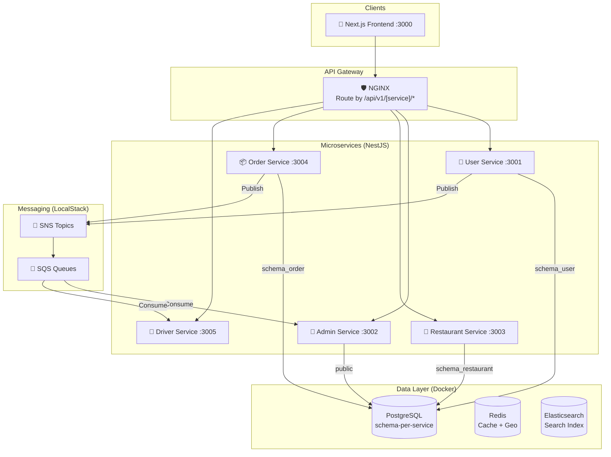

# 🍔 Food Delivery System

Dự án cá nhân xây dựng hệ thống đặt đồ ăn (Food Delivery) theo kiến trúc **Microservices + Event-Driven**. Bám sát các tiêu chuẩn thực tế trên môi trường Cloud.

**Tech Stack:**
- **Frontend:** Next.js + TypeScript + Tailwind CSS
- **Backend:** Node.js + NestJS + TypeScript (per-service)
- **Database & Cache:** PostgreSQL (schema-per-service) + Redis + Elasticsearch
- **Messaging:** Amazon SNS/SQS (LocalStack trên dev)
- **Infrastructure:** Docker + NGINX (API Gateway)

---

## 🏗️ Kiến Trúc Hệ Thống



> 📖 **Xem kiến trúc chi tiết:** [`docs/architecture/system-architecture.md`](./docs/architecture/system-architecture.md)

---

## 🗺️ Lộ Trình Phát Triển

### Phase 0 — Fix Infrastructure 🔴
- [ ] LocalStack SNS/SQS hoạt động đúng (Topic → Queue → Consumer)
- [ ] `docker-compose.yml` là file duy nhất cho mọi môi trường

### Phase 1 — Core APIs ✅ (Đang tiến hành)
- [x] User Service: Đăng ký, đăng nhập, JWT auth
- [x] Admin Service: Xét duyệt hồ sơ, dashboard metrics, cấu hình hệ thống
- [x] Restaurant Service: Quản lý nhà hàng, menu
- [x] Order Service: Tạo đơn, state machine
- [x] Database migrations (node-pg-migrate, schema tách biệt)
- [x] Admin Dashboard UI (Next.js) với Realtime WebSocket

### Phase 2 — Event-Driven Messaging 🔴
- [ ] SNS/SQS hoạt động: `RegistrationCreated` → Admin nhận realtime
- [ ] `OrderCreated` → Driver Service phân công tài xế
- [ ] Typed Event Contracts (`libs/events/`)

### Phase 3 — Search & Advanced Features 🟡
- [ ] Elasticsearch integration (Full-text + Geo-search)
- [ ] Smart Search API với filter đa chiều
- [ ] Redis Geo cho Driver tracking

### Phase 4 — Tách True Microservices 🔵
- [ ] Tái cấu trúc `services/` directory (mỗi service = repo độc lập)
- [ ] NGINX API Gateway
- [ ] CI/CD Pipeline (GitHub Actions)

> 📖 **Chi tiết lộ trình migration:** [`docs/architecture/migration-plan.md`](./docs/architecture/migration-plan.md)

---

## 🚀 Khởi Động (Local Development)

```bash
# 1. Khởi động toàn bộ infrastructure (DB, Redis, ES, LocalStack)
docker compose up -d

# 2. Chạy Backend (hot-reload, kết nối vào Docker)
cd backend && npm run start:dev:local

# 3. Chạy Frontend (hot-reload)
cd frontend && npm run dev
```

> **Tại sao không chạy Backend/Frontend trong Docker?**
> Chạy local để tận dụng HMR (Hot Module Replacement) — thay đổi code có hiệu lực tức thì, không cần rebuild container.

---

## 📁 Cấu Trúc Thư Mục

```
FoodDelivery/
├── frontend/               # Next.js App (App Router)
├── backend/                # NestJS Modular Monolith (đang tách ra services/)
│   ├── src/modules/
│   │   ├── users/          → (sẽ thành services/user-service)
│   │   ├── admin/          → (sẽ thành services/admin-service)
│   │   ├── restaurants/    → (sẽ thành services/restaurant-service)
│   │   ├── orders/         → (sẽ thành services/order-service)
│   │   └── drivers/        → (sẽ thành services/driver-service)
│   └── migrations/
├── docs/
│   ├── architecture/       # Tài liệu kiến trúc kỹ thuật
│   ├── services/           # Tài liệu chi tiết từng service
│   └── business/           # Business logic & luồng nghiệp vụ
├── scripts/
│   └── localstack-init.sh  # Tự động tạo SNS Topics + SQS Queues
└── docker-compose.yml      # Infrastructure (DB, Redis, ES, LocalStack)
```

---

## 📚 Tài Liệu Kỹ Thuật

| Tài liệu | Mô tả |
| :--- | :--- |
| [`docs/architecture/system-architecture.md`](./docs/architecture/system-architecture.md) | Kiến trúc tổng thể, service boundaries, event map |
| [`docs/architecture/migration-plan.md`](./docs/architecture/migration-plan.md) | Lộ trình và checklist Monolith → Microservices |
| [`docs/architecture/frontend-backend-connection.md`](./docs/architecture/frontend-backend-connection.md) | Hybrid Pattern: RSC + CSR + WebSocket |
| [`docs/services/user-service.md`](./docs/services/user-service.md) | User Service: Auth, Profile Add-ons |
| [`docs/services/admin-service.md`](./docs/services/admin-service.md) | Admin Service: Approvals, Config, Metrics |
| [`docs/services/order-service.md`](./docs/services/order-service.md) | Order Service: State machine, lịch sử đơn |
| [`docs/services/driver-service.md`](./docs/services/driver-service.md) | Driver Service: SQS Consumer, GPS tracking |
| [`docs/services/search-service.md`](./docs/services/search-service.md) | Search Service: Elasticsearch, Geo-search |
| [`docs/business/restaurant-registration-flow.md`](./docs/business/restaurant-registration-flow.md) | Flow đăng ký nhà hàng end-to-end |
| [`docs/business/business_roadmap.md`](./docs/business/business_roadmap.md) | Business features roadmap (Epics & Issues) |
