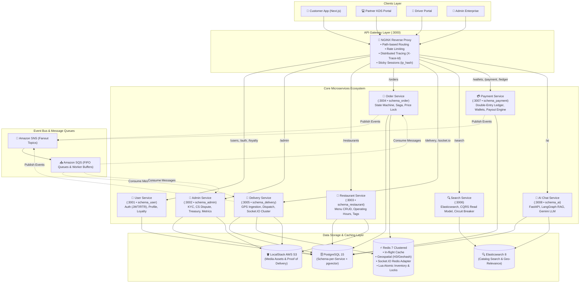
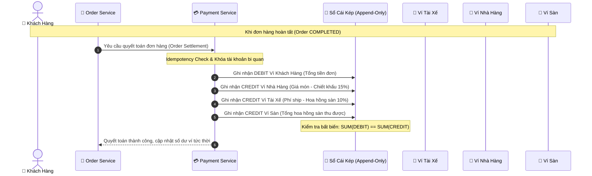

<div align="center">

# 🍔 FoodDelivery - Enterprise Food Delivery & Logistics Platform

**Nền tảng giao đồ ăn & điều phối logistics quy mô lớn xây dựng theo kiến trúc Microservices & Event-Driven, tích hợp Sổ cái kép FinTech, Định vị thời gian thực và Trợ lý AI RAG Gemini.**

[](https://nestjs.com/)
[](https://nextjs.org/)
[](https://www.typescriptlang.org/)
[](https://www.postgresql.org/)
[](https://redis.io/)
[](https://www.elastic.co/)
[](https://localstack.cloud/)
[](https://fastapi.tiangolo.com/)
[](https://www.docker.com/)

<p align="center">
  <a href="#-tổng-quan-hệ-thống">Tổng quan</a> •
  <a href="#%EF%B8%8F-kiến-trúc-hệ-thống">Kiến trúc</a> •
  <a href="#-điểm-nhấn-kỹ-thuật-độc-bản-engineering-highlights">Điểm nhấn kỹ thuật</a> •
  <a href="#-danh-mục-8-microservices">Microservices</a> •
  <a href="#-ma-trận-tính-năng-sản-phẩm">Tính năng</a> •
  <a href="#-tech-stack">Tech Stack</a> •
  <a href="#-hướng-dẫn-khởi-động-nhanh">Khởi động</a> •
  <a href="#-tiêu-chuẩn-kỹ-thuật--chất-lượng-mã-nguồn">Tiêu chuẩn</a> •
  <a href="#-trung-tâm-tài-liệu-dự-án">Tài liệu</a>
</p>

</div>

---

## 📖 Tổng Quan Hệ Thống

**FoodDelivery** là nền tảng giao đồ ăn và điều phối đơn hàng trực tuyến quy mô doanh nghiệp (tương tự GrabFood, ShopeeFood) được thiết kế theo mô hình **Microservices độc lập kết hợp Event-Driven Architecture**. Hệ thống kết nối và phục vụ liền mạch **4 nhóm chủ thể chính**:

1. **🧑 Khách Hàng (Customer)**: Trải nghiệm tìm kiếm thông minh đa chiều, giỏ hàng chống lệch giá, đặt hàng bất đồng bộ chịu tải cao, tích lũy điểm thưởng và theo dõi vị trí tài xế thời gian thực.
2. **🏪 Đối Tác Nhà Hàng (Merchant)**: Màn hình bếp KDS (Kitchen Display System) tiếp nhận đơn realtime, quản lý menu đa tầng, thiết lập khung giờ mở cửa và đối soát doanh thu tự động.
3. **🛵 Đối Tác Tài Xế (Driver)**: Hệ thống điều phối đơn tự động trong bán kính 5km, thuật toán chống tranh chấp cuốc (Atomic Lock), định tuyến đường phố turn-by-turn OSRM và quản lý ví điện tử/quyết toán ngân hàng.
4. **👑 Quản Trị Viên (Admin Enterprise)**: Cổng giám sát KPI tài chính, xét duyệt hồ sơ đối tác (KYC), can thiệp xử lý khiếu nại (CS Portal) với đối soát bằng chứng giao hàng (POD), và cấu hình hệ thống.
5. **🤖 Trợ Lý Ảo AI (AI Assistant)**: Chatbot tư vấn món ăn và tra cứu trạng thái đơn hàng thời gian thực sử dụng kỹ thuật RAG (Retrieval-Augmented Generation) kết hợp mô hình Google Gemini.

---

## 🏗️ Kiến Trúc Hệ Thống

Toàn bộ hệ sinh thái được phân tách thành **8 microservices biệt lập** theo ranh giới nghiệp vụ (Bounded Contexts), giao tiếp bất đồng bộ qua hàng đợi thông điệp Amazon SNS/SQS và giao tiếp đồng bộ qua REST/WebSocket thông qua cổng API Gateway NGINX.



---

## ⚡ Điểm Nhấn Kỹ Thuật Độc Bản (Engineering Highlights)

Hệ thống được phát triển với định hướng giải quyết các bài toán hạ tầng và phân tán phức tạp của một siêu ứng dụng giao vận:

### 1. FinTech Core: Sổ Cái Kép Bất Biến (Double-Entry Bookkeeping Ledger)
- **Bất biến kế toán**: Mọi dịch chuyển dòng tiền đều tuân thủ nguyên tắc `sum(DEBIT) == sum(CREDIT)`. Dữ liệu ghi vào bảng `t_ledger_entry` theo cơ chế **Append-Only** (nghiêm cấm `UPDATE` hoặc `DELETE`).
- **Phân lập 4 chủ thể ví**: Ví Khách hàng, Ví Đối tác Nhà hàng, Ví Tài xế và Ví Sàn (`SYS_REVENUE_PLATFORM_COMMISSION`).
- **Khóa số dư 2 pha (Hold & Settle)**: Khi yêu cầu rút tiền về tài khoản ngân hàng (VietQR/Napas), số dư được chuyển sang trạng thái `HOLDING`; chỉ khi ngân hàng xác nhận thành công mới chuyển thành `SETTLED`. Nếu lỗi, tự động hoàn trả số dư tức thời.
- **Phòng chống thấu chi & Khóa tài xế**: Cơ chế cấn trừ tiền mặt (COD) tự động trích hoa hồng sàn; tự động ngắt quyền nhận cuốc của tài xế khi số dư ví âm vượt ngưỡng an toàn.
- **Bảo toàn số học**: Sử dụng thư viện `Decimal.js` và khóa bi quan (`SELECT ... FOR UPDATE`) loại bỏ hoàn toàn sai số dấu phẩy động và Race Condition khi xử lý nạp/rút tiền đồng thời.



### 2. Giao Dịch Phân Tán với Saga Orchestrator & Transactional Outbox
- **Saga Orchestrator**: Điều phối chu trình đặt đơn xuyên suốt qua 4 microservices (`order-service` $\rightarrow$ `payment-service` $\rightarrow$ `restaurant-service` $\rightarrow$ `delivery-service`).
- **Compensating Transactions (Giao dịch bù trừ)**: Nếu nhà hàng từ chối nhận món hoặc không tìm được tài xế giao hàng, Saga tự động kích hoạt luồng hoàn tiền vào ví khách hàng, giải phóng nguyên tử tồn kho và đóng đơn hàng an toàn.
- **Transactional Outbox Pattern**: Lưu trữ sự kiện nghiệp vụ vào bảng `t_outbox` trong cùng một transaction cơ sở dữ liệu với nghiệp vụ chính, bảo đảm nguyên tắc **At-Least-Once Delivery** và triệt tiêu rủi ro mất dữ liệu (Dual-Write Problem).

### 3. Phòng Ngự Đột Biến Tải & Chống Cache Stampede (High-Concurrency)
- **XFetch Algorithm & Singleflight Mutex Lock**: Khi có 50.000 RPS đồng thời truy vấn menu hoặc thông tin quán vào thời điểm cache hết hạn (TTL Expired), chỉ **duy nhất 1 worker** được phép truy vấn Database để làm mới cache; 49.999 requests còn lại nhận dữ liệu cận hạn (Stale-While-Revalidate) hoặc chờ kết quả từ singleflight lock, loại bỏ hoàn toàn nguy cơ sập cơ sở dữ liệu.
- **Trừ Tồn Kho Nguyên Tử (Atomic Inventory Lua Script)**: Toàn bộ kiểm tra và trừ số lượng món ăn trong các đợt Flash Sale diễn ra bên trong Redis bằng kịch bản Lua đơn khối, chống bán âm (Overselling) tuyệt đối mà không cần khóa bảng cơ sở dữ liệu quan hệ.

### 4. Realtime Geospatial Ingestion (3.300 writes/s) & Điều Phối Tài Xế
- **Ingestion Pipeline**: Tiếp nhận tọa độ GPS liên tục từ hơn 10.000 tài xế đang hoạt động thông qua WebSocket, lưu trữ trên Redis Geospatial index (`GEOADD`) kết hợp thuật toán Uber H3 / Geohash.
- **Thuật toán ghép cuốc dưới 2ms**: Quét tài xế khả dụng trong bán kính 5km (`GEORADIUS`), phát tín hiệu WebSocket ping đồng loạt kèm đồng hồ đếm ngược 15 giây.
- **Redis Distributed Lock (`SETNX`)**: Bảo đảm chỉ có duy nhất 1 tài xế nhanh tay nhất nhận được cuốc xe; tự động chuyển nhượng cho tài xế kế tiếp nếu hết thời gian đếm ngược.
- **Định tuyến thực tế OSRM**: Tích hợp Open Source Routing Machine tính toán polyline bám cua ngã rẽ thực tế thay vì đường chim bay, hỗ trợ chỉ dẫn turn-by-turn.

### 5. Định Giá Động (Dynamic Surge Pricing) & Price Lock Ticket
- **Surge Engine**: Tự động tính toán hệ số tăng giá theo thời gian thực ($1.0x - 2.0x$) dựa trên tỷ lệ cung cầu (Số lượng đơn chờ vs Tài xế online) và điều kiện thời tiết tại từng khu vực địa lý.
- **Cart Versioning & Price Lock Ticket**: Cấp vé chốt giá (`Price Lock Ticket`) có thời hạn 5 phút được ký số bảo mật bằng mã HMAC-SHA256, triệt tiêu tình trạng lệch tiền giữa lúc chọn món và lúc bấm thanh toán.

### 6. CQRS Read-Model Projection & Circuit Breaker Tự Phục Hồi
- **CQRS Tách Biệt Read/Write**: Đường Ghi (Command) thực thi trên PostgreSQL ACID; Đường Đọc (Query) được phục vụ từ Elasticsearch index. Cơ chế Domain Event Projection đồng bộ dữ liệu sang Elasticsearch với độ trễ $< 100\text{ms}$.
- **Circuit Breaker 3 Trạng Thái (Closed, Open, Half-Open)**: Khi Elasticsearch gặp sự cố hoặc quá tải, Circuit Breaker tự động chuyển sang trạng thái `OPEN` trong vòng 15 giây, phục vụ dữ liệu suy giảm êm ái (Degraded Fallback Snapshot) với độ trễ $< 2\text{ms}$ thay vì để client chờ timeout, ngăn ngừa lỗi sập dây chuyền (Cascading Failure).

### 7. Mở Rộng Cụm WebSocket Đa Máy Chủ & Giám Sát Phân Tán (APM)
- **Clustered WebSocket (@socket.io/redis-adapter)**: Sử dụng Redis Pub/Sub kết nối toàn bộ các pod WebSocket chạy song song. Tin nhắn broadcast hoặc emit room phát ra ở Pod A lập tức được đồng bộ tới người dùng kết nối tại Pod B với độ trễ $< 2\text{ms}$.
- **Sticky Sessions NGINX**: Cấu hình `ip_hash` bảo đảm luồng WebSocket và HTTP polling fallback bám dính đúng pod.
- **Distributed Tracing & APM**: Cấp phát và chuyển tiếp header `X-Trace-Id` (chuẩn tiền tố `fd-tr-` hoặc W3C `traceparent`) xuyên suốt từ Gateway qua 8 microservices. Cung cấp endpoint Prometheus `/metrics` theo dõi RPS, độ trễ và số lượng client WebSocket kết nối realtime.

### 8. AI Chatbox Thông Minh với Kỹ Thuật RAG & Gemini LLM
- **Kiến trúc Hybrid Search**: Kết hợp tìm kiếm ngữ nghĩa Dense Vector (PostgreSQL `pgvector` HNSW index) và tìm kiếm từ khóa Sparse Keyword (Elasticsearch BM25) để truy xuất dữ liệu thực đơn, món ăn và đánh giá nhà hàng.
- **LangGraph Python Core & Gemini LLM**: Sử dụng StateGraph điều phối đa tác vụ: tư vấn chọn món cá nhân hóa, gợi ý món ăn theo chế độ ăn uống, và tra cứu trạng thái đơn hàng thời gian thực qua Tool Calling.
- **SSE Streaming & Session Memory**: Phản hồi câu trả lời dạng dòng (Server-Sent Events) với độ trễ gõ phím mượt mà; lưu trữ lịch sử ngữ cảnh hội thoại đa phiên lên tới 30 ngày.

---

## 🧩 Danh Mục 8 Microservices

Mỗi service được đóng gói độc lập, sở hữu cơ sở dữ liệu riêng biệt và phục vụ một miền trách nhiệm duy nhất:

| Microservice | Port | Schema Database | Công Nghệ Lõi | Trách Nhiệm Nghiệp Vụ Chính |
|:---|:---:|:---|:---|:---|
| **User Service** | `3001` | `schema_user` | NestJS, TypeORM, Passport-JWT | Xác thực tài khoản, Refresh Token Rotation, hồ sơ người dùng, phân quyền RBAC, tích điểm thưởng Loyalty. |
| **Admin Service** | `3002` | `schema_admin` | NestJS, SQS Consumer, Recharts | Xét duyệt hồ sơ đối tác (KYC), CS Dispute Portal, đối soát khiếu nại, ví tổng sàn (Platform Treasury), cấu hình hệ thống. |
| **Restaurant Service** | `3003` | `schema_restaurant` | NestJS, LocalStack S3, TypeORM | Quản lý nhà hàng, thực đơn CRUD, danh mục, Tags & Options Builder, khung giờ mở cửa 7 ngày, upload ảnh món S3. |
| **Order Service** | `3004` | `schema_order` | NestJS, SQS FIFO, Redis Lua | Quản lý vòng đời đơn hàng (State Machine), Saga Orchestration, Price Lock Ticket HMAC, Outbox Pattern. |
| **Delivery Service** | `3005` | `schema_delivery` | NestJS, Socket.IO, Redis Geo, OSRM | Ingestion tọa độ GPS 3.300 writes/s, điều phối cuốc xe (Dispatch), WebSocket Cluster, định tuyến turn-by-turn. |
| **Search Service** | `3006` | *(Elasticsearch)* | NestJS, Elasticsearch 8, Circuit Breaker | Tìm kiếm full-text không dấu tiếng Việt, tìm kiếm quán ăn lân cận (Geo-search), CQRS Read-Model Projection. |
| **Payment Service** | `3007` | `schema_payment` | NestJS, Decimal.js, PostgreSQL | Sổ cái kế toán kép (Double-Entry Ledger), ví 4 chủ thể, webhook cổng thanh toán trực tuyến, engine quyết toán ngân hàng. |
| **AI Chat Service** | `3008` | `schema_ai` | Python 3.11, FastAPI, LangGraph, Gemini | Trợ lý RAG thông minh, Hybrid Search (pgvector + ES), Tool Calling tra cứu đơn hàng, SSE Streaming. |

---

## ✨ Ma Trận Tính Năng Sản Phẩm

### 🧑 Phân Hệ Khách Hàng (Customer Experience)
- **Trang chủ thông minh**: 4 feed cá nhân hóa (Gần bạn, Quán đỉnh, Ưu đãi sốc, Món thịnh hành), infinite scroll, bộ chọn địa chỉ GPS định vị tự động.
- **Tìm kiếm đa tiêu chí**: Tìm kiếm món ăn và quán ăn theo từ khóa, danh mục, khoảng cách, freeship, đánh giá sao kèm gợi ý tức thì.
- **Menu tương tác chuẩn cao cấp**: Scroll Spy 2 chiều bám theo danh mục, popup chọn size/topping/mức ngọt đá với tính giá realtime, giỏ hàng nổi đáy màn hình (Floating Bottom Cart).
- **Chính sách đơn quán duy nhất (Single Restaurant Policy)**: Tự động cảnh báo và dọn giỏ hàng khi người dùng muốn đổi quán ăn khác.
- **Theo dõi đơn hàng thời gian thực (Order Tracker)**: Bản đồ Leaflet thể hiện lộ trình tài xế đang di chuyển bám đường phố, thanh trạng thái trực quan và kênh chat trực tiếp với tài xế.
- **Đánh giá & Xếp hạng 3 bên**: Đánh giá đa chiều (Món ăn, Nhà hàng, Tài xế) kèm tải ảnh review trực tiếp lên AWS S3.
- **Hệ thống Loyalty & Điểm thưởng**: Tích lũy điểm theo hạng thành viên (Đồng, Bạc, Vàng, Kim Cương), khấu trừ giảm giá trực tiếp tại bước Checkout (1 điểm = 10 VND, tối đa 50% đơn hàng).

### 🏪 Phân Hệ Đối Tác Nhà Hàng (Merchant Portal)
- **Màn hình bếp thời gian thực (Kitchen Display System - KDS)**: Quản lý trạng thái chế biến đơn hàng (`PENDING` $\rightarrow$ `COOKING` $\rightarrow$ `READY_FOR_PICKUP`) với âm báo và thông báo WebSocket tức thời.
- **Quản lý thực đơn nâng cao**: Tạo/sửa món ăn, thiết lập nhóm lựa chọn (bắt buộc/tùy chọn), giá gốc và giá khuyến mại, bật/tắt trạng thái còn hàng tức thời.
- **Cài đặt khung giờ mở cửa**: Thiết lập giờ mở/đóng cửa linh hoạt theo 7 ngày trong tuần; tự động đóng quán và chặn đặt hàng ngoài giờ.
- **Tải ảnh tài sản S3**: Upload avatar, banner quán ăn và ảnh món ăn trực tiếp lên S3 bucket thông qua shared module.

### 🛵 Phân Hệ Đối Tác Tài Xế (Driver Portal)
- **Tiếp nhận cuốc xe thông minh**: Nhận thông báo mời nhận đơn qua WebSocket trong bán kính 5km với thanh đếm ngược 15 giây; thuật toán Atomic Lock ngăn chặn nhận trùng đơn.
- **Bản đồ dẫn đường OSRM**: Hiển thị đường phố thực tế với chỉ dẫn Turn-by-Turn từ vị trí tài xế $\rightarrow$ Nhà hàng $\rightarrow$ Nhà khách hàng.
- **Bằng chứng giao hàng (Proof of Delivery - POD)**: Chụp ảnh xác thực 2 chặng (tại quán khi lấy món và tại cửa khi giao khách), nén ảnh WebP tải lên S3 lưu vết đối soát.
- **Ví tài xế & Rút tiền ngân hàng**: Theo dõi thu nhập theo từng chuyến, quản lý hạn mức tiền mặt COD, và tạo lệnh rút tiền về tài khoản ngân hàng liên kết VietQR.

### 👑 Phân Hệ Quản Trị Viên (Admin Enterprise Portal)
- **Dashboard phân tích KPI**: Biểu đồ trực quan hóa dữ liệu (Recharts): Tổng giá trị giao dịch (GMV), doanh thu hoa hồng sàn, phân bổ trạng thái đơn hàng.
- **Xét duyệt đối tác (KYC)**: Thẩm định hồ sơ mở quán và đăng ký tài xế mới; phê duyệt hoặc từ chối kèm lý do và tự động gửi thông báo thời gian thực.
- **Cổng CS & Can thiệp khiếu nại (Dispute Resolution)**: Tiếp nhận khiếu nại giao sai món/thiếu món từ khách, đối chiếu với ảnh chụp POD của tài xế, thực hiện hủy đơn cưỡng chế và tự động phạt/hoàn tiền trên sổ cái.
- **Phê duyệt lệnh rút tiền đối tác**: Duyệt lệnh rút tiền ngân hàng theo lô (Batch Processing), cân bằng sổ cái tài chính sàn.

---

## 🛠️ Tech Stack

```
┌─────────────────────────────────────────────────────────────────────────────┐
│                                  FRONTEND                                    │
│   Next.js 16 (App Router) • React 19 • TypeScript Strict • Tailwind CSS     │
│   Zustand (Client State) • TanStack React Query (Server Cache)              │
│   Leaflet + OpenStreetMap (Interactive GPS Maps) • Recharts • Socket.io-client│
└─────────────────────────────────────────────────────────────────────────────┘
                                      │
                                      ▼
┌─────────────────────────────────────────────────────────────────────────────┐
│                                   GATEWAY                                   │
│   NGINX Reverse Proxy • Rate Limiting • Sticky Sessions • X-Trace-Id Tracing│
└─────────────────────────────────────────────────────────────────────────────┘
                                      │
                                      ▼
┌─────────────────────────────────────────────────────────────────────────────┐
│                                   BACKEND                                   │
│   NestJS 12 Monorepo (7 Services) • Python 3.11 FastAPI (AI Service)       │
│   LangGraph • Google Gemini LLM API • TypeORM • node-pg-migrate             │
│   Socket.IO (@socket.io/redis-adapter) • Decimal.js (FinTech Accuracy)      │
└─────────────────────────────────────────────────────────────────────────────┘
                                      │
                                      ▼
┌─────────────────────────────────────────────────────────────────────────────┐
│                         DATA, MESSAGING & CLOUD                             │
│   PostgreSQL 15 (Schema-per-Service + pgvector) • Redis 7 (Pub/Sub & Geo)   │
│   Elasticsearch 8 (Full-Text & Suggester) • AWS LocalStack (SNS, SQS, S3)  │
│   Docker & Docker Compose • Prometheus Metrics Format (/metrics)            │
└─────────────────────────────────────────────────────────────────────────────┘
```

---

## 🚀 Hướng Dẫn Khởi Động Nhanh

### Yêu Cầu Hệ Thống
- **Docker Desktop** $\ge 4.20$
- **Node.js** $\ge 20.x$ & **npm** $\ge 10.x$
- **Python** $\ge 3.11$ *(chỉ cần nếu chạy local AI service)*

---

### ⚡ Phương Án 1: 1-Click Khởi Chạy Toàn Diện với Docker Compose (Khuyến nghị)

Chỉ với một câu lệnh duy nhất, toàn bộ hệ sinh thái gồm: Hạ tầng (Postgres, Redis, Elasticsearch, LocalStack), 8 Microservices, Cổng API Gateway NGINX và Ứng dụng Frontend Next.js sẽ được khởi chạy đồng bộ:

```bash
# 1. Clone mã nguồn
git clone https://github.com/DuyBinh2003/FoodDelivery.git
cd FoodDelivery

# 2. Thiết lập cấu hình môi trường
cp .env.example .env

# 3. Khởi chạy toàn bộ hệ thống
docker compose up -d --build
```

Sau khi khởi chạy thành công, truy cập hệ thống tại:
- **Cổng API Gateway / Hệ thống chính**: [`http://localhost:3000`](http://localhost:3000)
- **Frontend App**: [`http://localhost:3000`](http://localhost:3000) (hoặc trực tiếp [`http://localhost:3001`](http://localhost:3001) trong chế độ dev)

---

### 🔥 Phương Án 2: Phát Triển Cục Bộ (Local Development Workflow)

Dành cho nhà phát triển cần Debug và Hot-Reload từng microservice độc lập:

#### Bước 1: Khởi động các hạ tầng phụ trợ bằng Docker
```bash
docker compose up -d db redis elasticsearch localstack
```

#### Bước 2: Cài đặt dependencies và chạy Migrations cơ sở dữ liệu
```bash
# Tại thư mục backend
cd backend
npm install

# Chạy toàn bộ migrations tạo 8 schema database
npm run migrate:all

# Khởi tạo tài nguyên mock AWS S3 / SQS trên LocalStack
npm run sync:s3

# (Tùy chọn) Nạp bộ dữ liệu thử nghiệm lớn (>2.000 món ăn, 100+ nhà hàng)
npm run seed:large
```

#### Bước 3: Khởi chạy các Microservices (Chạy đồng thời hoặc từng service)
```bash
# Cách A: Chạy đồng thời toàn bộ 8 services
npm run start:all

# Cách B: Hoặc chạy từng service độc lập trong terminal riêng
npm run start:user        # :3001
npm run start:admin       # :3002
npm run start:restaurant  # :3003
npm run start:order       # :3004
npm run start:delivery    # :3005
npm run start:search      # :3006
npm run start:payment     # :3007
npm run start:ai          # :3008 (NestJS orchestrator)
```

#### Bước 4: Khởi chạy Frontend Next.js
```bash
cd ../frontend
npm install
npm run dev
```

---

### 📡 Bảng Tham Chiếu Cổng & Dịch Vụ Hệ Thống

| Dịch Vụ / Thành Phần | Địa Chỉ Truy Cập | Mục Đích |
|:---|:---|:---|
| **API Gateway (NGINX)** | `http://localhost:3000` | Cổng tiếp nhận duy nhất cho toàn bộ hệ thống |
| **User Service** | `http://localhost:3001` | REST API Người dùng, Xác thực & Loyalty |
| **Admin Service** | `http://localhost:3002` | REST API Quản trị & Duyệt hồ sơ |
| **Restaurant Service** | `http://localhost:3003` | REST API Quán ăn & Thực đơn |
| **Order Service** | `http://localhost:3004` | REST API Đơn hàng & State Machine |
| **Delivery Service** | `http://localhost:3005` | WebSocket Gateway `/delivery` & Điều phối cuốc |
| **Search Service** | `http://localhost:3006` | REST API Tìm kiếm & Suggester |
| **Payment Service** | `http://localhost:3007` | REST API Sổ cái kép & Ví điện tử |
| **AI Chat Service** | `http://localhost:3008` | REST & SSE API Chatbox RAG |
| **PostgreSQL Database** | `localhost:5432` | CSDL quan hệ chính (8 schemas độc lập) |
| **Redis Cache & Bus** | `localhost:6379` | Bộ nhớ tạm, Redis Geospatial, Socket.IO Pub/Sub |
| **Elasticsearch** | `http://localhost:9200` | Chỉ mục tìm kiếm văn bản & địa lý |
| **LocalStack AWS Mock** | `http://localhost:4566` | Giả lập đám mây: S3 Storage, SQS Queues, SNS Topics |

---

## 🛡️ Tiêu Chuẩn Kỹ Thuật & Chất Lượng Mã Nguồn

Dự án áp dụng quy chuẩn kỹ thuật nghiêm ngặt xuyên suốt toàn bộ codebase:

1. **TypeScript Strictness (Quy chuẩn cấm `any`)**:
   - Nghiêm cấm sử dụng kiểu `any` trong toàn bộ backend và frontend.
   - Định nghĩa kiểu dữ liệu và Interface chặt chẽ; các trường chưa xác định phải dùng `unknown` hoặc `Record<string, unknown>`.
2. **Nguyên Tắc Fail-Fast & No Hidden Fallbacks**:
   - Cấm sử dụng fallback ngầm cho biến môi trường cấu hình (ví dụ: `process.env.URL || 'http://localhost'`). Mọi cấu hình bắt buộc phải được khai báo tường minh trong `.env.example`, ném lỗi `ConfigError` ngay khi khởi động nếu thiếu.
   - Cấm chèn dữ liệu giả lập bịa đặt vào giao diện người dùng thông qua toán tử `||`.
3. **No Swallowed Exceptions (Bảo toàn nguyên nhân gốc lỗi)**:
   - Nghiêm cấm khối `catch () {}` để trống nuốt lỗi âm thầm.
   - Mọi ngoại lệ bọc lại đều phải đính kèm `{ cause: error }` và ghi log có ngữ cảnh kèm `traceId`.
4. **Kiểm Thử 3 Nhánh Bắt Buộc (Testing Policy Compliance)**:
   - Mọi Use Case nghiệp vụ phải có Unit Test bao phủ đủ **3 nhánh**:
     - **🟢 Happy Path**: Luồng xử lý dữ liệu chuẩn xác.
     - **🟡 Edge Cases**: Trường hợp biên, giới hạn cự ly, số dư bằng 0, timeout.
     - **🔴 Error & Rejection Flow**: Dữ liệu sai định dạng, vi phạm ràng buộc số dư, mất kết nối.
5. **Cổng Kiểm Soát CI Nội Bộ (Local CI Gate)**:
   - Toàn bộ thay đổi phải vượt qua **Bộ Tứ Kiểm Soát** trước khi tích hợp:
     ```bash
     # 1. Linter (Oxlint / ESLint - 0 warnings, 0 errors)
     npm run lint

     # 2. Type Check (tsc --noEmit - 0 errors)
     npx tsc --noEmit

     # 3. Unit Tests (Vitest & Node Test - 100% pass)
     npm test

     # 4. Build Check (Biên dịch thành công cả Backend & Frontend)
     npm run build
     ```

---

## 📚 Trung Tâm Tài Liệu Dự Án (Documentation Hub)

Toàn bộ tài liệu chi tiết được tổ chức theo phương pháp **Docs-as-Code** trong thư mục [`docs/`](./docs/README.md):

| Chuyên Mục | Đường Dẫn | Nội Dung Chi Tiết |
|:---|:---|:---|
| 🏗️ **Kiến Trúc Hệ Thống** | [`docs/architecture/`](./docs/architecture/README.md) | Bản vẽ hệ thống, Database Strategy, Event-Driven, Error Handling, Elasticsearch Indexing. |
| 🔌 **Đặc Tả Microservices** | [`docs/services/`](./docs/services/README.md) | Chi tiết API Contracts, Schema PostgreSQL, Message Events và Port Mapping cho từng service. |
| 👥 **Luồng Nghiệp Vụ Người Dùng** | [`docs/features/`](./docs/features/README.md) | Đặc tả User Flows cho Customer, Partner KDS, Driver Dispatch và Admin Portal. |
| 🎨 **Quy Chuẩn Frontend** | [`docs/frontend/`](./docs/frontend/README.md) | Next.js App Router patterns, State Management (Zustand/React Query), Design System Tokens. |
| 💼 **Lộ Trình & Nghiệp Vụ** | [`docs/business/`](./docs/business/README.md) | Business Epics, phân tích rủi ro tài chính và chiến lược mở rộng quy mô sản phẩm. |
| 📋 **Kế Hoạch Triển Khai Chi Tiết** | [`docs/plans/`](./docs/plans/README.md) | Master Query Matrix — Đặc tả kỹ thuật sâu và ma trận test 3 nhánh cho từng tính năng. |

---

## 📁 Cấu Trúc Mã Nguồn (Monorepo Layout)

```
FoodDelivery/
├── 📱 frontend/                    # Next.js 16 (App Router + React 19 + TypeScript)
│   └── src/
│       ├── app/                    # Next.js Route Segments (Pages & Layouts)
│       ├── features/               # Feature-Driven Architecture
│       │   ├── address/            # Sổ địa chỉ GPS & Nominatim geocoding
│       │   ├── admin/              # Dashboard KPI, duyệt hồ sơ, ví sàn
│       │   ├── ai-chat/            # Chatbox RAG streaming & session management
│       │   ├── auth/               # Đăng nhập, đăng ký, Refresh Token Rotation
│       │   ├── driver/             # Giao diện tài xế, đếm ngược nhận cuốc
│       │   ├── home/               # Trang chủ, 4 feed cá nhân hóa, carousel
│       │   ├── loyalty/            # Quy đổi điểm thưởng & hạng thành viên
│       │   ├── orders/             # Tracking đơn hàng realtime & review 3 bên
│       │   ├── payment/            # Cổng thanh toán trực tuyến & nạp ví
│       │   ├── promotions/         # Ví voucher đa tầng & khuyến mại
│       │   ├── restaurant/         # Trang menu, KDS nhà hàng, options dialog
│       │   └── search/             # Tìm kiếm full-text, bộ lọc, gợi ý tức thời
│       ├── components/             # Reusable UI components & Layouts
│       └── lib/                    # API client, env parser, utils
│
├── 🔧 backend/                     # NestJS Monorepo (7 Services) + Python AI Service
│   ├── apps/
│   │   ├── user-service/           # :3001 — Auth, User Profile, Loyalty Engine
│   │   ├── admin-service/          # :3002 — Duyệt KYC, CS Dispute, Metrics
│   │   ├── restaurant-service/     # :3003 — Menu CRUD, Giờ mở cửa, Upload S3
│   │   ├── order-service/          # :3004 — State Machine, Saga, Price Lock HMAC
│   │   ├── delivery-service/       # :3005 — Ingestion GPS, Dispatch, Socket.IO Cluster
│   │   ├── search-service/         # :3006 — Elasticsearch Search, Circuit Breaker
│   │   ├── payment-service/        # :3007 — Sổ cái kép (Double-Entry), Rút tiền
│   │   ├── ai-service/             # :3008 — NestJS Orchestrator & Python FastAPI Core
│   │   └── mcp-server/             # Model Context Protocol tools cho AI Agents
│   ├── libs/                       # Thư viện dùng chung (Shared Modules)
│   │   ├── common/                 # Adapters (Redis IO), Interceptors (Tracing), Metrics, Filters
│   │   ├── config/                 # Cấu hình Database, Redis, AWS SDK
│   │   └── events/                 # Event Contracts chuẩn hóa (BaseEvent<T>)
│   ├── migrations/                 # Migrations PostgreSQL phân lập theo từng service schema
│   └── scripts/                    # Scripts nạp dữ liệu lớn, reset DB, đồng bộ S3
│
├── 🚪 gateway/                     # NGINX API Gateway (:3000)
│   └── nginx.conf                  # Định tuyến path-based, Rate Limiting, Sticky Sessions
│
├── 📚 docs/                        # Trung tâm tài liệu dự án (Single Source of Truth)
├── docker-compose.yml              # Điều phối toàn bộ hạ tầng và dịch vụ
├── AGENTS.md                       # Quy chuẩn vận hành AI Coding Agents
└── README.md                       # Tài liệu tổng quan dự án (File này)
```

---

## 🤝 Đóng Góp & Phát Triển (Contributing)

Dự án hoan nghênh mọi đóng góp, phản hồi và thảo luận kỹ thuật về kiến trúc hệ thống:

1. Fork kho lưu trữ về tài khoản cá nhân.
2. Tạo nhánh tính năng mới: `git checkout -b feature/ten-tinh-nang-moi`.
3. Viết code và bổ sung Unit Test 3 nhánh theo [Testing Policy](./docs/plans/README.md).
4. Kiểm tra mã nguồn qua bộ tứ CI: `npm run lint && npx tsc --noEmit && npm test && npm run build`.
5. Tạo commit chuẩn Conventional Commits: `git commit -m "feat(module): mô tả tính năng"`.
6. Mở một **Pull Request** trên GitHub để cùng thảo luận và review code.

---

## 📄 Giấy Phép (License)

Dự án được phân phối dưới giấy phép **MIT License**. Xem file [`LICENSE`](./LICENSE) để biết thêm thông tin chi tiết.

---

<div align="center">

**Xây dựng với niềm đam mê kỹ thuật hệ thống phân tán bởi [DuyBinh2003](https://github.com/DuyBinh2003)**

*Distributed Systems · Event-Driven Architecture · FinTech Double-Entry · Real-time GPS · Generative AI RAG*

</div>
