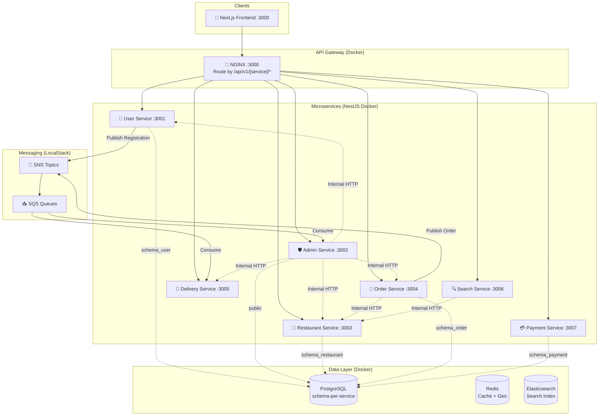

# 🍔 Food Delivery System (Microservices Architecture)

Dự án cá nhân xây dựng hệ thống đặt đồ ăn (Food Delivery) theo kiến trúc **Microservices + Event-Driven**. Bám sát các tiêu chuẩn thực tế trên môi trường Cloud.

**Tech Stack:**
- **Frontend:** Next.js + TypeScript + Tailwind CSS (App Router)
- **Backend:** Node.js + NestJS + TypeScript (Monorepo Microservices Workspace)
- **Database & Cache:** PostgreSQL (Schema-per-service) + Redis + Elasticsearch
- **Messaging:** Amazon SNS/SQS (LocalStack trên dev)
- **Infrastructure:** Docker Compose (Full Stack) + NGINX (API Gateway)

---

## 🏗️ Kiến Trúc Hệ Thống



> 📖 **Xem kiến trúc chi tiết:** [`docs/architecture/system-architecture.md`](./docs/architecture/system-architecture.md)
> 📚 **Trung tâm tài liệu toàn dự án:** [`docs/README.md`](./docs/README.md)


## ✨ Tính Năng Nổi Bật Của Hệ Thống (Core System Features)

Hệ thống Food Delivery được thiết kế toàn diện, phục vụ 4 nhóm đối tượng chính (Khách hàng, Đối tác Quán ăn, Đối tác Tài xế, Quản trị viên) cùng hệ thống Sổ cái Kế toán kép chuẩn FinTech:

### 1. 🧑 Phân Hệ Khách Hàng (Customer Experience)
- **Khám phá ẩm thực & Tìm kiếm thông minh**: Tìm kiếm món ăn và quán ăn siêu tốc qua Elasticsearch; hỗ trợ bộ lọc đa chiều (danh mục, tags ẩm thực, khoảng cách, freeship, đánh giá); xem chi tiết nhà hàng với hero banner và popup cấu hình món ăn.
- **Giỏ hàng nâng cao (Advanced Cart)**: Quản lý giỏ hàng offline-first, áp dụng chính sách nghiêm ngặt một nhà hàng duy nhất (Single Restaurant Policy), tự động đối soát giá và tình trạng đóng/mở cửa của quán trước khi chuyển sang bước thanh toán.
- **Sổ địa chỉ đa năng (Address Book & Leaflet Map)**: Bản đồ tương tác Leaflet + OpenStreetMap tích hợp định vị GPS (WGS84), tìm kiếm địa điểm autocomplete và reverse geocoding không phụ thuộc API key ngoài; quản lý nhiều địa chỉ với nhãn `HOME` / `WORK` / `OTHER` và tự động đổi địa chỉ mặc định.
- **Đặt hàng bất đồng bộ & Snapshot bất biến**: Snapshot nguyên vẹn tọa độ giao hàng (`delivery_lat`, `delivery_lng`) và người nhận vào đơn hàng; tiếp nhận đơn qua hàng đợi SQS FIFO chống quá tải hệ thống.

### 2. 🏪 Phân Hệ Đối Tác Nhà Hàng (Merchant Portal)
- **Đăng ký mở quán & Thẩm định hồ sơ**: Luồng nộp đơn đăng ký kinh doanh trực tuyến; phát tán sự kiện SNS/SQS sang Admin Service và nhận thông báo phê duyệt thời gian thực qua WebSockets.
- **Quản lý trạng thái hoạt động tức thì**: Bật/tắt trạng thái mở bán (`is_active`) theo thời gian thực; tự động vô hiệu hóa giỏ hàng và chặn đặt món khi quán tạm đóng cửa.
- **Quản lý thực đơn linh hoạt (Menu Catalog)**: Toàn quyền CRUD món ăn, điều chỉnh giá bán, bật/tắt tình trạng còn hàng (`is_available`), phân loại theo danh mục (`m_category`) và gán thẻ tags (`m_tag`).
- **Bảng điều khiển đơn bếp (Kitchen Orders Dashboard)**: Màn hình chuyên dụng cho bếp tại `/partner/restaurant` theo dõi đơn mới theo thời gian thực, chuyển trạng thái chế biến linh hoạt (`COOKING` ➔ `READY_FOR_PICKUP`).

### 3. 🛵 Phân Hệ Đối Tác Tài Xế (Driver Portal & Dispatch)
- **Đăng ký tài xế & Chuẩn hóa quan hệ 1-1**: Nộp hồ sơ đối tác với thông tin phương tiện và CCCD; ràng buộc cơ sở dữ liệu `UNIQUE` (1 tài khoản chỉ 1 tài xế, chống gian lận đăng ký trùng lặp).
- **Cổng thông tin tài xế chuyên biệt (`/driver/dashboard`)**:
  - Bật/tắt trạng thái nhận cuốc (Trực tuyến / Ngoại tuyến - Online/Offline) với hiệu ứng animation xung nhịp trực quan.
  - Nhận cuốc xe sẵn sàng (`AVAILABLE`) với cơ chế khóa nguyên tử Redis Atomic Lock chống race condition khi nhiều tài xế cùng bấm nhận.
  - Cập nhật trạng thái lộ trình di chuyển (`DELIVERING` ➔ `COMPLETED`).
- **Tính toán lộ trình & Khoảng cách (Haversine Distance)**: Tự động tính cự ly thực tế giữa Nhà hàng và Điểm giao hàng (`distance_km`), hiển thị huy hiệu cự ly trực quan trên từng thẻ chuyến đi giúp tài xế ước tính thời gian di chuyển.
- **Báo cáo thu nhập & Đánh giá**: Bảng thống kê tổng quan doanh thu ngày/tuần, số cuốc hoàn thành, lịch sử chuyến đi chi tiết và phân bổ điểm sao đánh giá từ khách hàng.

### 4. 💳 Dịch Vụ Thanh Toán & Sổ Cái Kế Toán Kép (FinTech Core Payment)
- **Microservice độc lập (`payment-service`)**: Cơ sở dữ liệu phân lập hoàn toàn tại `schema_payment`.
- **Sổ cái kế toán kép Append-Only**: Thiết kế chuẩn tài chính quốc tế (`t_ledger_transaction`, `t_ledger_entry`), bảo đảm bất biến tuyệt đối `sum(DEBIT) == sum(CREDIT)` bằng thư viện `Decimal.js` và khóa bi quan (`SELECT FOR UPDATE`).
- **Quản lý ví 4 chủ thể**: Khách hàng, Tài xế, Nhà hàng và Nền tảng Platform (`m_wallet_account`, `m_wallet_balance`).
- **Đối soát COD & Quản trị rủi ro**: Cơ chế cấn trừ tự động cho các cuốc xe tiền mặt (COD), quản lý thấu chi/số dư âm an toàn và tự động khóa nhận cuốc (`isDriverInactive`) khi tài xế vượt ngưỡng âm cho phép.

### 5. 👑 Phân Hệ Quản Trị & Vận Hành Hệ Thống (Admin & Ops)
- **Bảng điều khiển chỉ số (Admin Dashboard)**: Thống kê số lượng người dùng, tài xế hoạt động, nhà hàng, tổng sản lượng đơn hàng và tổng giá trị giao dịch GMV toàn hệ sinh thái.
- **Cổng phê duyệt đối tác (Approvals Portal)**: Thẩm định hồ sơ mở quán và đăng ký tài xế; duyệt/từ chối kèm lý do và kích hoạt tài khoản đối tác tự động.
- **Khả năng chịu tải & Xử lý lỗi toàn diện**:
  - Tầng đệm Queue-Based Load Leveling (AWS SQS FIFO) và bộ nhớ đệm In-flight Cache (Redis TTL 24h) chống nghẽn DB giờ cao điểm.
  - Trì hoãn ghi cơ sở dữ liệu (**Deferred Persistence**): Chỉ ghi nhận giao dịch xuống PostgreSQL khi đơn hoàn tất hoặc hủy đối soát.
  - Kiến trúc Full-Stack Error Handling: Bộ lọc ngoại lệ toàn cục `GlobalExceptionFilter` (Backend), Error Boundary phân cấp (Frontend), Fail-Fast ENV validation và 100% kiểm thử tự động với Vitest.

---

## 🚀 Khởi Động Hệ Thống (Local Development)

### Cách 1: Chạy Full Stack trên Docker (Recommended cho Test)
Chỉ với 1 lệnh, toàn bộ hạ tầng và 6 microservices + API Gateway sẽ được khởi chạy độc lập:

```bash
docker compose up -d --build
```
*API Gateway sẽ mở tại: `http://localhost:3000`*

### Cách 2: Chạy Local Development (Hot-reload từng Service)
Nếu bạn muốn code và xem thay đổi ngay lập tức trên máy:
```bash
# 1. Khởi động hạ tầng (DB, Redis, Localstack) - Lưu ý comment các service backend trong file docker-compose nếu bị trùng port
docker compose up -d db redis localstack elasticsearch

# 2. Chạy lần lượt các microservice cần thiết trong terminal riêng:
cd backend
npx nest start user-service --watch
npx nest start admin-service --watch
# ...
```

---

## 📁 Cấu Trúc Thư Mục Mới

```
FoodDelivery/
├── frontend/               # Next.js App (App Router, Tailwind CSS)
├── backend/                # NestJS Monorepo
│   ├── apps/               # Các Microservices độc lập
│   │   ├── admin-service/
│   │   ├── delivery-service/
│   │   ├── order-service/
│   │   ├── payment-service/
│   │   ├── restaurant-service/
│   │   ├── search-service/
│   │   └── user-service/
│   ├── libs/               # Thư viện dùng chung
│   │   ├── common/         # Decorators, Guards, Enums, Messaging SQS/SNS
│   │   ├── config/         # Cấu hình TypeORM, AWS
│   │   └── events/         # Event Contracts, Types
│   ├── Dockerfile          # Generic Dockerfile cho mọi service
│   └── nest-cli.json
├── docs/                   # Trung tâm tài liệu chuẩn hóa
│   ├── architecture/       # Kiến trúc & Hạ tầng hệ thống
│   ├── services/           # Đặc tả 7 Microservices & API Contracts
│   ├── business/           # Chiến lược & Lộ trình sản phẩm
│   ├── features/           # Đặc tả tính năng (Customer, Partner, Driver)
│   └── frontend/           # Quy chuẩn kiến trúc & UI/UX Next.js
├── gateway/
│   └── nginx.conf          # NGINX API Gateway Config
├── scripts/
│   └── localstack-init.sh  # Tự động tạo SNS Topics + SQS Queues
└── docker-compose.yml      # Hạ tầng & Toàn bộ Microservices + Gateway
```

