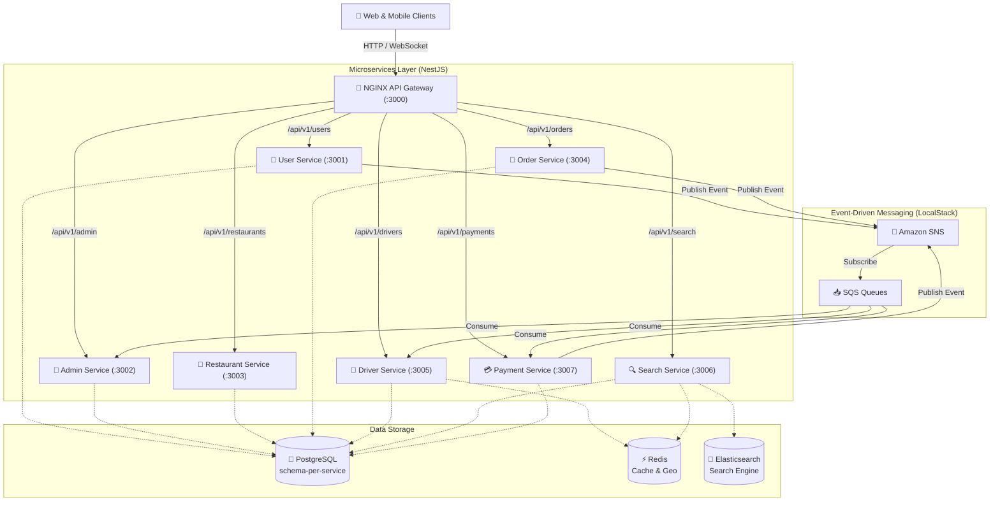

# 🏗️ Architecture & Infrastructure Documentation

Thư mục này chứa toàn bộ các tài liệu thiết kế kiến trúc kỹ thuật cấp cao (High-Level Architecture), mô hình triển khai hạ tầng, chiến lược cơ sở dữ liệu và các luồng giao tiếp dữ liệu cốt lõi của hệ thống **Food Delivery**.

---

## 📑 Danh Sách Tài Liệu

| Tài liệu | Mô tả | Đối tượng liên quan |
| :--- | :--- | :--- |
| **[`system-architecture.md`](./system-architecture.md)** | **Single Source of Truth** về kiến trúc toàn hệ thống: bản đồ Microservices, ports, NGINX Gateway, LocalStack, Docker Network. | Toàn bộ Team, DevOps, Backend |
| **[`microservices-design.md`](./microservices-design.md)** | Nguyên lý phân rã dịch vụ, cách ly dữ liệu (Data Isolation), cơ chế gọi API nội bộ thay thế TypeORM coupling. | Backend Developers |
| **[`database-schema-strategy.md`](./database-schema-strategy.md)** | Chiến lược Database độc lập (`schema-per-service`), quy ước đặt tên bảng Master (`m_`) và Transaction (`t_`), chuẩn hóa UUID. | Database Admins, Backend |
| **[`realtime-registration-flow.md`](./realtime-registration-flow.md)** | Kiến trúc Event-Driven Fan-out sử dụng AWS SNS/SQS và WebSockets đẩy thông báo duyệt hồ sơ theo thời gian thực. | Backend, Real-time, Admin |
| **[`elasticsearch.md`](./elasticsearch.md)** | Thiết kế hệ thống tìm kiếm thông minh: mapping chỉ mục món ăn & nhà hàng, cơ chế đồng bộ dữ liệu và fuzzy search. | Search Service, Backend |
| **[`frontend-backend-connection.md`](./frontend-backend-connection.md)** | Thiết lập Reverse Proxy NGINX làm API Gateway, xử lý tiền tố URL (`/api/v1/*`), CORS và routing. | Frontend, Gateway, DevOps |
| **[`async-order-processing-flow.md`](./async-order-processing-flow.md)** | Kiến trúc xử lý đơn hàng bất đồng bộ: Queue-Based Load Leveling (SQS FIFO), In-flight Cache (Redis), và Deferred DB Persistence khi COMPLETED. | Order Service, Delivery, Backend |
| **[`error-handling.md`](./error-handling.md)** | Kiến trúc xử lý lỗi toàn diện Full-Stack: GlobalExceptionFilter (NestJS), ApiError, Error Boundaries và UI Fallback. | Toàn bộ Team, Frontend, Backend |
| **[`migration-plan.md`](./migration-plan.md)** | Lịch sử và nhật ký hành trình chuyển đổi thành công từ kiến trúc Monolith sang Microservices chuẩn mực. | Tech Lead, Toàn bộ Team |

---

## 🏛️ Sơ Đồ Khái Quát Hạ Tầng

---

> [!NOTE]
> Để nắm sâu hơn về từng thành phần, hãy mở trực tiếp tài liệu chi tiết tương ứng trong bảng phía trên.
