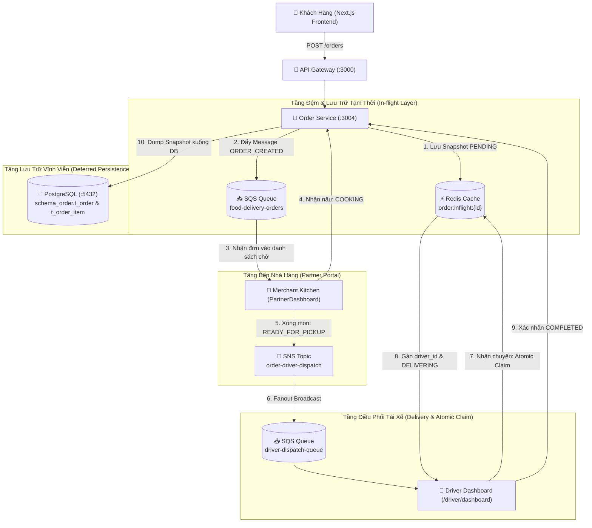
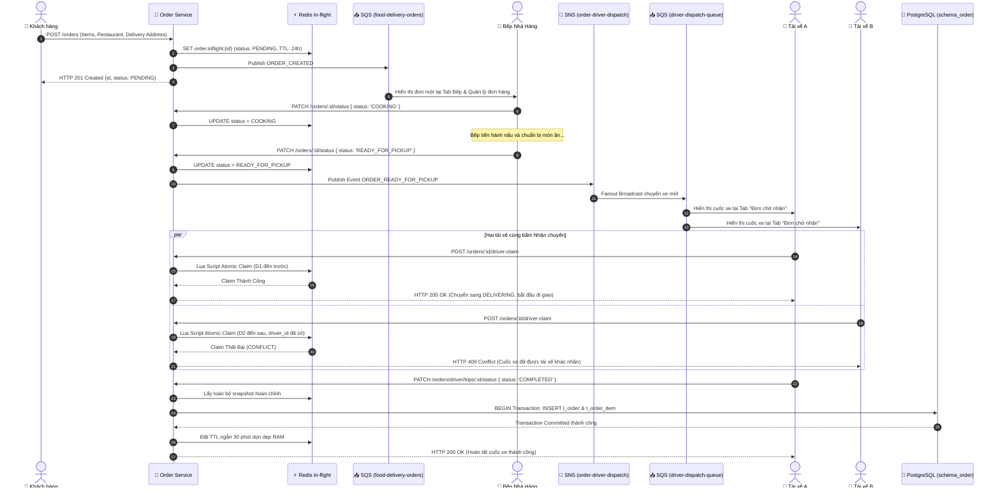

# 🏗️ Kiến Trúc Xử Lý Đơn Hàng Bất Đồng Bộ (Queue-Based Load Leveling & Sequential Partner-Driver Flow)

Tài liệu mô tả chi tiết thiết kế kỹ thuật, luồng thông điệp bất đồng bộ tuần tự giữa **Khách hàng ➔ Nhà hàng (Kitchen) ➔ Tài xế (Driver)** qua AWS SQS, AWS SNS, Redis Atomic Claim và Deferred Persistence trong hệ sinh thái **Food Delivery**.

---

## 1. Bối Cảnh & Kiến Trúc Tổng Thể (Context & System Flow)

### 1.1. Mục Tiêu Kiến Trúc
1. **Queue-Based Load Leveling (San phẳng tải trọng tiếp nhận)**:
   - SQS Queue `food-delivery-orders` đóng vai trò bộ đệm tiếp nhận đơn hàng (Ingestion Buffer). Khách đặt đơn nhận phản hồi tức thì `201 Created` kèm `orderId` (UUID) và trạng thái `PENDING` mà không phải chờ ghi DB đồng bộ.
2. **In-flight State Caching Trên Redis**:
   - Toàn bộ dữ liệu đơn hàng trong quá trình luân chuyển (`PENDING` ➔ `COOKING` ➔ `READY_FOR_PICKUP` ➔ `DELIVERING`) được quản lý bằng bộ nhớ đệm tốc độ cao Redis (`order:inflight:{id}`) với TTL 24h.
3. **Quy Trình Xử Lý Tuần Tự (Sequential Order Processing)**:
   - **Nhà hàng nhận đơn đầu tiên**: Bếp xem danh sách đơn chờ tại tab *Bếp & Quản lý đơn hàng* trên Partner Dashboard, chủ động bấm **"Nhận đơn & Nấu"** (`COOKING`).
   - **Khi nấu xong**: Bếp bấm **"Món đã xong - Tìm tài xế"** (`READY_FOR_PICKUP`), hệ thống tự động bắn bản tin vào SNS Topic `order-driver-dispatch`.
4. **Phát Tán Điều Phối & Nhận Cuốc Bất Khả Tranh Chấp (SNS Fanout & Atomic Claim)**:
   - SNS Topic `order-driver-dispatch` tự động Fanout tới SQS Queue `driver-dispatch-queue` của các tài xế.
   - Các tài xế đang trực tuyến nhìn thấy chuyến xe broadcast trong tab *Đơn chờ nhận*.
   - Cơ chế **Redis Lua Atomic Script (`claimOrder`)** bảo đảm khi nhiều tài xế cùng bấm *Nhận chuyến*, chỉ một tài xế nhanh nhất nhận được chuyến xe (`DELIVERING` gán `driver_id`), các tài xế khác nhận phản hồi `409 Conflict`.
5. **Trì Hoãn Ghi Cơ Sở Dữ Liệu (Deferred Persistence)**:
   - Khi tài xế giao hàng thành công và nhấn **`COMPLETED`**: Order Service dump toàn bộ snapshot từ Redis xuống PostgreSQL `schema_order` (`t_order` + `t_order_item`) trong một Database Transaction duy nhất, sau đó rút ngắn TTL Redis còn 30 phút để giải phóng RAM.

---

## 2. Sơ Đồ Thiết Kế Hệ Thống (Architecture & Sequence Diagram)

### 2.1. Sơ Đồ Thành Phần Hệ Thống



### 2.2. Sơ Đồ Luồng Tuần Tự Chi Tiết (Sequence Diagram)



---

## 3. Vòng Đời Trạng Thái Đơn Hàng (Order State Lifecycle)

| Trạng thái | Đối tượng kích hoạt | Kênh truyền / Hành động | Ý nghĩa nghiệp vụ |
| :--- | :--- | :--- | :--- |
| **`PENDING`** | Khách hàng | `POST /orders` ➔ SQS `food-delivery-orders` | Đơn đã tạo trên bộ đệm Redis, chờ nhà hàng tiếp nhận. |
| **`COOKING`** | Bếp Nhà hàng | `PATCH /orders/:id/status` từ Partner Dashboard | Nhà hàng nhận đơn và đang chuẩn bị chế biến món ăn. |
| **`READY_FOR_PICKUP`** | Bếp Nhà hàng | `PATCH /orders/:id/status` ➔ SNS Fanout | Món đã nấu xong, phát tán tìm tài xế giao hàng. |
| **`DELIVERING`** | Tài xế | `POST /orders/:id/driver-claim` (Atomic Lua) | Tài xế đã nhận cuốc xe thành công và đang trên đường giao. |
| **`COMPLETED`** | Tài xế | `PATCH /orders/driver/trips/:id/status` | Giao tận tay khách hàng. Kích hoạt Deferred Persistence ghi DB. |
| **`CANCELLED`** | Khách / Admin | `PATCH /orders/:id/status` | Hủy đơn hàng. Nếu đã trừ ví thì ghi DB đối soát hoàn tiền. |

---

## 4. Đặc Tả Cơ Chế Chống Tranh Chấp (Redis Atomic Claim)

Nhằm loại bỏ hoàn toàn hiện tượng nhiều tài xế cùng nhận một chuyến xe (Race-Condition), hệ thống triển khai mã lệnh Lua Script thực thi nguyên tử (Atomic) trong Redis Engine:

```lua
local key = KEYS[1]
local driverId = ARGV[1]
local now = ARGV[2]
local data = redis.call('GET', key)
if not data then
  return 'NOT_FOUND'
end
local order = cjson.decode(data)
-- Chỉ cho phép nhận nếu status là READY_FOR_PICKUP/ACCEPTED và chưa có driver_id
if (order.status == 'READY_FOR_PICKUP' or order.status == 'ACCEPTED') and (not order.driver_id or order.driver_id == '') then
  order.driver_id = driverId
  order.status = 'DELIVERING'
  order.updated_at = now
  local updatedData = cjson.encode(order)
  local ttl = redis.call('TTL', key)
  if ttl > 0 then
    redis.call('SET', key, updatedData, 'EX', ttl)
  else
    redis.call('SET', key, updatedData)
  end
  return updatedData
else
  return 'CONFLICT'
end
```

---

## 5. Danh Sách Endpoint Mới

| Endpoint | Method | Role | Mục đích |
| :--- | :---: | :---: | :--- |
| `/orders/restaurant/:restaurantId` | `GET` | Partner | Lấy toàn bộ đơn của nhà hàng (kết hợp in-flight Redis và lịch sử DB) |
| `/orders/driver/available` | `GET` | Driver | Lấy danh sách các chuyến xe broadcast đang chờ tài xế nhận |
| `/orders/:id/driver-claim` | `POST` | Driver | Tài xế nhận cuốc xe với cơ chế Redis Atomic Lock (chống race condition) |
| `/orders/:id/status` | `PATCH` | Partner/Admin | Cập nhật trạng thái chế biến (`COOKING`, `READY_FOR_PICKUP`) |
| `/orders/driver/trips/:id/status` | `PATCH` | Driver | Cập nhật hoàn thành giao hàng (`COMPLETED`) kích hoạt ghi DB |
