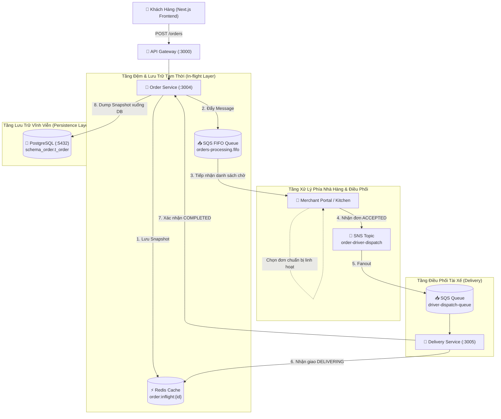
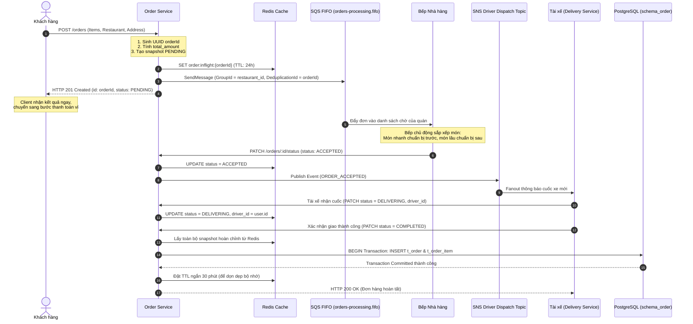

# 🏗️ Kiến Trúc Xử Lý Đơn Hàng Bất Đồng Bộ (Queue-Based Load Leveling & Deferred Persistence)

Tài liệu mô tả chi tiết thiết kế kỹ thuật, luồng dữ liệu, và giải pháp kiến trúc cho quy trình xử lý đơn hàng bất đồng bộ trong hệ sinh thái **Food Delivery**.

---

## 1. Bối Cảnh & Vấn Đề (Context & Problem Statement)

### 1.1. Anti-Pattern Trong Thiết Kế Ban Đầu
Trong mô hình ban đầu:
- Khi khách hàng gửi yêu cầu đặt đơn (`POST /orders`), hệ thống thực hiện ngay một Database Transaction đồng bộ xuống PostgreSQL (`t_order` và `t_order_item`), sau đó mới phát sự kiện `ORDER_CREATED` vào SQS.
- **Vấn đề nghẽn cổ chai (Database Bottleneck)**:
  - Trong các khung giờ cao điểm (11h00 - 13h00 và 18h00 - 20h00) hoặc các đợt Flash Sale, lượng truy cập đồng thời tăng đột biến (traffic spikes).
  - Việc mở hàng ngàn Transaction ghi đồng bộ xuống PostgreSQL gây cạn kiệt Connection Pool, tranh chấp khóa (Lock Contention), đẩy CPU của Database lên 100% và làm chậm toàn bộ các nghiệp vụ khác.
  - Đây là một **Anti-pattern** khi sử dụng Message Queue: SQS vốn được sinh ra làm bộ đệm chịu tải (Shock Absorber) nhưng lại bị đặt sau Database, làm mất đi hoàn toàn tác dụng bảo vệ DB.

### 1.2. Mục Tiêu Của Kiến Trúc Mới
1. **Queue-Based Load Leveling (San phẳng tải trọng)**:
   - SQS FIFO Queue đóng vai trò bộ đệm ở tầng tiếp nhận (Ingestion Buffer). Khách đặt đơn nhận phản hồi tức thì (Non-blocking response), giải phóng kết nối HTTP trong vài mili-giây.
2. **In-flight State Caching Trên Redis**:
   - Toàn bộ dữ liệu đơn hàng trong quá trình luân chuyển (`PENDING` ➔ `ACCEPTED` ➔ `COOKING` ➔ `DELIVERING`) được quản lý bằng bộ nhớ đệm tốc độ cao Redis (`order:inflight:{id}`).
3. **Quy Trình Bếp Linh Hoạt (Non-FIFO Kitchen Operations)**:
   - Cơ chế FIFO chỉ áp dụng cho bộ đệm Ingestion phía khách hàng để đảm bảo thứ tự tiếp nhận và chống duplicate đơn (`MessageDeduplicationId`).
   - Phía bếp nhà hàng **không bị áp đặt FIFO tuần tự cứng nhắc**, vì thực tế có món làm sẵn có thể chuẩn bị ngay, trong khi món phức tạp cần thời gian lâu hơn. Nhà hàng chủ động nhận và chuẩn bị đơn theo năng lực thực tế.
4. **Deferred Persistence (Trì hoãn ghi Database)**:
   - Chỉ khi đơn hàng đạt trạng thái cuối cùng (**`COMPLETED`** do tài xế xác nhận giao thành công, hoặc **`CANCELLED`** sau khi đã thanh toán để đối soát), hệ thống mới thực hiện ghi Database Transaction xuống PostgreSQL.

---

## 2. Sơ Đồ Thiết Kế Hệ Thống (Architecture & Sequence Diagram)

### 2.1. Sơ Đồ Thành Phần Hệ Thống


### 2.2. Sơ Đồ Luồng Tuần Tự Chi Tiết (Sequence Diagram)


---

## 3. Luồng Dữ Liệu Chi Tiết (Data Flow & Specifications)

### 3.1. Phase 1: Ingestion Buffer (Đệm tiếp nhận đơn)
- **Endpoint**: `POST /orders` (Yêu cầu `JwtAuthGuard`).
- **Nhiệm vụ**:
  1. Trích xuất `customer_id` từ JWT token (`@CurrentUser()`).
  2. Tạo mã đơn hàng `orderId = randomUUID()`.
  3. Tính toán tổng tiền `totalAmount` từ `items`.
  4. Đóng gói snapshot `InflightOrderData` với trạng thái khởi tạo `PENDING`.
  5. Ghi vào Redis: `order:inflight:{orderId}`.
  6. Gửi message vào hàng đợi SQS FIFO:
     - **Queue**: `orders-processing.fifo`
     - **MessageGroupId**: `restaurant_id` (Đảm bảo các đơn của cùng nhà hàng được xếp thứ tự tiếp nhận, các nhà hàng khác nhau xử lý song song).
     - **MessageDeduplicationId**: `orderId` (Chống gửi lặp đơn khi client retry).
  7. Trả về ngay lập tức HTTP `201 Created` cho Client. **Tuyệt đối không chạm vào PostgreSQL**.

### 3.2. Phase 2: In-flight State Management (Redis)
Cấu trúc dữ liệu lưu trong Redis key `order:inflight:{orderId}`:
```json
{
  "id": "e0eebc99-9c0b-4ef8-bb6d-6bb9bd380a11",
  "customer_id": "a0eebc99-9c0b-4ef8-bb6d-6bb9bd380a11",
  "restaurant_id": "d0eebc99-9c0b-4ef8-bb6d-6bb9bd380a11",
  "driver_id": null,
  "status": "PENDING",
  "delivery_address": "Tòa nhà Landmark 81, TP.HCM",
  "note": "Ít cay",
  "payment_method": "WALLET",
  "total_amount": 95000,
  "items": [
    {
      "menu_item_id": "m1",
      "quantity": 2,
      "unit_price": 40000
    }
  ],
  "created_at": "2026-10-17T11:45:00.000Z",
  "updated_at": "2026-10-17T11:45:00.000Z"
}
```

### 3.3. Phase 3: Tra Cứu Đơn Hàng Lai (Hybrid Query Strategy)
- Khi khách hàng hoặc tài xế gọi `GET /orders/:id`:
  1. **Bước 1**: Kiểm tra trong Redis cache `order:inflight:{id}`. Nếu tồn tại, trả về ngay dữ liệu realtime.
  2. **Bước 2**: Nếu không có trong Redis, truy vấn xuống PostgreSQL `schema_order.t_order` (đơn đã hoàn thành hoặc hủy trong quá khứ).
  3. **Bước 3**: Nếu cả 2 nơi đều không có, trả về lỗi `404 Not Found`.
- Tương tự, `GET /orders/history/me` sẽ tổng hợp các đơn đang hoạt động từ Redis cùng với lịch sử đơn trong quá khứ từ PostgreSQL.

### 3.4. Phase 4: Quy Trình Bếp Linh Hoạt & Driver Fanout
- Nhà hàng xem danh sách đơn đang chờ thông qua Merchant Portal.
- Bếp lựa chọn chế biến món ăn linh hoạt tùy theo thời gian chuẩn bị (món ăn nhanh làm trước, món phức tạp cần chuẩn bị lâu), không bị bó buộc theo FIFO cứng nhắc.
- Khi bấm nhận đơn (`ACCEPTED`), hệ thống cập nhật Redis và bắn message vào **SNS Topic `order-driver-dispatch`**.
- SNS Topic tự động Fanout bản tin đến các hàng đợi của dịch vụ tìm kiếm tài xế (`delivery-service`).

### 3.5. Phase 5: Ghi Cơ Sở Dữ Liệu Khi Hoàn Tất (Deferred Persistence)
- Khi tài xế giao món tận tay khách và nhấn **`COMPLETED`**:
  1. `order-service` nhận yêu cầu cập nhật trạng thái `COMPLETED`.
  2. Lấy toàn bộ snapshot hoàn chỉnh của đơn từ Redis (`order:inflight:{orderId}`).
  3. Mở Database Transaction ghi xuống PostgreSQL:
     - Tạo bản ghi `t_order` với đầy đủ thông tin: `id`, `customer_id`, `restaurant_id`, `driver_id`, `total_amount`, `status: COMPLETED`, `payment_method`.
     - Tạo danh sách bản ghi `t_order_item` gắn với `order_id`.
     - Commit transaction thành công.
  4. Đặt TTL ngắn cho key Redis (30 phút) để giải phóng bộ nhớ RAM.

---

## 4. Xử Lý Các Trường Hợp Biên (Edge Cases & Failure Recovery)

| Tình huống | Cơ chế xử lý |
| :--- | :--- |
| **Đơn bị HỦY khi chưa thanh toán** | Cập nhật `status = CANCELLED` trong Redis, đặt TTL ngắn 15 phút để tự giải phóng bộ nhớ. **Không ghi PostgreSQL**. |
| **Đơn bị HỦY sau khi đã thanh toán tiền** | Kích hoạt Transaction ghi vào PostgreSQL với `status: CANCELLED` để lưu vết kế toán kép, làm bằng chứng đối soát hoàn tiền ví. |
| **Sự cố mất điện / Restart Order Service** | Toàn bộ đơn đang xử lý được bảo toàn trên Redis Persistence (AOF/RDB) và SQS FIFO Queue. Service khởi động lại tiếp tục hoạt động mà không mất đơn. |
| **Ghi DB thất bại lúc COMPLETED** | Hệ thống giữ nguyên trạng thái trong Redis và đưa message vào Dead Letter Queue (DLQ) để cơ chế Retry hoặc Admin đối soát can thiệp, không làm mất dữ liệu đơn. |

---

## 5. Đánh Giá Trade-offs & Quyết Định Kỹ Thuật

- **Ưu điểm vượt trội**:
  - Bảo vệ Database tối đa: PostgreSQL giảm hơn 90% số lượng transaction ghi, loại bỏ hoàn toàn nguy cơ nghẽn DB trong giờ cao điểm.
  - Phản hồi siêu tốc (Ultra-low latency): API `POST /orders` phản hồi trong < 30ms thay vì phải chờ DB write transaction mất 100-300ms.
  - Tính linh hoạt cao cho Nhà hàng: Không gò ép quy trình chế biến của bếp theo thứ tự máy móc.
- **Thách thức & Biện pháp khắc phục**:
  - Dữ liệu đơn hàng đang chạy phụ thuộc vào Redis ➔ Khắc phục bằng cấu hình Redis Persistence (Append-Only File - AOF) kết hợp sao lưu snapshot định kỳ.
