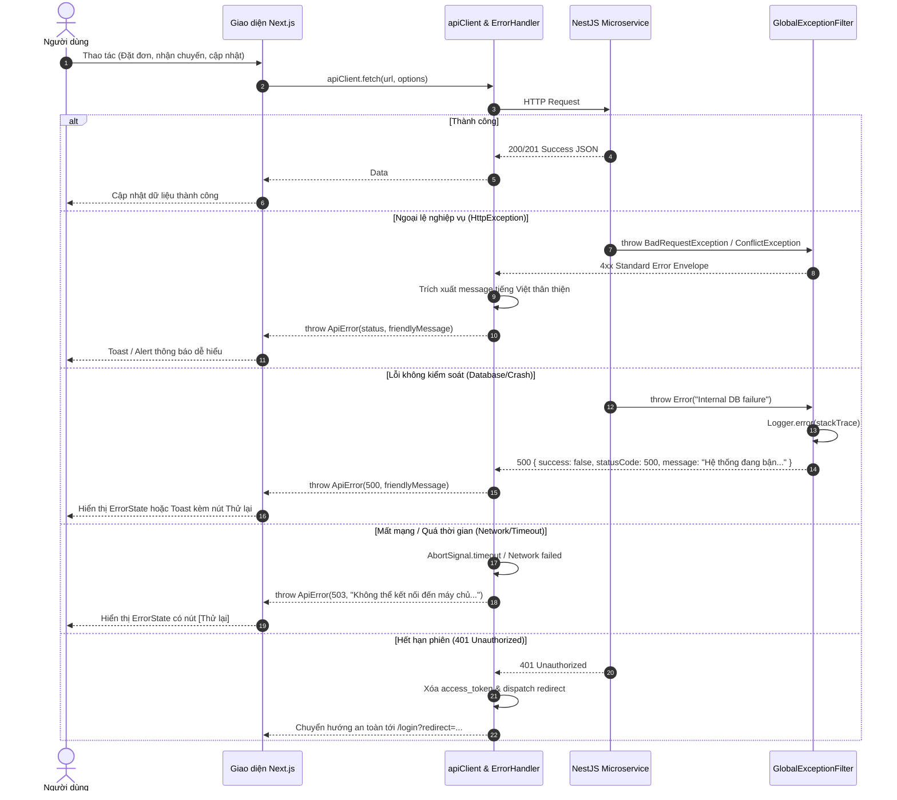

# Kiến Trúc Xử Lý Lỗi Toàn Diện (Full-Stack Error Handling Architecture)

Tài liệu này đặc tả quy chuẩn và kiến trúc xử lý lỗi xuyên suốt từ tầng **Backend (NestJS Microservices)** đến tầng **Frontend (Next.js App Router)** cho toàn bộ hệ thống Food Delivery.

---

## 1. Triết Lý Thiết Kế (Core Philosophy)

1. **Bảo vệ Trải nghiệm Người dùng (User-Centric UX)**:
   - Người dùng cuối tuyệt đối không nhìn thấy các chuỗi lỗi lập trình viên (Developer Errors) thô như `API Error: Bad Request (400)`, `TypeError`, hoặc thông báo lỗi database nội bộ.
   - Mọi thông báo lỗi hiển thị cho người dùng phải bằng tiếng Việt thân thiện, rõ ràng, mang tính hướng dẫn hành động (Actionable).
2. **Không Bao giờ Làm Kẹt Người dùng (Never Trap the User)**:
   - Khi có crash component hoặc API thất bại, giao diện luôn phải cung cấp lối thoát: nút **Thử lại** (Retry), **Quay về trang chủ** (Back to Home), hoặc điều hướng đăng nhập an toàn.
3. **Che giấu Chi tiết Nhạy cảm (Security by Default)**:
   - Các lỗi hệ thống không xác định (Internal Server Error, SQL Syntax, DB Connection) chỉ được log nội bộ kèm stack trace ở server và trả về mã lỗi 500 an toàn cho client.
4. **Chuẩn hóa Hợp đồng Dữ liệu Lỗi (Unified Error Envelope)**:
   - Mọi microservice đều tuân thủ cùng một định dạng JSON lỗi chuẩn hóa.

---

## 2. Kiến Trúc Luồng Bắt Lỗi (Error Handling Flow)



---

## 3. Phía Backend: Bộ lọc Ngoại lệ Toàn cục (GlobalExceptionFilter)

### 3.1. Vị trí và Đăng ký
- **Vị trí**: `backend/libs/common/src/filters/http-exception.filter.ts`.
- **Đăng ký**: Bắt buộc đăng ký tại `main.ts` của tất cả microservices:
  ```ts
  import { GlobalExceptionFilter } from '@/common/filters/index.js';

  app.useGlobalFilters(new GlobalExceptionFilter());
  ```

### 3.2. Cấu trúc JSON Lỗi Chuẩn hóa (Error Envelope)
```ts
export interface ErrorResponseBody {
  success: false;
  statusCode: number;
  errorCode: string;
  message: string;
  errors?: unknown[];
  timestamp: string;
  path: string;
}
```

### 3.3. Quy tắc Phân loại Ngoại lệ
- **`HttpException` chuẩn**:
  - Giữ nguyên `statusCode` (400, 401, 403, 404, 409,...).
  - Trích xuất thông điệp từ `response`. Nếu là lỗi từ `ValidationPipe` (mảng thông điệp validate), gán `errorCode = 'VALIDATION_ERROR'`, gộp mảng `message` và gán danh sách vào `errors`.
- **Ngoại lệ không kiểm soát (`Error`, `QueryFailedError`)**:
  - `statusCode`: 500 (`INTERNAL_SERVER_ERROR`).
  - `errorCode`: `'UNHANDLED_EXCEPTION'`.
  - `message`: `'Hệ thống đang bận hoặc gặp sự cố xử lý. Vui lòng thử lại.'`.
  - Ghi log đầy đủ lỗi và stack trace phía server qua `Logger.error`.

---

## 4. Phía Frontend: Tầng Bắt Lỗi và Giao diện Dự phòng (Frontend Layer)

### 4.1. Chuẩn hóa `apiClient` (`frontend/src/lib/api-client.ts`)
- **Class `ApiError`**:
  - Kế thừa `Error`.
  - Lưu giữ: `status`, `statusCode`, `errorCode`, `errors`, `data`, và `message` chuẩn hóa.
- **Ánh xạ Mã Trạng thái Mặc định**:
  - 400: "Yêu cầu không hợp lệ. Vui lòng kiểm tra lại thông tin."
  - 401: "Phiên đăng nhập đã hết hạn. Vui lòng đăng nhập lại."
  - 403: "Bạn không có quyền thực hiện thao tác này."
  - 404: "Không tìm thấy dữ liệu hoặc trang yêu cầu."
  - 408: "Yêu cầu quá thời gian chờ (Timeout). Vui lòng thử lại."
  - 409: "Dữ liệu đã tồn tại hoặc xảy ra xung đột trạng thái."
  - 422: "Dữ liệu không đúng định dạng quy định."
  - 429: "Bạn đã gửi quá nhiều yêu cầu. Vui lòng thử lại sau ít phút."
  - 500: "Hệ thống đang bận hoặc gặp sự cố xử lý. Vui lòng thử lại sau."
  - 502/503/504: "Máy chủ tạm thời gián đoạn hoặc bảo trì. Vui lòng thử lại sau."
- **Tự động Phục hồi Phiên 401**:
  - Tự động dọn sạch cookie `access_token` và `localStorage`.
  - Chuyển hướng an toàn tới `/login?expired=1&redirect=...`.

### 4.2. Bộ Helper Giải mã Lỗi (`frontend/src/lib/error-handler.ts`)
- `getErrorMessage(error: unknown, fallback?: string): string`: Bóc tách thông điệp tiếng Việt sạch từ bất kỳ dạng ngoại lệ nào.
- `notifyApiError(error: unknown, fallback?: string): void`: Bật Toast báo lỗi tiếng Việt thân thiện qua `react-hot-toast`.

### 4.3. Thành phần Giao diện Fallback
1. **Next.js Route Error Boundary (`frontend/src/app/error.tsx`)**:
   - Bắt các lỗi render hoặc SSR runtime ở cấp route.
   - Cung cấp nút "Thử lại trang" (`reset()`) và "Quay về trang chủ".
   - Tích hợp khung xem chi tiết lỗi kỹ thuật chỉ hiển thị khi `NODE_ENV === 'development'`.
2. **Global Error Boundary (`frontend/src/app/global-error.tsx`)**:
   - Bắt lỗi nghiêm trọng ở cấp Root Layout.
3. **Food Delivery 404 Page (`frontend/src/app/not-found.tsx`)**:
   - Giao diện 404 với phong cách ẩm thực, điều hướng về Thực đơn (`/menu`) hoặc Trang chủ (`/`).
4. **Component `ErrorState` (`frontend/src/components/ui/error-state/`)**:
   - Dùng cho các khối dữ liệu danh sách/tab khi gọi API thất bại.
   - Hiển thị icon trực quan, thông điệp rõ ràng, và nút **Thử lại** (Retry) với hiệu ứng spinner xoay mượt mà.

---

## 5. Quy Chuẩn Kiểm Thử (Testing & Traceability)
- Mọi bộ lọc ngoại lệ ở backend phải có unit test Vitest bám sát Testing Policy:
  - Khai báo Traceability Header trỏ đến file này (`@trace docs/architecture/error-handling.md`).
  - Đảm bảo 3 nhánh:
    - 🟢 Happy Path: `HttpException` nghiệp vụ chuẩn.
    - 🟡 Edge Cases: Lỗi mảng từ `ValidationPipe`, URL rỗng.
    - 🔴 Error Flow: Bắt lỗi 500, ẩn chi tiết DB nhạy cảm, log chi tiết.
