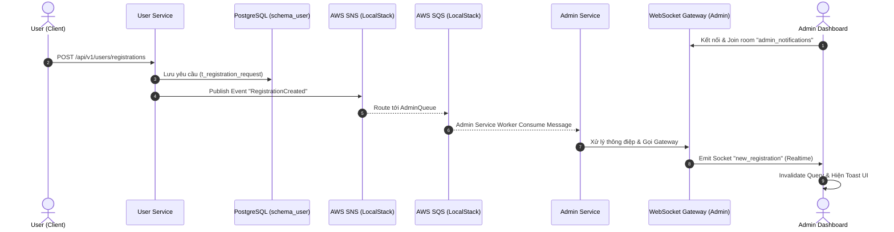

# 🏗️ System Architecture: Real-time Driver & Restaurant Registration

Tài liệu thiết kế kiến trúc hệ thống xử lý yêu cầu đăng ký mở Nhà hàng (Restaurant) hoặc Tài xế (Driver) theo thời gian thực (Real-time). Kiến trúc này tuân thủ nghiêm ngặt các quy chuẩn của dự án: **Microservices**, **AWS SNS/SQS (LocalStack) cho Event-Driven**, **NestJS CQRS-lite**, và **Database Master/Transaction**.

---

## 1. High-Level Architecture (Luồng xử lý Microservices)

Hệ thống phân tách rõ ràng trách nhiệm giữa **User Service** (nơi user nộp hồ sơ) và **Admin Service** (nơi quản lý và phê duyệt). Giao tiếp giữa 2 service này hoàn toàn bất đồng bộ thông qua **Amazon SNS/SQS (LocalStack)**.



---

## 2. Database Modeling (PostgreSQL)

Bởi vì việc sinh ra yêu cầu đăng ký xuất phát từ User, dữ liệu giao dịch gốc sẽ nằm ở `schema_user`. 

**Bảng: `schema_user.t_registration_request`**

| Cột | Kiểu dữ liệu | Ràng buộc | Mô tả |
| :--- | :--- | :--- | :--- |
| `id` | `UUID` | `PRIMARY KEY` | Khóa chính, `uuid_generate_v4()` |
| `user_id` | `UUID` | `NOT NULL` | ID của User gửi yêu cầu |
| `type` | `VARCHAR` | `NOT NULL` | Enum: `'DRIVER'`, `'RESTAURANT'` |
| `payload` | `JSONB` | `NOT NULL` | Dữ liệu form linh hoạt (Tên quán, Biển số...) |
| `status` | `VARCHAR` | `DEFAULT 'PENDING'` | `'PENDING'`, `'APPROVED'`, `'REJECTED'` |
| `reviewed_by` | `UUID` | `NULL` | ID của Admin duyệt đơn (Logical Ref sang Admin) |
| `created_at` | `TIMESTAMPTZ` | `DEFAULT NOW()` | Ngày tạo request |
| `updated_at` | `TIMESTAMPTZ` | `DEFAULT NOW()` | Ngày cập nhật trạng thái cuối |
| `is_deleted` | `BOOLEAN` | `DEFAULT FALSE` | Soft delete policy |

---

## 3. Kiến trúc Backend (NestJS CQRS & LocalStack)

Tuân thủ đúng chuẩn Microservices, chúng ta không dùng `@nestjs/event-emitter` (chỉ chạy trong nội bộ 1 instance). Thay vào đó, chúng ta tích hợp AWS SDK (trỏ endpoint về LocalStack).

### A. User Service: Publisher (Gửi Event)
Khi nhận HTTP Request từ User, User Service lưu vào Database, sau đó bắn message ra hệ thống.

```typescript
// user-service/src/modules/registrations/usecases/submit-registration.usecase.ts
@Injectable()
export class SubmitRegistrationUseCase {
  constructor(
    private readonly writeRepo: RegistrationWriteRepository,
    private readonly snsClient: SNSClientService, // Cấu hình trỏ tới LocalStack
  ) {}

  async execute(command: CreateRegistrationDto, userId: string) {
    const entity = await this.writeRepo.create({ ...command, userId });
    
    // Publish message lên AWS SNS (LocalStack)
    await this.snsClient.publish({
      TopicArn: process.env.SNS_USER_EVENTS_TOPIC,
      Message: JSON.stringify({
        eventType: 'RegistrationCreated',
        data: entity
      })
    });
    
    return entity;
  }
}
```

### B. Admin Service: Consumer & WebSocket (Nhận và Thông báo)
Admin Service có một Worker (được wrap bằng CQRS Command) chuyên lắng nghe SQS Queue.

```typescript
// admin-service/src/modules/notifications/sqs-consumer.service.ts
@Injectable()
export class RegistrationSqsConsumer {
  constructor(private readonly adminGateway: AdminGateway) {}

  // Sử dụng thư viện sqs-consumer hoặc @nestjs/microservices
  @SqsMessageHandler(process.env.SQS_ADMIN_REGISTRATION_QUEUE)
  async handleMessage(message: AWS.SQS.Message) {
    const body = JSON.parse(message.Body);
    
    if (body.eventType === 'RegistrationCreated') {
      // 1. Cập nhật cache hoặc DB của Admin Service nếu cần (CQRS)
      
      // 2. Push real-time tới Admin UI
      this.adminGateway.server
        .to('admin_room')
        .emit('new_registration', body.data);
    }
  }
}
```

---

## 4. Kiến trúc Frontend (Next.js)

### A. User App (Gửi yêu cầu)
Sử dụng **React Query** gọi thẳng API của API Gateway (trỏ vào User Service).

```typescript
const { mutate } = useMutation({
  mutationFn: (data: RegistrationPayload) => api.post('/users/registrations', data),
  onSuccess: () => toast.success('Yêu cầu đã gửi thành công!')
});
```

### B. Admin Dashboard (Nhận Realtime)
Cần xác thực chặt chẽ kết nối WebSocket.

```tsx
'use client';
import { useEffect } from 'react';
import { io } from 'socket.io-client';
import { useQueryClient } from '@tanstack/react-query';
import toast from 'react-hot-toast';

export function AdminSocketProvider({ children }) {
  const queryClient = useQueryClient();

  useEffect(() => {
    // Kết nối tới WebSocket port của Admin Service
    const socket = io(process.env.NEXT_PUBLIC_ADMIN_WS_URL, {
      auth: { token: 'JWT_TOKEN' } 
    });

    socket.on('new_registration', (data) => {
      toast.success(`Yêu cầu đăng ký mới từ ${data.type}`);
      queryClient.invalidateQueries({ queryKey: ['admin', 'registrations'] });
    });

    return () => socket.disconnect();
  }, []);

  return <>{children}</>;
}
```
