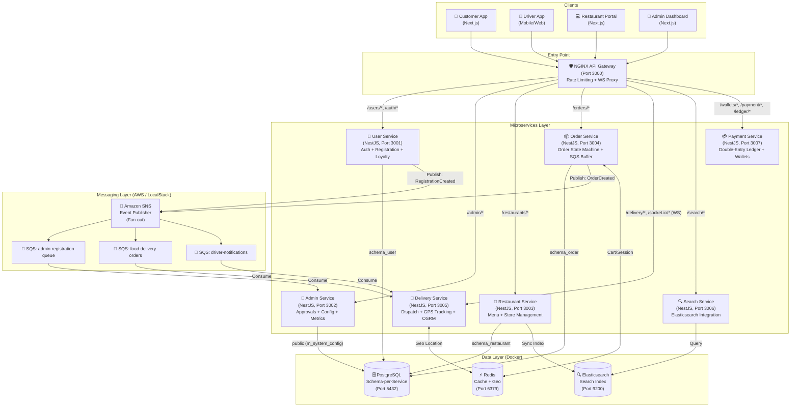

# 🏗️ System Architecture — Food Delivery

Tài liệu này là **nguồn chân lý duy nhất (Single Source of Truth)** mô tả toàn bộ kiến trúc kỹ thuật của hệ thống Food Delivery. Mọi quyết định thiết kế, pattern được lựa chọn và lý do đằng sau đều được ghi nhận tại đây.

---

## 1. Tổng Quan Kiến Trúc (High-Level Overview)

Hệ thống được xây dựng theo mô hình **Microservices** với **Event-Driven Architecture** cho giao tiếp bất đồng bộ giữa các services. Mỗi service sở hữu database schema độc lập, giao tiếp với nhau qua HTTP (đồng bộ) hoặc SNS/SQS (bất đồng bộ).



---

## 2. Phân Chia Services (Service Boundaries)

| Service | Port | Trách nhiệm | Database Schema | Publisher | Consumer |
| :--- | :---: | :--- | :--- | :--- | :--- |
| **User Service** | 3001 | Đăng ký, đăng nhập, JWT auth, profile, loyalty points | `schema_user` | `RegistrationCreated` | — |
| **Admin Service** | 3002 | Xét duyệt hồ sơ, cấu hình hệ thống, metrics dashboard | `public` | — | `admin-registration-queue` |
| **Restaurant Service** | 3003 | Quản lý nhà hàng, menu, options, giờ hoạt động | `schema_restaurant` | `RestaurantUpdated` | — |
| **Order Service** | 3004 | Tạo đơn, state machine trạng thái, SQS buffer | `schema_order` | `OrderCreated` | — |
| **Delivery Service** | 3005 | Dispatch tài xế, GPS realtime, OSRM routing, WebSocket | `schema_delivery` | `DriverAssigned` | `food-delivery-orders` |
| **Search Service** | 3006 | Full-text search, geo-search nhà hàng/món ăn | — (Elasticsearch) | — | `restaurant-updates` |
| **Payment Service** | 3007 | Sổ cái kép (Double-Entry Ledger), ví 4 chủ thể, COD | `schema_payment` | — | — |

---

## 3. Database Strategy (Schema-per-Service)

Tất cả services dùng chung **1 PostgreSQL instance** nhưng tách biệt nhau bằng **schema riêng**. Không service nào được phép query trực tiếp schema của service khác.

```
PostgreSQL (food_delivery database)
├── public                    → Admin: m_system_config
├── schema_user               → User Service: m_user, m_customer_profile, m_driver_profile, t_registration_request
├── schema_restaurant         → Restaurant Service: m_restaurant, m_menu_item, m_category
├── schema_order              → Order Service: t_order, t_order_item, t_order_review
├── schema_delivery           → Delivery Service: dispatch & tracking state
└── schema_payment            → Payment Service: m_wallet, t_ledger_entry, t_idempotency_key
```

> **Nguyên tắc Cross-service Data:** Không dùng FK hoặc JOIN qua schema. Chỉ lưu `UUID` của entity bên kia (Logical Reference). Để lấy data của service khác, phải gọi HTTP nội bộ hoặc nhận qua Event.

---

## 4. Event-Driven Communication (SNS/SQS)

### Khi nào dùng Event (Async) vs HTTP (Sync)?

| Tiêu chí | HTTP (Sync) | SNS/SQS (Async) |
| :--- | :--- | :--- |
| **Cần kết quả ngay** | ✅ Dùng HTTP | ❌ |
| **Side effect / Notification** | ❌ | ✅ Dùng Event |
| **Giao tiếp fan-out (1 → N)** | ❌ | ✅ SNS phù hợp |
| **Chịu được độ trễ** | ❌ | ✅ |
| **Fault tolerance (service crash)** | ❌ Mất request | ✅ Message nằm trong Queue |

### Event Map

| Event | Publisher | SQS Queue | Consumers |
| :--- | :--- | :--- | :--- |
| `RegistrationCreated` | User Service | `admin-registration-queue` | Admin Service |
| `OrderCreated` | Order Service | `food-delivery-orders` | Driver Service |
| `DriverAssigned` | Driver Service | `driver-notifications` | Order Service |
| `RestaurantUpdated` | Restaurant Service | `search-index-queue` | Search Service |

### Event Message Contract

Mọi event publish lên SNS phải tuân theo interface sau (định nghĩa trong `libs/events/`):

```typescript
interface BaseEvent<T> {
  eventType: string;       // VD: 'RegistrationCreated'
  version: string;         // VD: '1.0' — để versioning event schema
  timestamp: string;       // ISO 8601
  data: T;
}
```

---

## 5. Real-time Communication (WebSockets)

WebSocket được dùng cho các tính năng cần push ngay lập tức tới Client mà không cần Client phải request:

| Gateway | Service | Event phát ra | Receiver |
| :--- | :--- | :--- | :--- |
| `AdminGateway` (namespace `/admin`) | Admin Service | `new_registration` | Admin Dashboard |
| `OrderGateway` (namespace `/orders`) | Order Service | `order_status_updated` | Customer App |
| `DriverGateway` (namespace `/drivers`) | Driver Service | `driver_location_updated` | Customer App |

**Flow:** SQS Consumer (nhận message từ Queue) → emit WebSocket event → Frontend invalidate React Query cache và hiện Toast.

---

## 6. Frontend Architecture (Hybrid Pattern)

Frontend dùng **3 pattern fetch** tùy theo ngữ cảnh:

| Pattern | Khi nào dùng | Ví dụ |
| :--- | :--- | :--- |
| **RSC Fetch** (Server Component) | Trang public cần SEO | Danh sách nhà hàng, chi tiết menu |
| **CSR Fetch** (React Query) | Mutation, data cá nhân | Đặt món, login, cập nhật profile |
| **WebSocket** (Socket.io) | Real-time push | Trạng thái đơn hàng, vị trí tài xế, notification Admin |

---

## 7. Infrastructure (Docker)

Toàn bộ hạ tầng được chạy qua `docker-compose.yml`. Backend và Frontend được chạy local (HMR) để tốc độ dev nhanh nhất, kết nối vào các containers qua port đã expose.

| Service | Container | Port | Vai trò |
| :--- | :--- | :--- | :--- |
| PostgreSQL | `food_delivery_db` | 5432 | Primary database |
| Redis | `food_delivery_redis` | 6379 | Cache, session, geo-data |
| Elasticsearch | `food_delivery_elasticsearch` | 9200 | Search index |
| LocalStack | `food_delivery_localstack` | 4566 | Mock AWS SNS + SQS |

> **LocalStack Init:** File `scripts/localstack-init.sh` tự động chạy khi container LocalStack ready để tạo đủ Topics và Queues. Backend và Frontend **không** chạy trong Docker khi phát triển (để tận dụng HMR).

---

## 8. Lộ Trình Migration (Monolith → Microservices)

Hiện tại codebase đang ở giai đoạn **Modular Monolith** (tất cả modules trong 1 NestJS process). Lộ trình tách ra Microservices thực sự theo thứ tự:

```
Phase 0: Fix LocalStack init → SNS/SQS hoạt động đúng
Phase 1: Xoá cross-module imports trong AdminModule
Phase 2: Tách services/ directory (mỗi service = 1 package.json riêng)
Phase 3: Chuẩn hoá Event Contract trong libs/events/
Phase 4: Thêm NGINX API Gateway vào docker-compose
```

*(Chi tiết xem: [`docs/architecture/migration-plan.md`](./migration-plan.md))*
