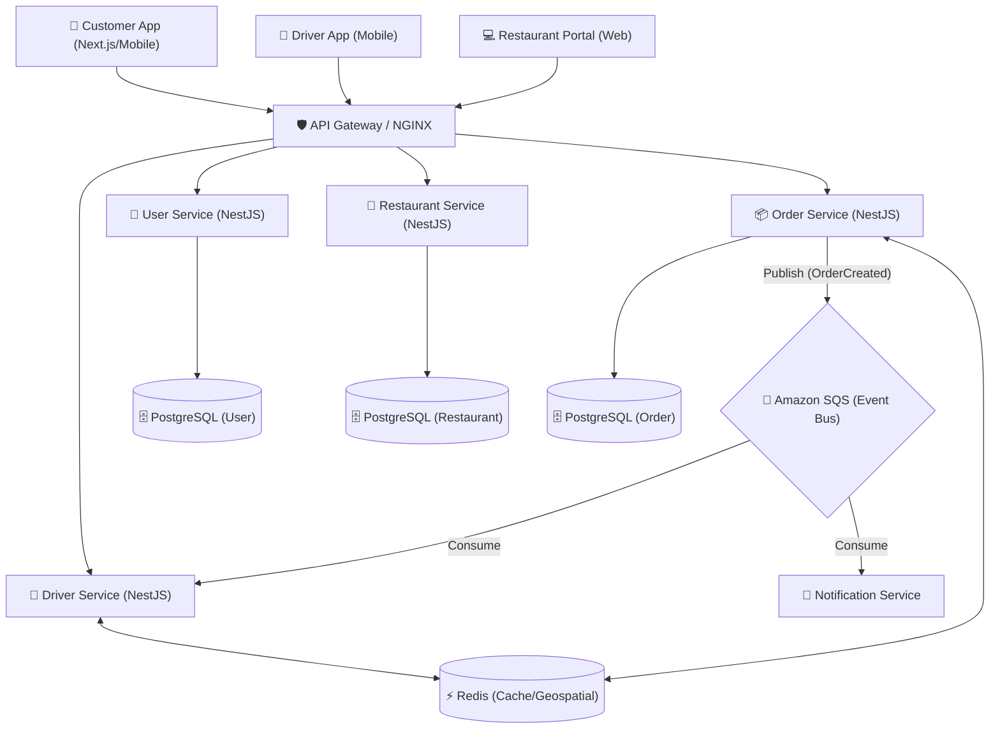

# 🚀 Food Delivery App - Business Roadmap & Issues List

Dưới đây là danh sách các tính năng (issues) được chia theo từng module/actor, được thiết kế bám sát với quy trình nghiệp vụ (business logic) của các ứng dụng đặt đồ ăn hiện đại như GrabFood, ShopeeFood, hoặc UberEats.

---

## 1. 🧑 Khách hàng (Customer App)

### 🛒 Epic 1: Trải nghiệm mua sắm (Shopping Experience)
- **[Issue C1] Tìm kiếm & Lọc thông minh:** Tích hợp engine tìm kiếm (Elasticsearch hoặc MeiliSearch) để tìm kiếm nhà hàng/món ăn theo tên, filter theo đánh giá, khoảng cách, freeship, category (trà sữa, cơm tấm...).
- **[Issue C2] Hệ thống Giỏ hàng (Advanced Cart):** Hỗ trợ thêm topping, ghi chú cho từng món. Cảnh báo khi đặt món ở 2 nhà hàng khác nhau (tách đơn hoặc reset giỏ hàng).
- **[Issue C3] Quản lý Địa chỉ (Address Book):** Tích hợp Google Maps API hoặc Goong API để chọn vị trí trên bản đồ, tính khoảng cách từ nhà hàng đến khách, lưu các địa chỉ quen thuộc (Nhà, Công ty).

### 💳 Epic 2: Thanh toán & Khuyến mãi (Checkout & Promos)
- **[Issue C4] Promotion/Voucher Engine:** Cho phép áp dụng nhiều loại mã giảm giá cùng lúc (1 mã giảm giá món + 1 mã freeship). Validate điều kiện áp dụng (giá trị đơn tối thiểu, số lượng giới hạn).
- **[Issue C5] Tích hợp Cổng thanh toán (Payment Gateway):** Hỗ trợ ví điện tử (MoMo, ZaloPay), thẻ tín dụng (Stripe), và thanh toán tiền mặt (COD). Xử lý luồng hoàn tiền (Refund) khi đơn bị hủy.
- **[Issue C6] Hệ thống Tích điểm thành viên (Loyalty):** Tích điểm sau mỗi đơn hàng thành công, dùng điểm để đổi voucher.

### ⭐ Epic 3: Hậu mãi (Post-order)
- **[Issue C7] Đánh giá & Review:** Cho phép khách hàng rate (1-5 sao) và để lại bình luận có hình ảnh cho **cả món ăn, nhà hàng và tài xế**.
- **[Issue C8] Live Chat:** Chat real-time giữa Khách hàng và Tài xế (ẩn số điện thoại thật để bảo vệ quyền riêng tư).

---

## 2. 🏪 Nhà hàng (Restaurant Portal/App)

### 🍔 Epic 4: Quản lý cửa hàng (Store Management)
- **[Issue R1] Quản lý Menu (Catalog):** Cho phép tạo Menu phức tạp (Món chính + Topping/Tùy chọn phụ, Size, Combo). Quản lý tình trạng "Hết hàng" (Out of stock) theo thời gian thực.
- **[Issue R2] Quản lý giờ hoạt động:** Cài đặt giờ đóng/mở cửa tự động. Tự động từ chối nhận đơn khi ngoài giờ.

### 📊 Epic 5: Vận hành & Báo cáo
- **[Issue R4] Bảng điều khiển Đơn hàng (Order Dashboard):** Màn hình hiển thị luồng đơn cho bếp: Mới -> Đang chuẩn bị -> Chờ tài xế lấy -> Đã giao. (UI tối ưu cho màn hình cảm ứng hoặc tablet).
- **[Issue R5] Thống kê & Đối soát:** Báo cáo doanh thu theo ngày/tuần/tháng. Hiển thị số tiền thực nhận sau khi trừ chiết khấu (commission) của platform.

---

## 3. 🛵 Tài xế (Driver App) - *Module mới cần bổ sung*

### 📍 Epic 6: Hệ thống điều phối (Dispatch System)
- **[Issue D1] Driver Tracking (Real-time GPS):** Bắn tọa độ liên tục của tài xế qua WebSocket để khách hàng thấy tài xế đang di chuyển trên bản đồ.
- **[Issue D2] Thuật toán chia cuốc (Order Routing):** Khi có đơn mới, tự động ping các tài xế trong bán kính gần nhất (dùng Redis Geospatial hoặc PostGIS). Tài xế có 15s để accept.
- **[Issue D3] Quy trình giao nhận (Delivery Flow):** Flow thao tác: Đã tới quán -> Đã lấy món (chụp ảnh hóa đơn) -> Đang giao -> Đã giao thành công (chụp ảnh bằng chứng).

### 💰 Epic 7: Ví tài xế (Driver Wallet)
- **[Issue D4] Ví điện tử tài xế:** Quản lý tiền ký quỹ, tiền thu hộ khách (COD). Trừ tiền chiết khấu theo từng cuốc xe. Cho phép tài xế rút tiền về tài khoản ngân hàng.

---

## 4. 👑 Quản trị viên (Admin/Backoffice)

### 🛠️ Epic 8: Vận hành Platform
- **[Issue A1] Quản lý rủi ro & KYC:** Xét duyệt hồ sơ nhà hàng mới và tài xế mới đăng ký (Upload CMND, Giấy phép VSATTP).
- **[Issue A2] Customer Support (CS) Portal:** Dashboard cho nhân viên CS để giải quyết tranh chấp (Dispute), hủy đơn cưỡng chế, hoặc hoàn tiền cho khách.
- **[Issue A3] Campaign Management:** Tạo các chiến dịch đồng giá, banner quảng cáo trên trang chủ, quản lý push notification hàng loạt (Marketing).

---

## 5. 🏗️ Kiến trúc Hệ thống (System Architecture)
Dưới đây là sơ đồ tổng quan về kiến trúc Microservices và luồng dữ liệu (Event-driven) cho ứng dụng Food Delivery:

---