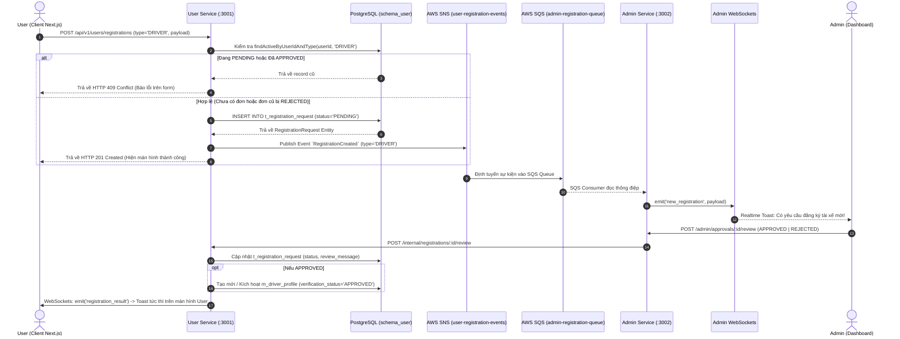

# Luồng Đăng Ký Đối Tác Tài Xế (Driver Registration Flow)

Tài liệu này mô tả chi tiết luồng xử lý từ khi một người dùng (`User`) gửi yêu cầu đăng ký làm tài xế (`DRIVER`), cơ chế kiểm tra và chặn đăng ký lần 2 (quan hệ 1-1), cho đến khi quản trị viên (`Admin`) nhận thông báo realtime, phê duyệt hồ sơ và kích hoạt tài khoản tài xế.

---

## 1. Mô tả Quy trình & Nguyên tắc nghiệp vụ (Business Rules)

### A. Ràng buộc Quan hệ 1-1 (One-to-One Relationships)
- **1 User : 1 Restaurant**: Mỗi tài khoản người dùng chỉ được phép sở hữu tối đa 1 nhà hàng trong `schema_restaurant.m_restaurant` (`owner_id` UNIQUE).
- **1 User : 1 DriverProfile**: Mỗi tài khoản người dùng chỉ được phép sở hữu tối đa 1 hồ sơ tài xế trong `schema_user.m_driver_profile` (`user_id` UNIQUE).
- **Quyền độc lập**: Một User có thể đồng thời là chủ nhà hàng VÀ là tài xế (hai vai trò không loại trừ lẫn nhau).

### B. Cơ chế Chặn Đăng Ký Lần 2 (Double Registration Blocking)
Khi người dùng gọi `POST /users/registrations` với `type: 'DRIVER'`:
1. **Kiểm tra trạng thái đang chờ (`PENDING`)**: Nếu người dùng đã có một đơn đăng ký tài xế đang chờ duyệt -> Hệ thống từ chối với mã lỗi `409 Conflict` (`"Yêu cầu đăng ký tài xế của bạn đang chờ phê duyệt. Vui lòng không gửi lại."`).
2. **Kiểm tra trạng thái đã duyệt (`APPROVED`)**: Nếu người dùng đã có đơn đăng ký tài xế được duyệt hoặc đã có hồ sơ tài xế hoạt động trong `m_driver_profile` -> Hệ thống từ chối với mã lỗi `409 Conflict` (`"Bạn đã là tài xế của hệ thống. Mỗi tài khoản chỉ được đăng ký 1 tài xế."`).
3. **Trường hợp bị từ chối (`REJECTED`)**: Nếu đơn trước đó của người dùng bị Admin từ chối kèm lý do (ví dụ: *"Sai biển số xe"*, *"Ảnh CCCD bị mờ"*), người dùng **được phép** gửi lại đơn đăng ký mới đã chỉnh sửa thông tin hợp lệ.

---

## 2. Sơ đồ Luồng Sequence (Sequence Diagram)

---

## 3. Kiến Trúc Dữ Liệu (Database Schema)

### A. Bảng `schema_user.m_driver_profile`
| Cột | Kiểu | Ràng buộc | Mô tả |
| :--- | :--- | :--- | :--- |
| `id` | `UUID` | `PRIMARY KEY` | Khóa chính tự sinh |
| `user_id` | `UUID` | `NOT NULL UNIQUE` | Khóa ngoại logic tham chiếu `m_user`, đảm bảo quan hệ 1-1 |
| `status` | `VARCHAR(20)` | `DEFAULT 'OFFLINE'` | Trạng thái hoạt động (`ONLINE` / `OFFLINE`) |
| `verification_status` | `VARCHAR(50)` | `DEFAULT 'PENDING'` | Trạng thái xác thực (`PENDING` / `APPROVED` / `REJECTED`) |
| `vehicle_plate` | `VARCHAR(50)` | `NULL` | Biển số xe đăng ký (VD: `59-X1 123.45`) |
| `vehicle_type` | `VARCHAR(50)` | `NULL` | Loại phương tiện (VD: `Xe máy (2 bánh)`) |
| `current_location_lat` | `NUMERIC` | `NULL` | Tọa độ vĩ độ hiện tại |
| `current_location_lng` | `NUMERIC` | `NULL` | Tọa độ kinh độ hiện tại |
| `is_deleted` | `BOOLEAN` | `DEFAULT FALSE` | Soft delete policy |

### B. Bảng `schema_user.t_registration_request`
| Cột | Kiểu | Ràng buộc | Mô tả |
| :--- | :--- | :--- | :--- |
| `id` | `UUID` | `PRIMARY KEY` | Mã yêu cầu đăng ký |
| `user_id` | `UUID` | `NOT NULL` | Người gửi yêu cầu |
| `type` | `VARCHAR(20)` | `NOT NULL` | `'DRIVER'` hoặc `'RESTAURANT'` |
| `payload` | `JSONB` | `NOT NULL` | Dữ liệu form (họ tên, điện thoại, biển số xe, loại xe...) |
| `status` | `VARCHAR(20)` | `DEFAULT 'PENDING'` | `'PENDING'` / `'APPROVED'` / `'REJECTED'` |
| `review_message` | `TEXT` | `NULL` | Lời nhắn hoặc lý do phản hồi từ Admin |
| `reviewed_by` | `UUID` | `NULL` | ID Admin phê duyệt |

---

## 4. Giao Diện Người Dùng & Trải Nghiệm (UI/UX)
- **Cổng Đăng Ký Đối Tác (`/register`)**: Cung cấp giao diện lựa chọn trực quan giữa **Mở Nhà Hàng** và **Làm Tài Xế**.
- **Trang Đăng Ký Tài Xế (`/register/driver`)**: Form nhập liệu tinh gọn, thẩm mỹ cao (Dark mode, tông hổ phách/cam vàng, biểu tượng xe máy), xác thực tức thì và hiển thị lỗi 409 Conflict rõ ràng khi đăng ký trùng lặp.
- **Màn hình Xét Duyệt Admin (`/admin/approvals`)**: Modal chi tiết hồ sơ hiển thị đầy đủ Họ tên, Điện thoại, Biển số xe, Loại xe, Số CCCD/GPLX, cho phép Admin duyệt hoặc từ chối kèm lý do.
- **Thông Báo Thời Gian Thực (`UserSocketProvider`)**: Người dùng nhận thông báo Toast ngay khi Admin phê duyệt mà không cần tải lại trang.
