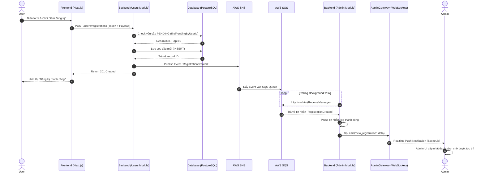

# Luồng Đăng Ký Nhà Hàng (Restaurant Registration Flow)

Tài liệu này mô tả chi tiết luồng xử lý từ khi một người dùng (`User`) gửi yêu cầu đăng ký mở nhà hàng, cho đến khi quản trị viên (`Admin`) nhận được thông báo theo thời gian thực (realtime).

## 1. Mô tả Quy trình (Flow Description)

Quy trình bao gồm 3 tác nhân chính: **User**, **Hệ thống (Backend & AWS LocalStack)**, và **Admin**.

1. **Phía User (Người dùng đăng ký)**
   - User đăng nhập vào hệ thống.
   - User vào trang Đăng ký Nhà hàng (`/register/restaurant`), điền form (Tên, Địa chỉ, Số điện thoại) và nhấn Submit.
   - Frontend gửi HTTP POST request `POST /users/registrations` kèm theo `access_token` (Authorization Bearer).

2. **Phía Backend (Users Module)**
   - API Gateway / NestJS Controller xác thực Token của User qua `JwtAuthGuard`.
   - `SubmitRegistrationUseCase` kiểm tra tính hợp lệ: đảm bảo User không có yêu cầu nào đang ở trạng thái `PENDING` (chống spam/trùng lặp).
   - Lưu thông tin đăng ký vào database (`schema_user.t_registration_request`) với status là `PENDING`.
   - Ngay lập tức Publish một event `RegistrationCreated` lên AWS SNS (Topic: `user-registration-events`).
   - Trả về mã thành công `201 Created` cho Frontend. User nhìn thấy màn hình "Đăng ký thành công".

3. **Phía Infrastructure (SNS & SQS)**
   - AWS SNS nhận tin nhắn và broadcast tới tất cả các subscribers.
   - SQS Queue (`admin-registration-queue`) đã đăng ký (subscribe) lắng nghe topic này sẽ lập tức đón được tin nhắn chứa dữ liệu đăng ký.

4. **Phía Admin (Xử lý Realtime)**
   - Tại Backend, `RegistrationSqsConsumer` (thuộc Admin Module) liên tục polling SQS Queue.
   - Khi có tin nhắn tới, Consumer đọc và parse dữ liệu JSON.
   - Thông qua `AdminGateway` (WebSockets - Socket.io), Backend phát (emit) sự kiện `new_registration` tới channel/room `admin_notifications`.
   - Trình duyệt của Admin (nếu đang online) nhận được sự kiện qua kết nối WebSockets và lập tức cập nhật UI (hiện Toast Notification, tăng số lượng badge yêu cầu chờ duyệt, hoặc chèn dòng mới vào bảng) một cách realtime mà không cần F5 (refresh) trang.

---

## 2. Sơ đồ Luồng Sequence (Sequence Diagram)

Sơ đồ dưới đây minh họa chi tiết từng bước giao tiếp giữa các thành phần trong hệ thống:

## 3. Các điểm lưu ý về kỹ thuật (Technical Notes)
- Kiến trúc **Event-Driven**: Đảm bảo Users Module và Admin Module hoạt động tách biệt (Decoupled). Users Module không cần biết ai xử lý yêu cầu, nó chỉ làm nhiệm vụ Publish event.
- **Idempotency**: Ngăn chặn 1 user gửi spam nhiều yêu cầu đăng ký bằng cách check `PENDING` ở database level và handle lỗi HTTP 409 Conflict ở Frontend.
- **Realtime**: WebSockets cho phép trải nghiệm liền mạch cho hệ thống Backend Dashboard, giúp Admin phản ứng ngay lập tức với các yêu cầu mở nhà hàng mới.
