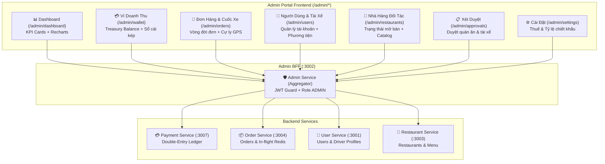

# 👑 Phân Hệ Quản Trị Viên (Admin Portal & Backoffice)

Tài liệu đặc tả toàn diện phân hệ quản trị vận hành và tài chính (Admin Portal) của hệ thống **Food Delivery**, bao gồm Dashboard phân tích trực quan hóa, Ví Doanh Thu Nền Tảng (Treasury Wallet), Quản lý Giao dịch Đơn hàng/Cuốc xe, và Quản lý Tài nguyên Master.

---

## 📌 1. Tổng Quan Kiến Trúc Phân Hệ

---

## 🚀 2. Các Tính Năng Chi Tiết

### 2.1. Bảng Điều Khiển Phân Tích (Dashboard Visualization)
- **Đường dẫn**: `/admin/dashboard`
- **Thư viện hiển thị**: `recharts` theo chuẩn UI/UX Pro Max Dark Theme.
- **5 Thẻ Chỉ Số Vận Hành (KPI Cards)**:
  1. *Tổng GMV Hệ Thống*: Tổng giá trị đơn hàng phát sinh trên toàn sàn.
  2. *Doanh Thu Sàn Ròng*: Số dư thực tế trong ví hoa hồng nền tảng.
  3. *Tổng Đơn Hàng*: Số đơn phát sinh và phân bổ trạng thái.
  4. *Nhà Hàng Đối Tác*: Số lượng quán ăn đang hoạt động trên hệ sinh thái.
  5. *Tài Xế Hoạt Động*: Số lượng đối tác tài xế đang trực tuyến sẵn sàng nhận cuốc.
- **Biểu Đồ Trực Quan**:
  - *Area Chart*: So sánh biến thiên GMV và Doanh thu sàn ròng theo từng ngày với hiệu ứng chuyển màu gradient.
  - *Bar Chart*: Sản lượng đơn hàng phát sinh so với số đơn giao hoàn tất thành công.
  - *Donut Chart*: Tỷ trọng đóng góp doanh thu: Chiết khấu Đơn quán ăn (15-20%) vs Chiết khấu Cuốc xe tài xế (10%).
- **Bộ lọc thời gian**: `7 ngày qua`, `30 ngày qua`, `Tất cả`.
- **Cơ chế Fallback (Graceful Degradation)**: Khi kết nối thời gian thực đến `order-service` gián đoạn, dashboard tự động fallback hiển thị dữ liệu snapshot tĩnh mà không làm crash giao diện.

### 2.2. Ví Doanh Thu Nền Tảng & Sổ Cái Kép (Platform Treasury Wallet)
- **Đường dẫn**: `/admin/wallet`
- **Mô hình**: Gắn liền với tài khoản kế toán kép `SYS_REVENUE_PLATFORM_COMMISSION` tại `payment-service`.
- **Luồng ghi nhận dòng tiền**:
  - *Chiết khấu Đơn quán ăn*: Tự động trích 15-20% giá trị giỏ hàng khi đơn được thanh toán (`ReferenceType.ORDER_SETTLEMENT`).
  - *Chiết khấu Cuốc xe tài xế*: Tự động trích 10% cước phí giao hàng khi tài xế hoàn tất đơn (`ReferenceType.COMMISSION_FEE`).
- **Giao diện Quản trị**:
  - Thẻ tài chính FinTech Card hiển thị số dư khả dụng thực tế.
  - Thống kê doanh thu theo từng kênh (Nhà hàng vs Tài xế).
  - Bảng tra cứu Bút toán Sổ cái (`t_ledger_entry`, `t_ledger_transaction`) phân trang, modal xem chi tiết 2 vế Nợ/Có (Debit/Credit).

### 2.3. Quản Lý Giao Dịch & Cuốc Xe (Orders & Driver Trips)
- **Đường dẫn**: `/admin/orders`
- **Bộ lọc trạng thái**: `Tất cả`, `Chờ nhận`, `Đang nấu`, `Chờ lấy`, `Đang giao`, `Hoàn tất`, `Đã hủy`.
- **Cự ly GPS**: Hiển thị khoảng cách tính toán theo công thức Haversine (`distance_km`) giữa nhà hàng và khách hàng.
- **Chi tiết đơn hàng**: Modal hiển thị danh sách món, địa chỉ giao hàng, phương thức thanh toán (COD / Ví điện tử).

### 2.4. Quản Lý Tài Nguyên Gốc (Master Resources)
- **Người dùng & Tài xế** (`/admin/users`):
  - Phân loại Khách hàng thành viên vs Tài xế đối tác.
  - Tra cứu biển số xe, loại xe, tình trạng trực tuyến (`ONLINE`/`OFFLINE`), tình trạng duyệt hồ sơ (`APPROVED`).
- **Nhà hàng đối tác** (`/admin/restaurants`):
  - Quản lý danh sách quán ăn, địa chỉ, trạng thái mở bán thời gian thực (`is_active`), xếp hạng sao.

---

## 🔒 3. Bảo Mật & Phân Quyền
Mọi API phục vụ Admin Portal đều bắt buộc xác thực:
1. `JwtAuthGuard`: Kiểm tra tính hợp lệ của JSON Web Token trong Cookie / Header Authorization.
2. `RolesGuard`: Chỉ cho phép tài khoản có vai trò `ADMIN` truy cập, chặn hoàn toàn người dùng thông thường (`USER`) và chuyển hướng an toàn.
