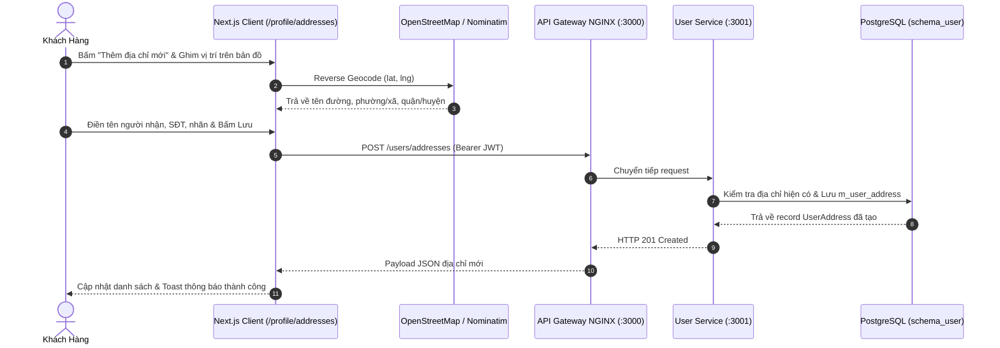
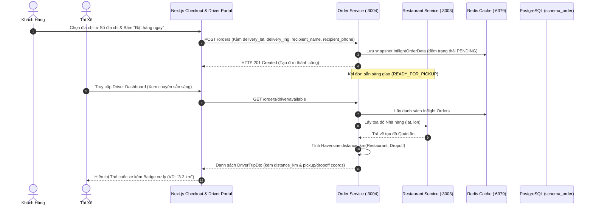

# Quản Lý Sổ Địa Chỉ (Address Book) & Tính Toán Lộ Trình Driver

Tài liệu đặc tả chi tiết luồng nghiệp vụ, kiến trúc dữ liệu, giao diện người dùng và cơ chế tính toán cự ly lộ trình giao hàng cho tính năng **Sổ Địa Chỉ (Address Book - Issue #18)**.

---

## 1. Bối Cảnh & Nguyên Tắc Nghiệp Vụ (Business Rules)

1. **Khách hàng sở hữu nhiều địa chỉ (`1 - N`)**:
   - Mỗi người dùng (`m_user`) có thể lưu nhiều địa chỉ nhận hàng khác nhau với các nhãn định danh: `HOME` (Nhà riêng), `WORK` (Cơ quan), `OTHER` (Khác).
   - Tối đa đúng **1 địa chỉ mặc định (`is_default = true`)** tại một thời điểm cho mỗi người dùng. Khi một địa chỉ được đánh dấu là mặc định, toàn bộ các địa chỉ khác của người dùng đó sẽ tự động chuyển về `is_default = false`.
   - Nếu người dùng tạo địa chỉ đầu tiên, hệ thống sẽ tự động gán `is_default = true`.
2. **Tọa độ địa lý chuẩn WGS84**:
   - Mọi địa chỉ lưu trữ đều bắt buộc có tọa độ GPS: `latitude` (numeric 10,8) và `longitude` (numeric 11,8).
   - Bản đồ tương tác Leaflet + OpenStreetMap kết hợp Nominatim Reverse Geocoding cho phép người dùng click kéo ghim chính xác vị trí nhận hàng mà không phụ thuộc vào API key bên ngoài (Google Maps / Goong).
3. **Snapshot bất biến khi Đặt Đơn (Immutable Order Snapshot)**:
   - Khi khách hàng tiến hành thanh toán (`/checkout`), thông tin địa chỉ giao hàng, tọa độ GPS (`delivery_lat`, `delivery_lng`), tên người nhận (`recipient_name`), số điện thoại (`recipient_phone`) được snapshot trực tiếp vào `t_order` và Redis In-flight data.
   - Các thay đổi sau này trong Sổ địa chỉ của người dùng **tuyệt đối không làm thay đổi** các đơn hàng đã tạo trong quá khứ.
4. **Tính toán khoảng cách & Hỗ trợ chia cuốc Driver**:
   - Sử dụng công thức Haversine (`calculateHaversineDistanceKm`) tính khoảng cách thực giữa tọa độ Nhà hàng (Pickup: `lat, lon`) và tọa độ Điểm giao hàng (Dropoff: `delivery_lat, delivery_lng`).
   - Cung cấp trường `distance_km` (làm tròn 1 chữ số thập phân) trong thông tin chuyến xe cho tài xế (`DriverTripDto`), hiển thị trực quan cự ly trên Cổng thông tin Tài xế (`DriverTripCard`).

---

## 2. Sơ Đồ Luồng Tương Tác (Sequence Diagrams)

### 2.1. Luồng Tạo Mới & Quản Lý Địa Chỉ



### 2.2. Luồng Snapshot Khi Đặt Hàng & Tính Khoảng Cách Cho Driver



---

## 3. Giao Diện Người Dùng & Các Trạng Thái (UI States)

### 3.1. Trang Quản Lý Sổ Địa Chỉ (`/profile/addresses`)
- **Đường dẫn**: `/profile/addresses` (Truy cập từ menu Người dùng trên thanh điều hướng Navbar).
- **Giao diện & Chức năng**:
  - **Trạng thái Tải (Loading State)**: Hiển thị spinner và nền đồng bộ hệ màu tối (Zinc-950) hiện đại.
  - **Trạng thái Trống (Empty State)**: Hướng dẫn người dùng thêm địa chỉ giao hàng đầu tiên.
  - **Danh sách Thẻ Địa Chỉ (`AddressCard`)**:
    - Hiển thị nhãn nổi bật (`Nhà riêng` - Xanh dương, `Cơ quan` - Tím, `Khác` - Hổ phách).
    - Huy hiệu `Mặc định` viền cam nổi bật.
    - Nút bấm trực tiếp: `Đặt làm mặc định`, `Chỉnh sửa`, `Xóa`.
  - **Modal Thêm / Sửa (`AddressFormModal`)**:
    - Tích hợp bộ chọn bản đồ Leaflet (`LocationMapPicker`).
    - Tìm kiếm địa chỉ bằng OpenStreetMap Nominatim tự động định vị và zoom.
    - Nút "Định vị hiện tại" lấy GPS thiết bị qua Geolocation API.
    - Nhập ghi chú giao hàng cho tài xế (ví dụ: *Tòa B, lầu 3, gọi trước khi giao*).

### 3.2. Modal Chọn Địa Chỉ Tại Bước Thanh Toán (`/checkout`)
- **Tích hợp**: Trong trang Checkout, phần "Địa chỉ nhận hàng" hiển thị địa chỉ đã chọn kèm nút *"Thay đổi"*.
- **Modal Lựa Chọn (`AddressSelectorModal`)**:
  - Liệt kê toàn bộ địa chỉ đã lưu trong sổ địa chỉ của tài khoản.
  - Cho phép người dùng chuyển nhanh địa chỉ giao hàng bằng 1 click.
  - Nút *"Thêm địa chỉ giao hàng mới"* mở trực tiếp form bản đồ ngay tại bước thanh toán.

### 3.3. Hiển Thị Khoảng Cách Cho Driver (`/driver/dashboard`)
- **Cổng thông tin tài xế**: Mỗi cuốc xe sẵn sàng nhận hoặc đang thực hiện hiển thị huy hiệu cự ly (`distance_km`) với biểu tượng `Route / MapPin`.
- Tọa độ điểm lấy hàng (Nhà hàng) và điểm giao hàng (Khách hàng) được format rõ ràng, giúp tài xế ước lượng thời gian và cung đường di chuyển tối ưu.

---

## 4. Cấu Trúc Dữ Liệu & Snapshot Đơn Hàng

### Bảng Cơ Sở Dữ Liệu: `schema_user.m_user_address`

| Tên Cột | Kiểu Dữ Liệu | Ràng Buộc | Ý Nghĩa |
| :--- | :--- | :--- | :--- |
| `id` | `uuid` | PK, default gen_random_uuid() | Định danh duy nhất của địa chỉ |
| `user_id` | `uuid` | FK -> `m_user.id` ON DELETE CASCADE | Người dùng sở hữu địa chỉ |
| `recipient_name` | `varchar(255)` | NOT NULL | Họ và tên người nhận |
| `recipient_phone` | `varchar(50)` | NOT NULL | Số điện thoại liên hệ nhận hàng |
| `label` | `varchar(50)` | NOT NULL, DEFAULT 'HOME' | Phân loại: `HOME`, `WORK`, `OTHER` |
| `street_address` | `text` | NOT NULL | Số nhà, tên đường |
| `ward` | `varchar(255)` | NULLABLE | Phường / Xã |
| `district` | `varchar(255)` | NULLABLE | Quận / Huyện |
| `city` | `varchar(255)` | NULLABLE | Tỉnh / Thành phố |
| `full_address` | `text` | NOT NULL | Chuỗi địa chỉ hoàn chỉnh |
| `latitude` | `numeric(10,8)` | NOT NULL | Tọa độ vĩ độ WGS84 |
| `longitude` | `numeric(11,8)` | NOT NULL | Tọa độ kinh độ WGS84 |
| `delivery_notes` | `text` | NULLABLE | Ghi chú chỉ đường cho tài xế |
| `is_default` | `boolean` | NOT NULL, DEFAULT FALSE | Đánh dấu địa chỉ giao hàng mặc định |
| `created_at` | `timestamptz` | NOT NULL, DEFAULT now() | Thời điểm tạo |
| `updated_at` | `timestamptz` | NOT NULL, DEFAULT now() | Thời điểm cập nhật cuối |

### Bổ Sung Snapshot Vào Bảng: `schema_order.t_order`

| Tên Cột Mới | Kiểu Dữ Liệu | Ràng Buộc | Ý Nghĩa |
| :--- | :--- | :--- | :--- |
| `delivery_lat` | `numeric(10,8)` | NULLABLE | Tọa độ vĩ độ điểm giao hàng tại thời điểm đặt đơn |
| `delivery_lng` | `numeric(11,8)` | NULLABLE | Tọa độ kinh độ điểm giao hàng tại thời điểm đặt đơn |
| `recipient_name` | `varchar(255)` | NULLABLE | Tên người nhận snapshot tại thời điểm đặt đơn |
| `recipient_phone` | `varchar(50)` | NULLABLE | Số điện thoại nhận snapshot tại thời điểm đặt đơn |

---

## 5. Thuật Toán Tính Khoảng Cách (Haversine Formula)

Được triển khai tập trung tại `libs/common/src/utils/geo.utils.ts` phục vụ toàn bộ các microservices:

$$\Delta\sigma = 2 \arcsin\left(\sqrt{\sin^2\left(\frac{\Delta\phi}{2}\right) + \cos(\phi_1)\cos(\phi_2)\sin^2\left(\frac{\Delta\lambda}{2}\right)}\right)$$

$$d = R \cdot \Delta\sigma$$

Trong đó:
- $R = 6371\text{ km}$ (Bán kính trung bình Trái Đất).
- $\phi_1, \phi_2$: Vĩ độ của Quán ăn và Khách hàng (radians).
- $\Delta\lambda$: Độ chênh lệch kinh độ (radians).

Hàm tính toán:
```typescript
calculateHaversineDistanceKm(
  lat1: number,
  lon1: number,
  lat2: number,
  lon2: number
): number
```
Kết quả được làm tròn tới 1 chữ số thập phân (`3.2 km`), đảm bảo hiệu năng tính toán cực cao mà không cần truy vấn external routing service cho các tác vụ ước tính cự ly sơ bộ.

---

## 6. Kiểm Thử & Nghiệm Thu (Testing & Verification)

- **Unit Test Sổ Địa Chỉ**: `apps/user-service/src/modules/users/tests/user-address.spec.ts`
  - Đầy đủ 3 nhánh: Tạo mới, Tự động gán mặc định, Đổi mặc định, Xóa địa chỉ, và Xử lý ngoại lệ.
- **Unit Test Khoảng Cách & Đơn Hàng**: `apps/order-service/src/modules/orders/tests/order-distance-calculation.spec.ts`
  - Kiểm thử công thức Haversine với tọa độ thực tế tại TP. Hồ Chí Minh.
  - Kiểm thử snapshot tọa độ khi tạo đơn và tính `distance_km` trong cuốc xe của tài xế.
- **Lệnh chạy kiểm thử**:
  ```bash
  cd backend
  npm test
  ```
