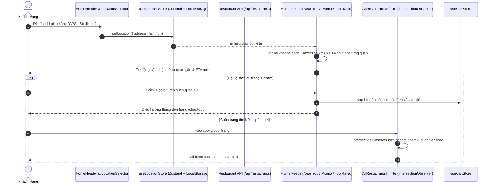

# Tài Liệu Kỹ Thuật: Nâng Cấp Giao Diện Trang Chủ (Homepage Revamp)

> Phân hệ: `customer` / `frontend`  
> Tham chiếu Issue: [#67](https://github.com/DuyBinh2003/FoodDelivery/issues/67)  
> Pull Request: [#68](https://github.com/DuyBinh2003/FoodDelivery/pull/68)  
> Trạng thái: `[ACTIVE]`  
> Lần cập nhật cuối: 2026-10-19  

---

## 1. Tổng Quan Nghiệp Vụ (Overview)

Tính năng **Trang Chủ Đặt Món Hiện Đại (Homepage Revamp)** biến giao diện tĩnh ban đầu thành một cổng khám phá ẩm thực trực quan, thông minh và phản ứng tức thì theo vị trí người dùng:
- **Định vị & Phản xạ khoảng cách**: Tự động lấy vị trí qua GPS trình duyệt hoặc sổ địa chỉ. Khi đổi địa chỉ giao hàng, toàn bộ feed nhà hàng tự động tính toán lại cự ly (km), thời gian giao (ETA) và phí ship tương ứng.
- **Thanh tìm kiếm động (Sticky Search)**: Cố định khi cuộn trang, tự động xoay chuyển placeholder gợi ý món ngon hot mỗi 3.5s, tích hợp gợi ý từ khóa xu hướng (Trending searches).
- **Khối Marketing & Khám phá**: Auto-play Carousel Banner quảng bá chiến dịch freeship và giảm giá, cùng Grid danh mục món ăn hỗ trợ lọc trực tiếp ngay trên trang chủ (In-place Filter).
- **Feeds cá nhân hóa**: 4 luồng đề xuất thông minh ("Đặt lại lần nữa", "Gần bạn nhất", "Đang có khuyến mãi", "Quán ngon nổi bật") và danh sách Infinite Scroll tự động tải thêm khi cuộn xuống đáy trang.
- **Thanh điều hướng Mobile-first (Bottom Navigation Bar)**: Cố định dưới đáy màn hình trên thiết bị di động, hỗ trợ chuyển đổi nhanh ngữ cảnh Home, Đơn hàng (thông minh theo đơn active), Thông báo và Tài khoản.

---

## 2. Kiến Trúc Luồng Dữ Liệu (Architecture & Sequence Diagram)

---

## 3. Cấu Trúc Thành Phần Frontend (`frontend/src/features/home/`)

### 3.1. Các Components Chính
1. [**`HomeHeader`**](file:///d:/code/FoodDelivery/frontend/src/features/home/components/home-header.tsx):
   - Thanh Header tích hợp Brand Logo, Bộ chọn địa chỉ giao hàng (`LocationSelector`), Cart Button kèm badge số lượng thực tế, Chuông thông báo, và Thanh tìm kiếm động cố định (Sticky) với hiệu ứng đổi placeholder mỗi 3.5s.
2. [**`LocationModal`**](file:///d:/code/FoodDelivery/frontend/src/features/home/components/location-modal.tsx):
   - Modal đổi địa chỉ: Chọn địa chỉ đã lưu (Nhà, Công ty), kích hoạt GPS trình duyệt (`navigator.geolocation`), hoặc nhập địa chỉ thủ công.
3. [**`BannerCarousel`**](file:///d:/code/FoodDelivery/frontend/src/features/home/components/banner-carousel.tsx):
   - Slider quảng cáo tự động trượt 4.5s/slide, dừng khi hover chuột, có nút chuyển trang và dots indicator.
4. [**`CategoryGrid`**](file:///d:/code/FoodDelivery/frontend/src/features/home/components/category-grid.tsx):
   - Grid 8 danh mục đồ ăn (Cơm, Phở/Bún, Trà sữa, Gà rán, Bánh mì, Ăn vặt, Cà phê, Tất cả), hỗ trợ lọc trực tiếp danh sách quán trên trang chủ.
5. [**`RestaurantCard`**](file:///d:/code/FoodDelivery/frontend/src/features/home/components/restaurant-card.tsx):
   - Thẻ hiển thị quán ăn: Ảnh lazy loading, nhãn Freeship/Giảm giá, điểm sao, cự ly km, thời gian ETA phút và nút "Đặt lại" nhanh.
6. [**`RestaurantFeedSection`**](file:///d:/code/FoodDelivery/frontend/src/features/home/components/restaurant-feed-section.tsx):
   - Khối danh sách nhà hàng cuộn ngang (Horizontal Scroll List) hỗ trợ điều khiển cuộn mượt mà trên cả desktop và mobile.
7. [**`AllRestaurantsInfinite`**](file:///d:/code/FoodDelivery/frontend/src/features/home/components/all-restaurants-infinite.tsx):
   - Lưới nhà hàng đa cột với Infinite Scroll qua `IntersectionObserver`, tự động tải thêm trang kế tiếp khi cuộn chạm đáy.
8. [**`BottomNavigationBar`**](file:///d:/code/FoodDelivery/frontend/src/features/home/components/bottom-navigation-bar.tsx):
   - Thanh điều hướng cố định dưới đáy màn hình trên Mobile (`md:hidden`). Tab Đơn hàng thông minh ưu tiên mở đơn đang giao nếu có, ngược lại mở lịch sử.
9. [**`NotificationDrawer`**](file:///d:/code/FoodDelivery/frontend/src/features/home/components/notification-drawer.tsx):
   - Drawer trượt xem tin khuyến mãi và cập nhật trạng thái đơn hàng.
10. [**`HomeSkeletons`**](file:///d:/code/FoodDelivery/frontend/src/features/home/components/home-skeletons.tsx):
    - Shimmer Skeletons cho Banner, Categories, và Restaurant Cards thay thế hoàn toàn spinner xoay.

### 3.2. Quản Lý Trạng Thái & Tiện Ích Thuần Túy
- [**`useLocationStore.ts`**](file:///d:/code/FoodDelivery/frontend/src/features/home/store/useLocationStore.ts):
  - Zustand Store lưu trữ `currentLocation: { address, lat, lng, source, label }`, đồng bộ LocalStorage `fd_user_location`, tự động fallback về trung tâm Quận 1 nếu chưa có GPS.
- [**`home-feed.utils.ts`**](file:///d:/code/FoodDelivery/frontend/src/features/home/utils/home-feed.utils.ts):
  - `enrichRestaurantsWithLocation`: Gắn cự ly km và ETA phút cho từng quán ăn.
  - `filterNearYouRestaurants`: Lọc quán trong bán kính $\le 3.5$ km và ETA $\le 25$ phút.
  - `filterPromoRestaurants`: Lọc quán có freeship hoặc nhãn giảm giá.
  - `filterTopRatedRestaurants`: Lọc quán có rating $\ge 4.5$ sao.
  - `filterRestaurantsByCategory`: Lọc theo danh mục đã chọn.

---

## 4. Kiểm Thử & Đảm Bảo Chất Lượng (Quality Gate)
Hệ thống kiểm thử bao phủ đủ 3 nhánh:
- **🟢 Happy Path**: Bổ sung cự ly, ETA, phân loại 4 feed (Near You, Promo, Top Rated, Category), định dạng km và phút.
- **🟡 Edge Cases**: Tọa độ trùng nhau (cự ly 0km), bán kính siêu nhỏ, ngưỡng rating 4.49 vs 4.50, chặn trần ETA tối đa 90 phút.
- **🔴 Error & Rejection Flow**: Tọa độ NaN/null/undefined, mảng danh sách rỗng hoặc null, format giá trị âm.

**Kết quả Local CI Gate**:
- `npm run lint`: 0 warnings, 0 errors.
- `npx tsc --noEmit`: 0 errors.
- `npm test`: 100% pass trên 20 test suites / 61 tests (Frontend) và 15 test suites / 100 tests (Backend).
- `npm run build`: Next.js Turbopack biên dịch thành công 100% (24/24 static & dynamic routes).
