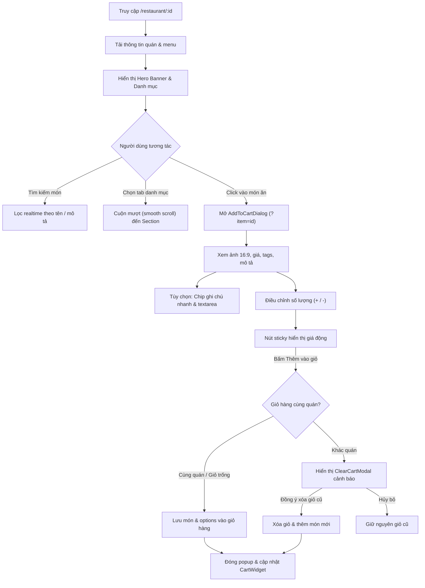

# Đặc Tả Tính Năng: Trang Chi Tiết Nhà Hàng & Popup Xem Sản Phẩm (Restaurant Detail & Product Modal)

Tài liệu đặc tả kiến trúc UI/UX và luồng tương tác của màn hình Chi tiết Nhà hàng (`/restaurant/[id]`) cùng Popup Thêm Món Vào Giỏ Hàng (`AddToCartDialog`).

---

## 1. Tổng Quan (Overview)

Màn hình Chi tiết Nhà hàng và Popup Thêm Món là hai mắt xích cốt lõi trong phễu chuyển đổi (conversion funnel) của ứng dụng Food Delivery, trực tiếp quyết định trải nghiệm chọn món và thêm vào giỏ hàng của khách hàng (Customer).

- **Route:** `/restaurant/[id]` (Hỗ trợ deep linking trực tiếp món ăn thông qua `?item=[menuItemId]`)
- **Đối tượng sử dụng (Actor):** Khách hàng (Customer - Cả người dùng đã đăng nhập hoặc khách vãng lai)
- **Tiêu chuẩn thiết kế:** Tuân thủ hệ thống UI/UX Pro Max, dark mode thẩm mỹ cao, micro-interactions, responsive mobile-first, và độ tương phản chuẩn WCAG 4.5:1.

---

## 2. Sơ Đồ Luồng Tương Tác (User Flow Diagram)

---

## 3. Đặc Tả Thành Phần Giao Diện (Screen Specifications)

### 3.1. Trang Chi Tiết Nhà Hàng (`RestaurantClient`)

1. **Thanh Điều Hướng Cố Định (Sticky Top Header):**
   - Nút quay lại (`<ChevronLeft />`) trở về `/menu`.
   - Tên nhà hàng hiển thị kèm huy hiệu Đối tác chính hãng (`<CheckCircle2 />`).
   - Badge trạng thái hoạt động: `Đang mở cửa` (xanh ngọc, hiệu ứng pulse) hoặc `Tạm đóng`.
   - Chỉ báo số lượng món hiện có trong giỏ hàng.

2. **Khối Header Thông Tin Nhà Hàng & Dữ Liệu Giao Vận Động (`RestaurantHeader`):**
   - Ảnh Cover & Logo sắc nét kèm avatar quán.
   - Xếp hạng sao thực tế kèm lượt đánh giá: ⭐ `4.8 (180+ đánh giá)`.
   - **Dữ liệu giao vận động:**
     - Khoảng cách (km) tính từ tọa độ GPS của người dùng (`useLocationStore`).
     - Thời gian giao hàng dự kiến (ETA phút).
     - Phí giao hàng tính theo cự ly thực tế (15.000đ cho 2km đầu, +5.000đ/km tiếp theo, miễn phí nếu Freeship).
   - **Vouchers / Promos:** Danh sách mã giảm giá độc quyền từ quán (`FREESHIP`, `GIAM20K`, `TIECNGON10`) kèm nút "Thu thập" / "Đã lưu".
   - **Trạng thái đóng cửa:** Cảnh báo nổi bật khi `is_active = false`, tự động làm mờ xám (gray-out) toàn bộ ảnh món ăn và vô hiệu hóa nút thêm vào giỏ.

3. **Thanh Tìm Kiếm Trong Quán (In-Restaurant Search Bar):**
   - Lọc trực tiếp các món trong thực đơn theo tên hoặc mô tả món ăn.
   - Nút xóa nhanh từ khóa (X) và hiển thị số lượng món thỏa mãn điều kiện.

4. **Thanh Danh Mục Sticky & Scroll Spy 2 Chiều:**
   - Thanh trượt ngang danh mục: `Tất cả`, `Món Nước`, `Món Cơm`, `Khai Vị`, `Đồ Uống`...
   - **Scroll Spy 2 chiều:** Khi cuộn trang đến nhóm món nào, tab tương ứng tự động bôi đậm (highlight) và trượt vào giữa tầm nhìn. Nhấn vào tab nào thì màn hình tự động cuộn mượt (smooth scroll) thẳng đến đúng nhóm món.

5. **Danh Sách Món Ăn (`FoodCard`):**
   - Thumbnail vuông bo góc, tên món, mô tả, giá bán nổi bật.
   - **Giá gốc gạch ngang:** Hiển thị khi `original_price > price` kèm huy hiệu giảm giá (`-15%`).
   - Quản lý tồn kho: Món hết hàng (`!is_available`) phủ nhãn "Hết hàng" và khóa click.
   - Nút "+" / "Thêm vào giỏ" mở trực tiếp popup tùy chỉnh món.

---

### 3.2. Cửa Sổ Tùy Chỉnh Món Đa Tùy Chọn (`AddToCartDialog`)

1. **Banner Ảnh 16:9 & Tags Đặc Trưng Từ Database:**
   - Ảnh món ăn sắc nét tải qua `next/image`, gradient bảo vệ độ tương phản.
   - Nút đóng (X) dạng pill tròn mờ, hỗ trợ phím `Escape`.
   - Lớp phủ mờ "Tạm hết hàng" nếu món đang ở trạng thái `is_available = false`.
   - **Tags món ăn từ DB:** Tự động lấy và hiển thị các nhãn đặc trưng (`item.tags`: `#Món Nước`, `#Bò`, `#Không Cay`, `#Bán Chạy`, `#Đặc Sản`...) được lưu trữ và liên kết từ database.

2. **Nhóm Tùy Chọn Bắt Buộc (Required Choices - Radio Button):**
   - Bắt buộc chọn đúng 1 lựa chọn (ví dụ: Chọn Kích cỡ Size M, Size L, Size XL).
   - Hiển thị giá chênh lệch rõ ràng (`+0đ`, `+10.000đ`, `+20.000đ`).
   - Tự động chặn submit và hiển thị cảnh báo nếu khách chưa chọn nhóm bắt buộc.

3. **Nhóm Tùy Chọn Thêm (Optional / Toppings - Checkbox):**
   - Cho phép chọn nhiều topping (ví dụ: Thêm bò tái, Trứng chần, Quẩy giòn).
   - Giới hạn số lượng lựa chọn tối đa nếu quán quy định (`max_choices`).

4. **Ghi Chú Cho Quán (Custom Note):**
   - Ô nhập tự do tối đa 150 ký tự kèm bộ đếm ký tự thực tế (`{customNote.length}/150`).
   - Cho phép khách hàng nhập lời dặn riêng cho quán (VD: "để riêng nước dùng, không hành...").
   - Loại bỏ các tag chip tĩnh định sẵn để đảm bảo tính linh hoạt tối đa theo từng món và theo phân quyền thực tế của từng nhà hàng.
   - Ghi chú được lưu vào thuộc tính `note` của dòng giỏ hàng (`CartItemType`) và tham gia cấu thành mã định danh giỏ hàng.

5. **Bộ Tăng Giảm Số Lượng & Giá Real-time:**
   - Nút trừ (`-`) và cộng (`+`) điều chỉnh số lượng tức thì.
   - Giá tiền trên nút CTA nhảy số Real-time: `(Giá gốc + Tổng giá modifier) * Số lượng`.
   - Kiểm tra validation: Nút CTA chỉ kích hoạt khi tất cả nhóm tùy chọn bắt buộc (`required: true`) đã được người dùng chọn.

---

### 3.3. Giỏ Hàng Nổi Đáy Màn Hình (`FloatingBottomCart`)

- **Hiển thị có điều kiện:** Chỉ pop-up lên ở mép đáy màn hình khi giỏ hàng có $\ge 1$ món.
- **Nội dung:** Tổng số lượng món, tổng tiền tạm tính, tên quán đang đặt, nút "Xem giỏ hàng" mở Drawer và nút "Thanh toán" chuyển ngay sang `/checkout`.
- **Ràng Buộc Đơn Nhà Hàng (Single Restaurant Policy):**
  - Giỏ hàng chỉ chứa món của 1 nhà hàng duy nhất.
  - Khi người dùng thêm món của Quán B trong khi giỏ đang có món của Quán A: Bật `ClearCartModal` cảnh báo:
    *"Bạn đang có món của quán khác trong giỏ. Bấm thêm món này sẽ xóa giỏ hàng cũ. Bạn có đồng ý không?"*
  - Nếu chọn đồng ý: Xóa giỏ cũ và nạp món quán mới vào.

---

## 4. Quản Lý Trạng Thái & Lưu Trữ (State Management & Persistence)

- **Zustand Persist (`useCartStore`):** Lưu trữ toàn bộ giỏ hàng xuống `localStorage` (`food_delivery_cart_storage`). Dữ liệu giỏ hàng được bảo toàn trọn vẹn khi F5, đóng tab hoặc mở lại ứng dụng.
- **Tách biệt dòng giỏ hàng (Cart Item Line Separation):**
  - Khóa giỏ hàng được định danh theo công thức: `${item.id}-${sortedOptions.join('|')}`.
  - Giúp phân biệt rạch ròi các cấu hình tùy chọn khác nhau của cùng một món ăn trong giỏ hàng.
