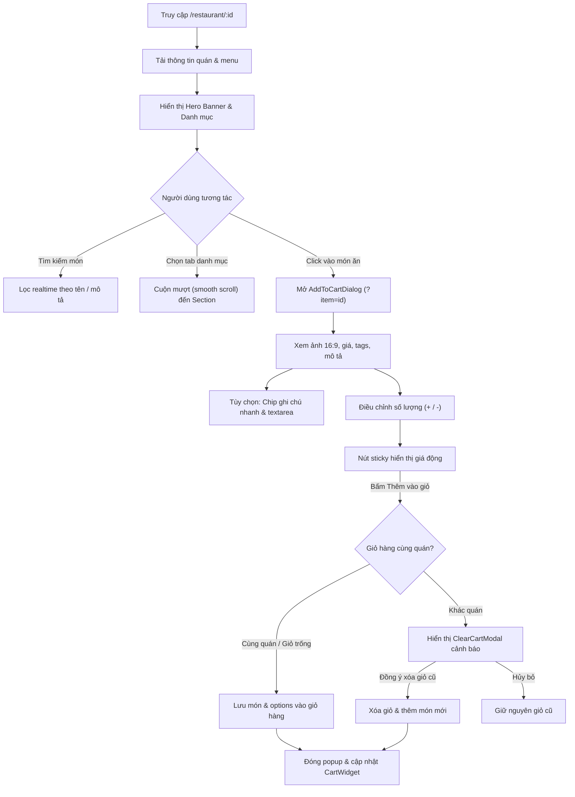

# Đặc Tả Tính Năng: Trang Chi Tiết Nhà Hàng & Popup Xem Sản Phẩm (Restaurant Detail & Product Modal)

Tài liệu đặc tả kiến trúc UI/UX và luồng tương tác của màn hình Chi tiết Nhà hàng (`/restaurant/[id]`) cùng Popup Thêm Món Vào Giỏ Hàng (`AddToCartDialog`).

---

## 1. Tổng Quan (Overview)

Màn hình Chi tiết Nhà hàng và Popup Thêm Món là hai mắt xích cốt lõi trong phễu chuyển đổi (conversion funnel) của ứng dụng Food Delivery, trực tiếp quyết định trải nghiệm chọn món và thêm vào giỏ hàng của khách hàng (Customer).

- **Route:** `/restaurant/[id]` (Hỗ trợ deep linking trực tiếp món ăn thông qua `?item=[menuItemId]`)
- **Đối tượng sử dụng (Actor):** Khách hàng (Customer - Cả người dùng đã đăng nhập hoặc khách vãng lai)
- **Tiêu chuẩn thiết kế:** Tuân thủ hệ thống UI/UX Pro Max, dark mode thẩm mỹ cao, micro-interactions, responsive mobile-first, và độ tương phản chuẩn WCAG 4.5:1.

---

## 2. Sơ Đồ Luồng Tương Tác (User Flow Diagram)

---

## 3. Đặc Tả Thành Phần Giao Diện (Screen Specifications)

### 3.1. Trang Chi Tiết Nhà Hàng (`RestaurantClient`)

1. **Thanh Điều Hướng Cố Định (Sticky Top Header):**
   - Nút quay lại (`<ChevronLeft />`) trở về `/menu`.
   - Tên nhà hàng hiển thị kèm huy hiệu Đối tác chính hãng (`<CheckCircle2 />`).
   - Badge trạng thái hoạt động: `Đang mở cửa` (xanh ngọc, hiệu ứng pulse) hoặc `Tạm đóng`.
   - Chỉ báo số lượng món hiện có trong giỏ hàng.

2. **Hero Banner Nhà Hàng (Atmospheric Hero Section):**
   - Ảnh nền / gradient phong cách ẩm thực với hiệu ứng ánh sáng mờ ambient.
   - Avatar / Logo nhà hàng viền đôi nổi bật.
   - Thông tin xếp hạng sao: ⭐ `4.8` (dựa trên đánh giá thực tế).
   - Thời gian ước tính & Khoảng cách: `20 - 30 phút • 1.8 km`.
   - Địa chỉ chi tiết kèm biểu tượng định vị.
   - Nhãn danh mục ẩm thực (Cuisine tags).

3. **Thanh Tìm Kiếm Trong Quán (In-Restaurant Search Bar):**
   - Lọc trực tiếp các món trong thực đơn theo tên hoặc mô tả món ăn.
   - Nút xóa nhanh từ khóa (X) và hiển thị số lượng món thỏa mãn điều kiện.

4. **Thanh Danh Mục Sticky (Sticky Category Tabs):**
   - Thanh trượt ngang danh mục: `Tất cả`, `Món Nước`, `Món Cơm`, `Khai Vị`, `Đồ Uống`...
   - Tự động cuộn mượt (smooth scroll spy) đến từng phân mục món ăn tương ứng khi nhấn chọn.

5. **Phân Mục Món Ăn Theo Nhóm (Grouped Category Sections):**
   - Tiêu đề từng nhóm món ăn kèm số lượng.
   - Lưới hiển thị `FoodCard` (1 cột trên di động, 2 cột trên tablet, 3-4 cột trên desktop).
   - Trạng thái trống (Empty State) lịch sự khi từ khóa tìm kiếm không khớp món nào.

---

### 3.2. Popup Xem Sản Phẩm & Thêm Món (`AddToCartDialog`)

1. **Banner Ảnh 16:9:**
   - Ảnh món ăn sắc nét tải qua `next/image`, bo tròn góc trên với gradient bảo vệ độ tương phản.
   - Trực quan hóa món ăn khi không có ảnh bằng gradient ẩm thực ấm áp và icon ngọn lửa rực sáng.
   - Huy hiệu danh mục món ăn đặt góc trên bên trái.
   - Nút đóng (X) dạng pill tròn mờ góc trên bên phải, hỗ trợ phím `Escape`.
   - Lớp phủ mờ "Tạm hết hàng" nếu món đang ở trạng thái `is_available = false`.

2. **Thông Tin Món & Thẻ Tag:**
   - Tên món ăn typography đậm nét, giá bán định dạng VND nổi bật.
   - Danh sách tag đặc trưng: `Bán chạy`, `Cay`, `Đặc sắc`...
   - Mô tả nguyên liệu và công thức chế biến.

3. **Yêu Cầu Đặc Biệt & Ghi Chú Nhanh (Special Instructions):**
   - **Interactive Quick Chips:** Các nhãn tương tác bật/tắt nhanh một chạm:
     - `Không hành`, `Ít cay`, `Không cay`, `Để riêng nước dùng`, `Nhiều rau`, `Không tiêu`, `Ít ngọt`, `Để riêng đá`.
   - **Ô Ghi Chú Tự Do (Custom Notes):** Textarea cho phép nhập tối đa 150 ký tự với bộ đếm ký tự trực tiếp.

4. **Bộ Tăng Giảm Số Lượng (Quantity Stepper):**
   - Nút trừ (`-`) tự động vô hiệu hóa khi số lượng = 1.
   - Nút cộng (`+`) tăng số lượng.
   - Đảm bảo chuẩn tiếp xúc cảm ứng (Touch target) tối thiểu 44×44px.

5. **Thanh Hành Động Dưới Cùng (Sticky Bottom CTA):**
   - Tính toán và phản hồi giá tiền trực tiếp: `Đơn giá * Số lượng`.
   - Nút thêm vào giỏ kèm hiệu ứng gradient `from-orange-500 to-amber-500` sống động.
   - Tích hợp cảnh báo `ClearCartModal` tự động khi giỏ hàng hiện tại đang lưu món của nhà hàng khác.

---

## 4. Quản Lý Trạng Thái & Dữ Liệu (State Management)

- **Đồng bộ URL:** Khi click vào món ăn, tham số query `?item=[id]` được thêm vào URL. Khi đóng popup, `router.replace(pathname, { scroll: false })` loại bỏ tham số mà không làm reload trang.
- **Tách biệt dòng giỏ hàng (Cart Item Line Separation):**
  - Khóa giỏ hàng được định danh theo công thức: `${item.id}-${sortedOptions.join('|')}`.
  - Ví dụ: 2 phần Phở bò với tùy chọn *"Không hành"* và *"Để riêng nước dùng"* sẽ được lưu thành 2 dòng riêng biệt với số lượng và ghi chú tương ứng.
