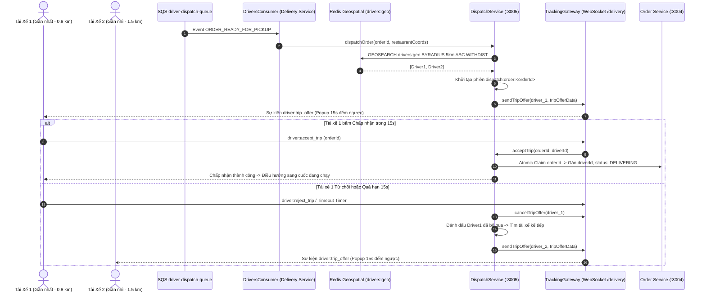

# Tài Liệu Kỹ Thuật: Thuật Toán Chia Cuốc & Tự Động Điều Phối Đơn Hàng (Order Routing & Auto-Dispatch)

> Phân hệ: `driver` / `delivery`  
> Tham chiếu Issue: [#29](https://github.com/DuyBinh2003/FoodDelivery/issues/29)  
> Pull Request: [#66](https://github.com/DuyBinh2003/FoodDelivery/pull/66)  
> Trạng thái: `[ACTIVE]`  
> Lần cập nhật cuối: 2026-10-19  

---

## 1. Tổng Quan Nghiệp Vụ (Overview)

Tính năng **Chia cuốc tự động (Order Routing & Dispatch Engine)** giải quyết bài toán phân bổ đơn hàng cho tài xế tối ưu và công bằng trong hệ thống FoodDelivery:
- **Tự động quét tài xế gần nhất**: Khi đơn hàng sẵn sàng lấy món (`ORDER_READY_FOR_PICKUP`), hệ thống tự động quét vị trí các tài xế đang Trực tuyến (`ONLINE`) trong bán kính $R = 5$ km quanh nhà hàng bằng **Redis Geospatial**.
- **Đẩy đơn thời gian thực (Push Dispatching)**: Bắn cuốc trực tiếp qua WebSocket `/delivery` tới room cá nhân của tài xế (`driver_<driverId>`).
- **Thời gian chờ phản hồi 15 giây**: Tài xế có đúng 15 giây để xem thông tin cuốc xe (quán ăn, điểm giao, cước phí thực nhận) và bấm **Chấp nhận (Accept)** hoặc **Từ chối (Reject)**.
- **Tự động chuyển tiếp (Failover / Escalation)**: Nếu tài xế từ chối hoặc không phản hồi sau 15 giây, hệ thống tự động chuyển cuốc cho tài xế gần thứ 2 trong danh sách ứng viên mà không làm gián đoạn đơn hàng.

---

## 2. Kiến Trúc Luồng Dữ Liệu (Data Flow Architecture)



---

## 3. Cấu Trúc Lưu Trữ Redis Geospatial

### 3.1. Key định vị địa lý: `drivers:geo`
- Kiểu dữ liệu: `Sorted Set (ZSET)` quản lý qua lệnh `GEOADD` / `GEOSEARCH` / `ZREM`.
- Dữ liệu lưu trữ:
  - Longitude / Latitude của tài xế.
  - Member: `driverId`.
- Vòng đời:
  - Tài xế bật `ONLINE` hoặc định kỳ 10 giây: `GEOADD drivers:geo <lng> <lat> <driverId>`.
  - Tài xế tắt `OFFLINE`: `ZREM drivers:geo <driverId>`.

### 3.2. Key phiên điều phối: `dispatch:order:<orderId>`
- Kiểu dữ liệu: `HASH` với TTL = 300 giây (5 phút).
- Các trường:
  - `status`: `PENDING` | `OFFERED` | `ACCEPTED` | `EXHAUSTED` | `CANCELLED`.
  - `candidates`: JSON string danh sách tài xế theo thứ tự khoảng cách tăng dần.
  - `current_candidate`: ID tài xế đang được mời nhận đơn.
  - `rejected_candidates`: JSON string danh sách ID các tài xế đã từ chối hoặc hết giờ.
  - `offer_expires_at`: Epoch timestamp thời điểm hết hạn của lời mời hiện tại.

---

## 4. Giao Thức WebSocket & REST API

### 4.1. WebSocket `/delivery`
- **Kết nối & Room**:
  - `driver:join`: `{ driverId: string }` $\rightarrow$ Join room `driver_<driverId>`.
- **Sự kiện từ Server tới Client**:
  - `driver:trip_offer`: Phát gói thông tin cuốc xe kèm đồng hồ 15s:
    ```json
    {
      "orderId": "uuid",
      "restaurantName": "Cơm Tấm Ba Ghiền",
      "restaurantAddress": "84 Đặng Văn Ngữ, Phú Nhuận",
      "restaurantLat": 10.7925,
      "restaurantLng": 106.6712,
      "deliveryAddress": "123 Lê Lợi, Bến Nghé, Quận 1",
      "deliveryLat": 10.7731,
      "deliveryLng": 106.7001,
      "distanceKm": 3.8,
      "deliveryFee": 32000,
      "driverEarnings": 28800,
      "itemsCount": 3,
      "timeoutSeconds": 15,
      "expiresAt": 1776600015000
    }
    ```
  - `driver:trip_cancelled`: Thông báo hủy hoặc cuốc xe đã được chuyển cho tài xế khác.
- **Sự kiện từ Client lên Server**:
  - `driver:accept_trip`: `{ orderId: string, driverId: string }`
  - `driver:reject_trip`: `{ orderId: string, driverId: string, reason?: string }`

### 4.2. REST Endpoints (`backend/apps/delivery-service`)
- `POST /delivery/driver/location`: Cập nhật tọa độ GPS tài xế vào Redis Geo (`drivers:geo`).
- `POST /delivery/driver/status`: Cập nhật trạng thái `ONLINE` / `OFFLINE`.
- `POST /delivery/orders/:orderId/accept`: Nhận cuốc xe (Fallback khi mất kết nối WebSocket).
- `POST /delivery/orders/:orderId/reject`: Từ chối cuốc xe (kèm lý do).
- `POST /delivery/dispatch/manual`: Kích hoạt thuật toán điều phối thủ công cho một đơn hàng.

---

## 5. Giao Diện Người Dùng (UI/UX)
- **Modal Nhận Cuốc Nổi (`IncomingTripModal`)**:
  - Tự động hiển thị nổi trên màn hình khi có cuốc mới bắn tới.
  - Thanh tiến trình đếm ngược 15 giây chuyển màu sinh động: Xanh lục ($>8$s) $\rightarrow$ Vàng hổ phách ($5-8$s) $\rightarrow$ Đỏ chớp nháy ($\le 4$s).
  - Thẻ thông tin thu nhập tài xế thực nhận to rõ, lộ trình trực quan từ quán ăn đến khách hàng.
  - Nút **Chấp nhận cuốc** (màu Gradient Amber-Emerald) và nút **Bỏ qua** (màu tối tối giản).
- **Badge Trạng Thái Trực Tuyến Live GPS**:
  - Hiển thị chấm xanh pulse khi tài xế trực tuyến và socket trạm điều phối kết nối ổn định.

---

## 6. Kiểm Thử 3 Nhánh & Đảm Bảo Chất Lượng (Quality Assurance)
Toàn bộ mã nguồn đã vượt qua cổng kiểm soát chất lượng cục bộ (Local CI Gate) 100% xanh:
1. **Backend Tests**: `apps/delivery-service/src/modules/dispatch/tests/order-dispatch.spec.ts` (9 tests Vitest bao phủ Happy, Edge, Error/Failover flow).
2. **Frontend Tests**: `src/features/driver/tests/driver-dispatch.test.ts` (13 tests bao phủ kiểm tra dữ liệu payload, toán học countdown và format tiền/cự ly).
3. **CI Gate**:
   - `npm run lint`: 0 warnings, 0 errors, 100% absolute imports.
   - `npx tsc --noEmit`: 0 errors.
   - `npm test`: 100% pass trên cả 2 phân hệ (Backend: 15 suites, Frontend: 16 suites).
   - `npm run build`: Thành công 100%.
