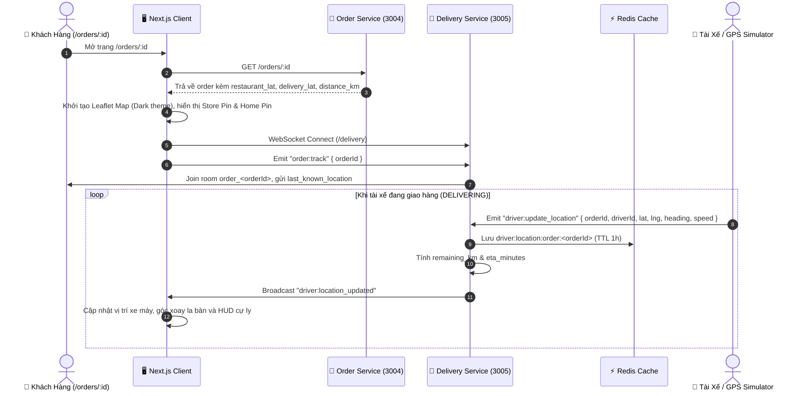

# 🛵 Định Vị Tài Xế Thời Gian Thực & Bản Đồ Đo Cự Ly (Real-time GPS Tracking & Map)

Tài liệu này đặc tả luồng người dùng (User Journey), giao diện tương tác và cơ chế kết nối thời gian thực cho tính năng **Bản đồ đo cự ly giao hàng & Định vị GPS tài xế** trên hệ thống FoodDelivery.

---

## 1. Tổng Quan Nghiệp Vụ & Đối Tượng Sử Dụng

- **Đối tượng chính**: 
  * 🧑 **Khách hàng (Customer)**: Mở màn hình theo dõi đơn hàng (`/orders/[id]`), quan sát tuyến đường di chuyển từ quán ăn về điểm nhận hàng, theo dõi trực tiếp vị trí xe máy của tài xế đang di chuyển trên bản đồ và cập nhật thời gian dự kiến giao hàng (ETA).
  * 🛵 **Đối tác Tài xế (Driver)**: Cập nhật tọa độ GPS khi nhận cuốc và bắt đầu giao (`DELIVERING`), hệ thống tự động tính khoảng cách còn lại tới khách hàng.
- **Microservices liên quan**:
  * `delivery-service` (Port 3005): WebSocket Gateway `/delivery`, lưu cache tọa độ trên Redis, REST API tính cự ly.
  * `order-service` (Port 3004): Trả về tọa độ quán ăn (`restaurant_lat`, `restaurant_lng`), tọa độ giao (`delivery_lat`, `delivery_lng`) và tổng cự ly (`distance_km`).
- **Giao diện người dùng (Frontend)**:
  * Next.js App Router: Component `OrderTrackingMap`, `DriverGpsSimulator`, `OrderVisualRoute` tại `/orders/[id]`.

---

## 2. Kiến Trúc Luồng Tương Tác (Interactive Sequence)

---

## 3. Đặc Điểm Giao Diện Người Dùng (UI/UX Highlights)

1. **Bản đồ số Dark Theme (Interactive Leaflet Map)**:
   - Tích hợp công nghệ Leaflet OSM tối ưu cho Web & Mobile.
   - Các điểm mốc phát sáng phong cách Cyberpunk/Neon:
     * 🏪 **Quán ăn**: Pin màu cam gradient rực rỡ, icon cửa hàng.
     * 🏠 **Điểm nhận hàng**: Pin màu xanh ngọc gradient, icon ngôi nhà.
     * 🛵 **Tài xế**: Pin xe máy xanh ngọc có hiệu ứng vòng xung radar ping và góc xoay hướng di chuyển (bearing).
   - Tuyến đường Polyline màu cam nét đứt nối thông suốt các điểm.
2. **Thẻ HUD Chỉ Số Nổi (Glassmorphism Floating HUD)**:
   - Tổng cự ly giao hàng: `~X.X km` tính chuẩn theo công thức Haversine (WGS84).
   - Cự ly thời gian thực: Khoảng cách từ tài xế đến đích.
   - Thời gian dự kiến giao (ETA): Cập nhật tự động dựa trên tốc độ di chuyển trung bình đô thị (25 km/h).
   - Đèn tín hiệu Live GPS màu xanh lá nhấp nháy xác nhận kết nối WebSocket ổn định.
3. **Nút Điều Khiển Thông Minh**:
   - 🎯 **Tập trung vào tài xế (Locate Driver)**: Đặt tâm bản đồ ngay vị trí hiện tại của tài xế.
   - 🔍 **Xem toàn cảnh (Fit Bounds)**: Tự động điều chỉnh góc nhìn để bao quát trọn vẹn cả 3 điểm mốc.
4. **Bộ Công Cụ Mô Phỏng GPS (Driver GPS Route Simulator)**:
   - Xuất hiện khi cuốc xe ở trạng thái `DELIVERING`.
   - Cung cấp nút Chạy / Tạm dừng và tùy chọn tốc độ (1x, 2x, 5x) nội suy 20 tọa độ dọc tuyến đường.
   - Phát tọa độ qua WebSocket giúp kiểm thử trực quan trên trình duyệt tức thì.
