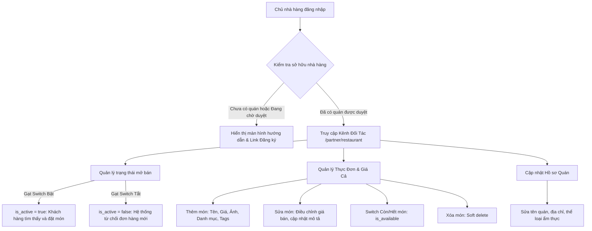

# Tài Liệu Nghiệp Vụ: Kênh Quản Lý Dành Cho Đối Tác Nhà Hàng (Merchant Portal)

## 1. Mục Đích & Bối Cảnh
Sau khi người dùng gửi form đăng ký mở quán tại `/register/restaurant` và được Admin xét duyệt (`APPROVED`), người dùng chính thức trở thành **Chủ sở hữu nhà hàng (Restaurant Owner)**. Kênh Đối tác (`/partner/restaurant`) cung cấp công cụ tự quản trị toàn diện giúp chủ quán:
- Chủ động mở bán hoặc tạm nghỉ nhận đơn hàng theo giờ giấc kinh doanh.
- Quản lý giá bán, thực đơn, hình ảnh và gắn nhãn các món đặc sản.
- Tránh tình trạng khách hàng đặt món khi quán đã đóng cửa hoặc hết nguyên liệu.

---

## 2. Luồng Nghiệp Vụ Chính

---

## 3. Quy Tắc Nghiệp Vụ (Business Rules)

### 3.1. Trạng Thái Hoạt Động (`is_active`)
- **Mở cửa nhận đơn (`is_active = true`):**
  - Quán hiển thị trạng thái hoạt động bình thường trên trang chủ và danh sách tìm kiếm.
  - Khách hàng có thể thêm món vào giỏ và đặt hàng thành công.
- **Tạm đóng cửa (`is_active = false`):**
  - Quán hiển thị trạng thái "Tạm đóng cửa" / "Nghỉ bán".
  - Tại bước thanh toán / kiểm tra giỏ hàng (`POST /orders/validate-cart`), `order-service` tự động gọi sang `restaurant-service` kiểm tra `is_active`. Nếu quán đang tắt, hệ thống sẽ từ chối đơn hàng với thông báo: *"Nhà hàng hiện đang tạm đóng cửa, không nhận đơn đặt món."*

### 3.2. Quản Lý Thực Đơn & Giá Cả
- **Giá bán (VNĐ):** Bắt buộc phải là số dương lớn hơn 0.
- **Trạng thái Còn món (`is_available`):**
  - Khi chủ quán chuyển một món sang "Hết món", khách hàng không thể đặt món này.
  - Khi chủ quán bật "Còn món", khách hàng có thể đặt lại ngay lập tức.
- **Tags & Category:**
  - Danh mục món ăn (`category_id`): Giúp gom nhóm món ăn (Phở, Bún bò, Giải khát...).
  - Nhãn tag (`tag_ids`): Gắn các thuộc tính đặc trưng như `#Món nước`, `#Cay`, `#Bò`, `#Gà`, `#Ăn vặt`.

### 3.3. Chiết Khấu Sàn & Bộ Tính Giá Bán 2 Chiều (Bidirectional Pricing Calculator)
- **Tỷ lệ chiết khấu sàn:** Cố định `20%` trên giá bán niêm yết món ăn (đối tác thực nhận `80%`).
- **Phân rã dòng tiền thời gian thực:**
  - Khi chủ quán nhập giá niêm yết (Ví dụ: `50.000 VNĐ`), modal tự động phân tích:
    - 🏷️ Giá bán cho khách: `50.000 VNĐ`
    - ✂️ Chiết khấu ứng dụng (20%): `-10.000 VNĐ`
    - 💰 Quán thực nhận (80%): `+40.000 VNĐ`
  - Trên thẻ món ăn ở Kênh đối tác, hiển thị song song cả giá bán niêm yết và mức thực nhận (Ví dụ: `50.000 ₫ • Thực nhận: 40.000 ₫`).
- **Công cụ gợi ý giá theo mức thu về mong muốn:**
  - Chủ quán nhập mức tiền thực nhận mong muốn (Ví dụ: `40.000 VNĐ`).
  - Hệ thống tự động tính toán bù trừ chiết khấu sàn theo công thức: `Giá niêm yết = Math.ceil((Mong muốn / 0.8) / 1000) * 1000`.
  - Cung cấp nút 1-click **"Áp dụng giá này"** để tự động gán vào ô Giá niêm yết.

### 3.4. Bảo Mật & Phân Quyền
- Tất cả các endpoint quản trị đối tác (`/restaurants/partner/...`) đều yêu cầu Bearer JWT token hợp lệ.
- Hệ thống luôn kiểm tra `restaurant.owner_id === req.user.id`. Tuyệt đối không cho phép chủ quán này thao tác trên quán của người khác.
