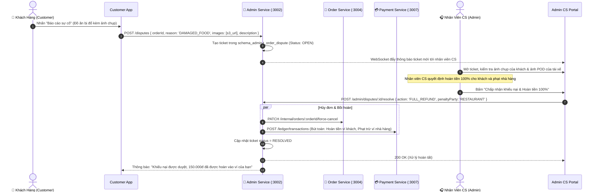

# 📋 Kế Hoạch Triển Khai: Cổng Chăm Sóc Khách Hàng & Xử Lý Tranh Chấp Khiếu Nại (CS Portal & Dispute Resolution)

`[DRAFT]` • **Issue liên kết:** #A2 • **Phân loại:** `admin` • **Ngày khởi tạo:** 2026-11-09

---

## 1. 🎯 Tổng Quan & Bài Toán Cần Giải Quyết

### 1.1. Hiện trạng & Khoảng Trống Vận Hành (The Customer Support Void)
- **Hiện trạng:**
  - Khi đơn hàng xảy ra sự cố (đồ ăn bị đổ, giao trễ 2 tiếng, quán hết món không nấu được, tài xế không liên lạc được):
  - Người dùng hoặc tài xế không có kênh báo cáo sự cố có hệ thống.
  - Quản trị viên/CS viên chưa có công cụ chuyên dụng trên Portal để can thiệp cưỡng chế vào vòng đời đơn hàng (`Forced Cancellation`), không thể hoàn tiền bồi thường hoặc phạt tài xế/nhà hàng.
- **Rủi ro vận hành:**
  - Khách hàng rời bỏ ứng dụng khi gặp trải nghiệm tiêu cực mà không được giải quyết ngay.
  - Không có nhật ký lưu vết (Audit Trail) cho các quyết định can thiệp thủ công của nhân viên, dễ dẫn đến gian lận nội bộ.

### 1.2. Mục tiêu kỹ thuật
1. **Module Khiếu Nại Đơn Hàng Phía Khách Hàng (Customer Dispute Reporting)**:
   - Cho phép khách gửi khiếu nại kèm hình ảnh chụp sự cố (đồ ăn hỏng, giao thiếu món, thái độ tài xế) trực tiếp từ màn hình chi tiết đơn.
2. **Bảng Điều Khiển Xử Lý Khiếu Nại Cho Nhân Viên CS (`/admin/disputes`)**:
   - Hiển thị danh sách ticket sự cố theo mức độ nghiêm trọng (SLA: Khẩn cấp $< 15\text{phút}$, Bình thường $< 60\text{phút}$).
   - Công cụ tra cứu dòng thời gian đơn hàng (Order Timeline): Vị trí GPS tài xế, ảnh bằng chứng giao hàng POD, nhật ký tin nhắn chat.
3. **Bộ Công Cụ Can Thiệp & Bồi Thường Cưỡng Chế (Intervention & Refund Actions)**:
   - **Hủy đơn cưỡng chế:** Đổi trạng thái sang `CANCELLED_BY_CS` kèm lý do.
   - **Hoàn tiền linh hoạt (Partial / Full Refund):** Hoàn lại $100\%$ hoặc một tỷ lệ phần trăm vào ví khách.
   - **Hạch toán bồi thường tự động:** Tự động tạo bút toán Sổ cái phạt tiền đối tác vi phạm và bồi hoàn cho khách hàng mà không làm lệch sổ sách.

---

## 2. 🔍 Khảo Sát Hiện Trạng Codebase

| File / Component | Hiện trạng | Hành động cần thực hiện |
| :--- | :--- | :--- |
| [`backend/apps/admin-service/src/modules`](file:///d:/code/FoodDelivery/backend/apps/admin-service) | Chỉ có module `approvals` và `metrics`. | Tạo mới `DisputeModule` quản lý ticket sự cố và quyết định hoàn tiền. |
| [`backend/apps/order-service/src/modules/order`](file:///d:/code/FoodDelivery/backend/apps/order-service) | Chưa hỗ trợ trigger hủy đơn cưỡng chế từ bên ngoài. | Mở internal endpoint `/internal/orders/:id/force-cancel` bảo vệ bằng secret key. |
| [`backend/apps/payment-service/src/modules/ledger`](file:///d:/code/FoodDelivery/backend/apps/payment-service) | Đã có cơ chế Sổ cái kép. | Bổ sung giao dịch `CS_DISPUTE_REFUND` và `PENALTY_DEDUCTION`. |
| [`frontend/src/features/admin`](file:///d:/code/FoodDelivery/frontend/src/features/admin) | Chưa có menu và trang CS. | Thêm route `/admin/disputes` và màn hình chi tiết ticket khiếu nại. |
| [`frontend/src/features/order`](file:///d:/code/FoodDelivery/frontend/src/features/order) | Chưa có nút báo cáo sự cố. | Bổ sung nút `[Báo cáo sự cố / Khiếu nại]` trên màn hình chi tiết đơn. |

---

## 3. 🛠️ Thiết Kế Chi Tiết & Giải Pháp Kỹ Thuật

### 3.1. Sơ Đồ Luồng Xử Lý Khiếu Nại (Dispute Resolution Flow)



### 3.2. Cấu Trúc Bảng Dữ Liệu (`schema_admin.t_order_dispute`)
```sql
CREATE TABLE schema_admin.t_order_dispute (
    id UUID PRIMARY KEY DEFAULT gen_random_uuid(),
    order_id UUID NOT NULL,
    customer_id UUID NOT NULL,
    reason_code VARCHAR(50) NOT NULL, -- DAMAGED_FOOD, WRONG_ITEMS, NEVER_ARRIVED, RUDE_BEHAVIOR
    description TEXT NOT NULL,
    evidence_images JSONB DEFAULT '[]'::jsonb,
    status VARCHAR(20) NOT NULL DEFAULT 'OPEN' CHECK (status IN ('OPEN', 'INVESTIGATING', 'RESOLVED', 'REJECTED')),
    priority VARCHAR(10) NOT NULL DEFAULT 'NORMAL' CHECK (priority IN ('URGENT', 'HIGH', 'NORMAL')),
    resolution_action VARCHAR(30) CHECK (resolution_action IN ('FULL_REFUND', 'PARTIAL_REFUND', 'VOUCHER_COMPENSATION', 'REJECT')),
    refund_amount NUMERIC(15, 2) DEFAULT 0,
    penalty_party VARCHAR(20) CHECK (penalty_party IN ('DRIVER', 'RESTAURANT', 'PLATFORM')),
    assigned_cs_id UUID,
    resolution_notes TEXT,
    created_at TIMESTAMP WITH TIME ZONE DEFAULT NOW(),
    resolved_at TIMESTAMP WITH TIME ZONE
);
```

### 3.3. Thiết Kế Trải Nghiệm Người Dùng Phía Frontend (Next.js UI/UX Integration)

1. **Khách Hàng Báo Cáo Sự Cố (`ReportIssueDialog`)**:
   - Nút `[Khiếu nại / Báo cáo sự cố]` xuất hiện trên màn hình đơn hàng từ lúc giao đến 24 giờ sau khi hoàn tất.
   - Các lý do lựa chọn sẵn kèm icon trực quan: `Đồ ăn bị đổ / hỏng`, `Giao thiếu món`, `Chưa nhận được đồ ăn`, `Vấn đề khác`.
   - Khu vực upload tối đa 3 ảnh bằng chứng sự cố (chụp đồ ăn thực tế nhận được).
   - Ô nhập mô tả chi tiết và gửi yêu cầu. Khi gửi thành công, trạng thái ticket được hiển thị ngay trên chi tiết đơn.
2. **Cổng Vận Hành CS Phía Admin (`/admin/disputes`)**:
   - Giao diện 2 cột thông minh:
     - Cột trái: Danh sách khiếu nại đang chờ xử lý, sắp xếp theo độ khẩn cấp (SLA đếm ngược).
     - Cột phải: Bảng đối soát toàn diện của đơn hàng:
       - Chi tiết đơn, món ăn đã đặt.
       - Ảnh bằng chứng của khách **đối chiếu song song** với ảnh POD bàn giao của tài xế.
       - Tọa độ GPS của tài xế lúc bấm hoàn tất đơn.
   - Thanh tác vụ can thiệp nhanh:
     - Nút `[Hoàn tiền 100%]`: Tự động điền giá trị toàn bộ đơn hàng.
     - Nút `[Hoàn tiền một phần]`: Cho phép CS viên nhập số tiền cụ thể (ví dụ hoàn tiền 1 món bị thiếu).
     - Checkbox: `Trích tiền phạt từ ví tài xế` hoặc `Trích tiền phạt từ ví quán ăn`.
     - Nút `[Bác bỏ khiếu nại]`: Nhập lý do gửi về cho khách (ví dụ: ảnh POD chứng minh đã giao đúng người).

---

## 4. 🧪 Kịch Bản Kiểm Thử 3 Nhánh (Testing Policy Compliance)

### 4.1. Nhánh 1: Happy Path (Dòng Chảy Chuẩn)
- **Kịch bản**: Khách báo cáo món ăn bị giao thiếu 1 cốc trà sữa 35.000 VND. Nhân viên CS duyệt hoàn tiền một phần 35.000 VND cho khách và trừ tiền ví nhà hàng.
- **Kỳ vọng**: 
  - Ticket chuyển sang `RESOLVED`.
  - Khách nhận 35.000 VND vào ví khả dụng.
  - Sổ cái kép ghi nhận bút toán phạt trừ ví nhà hàng cân bằng với ví khách.

### 4.2. Nhánh 2: Edge Cases (Biên & Giới Hạn)
- **Kịch bản 1 (Khiếu nại quá thời hạn quy định)**: Khách gửi khiếu nại cho đơn hàng đã hoàn tất quá 48 tiếng.
- **Kỳ vọng**: Hệ thống từ chối nhận ticket với thông báo `400 Bad Request: Thời hạn tiếp nhận khiếu nại cho đơn hàng này đã kết thúc (tối đa 24h sau giao hàng)`.
- **Kịch bản 2 (Hai nhân viên CS cùng xử lý 1 ticket đồng thời)**: 2 nhân viên cùng nhấn duyệt hoàn tiền cho 1 ticket trong cùng 1 giây.
- **Kỳ vọng**: Optimistic Concurrency Control (Version Check) cho phép người đầu tiên xử lý thành công, người thứ hai nhận thông báo `"Ticket này đã được giải quyết bởi CS khác"`.

### 4.3. Nhánh 3: Error & Rejection Flow (Ngoại Lệ & Khắc Phục)
- **Kịch bản**: Khách gửi khiếu nại ảo nhằm trục lợi bồi thường trong khi ảnh POD của tài xế chứng minh giao hàng hoàn hảo. CS bác bỏ khiếu nại.
- **Kỳ vọng**: 
  - Ticket chuyển sang `REJECTED`.
  - Không có bất kỳ giao dịch tiền tệ nào bị trừ hoặc hoàn.
  - Gửi thông báo từ chối kèm lý do rõ ràng tới tài khoản khách.

---

## 5. ✅ Checklist Tiêu Chuẩn Cần Vượt Qua (Local CI Gate)

- [ ] **Linter**: `npm run lint` đạt 0 warnings, 0 errors.
- [ ] **Type Check**: `npx tsc --noEmit` đạt 0 errors (nghiêm cấm `any`).
- [ ] **Unit Tests (Vitest)**:
  - [ ] `admin-service/tests/dispute-resolution.spec.ts` pass 100%.
  - [ ] `payment-service/tests/dispute-refund-ledger.spec.ts` pass 100%.
  - [ ] `frontend/src/features/order/tests/report-issue-dialog.spec.ts` pass 100%.
  - [ ] `frontend/src/features/admin/tests/dispute-management-portal.spec.ts` pass 100%.
- [ ] **Build Check**: `npm run build` thành công.
- [ ] **Traceability Header**: Đầy đủ `[Requirement/Issue]`, `[Branch: Happy|Edge|Error]`, `[Expected Output]`.

