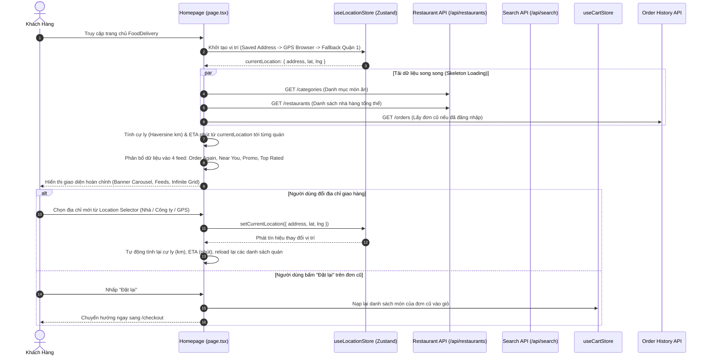

# Kế Hoạch Triển Khai: Nâng Cấp Giao Diện Trang Chủ (Homepage Revamp)

> Trạng thái: `[COMPLETED]`  
> Mã Task: `customer-homepage-revamp`  
> Phân hệ: `customer` / `frontend`  
> Tham chiếu Issue: [#67](https://github.com/DuyBinh2003/FoodDelivery/issues/67)  
> Pull Request: [#68](https://github.com/DuyBinh2003/FoodDelivery/pull/68)  
> Phụ trách: Master Orchestrator & Planner  

---

## 1. Bối Cảnh & Mục Tiêu Nghiệp Vụ (Context & Objectives)

### 1.1. Hiện Trạng
- Hiện tại, trang chủ (`frontend/src/app/page.tsx`) chỉ là một trang landing page tĩnh giới thiệu về "Microservices Architecture" với 3 thẻ thông tin đơn giản.
- Khách hàng khi vào website chưa thể xem ngay danh sách các quán ăn lân cận, chưa có bộ chọn địa chỉ giao hàng để tính chính xác cự ly (km) và phí ship.
- Thiếu thanh tìm kiếm tiện lợi ngay trên trang chủ, thiếu danh mục món ăn (Food Categories), thiếu banner khuyến mãi quảng bá chiến dịch.
- Thiếu các danh sách đề xuất cá nhân hóa (Personalized Feeds) như: "Đặt lại lần nữa", "Gần bạn nhất", "Đang có khuyến mãi", "Quán ngon nổi bật".
- Trên thiết bị di động (Mobile), chưa có thanh điều hướng dưới cùng (Bottom Navigation Bar) chuẩn thói quen người dùng ứng dụng giao đồ ăn.

### 1.2. Mục Tiêu Cốt Lõi (Theo Issue #67)
1. **Khu Vực Header & Điều Hướng Trung Tâm**:
   - **Bộ chọn địa chỉ giao hàng (Location Selector)**: Đặt ở vị trí cao nhất. Mặc định lấy theo GPS hiện tại của trình duyệt hoặc địa chỉ mặc định trong sổ địa chỉ của tài khoản. Cho phép người dùng chuyển đổi sang các địa chỉ đã lưu (Nhà, Công ty) hoặc ghim địa chỉ mới.
   - **Business Logic phản ứng vị trí**: Khi đổi địa chỉ giao hàng, toàn bộ danh sách nhà hàng bên dưới tự động reload để tính lại khoảng cách (km), thời gian giao (ETA) và phí ship.
   - **Thanh tìm kiếm (Sticky Dynamic Search Bar)**: Cố định khi cuộn trang, hỗ trợ placeholder thay đổi động theo thời gian (VD: *"Thèm trà sữa?*", *"Tìm bún bò Huế nóng hổi..."*), nhấp vào mở màn hình/drawer tìm kiếm kèm từ khóa xu hướng (Trending).
   - **Điểm chạm tương tác nhanh**: Icon Giỏ hàng kèm badge số lượng món thực tế (`useCartStore`), Icon Chuông thông báo mở trung tâm tin khuyến mãi.
2. **Khối Marketing & Khám Phá (Discovery)**:
   - **Auto-Play Carousel Banner**: Trượt banner khuyến mãi tự động với hiệu ứng chuyển trang mượt mà, pause khi hover, nhấp dẫn đến chiến dịch/quán ăn.
   - **Danh mục món ăn (Food Categories Grid)**: Biểu tượng đồ họa sinh động (Cơm, Phở/Bún, Trà sữa, Gà rán, Ăn vặt, Bánh mì, Cafe, Tráng miệng). Khi nhấp vào danh mục sẽ **Lọc trực tiếp ngay trên trang chủ (In-place Filter)** và có nút "Xem tất cả" mở rộng sang `/menu`.
3. **Khối Cá Nhân Hóa & Đề Xuất (Personalized Feeds)**:
   - **"Đặt lại lần nữa" (Order Again)**: Chỉ xuất hiện khi user đăng nhập và có đơn hàng trong lịch sử. Nút "Đặt lại" nạp nhanh toàn bộ món của đơn cũ vào giỏ và chuyển đến `/checkout` trong 1 chạm.
   - **"Gần bạn nhất" (Near You / Fast Delivery)**: Lọc các quán trong bán kính $\le 3$ km, thời gian giao ước tính ETA $< 20$ phút dựa trên GPS hiện tại.
   - **"Đang có khuyến mãi" (Promo / Flash Sale)**: Danh sách quán có freeship, mã giảm giá hoặc flash sale.
   - **"Quán ngon nổi bật" (Top Rated / Trending)**: Quán có điểm đánh giá rating $\ge 4.5$ sao.
   - **"Tất cả quán ngon" (All Restaurants Grid)**: Lưới tổng hợp hỗ trợ **Infinite Scroll** (Intersection Observer API tự động tải thêm dữ liệu khi cuộn chạm đáy thay vì phân trang số).
4. **Thanh Điều Hướng Dưới Cùng (Bottom Navigation Bar cho Mobile)**:
   - Cố định ở đáy màn hình trên thiết bị di động (`md:hidden`):
     - **Trang chủ (Home)**: Đang active.
     - **Đơn hàng (Orders)**: Thông minh theo ngữ cảnh (mở ngay Active Order Tracker nếu có đơn đang giao, ngược lại mở Lịch sử đơn `/history`).
     - **Thông báo (Inbox)**: Mở Drawer trượt xem tin khuyến mãi & trạng thái đơn hàng.
     - **Tài khoản (Profile)**: Điều hướng tới thông tin cá nhân, ví điện tử, quản lý sổ địa chỉ.
5. **Hiệu Năng & Trải Nghiệm Người Dùng (UX/Tech)**:
   - **Skeleton Loading**: Hiển thị Shimmer Skeleton cho Banner, Categories, và Restaurant Cards thay vì Spinner quay giữa màn hình trắng.
   - **Lazy Loading**: Tối ưu hóa tải ảnh nhà hàng khi cuộn tới vị trí hiển thị.

---

## 2. Kiến Trúc Luồng Dữ Liệu & Tương Tác

---

## 3. Chi Tiết File Thay Đổi (Proposed Changes)

### 3.1. Tạo mới Feature `features/home/` & Store
- `frontend/src/features/home/store/useLocationStore.ts` [NEW]:
  - Quản lý trạng thái vị trí giao hàng hiện tại (`address`, `lat`, `lng`, `source`, `label`).
  - Tự động đồng bộ LocalStorage, tích hợp Browser Geolocation API và fallback trung tâm Quận 1 (10.7725, 106.7027).
- `frontend/src/features/home/components/home-header.tsx` [NEW]:
  - Thanh Header chuyên biệt cho Homepage: Bộ chọn địa chỉ nổi bật ở trên cùng, Sticky Search Bar với placeholder quay vòng động, Cart Icon kèm số lượng, Bell Notification button.
- `frontend/src/features/home/components/location-modal.tsx` [NEW]:
  - Modal chọn địa chỉ giao hàng: Danh sách địa chỉ đã lưu (Nhà, Công ty), nút "Dùng vị trí hiện tại (GPS)", và ô tìm kiếm địa chỉ.
- `frontend/src/features/home/components/banner-carousel.tsx` [NEW]:
  - Slider quảng cáo chiến dịch tự động trượt, nút chuyển slide, indicator dots, hỗ trợ pause khi hover.
- `frontend/src/features/home/components/category-grid.tsx` [NEW]:
  - Grid danh mục món ăn (Cơm, Phở, Trà sữa, Gà rán...), icon đồ họa bắt mắt, badge số lượng, hỗ trợ In-place filter.
- `frontend/src/features/home/components/restaurant-feed-section.tsx` [NEW]:
  - Khối danh sách nhà hàng cuộn ngang (Horizontal scroll list) tái sử dụng cho: "Đặt lại lần nữa", "Gần bạn nhất", "Đang có khuyến mãi", "Quán ngon nổi bật".
- `frontend/src/features/home/components/restaurant-card.tsx` [NEW]:
  - Thẻ thông tin nhà hàng: Ảnh thumbnail lazy loading, rating sao, cự ly km, thời gian giao ETA phút, label voucher/freeship, tag danh mục.
- `frontend/src/features/home/components/all-restaurants-infinite.tsx` [NEW]:
  - Danh sách lưới đa cột (Multi-column grid) kèm Intersection Observer Infinite Scroll để tự động tải thêm trang tiếp theo khi cuộn chạm đáy.
- `frontend/src/features/home/components/bottom-navigation-bar.tsx` [NEW]:
  - Thanh điều hướng cố định dưới đáy màn hình trên Mobile (`md:hidden`): Trang chủ, Đơn hàng (thông minh theo ngữ cảnh active/history), Thông báo (Notification Drawer), Tài khoản.
- `frontend/src/features/home/components/notification-drawer.tsx` [NEW]:
  - Drawer hiển thị thông báo khuyến mãi, voucher mới và cập nhật trạng thái đơn hàng.
- `frontend/src/features/home/components/home-skeletons.tsx` [NEW]:
  - Bộ Shimmer Skeletons cho Banner, Categories, Restaurant Feed Cards và Infinite Grid.
- `frontend/src/features/home/utils/home-feed.utils.ts` [NEW]:
  - Hàm thuần túy phân loại quán ăn: Lọc quán gần ($R \le 3$km), tính ETA, lọc quán khuyến mãi, lọc quán rating cao, lọc theo category.

### 3.2. Cập nhật Trang Chủ & Navigation Layout
- `frontend/src/app/page.tsx` [MODIFY]:
  - Chuyển đổi toàn diện từ landing page cũ sang trang chủ đặt món hiện đại, tích hợp đầy đủ 5 phân khu chức năng theo Issue #67.
- `frontend/src/components/layout/Navbar.tsx` [MODIFY]:
  - Ẩn bớt các thành phần thừa trên trang chủ để nhường không gian cho `HomeHeader` chuyên biệt, tránh trùng lặp 2 thanh bar.

---

## 4. Kịch Bản Kiểm Thử 3 Nhánh (Testing Matrix)

### Kịch bản 1: Nhánh Thuận Lợi (Happy Path)
1. **Khởi tạo vị trí & Tải dữ liệu trang chủ**:
   - Khởi tạo `useLocationStore` thành công, lấy đúng địa chỉ và tọa độ GPS.
   - Tải song song danh mục món ăn và danh sách nhà hàng, hiển thị Skeleton mượt mà trước khi nạp dữ liệu thật.
2. **Tính toán cự ly & Phân loại Feed**:
   - Hàm `filterNearYouRestaurants` lọc chính xác các quán có $R \le 3.0$ km và ETA $< 20$ phút từ vị trí người dùng.
   - Hàm `filterPromoRestaurants` lọc chính xác các quán có cờ freeship hoặc mã giảm giá.
   - Hàm `filterTopRatedRestaurants` lọc chính xác các quán có rating $\ge 4.5$.
3. **Thao tác đổi địa chỉ giao hàng**:
   - Người dùng chuyển sang địa chỉ mới $\rightarrow$ `currentLocation` cập nhật $\rightarrow$ cự ly km và ETA của toàn bộ các quán được tính lại tương ứng.
4. **Nạp đơn cũ vào giỏ (Order Again)**:
   - Bấm "Đặt lại" trên đơn cũ $\rightarrow$ Giỏ hàng được cập nhật đầy đủ món ăn và điều hướng sang `/checkout`.

### Kịch bản 2: Nhánh Biên & Ranh Giới (Edge Cases)
1. **Người dùng từ chối cấp quyền GPS trình duyệt**:
   - Hệ thống tự động fallback về địa chỉ mặc định trong tài khoản (nếu có) hoặc tọa độ trung tâm TP.HCM (Quận 1) an toàn, không làm hỏng ứng dụng.
2. **Không có quán nào trong bán kính 3km (Khu vực hẻo lánh)**:
   - Khối "Gần bạn nhất" hiển thị empty state thân thiện gợi ý mở rộng bán kính tìm kiếm.
3. **Khách hàng chưa đăng nhập hoặc chưa từng đặt hàng**:
   - Khối "Đặt lại lần nữa" tự động ẩn đi một cách tự nhiên, không để lại khoảng trống thừa.
4. **Hết danh sách quán khi cuộn Infinite Scroll**:
   - Hiển thị thông báo "Bạn đã xem hết tất cả nhà hàng trong khu vực" và ngắt Intersection Observer.

### Kịch bản 3: Nhánh Ngoại Lệ & Xử Lý Lỗi (Error & Rejection Flow)
1. **API Nhà hàng hoặc Danh mục bị lỗi mạng (500 / Network Error)**:
   - Hiển thị ErrorState có nút "Thử lại", không làm crash toàn bộ trang chủ.
2. **Dữ liệu tọa độ quán ăn bị null hoặc không hợp lệ**:
   - Hàm tính cự ly xử lý an toàn (fallback về 0 km, ETA mặc định 25 phút), không gây lỗi chia cho 0 hoặc NaN.
3. **Hình ảnh quán ăn bị lỗi đường link (404 / Broken URL)**:
   - Tự động thay thế bằng ảnh fallback đẹp mắt theo chủ đề món ăn.

---

## 5. Local CI Gate Checklist
- [x] Frontend Lint Check: `npm run lint` (ESLint: 0 warnings, 0 errors).
- [x] Frontend Type Check: `npx tsc --noEmit` (0 errors).
- [x] Frontend Unit Tests: `npm test` (100% pass trên 20 test suites / 61 tests, gồm `home-feed.test.ts`).
- [x] Frontend Build Check: `npm run build` (Next.js Turbopack biên dịch thành công 100%).
