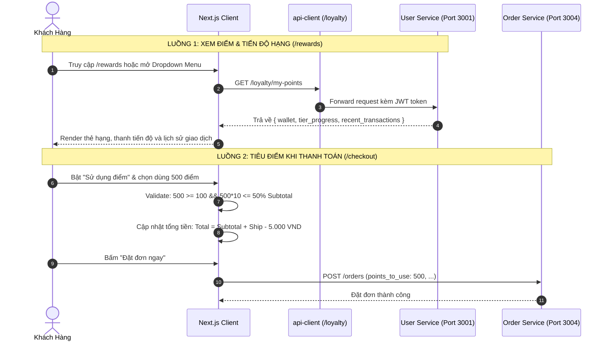

# Kế Hoạch Triển Khai: Giao Diện Tích Điểm, Quy Đổi & Sử Dụng Điểm Thưởng (Customer Loyalty Points UI)

> **Mã công việc (Task Code):** `customer-loyalty-ui`  
> **Trạng thái:** `[COMPLETED]`  
> **Tác giả:** `@planner` (Điều phối bởi `@orchestrator`)  
> **Miền nghiệp vụ:** `customer`  
> **Tài liệu tham chiếu:** `docs/plans/platform/loyalty-points-rewards-engine.md`, `docs/services/user-service.md`  

---

## 1. Bối Cảnh & Mục Tiêu Giao Diện (Context & UX Objectives)

Sau khi hoàn thành Backend Loyalty Engine tại `user-service` và `order-service`, hệ thống cần hoàn thiện trải nghiệm giao diện người dùng (Frontend Next.js) đạt tiêu chuẩn các ứng dụng lớn như GrabRewards và Shopee Xu:

1. **Tích hợp tiêu điểm tại Checkout (`/checkout`)**:
   - Khách hàng xem được số điểm khả dụng ngay trong màn hình thanh toán.
   - Cho phép bật/tắt "Sử dụng điểm thưởng" với ô nhập / thanh trượt trực quan.
   - Validate tức thì: tối thiểu 100 điểm, tối đa 50% tiền món (Subtotal).
   - Tự động giảm trừ vào tổng tiền thanh toán hiển thị trên giao diện và truyền `points_to_use` vào API `POST /orders`.
2. **Trang Quản lý Điểm Thưởng & Hạng Thành Viên (`/rewards`)**:
   - Thẻ hiển thị hạng thành viên đẳng cấp (Đồng, Bạc, Vàng, Bạch Kim) kèm hệ số nhân điểm (1.0x - 2.0x).
   - Thanh tiến độ nâng hạng trực quan (Ví dụ: "Tích thêm 7.500 điểm để lên Hạng Vàng").
   - Bảng sao kê nhật ký giao dịch điểm thưởng (Tích điểm, Dùng điểm, Hoàn điểm, ngày giờ, số điểm biến động).
3. **Điều hướng tiện lợi trên Header ([Navbar.tsx](file:///d:/code/FoodDelivery/frontend/src/components/layout/Navbar.tsx))**:
   - Bổ sung mục "Điểm thưởng & Hạng thành viên" vào User Dropdown Menu với icon quà tặng / cúp vinh danh.

---

## 2. Kiến Trúc Luồng Dữ Liệu Frontend (Data Flow)

---

## 3. Thiết Kế Giao Diện & Trạng Thái (UI Specifications)

### A. Widget Tiêu Điểm tại Checkout (`LoyaltyCheckoutSection.tsx`)
- Vị trí: Đặt ngay trên khối "Tổng kết đơn hàng" trong trang `checkout/page.tsx`.
- Giao diện:
  - Header: Icon `Coins` màu vàng cam, tiêu đề "Dùng điểm tích lũy", hiển thị số dư hiện tại ("Khả dụng: 1.500 điểm").
  - Trạng thái chưa dùng: Switch / Checkbox bật dùng điểm.
  - Trạng thái đang dùng: Hiển thị số điểm muốn đổi, số tiền giảm tương ứng (`-5.000 đ`), nút "Tối đa" (tự động điền số điểm kịch trần 50% Subtotal).
  - Cảnh báo: Nếu số dư < 100 điểm, hiển thị ghi chú màu xám "Cần tối thiểu 100 điểm để quy đổi".

### B. Trang Trung Tâm Thưởng (`app/rewards/page.tsx`)
- Thẻ Thành Viên (Membership Tier Card):
  - Màu gradient theo Hạng:
    - `BRONZE`: Đồng ánh kim (`from-amber-700 to-orange-950`)
    - `SILVER`: Bạc titan ánh kim (`from-slate-400 to-zinc-800`)
    - `GOLD`: Vàng hoàng gia (`from-amber-400 to-yellow-700`)
    - `PLATINUM`: Bạch kim kim cương (`from-cyan-400 to-blue-900`)
  - Thông tin hiển thị: Tên khách hàng, Hạng hiện tại, Tỷ lệ tích điểm (`1.5x`), Số điểm khả dụng.
  - Thanh tiến độ: Phần trăm đạt được mốc hạng kế tiếp kèm số điểm còn thiếu.
- Bảng Lịch Sử Biến Động (Transactions Ledger):
  - Bảng danh sách cuộn mượt: Loại giao dịch (`Tích điểm`, `Tiêu điểm đơn hàng`, `Hoàn điểm hủy đơn`), Thời gian định dạng Việt Nam, Biến động (`+150 điểm` xanh lá, `-500 điểm` đỏ cam), số dư sau giao dịch.

---

## 4. Kịch Bản Kiểm Thử 3 Nhánh Bắt Buộc (Test Scenarios)

### Nhánh 1: 🟢 Happy Path (Luồng Chuẩn)
1. Khách hàng vào trang `/rewards`: Tải thành công thông tin ví điểm, hiển thị đúng Hạng `BRONZE`/`GOLD`, thanh tiến độ và danh sách giao dịch.
2. Khách hàng tại `/checkout` có 1.000 điểm: Bật chọn dùng 500 điểm ➡️ Tổng tiền thanh toán giảm chính xác 5.000 VND.
3. Bấm nút "Dùng tối đa": Điền đúng số điểm tương đương 50% Subtotal (nếu ví có nhiều điểm) hoặc toàn bộ điểm khả dụng (nếu ví ít hơn trần).

### Nhánh 2: 🟡 Edge Cases (Biên & Giới Hạn)
1. Khách hàng có ít hơn 100 điểm: Toggle dùng điểm bị vô hiệu hóa hoặc có tooltip hướng dẫn "Cần tối thiểu 100 điểm".
2. Khách hàng cố tình nhập số điểm vượt trần 50% Subtotal: Input tự động clamp về trần tối đa hoặc hiển thị cảnh báo đỏ.
3. Khách hàng đạt hạng cao nhất (`PLATINUM`): Thanh tiến độ hiển thị "Bạn đã đạt hạng thành viên cao nhất".

### Nhánh 3: 🔴 Error / Rejection Flow (Bảo Vệ)
1. Khách hàng chưa đăng nhập vào `/rewards`: Tự động chuyển hướng về `/login?redirect=/rewards`.
2. Lỗi mạng khi tải ví điểm: Hiển thị nút "Thử lại" thân thiện thay vì làm sập trang.

---

## 5. Danh Sách Tập Tin Tác Động (File Scope)

- `frontend/src/lib/api-client.ts` (Bổ sung route `loyalty` trỏ đến `user-service`)
- `frontend/src/features/loyalty/types/loyalty.types.ts` (Mới: Types cho ví điểm và giao dịch)
- `frontend/src/features/loyalty/api/loyalty-api.ts` (Mới: Hàm gọi API `GET /loyalty/my-points`)
- `frontend/src/features/loyalty/components/LoyaltyCheckoutSection.tsx` (Mới: Widget tiêu điểm tại Checkout)
- `frontend/src/features/loyalty/components/LoyaltyTierCard.tsx` (Mới: Thẻ hạng thành viên sang trọng)
- `frontend/src/features/loyalty/index.ts` (Mới: Barrel export)
- `frontend/src/features/orders/api/order-api.ts` (Bổ sung `points_to_use` vào `CreateOrderPayload`)
- `frontend/src/app/checkout/page.tsx` (Tích hợp widget tiêu điểm và cấn trừ tiền vào tổng bill)
- `frontend/src/app/rewards/page.tsx` (Mới: Trang Khách hàng thân thiết & Điểm thưởng)
- `frontend/src/components/layout/Navbar.tsx` (Bổ sung link `/rewards` vào Dropdown Menu)
- `frontend/src/features/loyalty/tests/loyalty-checkout.test.tsx` (Bộ test kiểm thử UI & logic tính toán)
