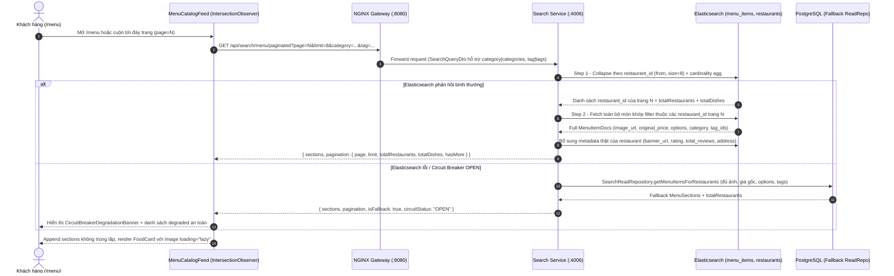
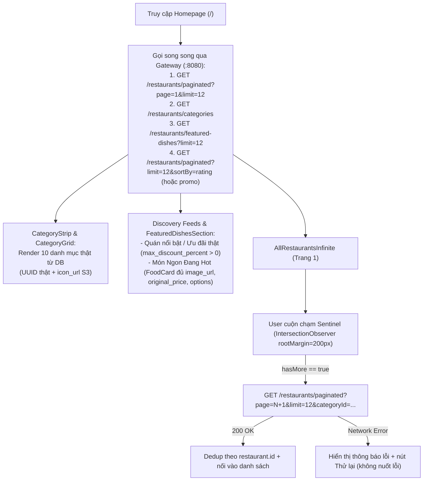

# 📋 Kế Hoạch Khắc Phục Toàn Diện: Lazy Load, Thông Tin Món Ăn (Dish) & Dữ Liệu Thật Trên Trang Chủ (`/`) & Thực Đơn (`/menu`)

> **Trạng thái:** `[COMPLETED]`  
> **Phân loại:** `customer` | **Ngày khởi tạo:** 2026-11-25  
> **Phạm vi tác động:** `restaurant-service` (`:4003`), `search-service` (`:4006`), `libs/common` (Seeding/ES), `frontend` (`/`, `/menu`, `/restaurant/[id]`)  
> **Mục tiêu:** Chấm dứt tình trạng tải toàn bộ dữ liệu một lần / cắt cụt 60 món, khôi phục đầy đủ thông tin món ăn (ảnh, giá gốc, giảm giá, tùy chọn modifiers, danh mục, tags), loại bỏ dữ liệu giả hardcoded trên UI, đồng bộ bộ lọc danh mục/tag theo đúng DB (`m_category`, `m_tag`), và bảo vệ trang `/menu` trước trạng thái Circuit Breaker mở.

---

## 1. 🔍 Chẩn Đoán Hiện Trạng & Nguyên Nhân Gốc Rễ (Audit Findings)

Dữ liệu hệ thống hiện tại đang có **150 nhà hàng**, **1.644 món ăn**, **10 danh mục (`m_category`)** và **16 tags (`m_tag`)**, nhưng luồng hiển thị trên Homepage và `/menu` đang đứt gãy ở cả 3 tầng (Frontend — API Gateway/Backend — Elasticsearch/Seeder):

| Khu vực | Triệu chứng thực tế | Nguyên nhân gốc rễ (Root Cause trong Code) |
| :--- | :--- | :--- |
| **Homepage — Ảnh nhà hàng (`RestaurantCard`)** | Toàn bộ thẻ quán hiện ảnh fallback Unsplash giống nhau dù DB đã có URL ảnh SVG trên S3 LocalStack. | [`restaurant-card.tsx`](file:///d:/code/FoodDelivery/frontend/src/features/home/components/restaurant-card.tsx) chỉ đọc `restaurant.image_url \|\| defaultThumbnail` và thiếu trường `banner_url`, trong khi `GET /api/restaurants` trả về `banner_url` và **không** trả `image_url`. Interface `HomeRestaurantItem` trong [`home-feed.utils.ts`](file:///d:/code/FoodDelivery/frontend/src/features/home/utils/home-feed.utils.ts) cũng thiếu `banner_url`. |
| **Homepage — Lazy Load giả (`AllRestaurantsInfinite`)** | Toàn bộ 150–500 quán bị fetch 1 lần lúc mount; cuộn trang chỉ hiện thêm bằng `setTimeout`. | [`page.tsx`](file:///d:/code/FoodDelivery/frontend/src/app/page.tsx) gọi `GET /api/restaurants` không phân trang; [`all-restaurants-infinite.tsx`](file:///d:/code/FoodDelivery/frontend/src/features/home/components/all-restaurants-infinite.tsx) chỉ slice mảng có sẵn trên client (`restaurants.slice(0, visibleCount)` + `setTimeout(..., 350)`). |
| **Homepage — Bộ lọc Danh mục & Mục Ưu đãi & Thiếu Món ăn** | Bấm đa số pill danh mục ra 0 quán; mục Promo trống/ẩn; Trang chủ không hiển thị khu vực món ăn nổi bật (`FoodCard`). | [`category-strip.tsx`](file:///d:/code/FoodDelivery/frontend/src/features/home/components/category-strip/category-strip.tsx), [`category-grid.tsx`](file:///d:/code/FoodDelivery/frontend/src/features/home/components/category-grid.tsx) và [`banner-carousel.tsx`](file:///d:/code/FoodDelivery/frontend/src/features/home/components/banner-carousel.tsx) hardcode slug giả (`com`, `pho-bun`, `tra-sua`, `ga-ran`, `banh-mi`, `an-vat`, `ca-phe`) lệch với 10 danh mục thật trong `m_category`. Ngoài ra `filterPromoRestaurants` kiểm tra `is_freeship`/`discount_label` không tồn tại trong payload `/restaurants`. |
| **Menu (`/menu`) — Không Lazy Load & Mất 1.584+ món** | Trang `/menu` chỉ hiện tối đa 60 món đầu tiên rồi dừng, cuộn xuống không tải thêm. | [`menu/page.tsx`](file:///d:/code/FoodDelivery/frontend/src/app/menu/page.tsx) fetch `/api/search/menu` 1 lần bằng SSR; [`elasticsearch.repository.ts`](file:///d:/code/FoodDelivery/backend/apps/search-service/src/modules/search/repositories/elasticsearch.repository.ts) hardcode `size: 60` không có phân trang (`page`/`limit`/`hasMore`). [`food-list.tsx`](file:///d:/code/FoodDelivery/frontend/src/features/menu/components/food-list/food-list.tsx) render toàn bộ item ngay lập tức; [`food-card.tsx`](file:///d:/code/FoodDelivery/frontend/src/features/menu/components/food-card/food-card.tsx) thiếu `loading="lazy"` trên `<Image>`. |
| **Menu (`/menu`) — Thiếu toàn bộ metadata món ăn (`Dish`)** | Mọi thẻ món ăn mất ảnh (hiện icon ngọn lửa), mất giá gạch ngang & badge `-XX%`, mất badge `"Tùy chọn"`. | `MenuItemDocument` ([`elasticsearch.repository.ts`](file:///d:/code/FoodDelivery/backend/apps/search-service/src/modules/search/repositories/elasticsearch.repository.ts)), [`search-menu.usecase.ts`](file:///d:/code/FoodDelivery/backend/apps/search-service/src/modules/search/usecases/search-menu.usecase.ts), [`seed-generator.ts`](file:///d:/code/FoodDelivery/backend/libs/common/src/seeding/seed-generator.ts) (`esMenuItems`) và mapping `menu_items` trong [`seed-all.ts`](file:///d:/code/FoodDelivery/backend/scripts/seed-all.ts) đều bỏ sót `image_url`, `original_price`, `options`, `category_id`, `category_name`, `tag_ids`. |
| **Menu (`/menu`) — Dữ liệu quán giả hardcoded** | Mọi cụm quán trên `/menu` đều in giống hệt nhau `4.8 (100+) • 20 - 30 phút • Gần bạn`. | [`food-list.tsx`](file:///d:/code/FoodDelivery/frontend/src/features/menu/components/food-list/food-list.tsx) hardcode string tĩnh thay vì đọc `rating`, `total_reviews`, `banner_url` và khoảng cách thực từ ES / API (vi phạm `general-project-policy` No Fake Data). |
| **Menu (`/menu`) — Gãy bộ lọc Category & Tag** | Chọn Category/Tag trên `/menu` không lọc đúng món ăn. | [`CategoryFilter.tsx`](file:///d:/code/FoodDelivery/frontend/src/features/search/components/CategoryFilter.tsx) và [`TagFilter.tsx`](file:///d:/code/FoodDelivery/frontend/src/features/search/components/TagFilter.tsx) đẩy UUID lên query string `?category=<uuid>&tag=<uuid>`, [`search-api.ts`](file:///d:/code/FoodDelivery/frontend/src/features/search/api/search-api.ts) gửi khóa số ít (`category`, `tag`), trong khi [`search-query.dto.ts`](file:///d:/code/FoodDelivery/backend/apps/search-service/src/modules/search/dto/search-query.dto.ts) chỉ nhận khóa số nhiều (`categories`, `tags`), còn ES `menu_items` lại chỉ lưu tên tag dạng chữ và thiếu `category_id`. |
| **Menu (`/menu`) — Lỗi sập khi Circuit Breaker mở & Service `:4006` tắt** | Khi `SearchCatalogBreaker` mở (OPEN), `/menu` ném TypeError tại `menuData.reduce`. | [`search.controller.ts`](file:///d:/code/FoodDelivery/backend/apps/search-service/src/modules/search/search.controller.ts) trả `{ items: [...], isFallback: true, circuitStatus: 'OPEN' }` trong khi `menu/page.tsx` ép kiểu `MenuSection[]` và gọi `.reduce` mà chưa kiểm tra `isFallback` để hiển thị [`CircuitBreakerDegradationBanner.tsx`](file:///d:/code/FoodDelivery/frontend/src/features/search/components/CircuitBreakerDegradationBanner.tsx). Ngoài ra service `:4006` cần được kiểm tra khởi chạy đầy đủ. |

---

## 2. 🏗️ Kiến Trúc Giải Pháp & Luồng Dữ Liệu Mới

### 2.1. Chiến Lược Phân Trang Theo Cụm Nhà Hàng (Section-Aware Collapse Pagination)

Để lazy load 1.644+ món ăn trên `/menu` mà **không làm một quán ăn bị xé đôi sang 2 trang khác nhau**, backend áp dụng chiến lược **2 bước Collapse theo `restaurant_id`** trên Elasticsearch:

### 2.2. Luồng Trang Chủ Dữ Liệu Thật & Lazy Load Phân Trang Thật (`/`)

---

## 3. 🛠️ Đặc Tả Thay Đổi Kỹ Thuật Chi Tiết (Design Blueprint)

### 3.1. Nhóm A — `restaurant-service` (`:4003`): Phân Trang Thật, Món Nổi Bật & Cờ Ưu Đãi Thật
1. **Tạo [`GetRestaurantsQueryDto`](file:///d:/code/FoodDelivery/backend/apps/restaurant-service/src/modules/restaurants/dto/get-restaurants-query.dto.ts)** (Class-validator chặt chẽ, `Type(() => Number)`):
   - Hỗ trợ `page` (`>= 1`, mặc định `1`), `limit` (`1..50`, mặc định `12`), `categoryId` (UUID hoặc slug/tên danh mục), `promoOnly` (`boolean`), `sortBy` (`'rating' | 'newest' | 'discount'`), `q` (tìm kiếm tên/địa chỉ).
   - Bảo toàn nguyên vẹn hành vi cũ của `GET /restaurants` để tránh làm vỡ client/test đang gọi mảng trực tiếp, đồng thời bổ sung thêm metadata promo thật trên từng item trả về.
2. **Bổ sung Endpoint Phân Trang & Món Nổi Bật trong [`restaurants.controller.ts`](file:///d:/code/FoodDelivery/backend/apps/restaurant-service/src/modules/restaurants/restaurants.controller.ts) & [`restaurant.read.repository.ts`](file:///d:/code/FoodDelivery/backend/apps/restaurant-service/src/modules/restaurants/repositories/restaurant.read.repository.ts)**:
   - `GET /restaurants/paginated`: Trả về `{ items: RestaurantListItem[], pagination: { page, limit, total, totalPages, hasMore } }`. Truy vấn SQL đếm tổng quán `is_active = true` theo bộ lọc và join subquery tổng hợp từ `m_menu_item` (`MAX(CASE WHEN original_price > price THEN ROUND((original_price - price) * 100.0 / original_price) ELSE 0 END) AS max_discount_percent`) + `COUNT(*) FILTER (WHERE original_price > price) AS promo_item_count` để tính `has_promo: boolean` hoàn toàn từ dữ liệu thật.
   - `GET /restaurants/featured-dishes`: Trả về `{ items: FeaturedDishItem[], pagination: { page, limit, total, hasMore } }` lấy từ `m_menu_item` (`is_available = true`) kết hợp `m_restaurant` (`is_active = true`), `m_category`, `m_menu_item_tag`, sắp xếp ưu tiên món có giảm giá thực tế (`original_price > price`) và rating quán cao. Trả đầy đủ `id, restaurant_id, restaurant_name, restaurant_banner_url, restaurant_rating, category_id, category_name, name, description, image_url, price, original_price, options, is_available, tags`.
   - Khai báo route `/restaurants/paginated` và `/restaurants/featured-dishes` **trước** `@Get(':id')` trong controller để NestJS không bắt nhầm chuỗi `"paginated"` / `"featured-dishes"` thành `:id` UUID.

### 3.2. Nhóm B — `search-service` (`:4006`) & `libs/common` (Seeding/ES/CQRS): Mở Rộng Schema Món Ăn, Collapse Pagination & Chuẩn Hóa Filter
1. **Mở rộng ES Types, Seeder & Index Mapping**:
   - Cập nhật `EsRestaurantDoc`, `EsMenuItemDoc` trong [`seed-types.ts`](file:///d:/code/FoodDelivery/backend/libs/common/src/seeding/seed-types.ts), [`seed-generator.ts`](file:///d:/code/FoodDelivery/backend/libs/common/src/seeding/seed-generator.ts) và `recreateIndex` trong [`seed-all.ts`](file:///d:/code/FoodDelivery/backend/scripts/seed-all.ts):
     - Index `restaurants`: thêm `banner_url` (`keyword`, `index: false`), `address` (`text`), `category_ids` (`keyword`), `has_promo` (`boolean`), `max_discount_percent` (`integer`).
     - Index `menu_items`: thêm `image_url` (`keyword`, `index: false`), `original_price` (`double`), `options` (`object`, `enabled: false`), `category_id` (`keyword`), `category_name` (`text` với sub-field `keyword`), `tag_ids` (`keyword`), `restaurant_banner_url` (`keyword`, `index: false`), `restaurant_total_reviews` (`integer`), `restaurant_address` (`text`).
   - Đồng bộ `MenuItemDocument`, `RestaurantDocument`, `syncAllRestaurants` và `ensureIndicesExist` trong [`elasticsearch.repository.ts`](file:///d:/code/FoodDelivery/backend/apps/search-service/src/modules/search/repositories/elasticsearch.repository.ts) để mọi luồng re-index trực tiếp từ `restaurant-service` / PostgreSQL đều nạp đủ các trường mới (cả lúc `DB: Reset` lẫn lúc chạy `POST /search/sync`).
2. **Hỗ Trợ Đầy Đủ Filter Category/Tag (Cả UUID, Tên & Legacy Slugs) & Pagination DTO**:
   - Cập nhật [`search-query.dto.ts`](file:///d:/code/FoodDelivery/backend/apps/search-service/src/modules/search/dto/search-query.dto.ts): nhận thêm `category?: string`, `tag?: string`, `page?: number` (`@Min(1)`), `limit?: number` (`@Min(1) @Max(50)`), `promo?: 'freeship' | 'discount'`, chuẩn hóa gộp `category` + `categories` và `tag` + `tags` trước khi chuyển xuống UseCase.
   - Trong `ElasticsearchRepository`:
     - Bộ lọc danh mục khớp **đồng thời** theo UUID (`category_id`), tên chính xác (`category_name.keyword`), và bảng ánh xạ slug kế thừa từ banner cũ (`com` -> `Cơm Tấm`, `tra-sua` -> `Trà Sữa`, `pho-bun` -> `['Phở', 'Bún Bò']`, `ga-ran` -> `Gà Rán & Burger`, `banh-mi` -> `Bánh Mì`, `ca-phe` -> `Cà Phê & Bánh`, `an-vat` -> `Giải khát` / tag `Ăn Vặt`).
     - Bộ lọc tag khớp theo **cả** `tag_ids` (UUID từ `TagFilter`) **lẫn** `tags` (tên tag).
     - Bộ lọc `promo=discount` kiểm tra script/range `doc['original_price'].size() > 0 && doc['original_price'].value > doc['price'].value`.
3. **True Lazy Pagination Trên `/menu` & Không Phá Test Cũ**:
   - Giữ nguyên `SearchMenuUseCase.execute()` (trả `MenuSection[]`, vẫn hoạt động chuẩn cho `smart-search.spec.ts` HP-02 & ER-03) và bỏ mức cắt cứng `size: 60` vô lý bằng giới hạn an toàn hoặc cấu hình rõ, đồng thời thêm:
     - `SearchMenuUseCase.executePaginated(query)` & `ElasticsearchRepository.searchMenuItemsPaginated(query)` & `GET /search/menu/paginated` trong [`search.controller.ts`](file:///d:/code/FoodDelivery/backend/apps/search-service/src/modules/search/search.controller.ts).
     - Thực hiện Collapse theo `restaurant_id` ở Bước 1 (`from = (page - 1) * limit`, `size = limit`, kèm `cardinality(restaurant_id)` để đếm `totalRestaurants`), lấy danh sách món thuộc nhóm nhà hàng đó ở Bước 2 kèm thông tin quán thật từ index `restaurants` (`banner_url`, `total_reviews`, `rating`, `address`, `location`).
   - Nâng cấp [`search.read.repository.ts`](file:///d:/code/FoodDelivery/backend/apps/search-service/src/modules/search/repositories/search.read.repository.ts): SQL Fallback `getMenuItemsForRestaurants` trả đầy đủ `image_url`, `original_price`, `options`, `category`, `tags` và thông tin quán thật (`banner_url`, `rating`, `total_reviews`) để khi ES offline thì dữ liệu Fallback vẫn đầy đủ như bình thường.
   - Bảo toàn test [`cqrs-projection.spec.ts`](file:///d:/code/FoodDelivery/backend/apps/search-service/src/modules/search/tests/cqrs-projection.spec.ts) (nhánh Circuit Breaker OPEN trên `GET /search/menu`), còn `GET /search/menu/paginated` khi Circuit Breaker mở vẫn trả payload có cấu trúc `{ sections: [...], pagination: {...}, isFallback: true, circuitStatus: 'OPEN' }` để Frontend hiển thị `<CircuitBreakerDegradationBanner />` mượt mà mà không sập trang.

### 3.3. Nhóm C — Frontend Homepage (`/`): Ảnh S3, Danh Mục DB Thật, Infinite Scroll Thật & Món Ngon Đang Hot
1. **[`home-feed.utils.ts`](file:///d:/code/FoodDelivery/frontend/src/features/home/utils/home-feed.utils.ts) & [`restaurant-card.tsx`](file:///d:/code/FoodDelivery/frontend/src/features/home/components/restaurant-card.tsx)**:
   - Bổ sung `banner_url?: string | null`, `has_promo?: boolean`, `max_discount_percent?: number` vào `HomeRestaurantItem`.
   - Trong `RestaurantCard`: ưu tiên `restaurant.banner_url || restaurant.image_url || defaultThumbnail`; giữ `loading="lazy"` + `decoding="async"`; hiển thị badge `Giảm tới ${max_discount_percent}%` khi `max_discount_percent > 0`.
   - Trong `filterPromoRestaurants`: hỗ trợ `has_promo`, `max_discount_percent > 0` bên cạnh `is_freeship` / `discount_label`.
   - Trong `filterRestaurantsByCategory`: khớp linh hoạt theo `cat.id === selected`, `cat.name`, và map alias slug nếu người dùng đi từ banner/deeplink.
2. **Đồng Bộ Danh Mục Thật ([`category-strip.tsx`](file:///d:/code/FoodDelivery/frontend/src/features/home/components/category-strip/category-strip.tsx), [`category-grid.tsx`](file:///d:/code/FoodDelivery/frontend/src/features/home/components/category-grid.tsx), [`banner-carousel.tsx`](file:///d:/code/FoodDelivery/frontend/src/features/home/components/banner-carousel.tsx))**:
   - Nhận danh sách danh mục thật `categories` từ `GET /api/restaurants/categories` (fetch trong [`page.tsx`](file:///d:/code/FoodDelivery/frontend/src/app/page.tsx)); hiển thị `icon_url` / emoji fallback tương ứng theo tên danh mục, lọc bằng chính UUID thật của DB; cập nhật nút CTA trên `BannerCarousel` dẫn đúng sang `/menu?promo=discount`, `/menu?category=Trà Sữa`, `/menu?category=Cơm Tấm`.
3. **True Server-Backed Infinite Scroll ([`page.tsx`](file:///d:/code/FoodDelivery/frontend/src/app/page.tsx) & [`all-restaurants-infinite.tsx`](file:///d:/code/FoodDelivery/frontend/src/features/home/components/all-restaurants-infinite.tsx))**:
   - `page.tsx` khởi tải trang 1 (`GET /api/restaurants/paginated?page=1&limit=12`) cùng danh sách `categories`, Discovery feeds (Top Rated / Promo) và `featuredDishes`.
   - `AllRestaurantsInfinite` loại bỏ hoàn toàn `setTimeout(..., 350)` giả và client slicing: dùng `IntersectionObserver` gọi `GET /api/restaurants/paginated?page=${nextPage}&limit=12` (kèm `categoryId` khi đang chọn danh mục), dedup theo `id`, hiển thị `RestaurantGridSkeleton` lúc tải trang mới và hiện nút **"Thử lại"** rõ ràng nếu request thất bại.
4. **Mục "Món Ngon Đang Hot" Trên Trang Chủ (`FeaturedDishesSection`)**:
   - Tạo [`featured-dishes-section.tsx`](file:///d:/code/FoodDelivery/frontend/src/features/home/components/featured-dishes-section.tsx) tái sử dụng `FoodCard` (với `loading="lazy"`), render từ `GET /api/restaurants/featured-dishes?limit=12`, cho phép khách bấm xem nhanh / điều hướng tới `/restaurant/[restaurant_id]` (mở đúng quán có món đó) hoặc bấm `"Xem thêm tại Thực đơn"` sang `/menu`.

### 3.4. Nhóm D — Frontend Menu (`/menu`) & Chi Tiết Quán (`/restaurant/[id]`)
1. **[`search/types/index.ts`](file:///d:/code/FoodDelivery/frontend/src/features/search/types/index.ts) & [`menu/types/index.ts`](file:///d:/code/FoodDelivery/frontend/src/features/menu/types/index.ts) & [`search-api.ts`](file:///d:/code/FoodDelivery/frontend/src/features/search/api/search-api.ts)**:
   - Bổ sung đầy đủ kiểu `PaginatedMenuResponse` (`sections`, `pagination`, `isFallback`, `circuitStatus`), `restaurant_banner_url`, `restaurant_total_reviews`, `restaurant_rating`, `restaurant_address`, `distance_km` trên `MenuSection`, và `image_url`, `original_price`, `options`, `category_id`, `category_name`, `tags` trên `MenuItem`.
   - Tạo hàm `searchMenuCatalogPaginated(filters, page, limit)`: gửi đúng các query params (`q`, `category`, `categories`, `tag`, `tags`, `promo`, `lat`, `lon`, `page`, `limit`), chuẩn hóa phản hồi cả khi Circuit Breaker trả `{ isFallback: true }` để **không bao giờ** ném lỗi `.reduce is not a function`.
2. **[`food-card.tsx`](file:///d:/code/FoodDelivery/frontend/src/features/menu/components/food-card/food-card.tsx) & [`food-list.tsx`](file:///d:/code/FoodDelivery/frontend/src/features/menu/components/food-list/food-list.tsx)**:
   - `FoodCard`: bổ sung `loading="lazy"` và `decoding="async"` (hỗ trợ prop `priority?: boolean` chỉ bật ở tối đa 4 thẻ đầu trang nếu muốn), hiển thị chuẩn xác ảnh món, `-%` giảm giá, `original_price`, số nhóm `"Tùy chọn"`, tag (xử lý đồng bộ `string | { id, name }`).
   - `FoodList`: **xóa bỏ** toàn bộ chuỗi fake `4.8 (100+) • 20 - 30 phút • Gần bạn`. Render `restaurant_banner_url`, `restaurant_rating` thật (hoặc nhãn `"Quán mới"` nếu `0`), `(${restaurant_total_reviews} đánh giá)`, và chỉ hiện khoảng cách/ETA khi `distance_km` thực sự được tính từ tọa độ.
3. **[`menu/page.tsx`](file:///d:/code/FoodDelivery/frontend/src/app/menu/page.tsx) & [`menu-catalog-feed.tsx`](file:///d:/code/FoodDelivery/frontend/src/features/menu/components/menu-catalog-feed/menu-catalog-feed.tsx)**:
   - SSR `menu/page.tsx` gọi `searchMenuCatalogPaginated(filters, 1, 8)` -> chỉ tải **8 cụm nhà hàng đầu tiên** cho lần render đầu.
   - `MenuCatalogFeed` nhận `initialSections`, `initialPagination`, `isFallback` và quản lý IntersectionObserver để lazy load các trang kế tiếp (`page = 2, 3, ...`) qua Gateway `/api/search/menu/paginated`, hiển thị tổng số thực đơn thực (`totalDishes` món từ `totalRestaurants` quán), hiển thị `<CircuitBreakerDegradationBanner />` khi `isFallback === true`, và đồng bộ sắp xếp theo trang đã nạp + reset trang về 1 khi query filters thay đổi.
4. **[`CategoryFilter.tsx`](file:///d:/code/FoodDelivery/frontend/src/features/search/components/CategoryFilter.tsx) & [`TagFilter.tsx`](file:///d:/code/FoodDelivery/frontend/src/features/search/components/TagFilter.tsx)**:
   - Khi URL nhận `?category=<slug>` từ Banner Homepage (vd `tra-sua`, `com`), ánh xạ mượt để highlight đúng pill danh mục thật tương ứng trên thanh lọc.
5. **Trang Chi Tiết Quán ([`restaurant-client.tsx`](file:///d:/code/FoodDelivery/frontend/src/features/restaurant/components/restaurant-client/restaurant-client.tsx))**:
   - Đảm bảo ảnh món ăn trong danh sách dùng `loading="lazy"`, hỗ trợ query `?dish=<dishId>` tự động cuộn/highlight hoặc mở modal chi tiết món nếu điều hướng từ Homepage/Menu.

---

## 4. 📁 Danh Sách File Dự Kiến Thay Đổi / Tạo Mới

| File | Hành động | Vai trò chính |
| :--- | :---: | :--- |
| `backend/apps/restaurant-service/src/modules/restaurants/dto/get-restaurants-query.dto.ts` | Tạo mới | DTO validate `page`, `limit`, `categoryId`, `promoOnly`, `sortBy`, `q` |
| `backend/apps/restaurant-service/src/modules/restaurants/usecases/get-paginated-restaurants.usecase.ts` | Tạo mới | UseCase phân trang danh sách nhà hàng kèm cờ promo thật |
| `backend/apps/restaurant-service/src/modules/restaurants/usecases/get-featured-dishes.usecase.ts` | Tạo mới | UseCase lấy danh sách món ăn nổi bật (có ảnh, giá gốc, options, tags) |
| `backend/apps/restaurant-service/src/modules/restaurants/repositories/restaurant.read.repository.ts` | Chỉnh sửa | Query SQL `findPaginated`, `findFeaturedDishes`, tổng hợp `has_promo` & `max_discount_percent` |
| `backend/apps/restaurant-service/src/modules/restaurants/restaurants.controller.ts` | Chỉnh sửa | Thêm `GET /restaurants/paginated` và `GET /restaurants/featured-dishes` trước `:id` |
| `backend/apps/restaurant-service/src/modules/restaurants/restaurants.module.ts` | Chỉnh sửa | Đăng ký các UseCase mới |
| `backend/apps/restaurant-service/src/modules/restaurants/tests/restaurant-discovery-feed.spec.ts` | Tạo mới | Vitest 3 nhánh cho phân trang nhà hàng & featured dishes |
| `backend/libs/common/src/seeding/seed-types.ts` | Chỉnh sửa | Bổ sung fields cho `EsRestaurantDoc` & `EsMenuItemDoc` |
| `backend/libs/common/src/seeding/seed-generator.ts` | Chỉnh sửa | Đẩy đủ `image_url`, `original_price`, `options`, `category_id/name`, `tag_ids`, `banner_url`, `has_promo` vào ES bundle |
| `backend/scripts/seed-all.ts` | Chỉnh sửa | Cập nhật ES index properties cho `restaurants` & `menu_items` |
| `backend/apps/search-service/src/modules/search/dto/search-query.dto.ts` | Chỉnh sửa | Hỗ trợ `category`/`categories`, `tag`/`tags`, `page`, `limit`, `promo` |
| `backend/apps/search-service/src/modules/search/repositories/elasticsearch.repository.ts` | Chỉnh sửa | Mở rộng `MenuItemDocument`, `RestaurantDocument`, `syncAllRestaurants`, thêm `searchMenuItemsPaginated` & filter UUID/name/slug |
| `backend/apps/search-service/src/modules/search/repositories/search.read.repository.ts` | Chỉnh sửa | SQL Fallback trả đầy đủ `image_url`, `original_price`, `options`, `category`, `tags`, `banner_url`, `rating`, `total_reviews` |
| `backend/apps/search-service/src/modules/search/usecases/search-menu.usecase.ts` | Chỉnh sửa | Thêm `executePaginated` kèm làm giàu thông tin quán thật (giữ `execute` tương thích ngược) |
| `backend/apps/search-service/src/modules/search/search.controller.ts` | Chỉnh sửa | Thêm `GET /search/menu/paginated` với Circuit Breaker trả JSON phân trang an toàn |
| `backend/apps/search-service/src/modules/search/tests/menu-pagination-and-dish-projection.spec.ts` | Tạo mới | Vitest 3 nhánh kiểm thử ES pagination, dish projection, filter & Circuit Breaker fallback |
| `frontend/src/features/home/utils/home-feed.utils.ts` | Chỉnh sửa | Thêm `banner_url`, `has_promo`, `max_discount_percent`, fix `filterPromoRestaurants` & `filterRestaurantsByCategory` |
| `frontend/src/features/home/components/restaurant-card.tsx` | Chỉnh sửa | Đọc `banner_url \|\| image_url`, badge giảm giá thật, lazy loading |
| `frontend/src/features/home/components/category-strip/category-strip.tsx` | Chỉnh sửa | Dùng danh mục thật từ DB (`categories` prop/API), bỏ slug giả |
| `frontend/src/features/home/components/category-grid.tsx` | Chỉnh sửa | Dùng danh mục thật từ DB |
| `frontend/src/features/home/components/banner-carousel.tsx` | Chỉnh sửa | Link CTA khớp filter thật trên `/menu` |
| `frontend/src/features/home/components/all-restaurants-infinite.tsx` | Chỉnh sửa | Infinite scroll gọi `/api/restaurants/paginated`, bỏ `setTimeout` giả |
| `frontend/src/features/home/components/featured-dishes-section.tsx` | Tạo mới | Section "Món Ngon Đang Hot" trên Trang Chủ tái sử dụng `FoodCard` |
| `frontend/src/app/page.tsx` | Chỉnh sửa | Tải page 1 phân trang + `categories` + `featuredDishes` qua Gateway |
| `frontend/src/features/home/tests/home-feed.test.ts` | Chỉnh sửa | Thêm test 3 nhánh cho `banner_url`, `max_discount_percent`, lọc danh mục thật |
| `frontend/src/features/search/types/index.ts` | Chỉnh sửa | Bổ sung `PaginatedMenuResponse`, `category`/`tag`/`page`/`limit`/`promo` |
| `frontend/src/features/search/api/search-api.ts` | Chỉnh sửa | Thêm `searchMenuCatalogPaginated`, fix gửi filter, chống lỗi Circuit Breaker |
| `frontend/src/features/search/components/CategoryFilter.tsx` & `TagFilter.tsx` | Chỉnh sửa | Active state chuẩn cho cả UUID & slug alias từ banner |
| `frontend/src/features/menu/types/index.ts` & `food-list/types.ts` | Chỉnh sửa | Khai báo đủ trường món ăn & metadata quán thật (`banner_url`, `total_reviews`, `rating`) |
| `frontend/src/features/menu/components/food-card/food-card.tsx` | Chỉnh sửa | Thêm `<Image loading="lazy">`, chuẩn hóa hiển thị tags/options/giảm giá |
| `frontend/src/features/menu/components/food-list/food-list.tsx` | Chỉnh sửa | Bỏ `4.8 (100+)` giả, hiển thị rating/review/banner/distance thật |
| `frontend/src/features/menu/components/menu-catalog-feed/menu-catalog-feed.tsx` | Tạo mới | Client feed quản lý IntersectionObserver lazy load trang tiếp theo & `<CircuitBreakerDegradationBanner />` |
| `frontend/src/app/menu/page.tsx` | Chỉnh sửa | SSR tải trang 1 phân trang (`/api/search/menu/paginated`), xử lý fallback an toàn |
| `frontend/src/features/restaurant/components/restaurant-client/restaurant-client.tsx` | Chỉnh sửa | Lazy loading ảnh món ăn & hỗ trợ `?dish=<id>` deep link |
| `frontend/src/features/search/tests/menu-catalog.test.ts` & `circuit-breaker-degradation.test.ts` | Chỉnh sửa | Bổ sung test 3 nhánh chuẩn hóa fallback, phân trang & metadata quán thật |

---

## 5. 🧪 Verification Plan (Kế Hoạch Kiểm Thử & Cổng Kiểm Soát CI)

Tuân thủ bắt buộc `.agents/skills/testing-policy/SKILL.md` (Traceability Header + 3 nhánh) & Bộ tứ CI Gate trong `AGENTS.md`:

### 5.1. Automated Tests — Backend (Vitest 3 Nhánh)
1. **`restaurant-discovery-feed.spec.ts` (`restaurant-service`)**:
   - **🟢 Happy Path:** `GetPaginatedRestaurantsUseCase` trả đúng trang 1 (`items`, `pagination.hasMore = true`) kèm `banner_url`, `has_promo`, `max_discount_percent`; `GetFeaturedDishesUseCase` trả danh sách món ăn đủ `image_url`, `original_price`, `options`, `tags`.
   - **🟡 Edge Cases:** Danh sách rỗng khi `page` vượt quá `totalPages` (`hasMore = false`, `items = []`); giới hạn `limit` biên trên/dưới; quán không có món giảm giá trả `has_promo = false, max_discount_percent = 0`.
   - **🔴 Error & Rejection Flow:** Lỗi truy vấn PostgreSQL không bị nuốt âm thầm mà bảo toàn `{ cause: error }`; `categoryId` không hợp lệ không crash query.
2. **`menu-pagination-and-dish-projection.spec.ts` & bảo toàn `smart-search.spec.ts`, `cqrs-projection.spec.ts` (`search-service`)**:
   - **🟢 Happy Path:** `searchMenuItemsPaginated` thực hiện ES collapse theo `restaurant_id`, giữ nguyên vẹn tất cả món của từng quán trên cùng trang, trả đầy đủ `image_url`, `original_price`, `options`, `category_id`, `category_name`, `tag_ids` và thông tin thật của quán (`banner_url`, `rating`, `total_reviews`); lọc đúng theo cả `?category=<uuid>`, `?category=tra-sua`, và `?tag=<uuid>`.
   - **🟡 Edge Cases:** Kết quả trả về nhỏ hơn `limit` (`hasMore = false`); món ăn không có `original_price` hoặc `options` rỗng vẫn map sạch sang `MenuItem` hợp lệ; ES lỗi tự động fallback sang `SearchReadRepository` vẫn có đủ ảnh và options từ DB.
   - **🔴 Error & Rejection Flow:** Khi `SearchCatalogBreaker` đang mở (OPEN), `/search/menu/paginated` trả JSON an toàn `{ sections: [...], pagination: ..., isFallback: true, circuitStatus: 'OPEN' }` thay vì làm vỡ cấu trúc `sections`; lỗi ngoài dự kiến ném Exception có Logger + `{ cause: error }`.

### 5.2. Automated Tests — Frontend (`node --test` 3 Nhánh)
1. **`home-feed.test.ts`**:
   - **🟢 Happy Path:** Xác thực `RestaurantCard`/helper ưu tiên `banner_url`, `filterPromoRestaurants` nhận diện đúng `has_promo` & `max_discount_percent > 0`, `filterRestaurantsByCategory` khớp đúng cả UUID lẫn tên danh mục thật.
   - **🟡 Edge Cases:** Quán không có `banner_url` và `image_url` fallback hợp lệ không ném lỗi; bộ lọc khi danh mục rỗng trả toàn bộ quán trang hiện tại.
   - **🔴 Error & Rejection Flow:** API trả payload rỗng hoặc lỗi HTTP trả kết quả an toàn không làm crash render.
2. **`menu-catalog.test.ts` & `circuit-breaker-degradation.test.ts`**:
   - **🟢 Happy Path:** `searchMenuCatalogPaginated` parse chuẩn response phân trang có đủ `image_url`, `original_price`, `options`, metadata quán thật và dedup sections khi append trang 2.
   - **🟡 Edge Cases:** Quán có `rating = 0` và `total_reviews = 0` không hiển thị số `4.8 (100+)` giả; `tags` dạng string hay object `{ id, name }` đều chuẩn hóa thành nhãn hiển thị thống nhất.
   - **🔴 Error & Rejection Flow:** Khi Gateway/Backend trả về payload Circuit Breaker OPEN (`{ isFallback: true, items: [...] }` hoặc `{ sections: [], isFallback: true }`), helper không bao giờ crash `.reduce(...)` mà kích hoạt cờ hiển thị `<CircuitBreakerDegradationBanner />`.

### 5.3. Local CI Gate & Kiểm Chứng Thực Tế (Live End-to-End)
1. **Local CI Gate (100% Xanh sau code xong):**
   - Backend: `cd backend && npm run lint && npx tsc --noEmit && npm test && npm run build` (0 warnings, 0 errors).
   - Frontend: `cd frontend && npm run lint && npx tsc --noEmit && npm test && npm run build` (0 warnings, 0 errors).
2. **Re-seed / Re-index & Live API Verification:**
   - Khởi động / kiểm tra `search-service` (`:4006`) + chạy `npm run seed:all` (hoặc re-index ES) để nạp mapping mới cho 150 nhà hàng & 1.644 món ăn vào Elasticsearch.
   - Kiểm chứng trực tiếp qua NGINX Unified Gateway (`http://localhost:8080`):
     - `GET /api/restaurants/paginated?page=1&limit=12` -> trả 12 quán kèm `banner_url` S3 và `pagination.hasMore = true`.
     - `GET /api/restaurants/featured-dishes?limit=12` -> trả 12 món có đủ `image_url`, `original_price`, `options`.
     - `GET /api/search/menu/paginated?page=1&limit=8` & `page=2&limit=8` -> trả các cụm nhà hàng khác nhau, mỗi món có đủ `image_url`, `original_price`, `options`, `category`, `tags`, tổng `totalDishes ≈ 1644`.
     - `GET /api/search/menu/paginated?category=<uuid>` & `?tag=<uuid>` -> trả đúng món thuộc danh mục/tag đó.
     - Trình duyệt mở `http://localhost:3000/` & `http://localhost:3000/menu`: ảnh quán/món hiển thị đầy đủ từ LocalStack S3, không còn `4.8 (100+)` giả, cuộn xuống tải mượt trang tiếp theo, Console/Network không có lỗi 4xx/5xx.
