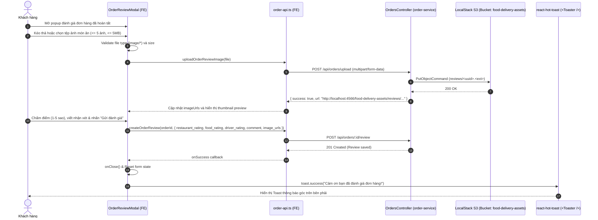

# 📋 Kế Hoạch Triển Khai: Nâng Cấp Tải Ảnh Đánh Giá Lên LocalStack S3 & Sửa Lỗi Toast Hoàn Tất Review

`[COMPLETED]` • **Issue liên kết:** [#74](https://github.com/DuyBinh2003/FoodDelivery/issues/74) • **Phân loại:** `customer` • **Ngày khởi tạo:** 2026-10-22

---

## 1. 🎯 Tổng Quan & Mục Tiêu Nghiệp Vụ

### 1.1. Hiện Trạng & Vấn Đề (Problem Statement)
1. **Trải nghiệm đính kèm ảnh đánh giá chưa tối ưu**:
   - Hiện tại, hộp thoại đánh giá đơn hàng ([`OrderReviewModal.tsx`](file:///d:/code/FoodDelivery/frontend/src/features/orders/components/OrderReviewModal.tsx)) chỉ hỗ trợ nhập thủ công đường link URL ảnh (`Add Images (URLs)` qua ô input text).
   - Người dùng không thể trực tiếp chọn tệp ảnh từ máy tính hoặc kéo thả (Drag & Drop) để tải ảnh chụp món ăn thực tế.
2. **Chưa lưu trữ ảnh review vào LocalStack S3**:
   - Mặc dù hệ thống đã có `S3StorageModule` và dịch vụ S3 trên LocalStack (`food-delivery-assets`), `order-service` chưa cung cấp endpoint upload tài nguyên media để lưu trữ ảnh review độc lập theo chuẩn Microservices.
3. **Lỗi Toast Notification không được render sau khi gửi đánh giá**:
   - Trong `OrderReviewModal.tsx`, hàm `handleSubmit` khi gọi mutation `onSuccess` chỉ thực thi `onClose()` mà không hề kích hoạt thông báo Toast.
   - Thư viện `react-hot-toast` đã được cấu hình toàn cục (`<Toaster position="top-right" />` tại `RootLayout`), nhưng modal đánh giá chưa tích hợp thông báo thành công / thất bại, dẫn đến việc người dùng không nhận được phản hồi trực quan sau khi gửi đánh giá.

### 1.2. Mục Tiêu Đạt Được (Key Objectives)
1. **Backend - Endpoint Upload Tài Nguyên Đánh Giá**:
   - Tích hợp `StorageModule` (`S3StorageService`) vào `order-service`.
   - Tạo endpoint `POST /orders/upload` yêu cầu xác thực JWT (`JwtAuthGuard`), sử dụng `FileInterceptor('file')`.
   - Tải tệp lên bucket LocalStack S3 `food-delivery-assets` dưới thư mục `reviews/`.
   - Trả về đường dẫn S3 công khai: `{ success: true, url: "http://localhost:4566/food-delivery-assets/reviews/<uuid>.<ext>" }`.
2. **Frontend - Nâng Cấp Giao Diện Đánh Giá Cao Cấp**:
   - Bổ sung hàm API `uploadOrderReviewImage(file: File)` trong `order-api.ts`.
   - Thiết kế lại khu vực tải ảnh trong `OrderReviewModal.tsx`:
     - Khu vực Drag & Drop / File Selector hiện đại với biểu tượng `ImagePlus` / `UploadCloud`.
     - Giới hạn tải tối đa 5 hình ảnh, dung lượng mỗi ảnh <= 5MB, chấp nhận định dạng JPEG, PNG, WEBP.
     - Tải lên ngay lập tức khi người dùng chọn ảnh (Immediate Upload), hiển thị thumbnail preview kèm trạng thái loading spinner trên từng ảnh.
     - Nút xóa ảnh nhanh (Remove thumbnail) trên từng ảnh đã tải lên.
     - Khóa nút gửi khi ảnh đang trong quá trình upload.
3. **Frontend - Khắc Phục Lỗi Toast**:
   - Tích hợp `toast` từ `react-hot-toast` trong `OrderReviewModal.tsx`.
   - Khi hoàn tất thành công (`onSuccess`): đóng modal, reset state và hiển thị `toast.success('Cảm ơn bạn đã đánh giá đơn hàng!')`.
   - Khi gặp lỗi (`onError`): hiển thị `toast.error(message)` thân thiện thay vì dùng hàm `alert()`.

---

## 2. 🔍 Khảo Sát Hiện Trạng Codebase

| Thành phần / File | Trạng thái hiện tại | Hành động can thiệp |
| :--- | :--- | :--- |
| [`backend/apps/order-service/src/modules/orders/orders.module.ts`](file:///d:/code/FoodDelivery/backend/apps/order-service/src/modules/orders/orders.module.ts) | Chưa import `StorageModule`. | Import `StorageModule` từ `@/common/storage/storage.module.js`. |
| [`backend/apps/order-service/src/modules/orders/orders.controller.ts`](file:///d:/code/FoodDelivery/backend/apps/order-service/src/modules/orders/orders.controller.ts) | Chưa có endpoint upload ảnh. | Bổ sung `POST /upload` với `FileInterceptor` và gọi `S3StorageService.uploadFile` vào folder `reviews`. |
| [`backend/apps/order-service/src/modules/orders/tests/order-media-upload.spec.ts`](file:///d:/code/FoodDelivery/backend/apps/order-service/src/modules/orders/tests/order-media-upload.spec.ts) | Chưa có file test cho upload endpoint. | Tạo mới unit test Vitest 3 nhánh (Happy, Edge, Error) có Traceability Header. |
| [`frontend/src/features/orders/api/order-api.ts`](file:///d:/code/FoodDelivery/frontend/src/features/orders/api/order-api.ts) | Chưa có API upload ảnh review. | Thêm hàm `uploadOrderReviewImage(file: File)`. |
| [`frontend/src/features/orders/components/OrderReviewModal.tsx`](file:///d:/code/FoodDelivery/frontend/src/features/orders/components/OrderReviewModal.tsx) | Dùng ô input text nhập URL; không gọi `toast` khi hoàn tất review. | Thay thế bằng Drag & Drop upload S3, quản lý trạng thái tải ảnh, tích hợp `react-hot-toast`. |
| [`frontend/src/features/orders/tests/OrderReviewModal.spec.tsx`](file:///d:/code/FoodDelivery/frontend/src/features/orders/tests/OrderReviewModal.spec.tsx) | Chưa có test cho modal review và toast. | Viết unit test Vitest kiểm thử tương tác upload ảnh, xóa ảnh và render toast. |

---

## 3. 🛠️ Thiết Kế Chi Tiết & Luồng Dữ Liệu

### 3.1. Sơ đồ Luồng Đánh Giá & Tải Ảnh S3 (Sequence Diagram)

---

## 4. 🧪 Kịch Bản Kiểm Thử 3 Nhánh (3-Branch Testing Strategy)

### Nhánh 1: Happy Path (Luồng Tiêu Chuẩn)
- **HP-01 (Backend)**: Khách hàng gửi request upload file ảnh hợp lệ (PNG, 1MB) kèm JWT token -> Endpoint `POST /orders/upload` lưu thành công vào S3 thư mục `reviews/` và trả về URL S3 với HTTP 201/200.
- **HP-02 (Frontend - Upload)**: Người dùng chọn 2 ảnh hợp lệ -> Upload thành công, danh sách `imageUrls` có 2 phần tử, thumbnail hiển thị kèm nút xóa.
- **HP-03 (Frontend - Complete & Toast)**: Người dùng nhấn "Submit Review" sau khi upload ảnh -> Gọi API tạo review thành công, modal đóng lại, `toast.success` được kích hoạt với nội dung cảm ơn.

### Nhánh 2: Edge Cases (Trường Hợp Biên)
- **EC-01 (Backend - File name)**: File ảnh chứa tên ký tự đặc biệt tiếng Việt ("ảnh món ăn #1.png") -> S3 sinh khóa UUID an toàn và trả về URL hợp lệ.
- **EC-02 (Frontend - Max Images Limit)**: Người dùng đã upload đủ 5 ảnh -> Ẩn hoặc disable khu vực chọn thêm ảnh, hiển thị thông báo đã đạt giới hạn tối đa 5 ảnh.
- **EC-03 (Frontend - Xóa ảnh đã upload)**: Người dùng nhấp nút "X" trên một thumbnail -> Ảnh bị loại khỏi danh sách `imageUrls`, thumbnail biến mất và cho phép chọn ảnh khác thay thế.
- **EC-04 (Frontend - Tải không kèm ảnh)**: Người dùng chỉ chấm sao và viết nhận xét mà không tải ảnh -> Gửi review bình thường với `image_urls: undefined`.

### Nhánh 3: Error & Rejection Flow (Luồng Lỗi & Từ Chối)
- **ER-01 (Backend - No File)**: Gọi `POST /orders/upload` nhưng không đính kèm file trong FormData -> Trả về `400 Bad Request` ("Vui lòng chọn tệp hình ảnh để tải lên").
- **ER-02 (Backend - Invalid File Type)**: Tải tệp `.pdf` hoặc `.exe` -> Bị `S3StorageService` từ chối với `400 Bad Request` ("Chỉ chấp nhận các định dạng ảnh: JPEG, PNG, WEBP, GIF").
- **ER-03 (Frontend - Oversized File)**: Chọn tệp ảnh > 5MB -> Frontend chặn ngay trước khi gửi request, hiển thị `toast.error` cảnh báo dung lượng vượt mức 5MB.
- **ER-04 (Frontend - Submit Error Toast)**: API tạo review gặp sự cố (ví dụ mạng gián đoạn 500) -> Modal không đóng, hiển thị `toast.error` báo lỗi thân thiện thay vì popup `alert()`.

---

## 5. 🛡️ Tiêu Chí Nghiệm Thu & Cổng Kiểm Soát CI (Local CI Gate)

- [x] `order-service` biên dịch và chạy kiểm thử đơn vị thành công với endpoint `POST /orders/upload`.
- [x] Giao diện `OrderReviewModal` hiển thị chuyên nghiệp, kéo thả ảnh trực quan, hỗ trợ tối đa 5 ảnh.
- [x] Ảnh được lưu trữ chính xác trên LocalStack S3 (`food-delivery-assets/reviews/`).
- [x] Toast notification xuất hiện chuẩn xác và đẹp mắt sau khi hoàn tất review hoặc khi phát sinh lỗi.
- [x] Bộ tứ kiểm soát nội bộ (Local CI Gate) đạt 100% xanh:
  1. `npm run lint` (oxlint Backend 0 errors/warnings, ESLint Frontend 0 errors/warnings).
  2. `npx tsc --noEmit` (TypeScript 0 errors cả Backend và Frontend).
  3. `npm test` (100% test cases pass trên cả 2 test suites).
  4. `npm run build` (Biên dịch production thành công).
