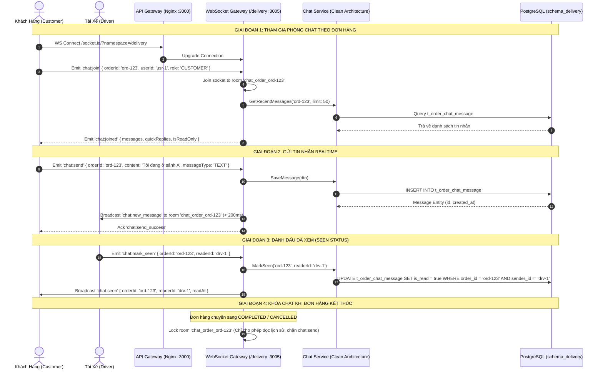

# Kế Hoạch Triển Khai: Kênh Chat Thời Gian Thực Khách Hàng - Tài Xế - Nhà Hàng Qua WebSocket

> **Mã công việc (Task Code):** `realtime-order-chat`  
> **Trạng thái:** `[IN_PROGRESS]`  
> **Tác giả:** `@planner` (Điều phối bởi `@orchestrator`)  
> **Nhánh phát triển:** `feature/issue-76-realtime-order-chat`  
> **GitHub Issue:** [#76](https://github.com/DuyBinh2003/FoodDelivery/issues/76)  
> **Tài liệu tham chiếu:** `docs/services/delivery-service.md`, `docs/services/order-service.md`, `docs/architecture/websocket-architecture.md`

---

## 1. Bối Cảnh & Mục Tiêu Nghiệp Vụ (Context & Business Objectives)

Trong suốt quá trình từ lúc quán nhận đơn đến khi tài xế giao tận tay khách hàng, việc liên lạc trực tiếp (In-App Messaging) là tính năng tối quan trọng để:
- Giúp khách hàng hướng dẫn tài xế vị trí sảnh tòa nhà, gửi số điện thoại phụ hoặc dặn dò người nhà nhận thay.
- Giúp tài xế cập nhật tình hình kẹt xe, sự cố phát sinh hoặc thông báo đã đến nơi nhận món.
- Giúp nhà hàng trao đổi nhanh với khách nếu hết món phụ/gia vị mà không cần huỷ đơn.

### Mục tiêu cốt lõi:
1. **Truyền tin thời gian thực cực nhanh (< 200ms)**: Sử dụng Socket.IO qua WebSocket Gateway trong `delivery-service`.
2. **Cô lập phòng chat theo Đơn hàng (Room Isolation)**: Mỗi đơn hàng tạo một phòng `chat_order_${orderId}`. Chỉ các bên liên quan mới được phép nhận và gửi tin trong phòng.
3. **Mẫu câu trả lời nhanh (Quick Replies)**: Cung cấp danh mục các câu phản hồi nhanh phù hợp với từng vai trò (`CUSTOMER`, `DRIVER`, `RESTAURANT`) để gửi tức thì chỉ với một chạm.
4. **Trạng thái đã xem & Đang gõ (Seen & Typing Indicator)**: Cập nhật chỉ báo đã đọc (`is_read`, `read_at`) và sự kiện đang soạn tin (`typing`).
5. **Chế độ Chỉ đọc khi đơn đóng (Read-only on Closed)**: Khi đơn hàng chuyển sang trạng thái kết thúc (`COMPLETED` hoặc `CANCELLED`), phòng chat tự động chuyển sang chế độ lưu trữ (Read-Only) để bảo toàn lịch sử.
6. **Lưu trữ & REST API Dự phòng**: Tin nhắn được lưu vào PostgreSQL (`t_order_chat_message`) và hỗ trợ REST endpoints để lấy lịch sử hoặc gửi tin nhắn khi mạng chập chờn.

---

## 2. Kiến Trúc Kỹ Thuật & Sơ Đồ Luồng (Architecture & Flow)

---

## 3. Cấu Trúc Dữ Liệu (Database Schema)

### Bảng Transaction: `t_order_chat_message` (`schema_delivery`)
| Tên cột | Kiểu dữ liệu | Ràng buộc | Diễn giải |
| :--- | :--- | :--- | :--- |
| `id` | UUID | PK, default uuidv4 | Mã tin nhắn duy nhất |
| `order_id` | UUID | NOT NULL, INDEX | Mã đơn hàng tương ứng |
| `sender_id` | UUID | NOT NULL | Mã người gửi |
| `sender_role` | VARCHAR(20) | NOT NULL | `CUSTOMER` \| `DRIVER` \| `RESTAURANT` \| `SYSTEM` |
| `sender_name` | VARCHAR(100) | NOT NULL | Tên hiển thị người gửi |
| `message_type` | VARCHAR(20) | DEFAULT 'TEXT' | `TEXT` \| `QUICK_REPLY` \| `IMAGE` \| `SYSTEM` |
| `content` | TEXT | NOT NULL | Nội dung tin nhắn (Tối đa 1000 ký tự) |
| `is_read` | BOOLEAN | DEFAULT false | Trạng thái đã xem |
| `read_at` | TIMESTAMPTZ | NULLABLE | Thời điểm được xem |
| `created_at` | TIMESTAMPTZ | DEFAULT NOW() | Thời điểm gửi |
| `is_deleted` | BOOLEAN | DEFAULT false | Soft delete flag |

---

## 4. Danh Sách Sự Kiện WebSocket & REST API

### 4.1. WebSocket Events (Namespace `/delivery`)
- **Client to Server**:
  - `chat:join` `{ orderId, userId, role }`: Tham gia phòng chat của đơn hàng.
  - `chat:send` `{ orderId, senderId, senderRole, senderName, content, messageType? }`: Gửi tin nhắn mới.
  - `chat:mark_seen` `{ orderId, readerId }`: Đánh dấu các tin nhắn đối phương gửi đã được đọc.
  - `chat:typing` `{ orderId, userId, userName, role, isTyping }`: Báo trạng thái đang gõ phím.
- **Server to Client**:
  - `chat:joined`: Trả về mảng tin nhắn quá khứ, cấu hình quick replies và trạng thái phòng.
  - `chat:new_message`: Phát tin nhắn mới tới toàn bộ người trong phòng.
  - `chat:seen`: Báo tin nhắn đã được đối phương đọc.
  - `chat:typing`: Hiển thị trạng thái đang soạn tin.
  - `chat:error`: Báo lỗi (ví dụ nội dung rỗng, phòng đã đóng).

### 4.2. REST API Endpoints (Phục vụ truy xuất lịch sử & Fallback)
| Phương thức | Đường dẫn | Phân quyền | Mô tả |
| :--- | :--- | :--- | :--- |
| `GET` | `/delivery/chat/orders/:orderId/messages` | User / Driver | Lấy lịch sử chat của đơn hàng (hỗ trợ phân trang) |
| `POST` | `/delivery/chat/orders/:orderId/messages` | User / Driver | Gửi tin nhắn qua REST API (fallback) |
| `POST` | `/delivery/chat/orders/:orderId/seen` | User / Driver | Đánh dấu đã đọc qua REST API |
| `GET` | `/delivery/chat/quick-replies` | Public | Lấy danh mục câu trả lời nhanh theo vai trò |

---

## 5. Kịch Bản Kiểm Thử 3 Nhánh (Vitest Test Suite)

Tất cả các ca kiểm thử được đặt tại `backend/apps/delivery-service/src/modules/chat/tests/order-chat.spec.ts` có gắn Traceability Header.

### Nhánh 1: Luồng chuẩn thành công (Happy Path)
- **HP-01**: Gửi và lưu tin nhắn `TEXT` thành công với đầy đủ metadata và thời gian tạo.
- **HP-02**: Gửi tin nhắn `QUICK_REPLY` thành công từ danh mục mẫu câu trả lời nhanh.
- **HP-03**: Đánh dấu đã xem (`mark_seen`) cập nhật `is_read = true` và `read_at` cho các tin nhắn chưa đọc của đối phương.
- **HP-04**: Lấy lịch sử tin nhắn của đơn hàng theo thứ tự thời gian tăng dần (`created_at ASC`).

### Nhánh 2: Các trường hợp biên (Edge Cases)
- **EC-01**: Tin nhắn dài chạm trần tối đa cho phép (1000 ký tự).
- **EC-02**: Tin nhắn có khoảng trắng đầu hoặc cuối được tự động chuẩn hóa (`trim()`).
- **EC-03**: Truy vấn danh sách quick replies lọc chuẩn xác theo từng role (`CUSTOMER`, `DRIVER`, `RESTAURANT`).
- **EC-04**: Lấy lịch sử của đơn hàng mới chưa có tin nhắn nào (trả về danh sách rỗng `[]`).
- **EC-05**: Đánh dấu đã xem khi không có tin nhắn nào chưa đọc (không gây lỗi, trả về count = 0).

### Nhánh 3: Luồng lỗi & Từ chối vi phạm (Error / Rejection Flow)
- **ERR-01**: Gửi tin nhắn rỗng hoặc chỉ toàn khoảng trắng -> ném `BadRequestException`.
- **ERR-02**: Thiếu trường bắt buộc `order_id` hoặc `sender_id` -> từ chối gửi.
- **ERR-03**: Gửi tin nhắn với `sender_role` không hợp lệ -> từ chối gửi.
- **ERR-04**: Gửi tin nhắn vượt quá 1000 ký tự -> ném `BadRequestException`.
- **ERR-05**: Từ chối gửi tin nhắn mới khi phòng chat đã bị khóa (`is_closed = true`).

---

## 6. Bộ Tứ Kiểm Soát CI Nội Bộ (Local CI Gate)
1. **Linter**: `npm run lint` (0 warning, 0 error).
2. **Type Check**: `npx tsc -p apps/delivery-service/tsconfig.json --noEmit` (0 error).
3. **Unit Tests**: `npm test` với Vitest (100% pass trên toàn bộ test suite).
4. **Build Check**: `npm run build` (Biên dịch thành công).
