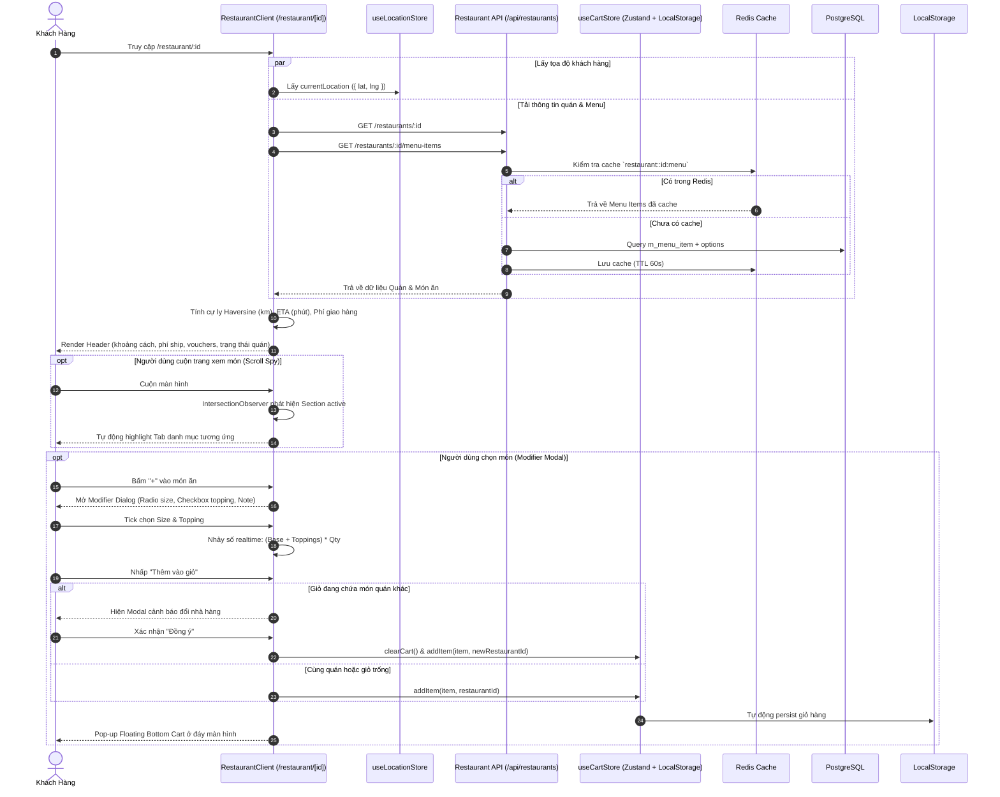

# Kế Hoạch Triển Khai: Nâng Cấp Giao Diện Trang Menu Nhà Hàng (Restaurant Menu UI Revamp)

> Trạng thái: `[COMPLETED]`  
> Mã Task: `restaurant-menu-ui-revamp`  
> Phân hệ: `customer` / `frontend` & `restaurant-service` / `backend`  
> Tham chiếu Issue: [#69](https://github.com/DuyBinh2003/FoodDelivery/issues/69)  
> Phụ trách: Master Orchestrator & Planner  

---

## 1. Bối Cảnh & Mục Tiêu Nghiệp Vụ (Context & Objectives)

### 1.1. Hiện Trạng Codebase
- Trang chi tiết nhà hàng và thực đơn hiện tại (`frontend/src/app/restaurant/[id]/page.tsx` và `RestaurantClient`) đã có khung hiển thị cơ bản, tuy nhiên còn nhiều hạn chế so với yêu cầu chuẩn trải nghiệm ứng dụng giao đồ ăn hiện đại:
  1. **Khối Header**: Chưa hiển thị cự ly (km), thời gian giao dự kiến (ETA phút), và phí giao hàng động dựa trên tọa độ GPS của khách hàng (`useLocationStore`). Chưa có khối khuyến mãi (Vouchers / Promos) để khách hàng thu thập ngay tại quán. Khi nhà hàng tạm đóng cửa (`!restaurant.is_active`), hình ảnh và nút thêm món chưa được làm mờ (gray-out) và vô hiệu hóa triệt để.
  2. **Thanh Danh Mục Sticky & Scroll Spy**: Thanh danh mục mới chỉ hỗ trợ click cuộn cơ bản, chưa có hiệu ứng **Scroll Spy 2 chiều** (vừa cuộn vừa tự động highlight tab tương ứng và trượt tab vào tầm nhìn; bấm vào tab thì cuộn mượt chính xác đến section).
  3. **Danh Sách Món Ăn**: Thẻ món ăn chưa có hiển thị Giá gốc (gạch ngang) khi có chiết khấu; trạng thái hết hàng ("Sold Out") chưa vô hiệu hóa click tương tác mở modal.
  4. **Cửa Sổ Tùy Chỉnh Món (Modifier / Customization Modal)**: Hiện tại `AddToCartDialog` chỉ có các tag ghi chú cứng (`QUICK_INSTRUCTION_TAGS`) mà chưa hỗ trợ cấu trúc dữ liệu tùy chọn món ăn phân cấp thực thụ:
     - **Nhóm bắt buộc (Required Choices - Radio Button)**: Bắt buộc chọn đúng 1 (ví dụ: Size M +0đ, Size L +10.000đ). Cấm thêm vào giỏ nếu chưa chọn đủ.
     - **Nhóm tùy chọn (Optional / Toppings - Checkbox)**: Chọn nhiều hoặc không chọn kèm giá cộng dồn (ví dụ: Trân châu +5.000đ, Thạch +5.000đ).
     - Giá tổng phải nhảy số **Real-time** theo từng lựa chọn và số lượng.
  5. **Giỏ Hàng Nổi (Floating Bottom Cart)**: Hiện đang là một nút tròn trôi nổi góc phải (`CartWidget`), chưa chuẩn theo dạng **Thanh đáy nổi (Floating Bottom Bar)** xuất hiện khi giỏ có $\ge 1$ món với tổng số lượng, tổng tiền và nút Xem giỏ / Thanh toán.
  6. **Lưu Trữ Giỏ Hàng (State Management & Persistence)**: `useCartStore` hiện chỉ lưu trên RAM (in-memory Zustand), chưa cấu hình `persist` lưu vào `localStorage`, khiến giỏ hàng bị mất khi người dùng F5 hoặc tắt trình duyệt.
  7. **Backend Caching & Data Model**: Bảng `schema_restaurant.m_menu_item` chưa lưu `options` (JSONB) và `original_price` (numeric); endpoint menu cần được hoàn thiện Redis Caching và cơ chế xóa cache (cache invalidation) khi cập nhật món.

---

### 1.2. Mục Tiêu Cốt Lõi (Theo Đề Bài Issue #69)

1. **Khối Header Nhà Hàng Thông Minh (Restaurant Header)**:
   - Ảnh Cover & Logo sắc nét, Tên quán, Rating sao kèm số lượt đánh giá, huy hiệu Đối tác chính hãng.
   - **Dữ liệu giao vận động (Dynamic Delivery Info)**:
     - Cự ly (km) tính từ tọa độ khách (`useLocationStore`) tới nhà hàng.
     - Thời gian giao dự kiến ETA (phút).
     - Phí giao hàng tính theo cự ly thực tế (ví dụ: 15.000đ cho 2km đầu, +5.000đ mỗi km tiếp theo; miễn phí nếu quán có Freeship).
   - **Vouchers / Promos**: Băng chuyền / danh sách mã giảm giá áp dụng riêng cho quán với nút "Lưu / Thu thập" mã 1-chạm kèm toast phản hồi.
   - **Trạng thái hoạt động**: Khi quán đóng cửa (`is_active = false`), toàn bộ menu chuyển xám mờ (gray-out), khóa các nút thao tác và hiển thị thông báo "Quán tạm ngưng nhận đơn".

2. **Thanh Điều Hướng Danh Mục (Sticky Category Navigation & Scroll Spy)**:
   - Thanh trượt ngang (Horizontal Scroll) ghim cố định ở đầu màn hình khi cuộn.
   - **Scroll Spy 2 chiều**:
     - Khi cuộn trang đến nhóm món nào (Cơm, Phở, Trà sữa...), tab danh mục tương ứng tự động bôi đậm (highlight) và tự trượt vào khung nhìn ngang.
     - Khi bấm vào tab danh mục, màn hình tự cuộn mượt (smooth scroll) thẳng đến đúng vị trí nhóm món (trừ đi chiều cao bù của thanh sticky header).

3. **Danh Sách Món Ăn Chuẩn UX (Menu Items)**:
   - Thẻ món ăn (Item Card): Thumbnail vuông bo góc, Tên món, Mô tả ngắn, Giá bán hiện tại, Giá gốc gạch ngang (nếu có ưu đãi).
   - Thao tác nhanh: Nút "+" / "Thêm" mở cửa sổ tùy biến.
   - Quản lý tồn kho: Món hết hàng (`!is_available`) phủ overlay "Hết hàng", không cho click mở modal.

4. **Cửa Sổ Tùy Chỉnh Món Đa Tùy Chọn (Modifier / Customization Modal & Bottom Sheet)**:
   - Mở Bottom Sheet (Mobile) hoặc Modal (Desktop) khi nhấp thêm món.
   - **Nhóm bắt buộc (Required Choices - Radio Button)**: Bắt buộc chọn 1 và chỉ 1 (VD: Size M, Size L). Khóa nút "Thêm vào giỏ" nếu chưa hoàn thành các nhóm bắt buộc.
   - **Nhóm tùy chọn (Optional / Toppings - Checkbox)**: Cho phép chọn nhiều topping với đơn giá cộng thêm.
   - **Mức gia vị / đá / đường**: Cho phép khách chọn định lượng nhanh.
   - **Ô ghi chú (Special Note)**: Nhập yêu cầu riêng cho nhà bếp (tối đa 150 ký tự).
   - **Bộ đếm số lượng (+ / -)**: Thay đổi số lượng món tức thì.
   - **Giá Real-time**: Tổng tiền hiển thị trên nút CTA tự động nhảy số theo công thức:
     $$\text{Total} = (\text{Base Price} + \sum \text{Selected Modifiers}) \times \text{Quantity}$$

5. **Giỏ Hàng Nổi Đáy Màn Hình (Floating Bottom Cart Bar)**:
   - Tự động pop-up ở mép đáy màn hình khi giỏ hàng có $\ge 1$ món.
   - Hiển thị: Tổng số lượng món, Tổng tiền tạm tính, nút "Xem chi tiết" mở Drawer và nút "Thanh toán" chuyển ngay sang `/checkout`.
   - **Ràng Buộc Đơn Nhà Hàng (Single Restaurant Constraint)**:
     - Giỏ hàng chỉ chứa món của 1 nhà hàng duy nhất.
     - Nếu đang có món của Quán A mà bấm thêm món ở Quán B: Hiển thị hộp thoại cảnh báo:
       *"Bạn đang có món của quán khác trong giỏ. Bấm thêm món này sẽ xóa giỏ hàng cũ. Bạn có đồng ý không?"*
     - Nếu user xác nhận "Đồng ý": Xóa giỏ hàng cũ và nạp món quán mới vào.

6. **Yêu Cầu Kỹ Thuật (Architecture & Tech Spec)**:
   - **Zustand Persist**: Cập nhật `useCartStore` với middleware `persist` lưu vào `localStorage` (`food_delivery_cart_storage`), đồng bộ an toàn qua SSR (không gây hydration mismatch).
   - **Backend Data Modeling**:
     - Thêm trường `options` (`jsonb`, default `'[]'`) và `original_price` (`numeric`, nullable) vào bảng `m_menu_item`.
     - Cập nhật Entity, DTOs, Repository của `restaurant-service`.
     - Cập nhật seed data mẫu với các món có Size, Topping, Mức đường/đá.
   - **Redis Caching**: Hoàn thiện caching cho menu nhà hàng tại `restaurant-service` và cơ chế xóa cache (`cacheManager.del`) khi chủ quán cập nhật thực đơn.

---

## 2. Kiến Trúc Luồng Dữ Liệu & Tương Tác (Architecture)

---

## 3. Kế Hoạch Thay Đổi Chi Tiết (File Impacts)

### 3.1. Backend (`backend/apps/restaurant-service/`)
1. **Database Migration & Entities**:
   - `backend/migrations/restaurant-service/1788925717338_restaurant-service-tables.js` & seeder:
     - Thêm cột `original_price` (`numeric(15,2)`, nullable) và `options` (`jsonb`, default `'[]'`).
     - Cập nhật seeder `1789353917002_seed-restaurants.js` bổ sung Size, Topping cho Trà sữa, Phở, Bún bò.
   - `backend/apps/restaurant-service/src/modules/restaurants/entities/menu-item.entity.ts`:
     - Khai báo trường `original_price?: number` và `options?: MenuItemOptionGroup[]`.
2. **DTOs & Interfaces**:
   - `backend/apps/restaurant-service/src/modules/restaurants/dto/create-menu-item.dto.ts` & `update-menu-item.dto.ts`:
     - Hỗ trợ validate `original_price` và `options`.
3. **Repository & Caching**:
   - `backend/apps/restaurant-service/src/modules/restaurants/usecases/get-menu-items.usecase.ts`:
     - Trả về đầy đủ trường `options` và `original_price`, cache vào Redis.
   - Đảm bảo các use case `update-menu-item`, `add-menu-item`, `delete-menu-item` xóa cache key `restaurant:${restaurantId}:menu`.

### 3.2. Frontend (`frontend/src/`)
1. **Types (`frontend/src/features/menu/types/index.ts`)**:
   - Định nghĩa `MenuItemOptionGroup`, `MenuItemOptionChoice`, và bổ sung `original_price`, `options` vào `MenuItem`.
2. **Cart Store (`frontend/src/features/cart/store/useCartStore.ts`)**:
   - Thêm `persist` middleware với `food_delivery_cart_storage`.
   - Lưu trữ chi tiết options đã chọn (`selectedOptions: { name: string; price: number }[]`) để hiển thị rõ ràng trên giỏ hàng và thanh toán.
3. **Header Nhà Hàng Mới (`frontend/src/features/restaurant/components/restaurant-header/`) [REFACTOR/NEW]**:
   - Tích hợp tính cự ly GPS, ETA phút, và Phí giao hàng động từ `useLocationStore`.
   - Danh sách Vouchers / Promos với nút "Lưu mã" (toast phản hồi).
   - Cảnh báo và gray-out toàn trang khi quán tạm đóng cửa (`!restaurant.is_active`).
4. **Thanh Danh Mục & Scroll Spy (`frontend/src/features/restaurant/components/restaurant-client/`) [ENHANCE]**:
   - Cải tiến Sticky Category Header với thanh trượt mượt mà.
   - Cài đặt `IntersectionObserver` theo dõi các category sections để tự động highlight và scroll tab active vào tầm nhìn.
5. **Thẻ Món Ăn (`frontend/src/features/menu/components/food-card/food-card.tsx`) [ENHANCE]**:
   - Hiển thị Giá gốc gạch ngang khi `original_price > price`.
   - Vô hiệu hóa click và làm mờ thẻ khi món hết hàng (`!is_available`) hoặc quán tạm đóng.
6. **Cửa Sổ Tùy Chỉnh Món (`frontend/src/features/restaurant/components/add-to-cart-dialog/`) [UPGRADE]**:
   - Hỗ trợ Radio Button cho nhóm tùy chọn bắt buộc (Required Choices).
   - Hỗ trợ Checkbox cho nhóm tùy chọn thêm (Optional Toppings).
   - Tính tổng tiền Real-time theo số lượng và tùy chọn.
   - Validate chặn submit nếu chưa chọn đủ nhóm bắt buộc.
7. **Thanh Giỏ Hàng Nổi (`frontend/src/features/restaurant/components/floating-bottom-cart/`) [NEW]**:
   - Thanh bar nổi cố định ở đáy màn hình khi giỏ hàng có món.
   - Hiển thị số lượng, tạm tính, nút xem giỏ và nút thanh toán nhanh.
   - Modal cảnh báo xóa giỏ khi đổi quán (`ClearCartModal`).

---

## 4. Kịch Bản Kiểm Thử 3 Nhánh (3-Branch Test Checklist)

### 4.1. Nhánh 1: Happy Path (Luồng Tiêu Chuẩn)
- [x] **TC-MENU-01**: Khách hàng truy cập trang quán mở cửa, Header tính đúng khoảng cách (km), ETA (phút), và phí giao hàng dựa trên tọa độ GPS hiện tại.
- [x] **TC-MENU-02**: Danh sách voucher của quán hiển thị đúng, bấm "Lưu" hiển thị thông báo thành công và lưu mã vào bộ nhớ.
- [x] **TC-MENU-03**: Khi cuộn trang qua các danh mục (Phở -> Bún bò -> Giải khát), tab danh mục phía trên tự động chuyển highlight tương ứng (Scroll Spy). Bấm vào tab "Giải khát", trang tự động cuộn mượt đến đúng vị trí.
- [x] **TC-MENU-04**: Bấm vào món có modifier (VD: Trà sữa), modal mở ra cho phép chọn Size (bắt buộc) và tick thêm Topping (tùy chọn). Giá trên nút "Thêm vào giỏ" nhảy số realtime.
- [x] **TC-MENU-05**: Bấm "Thêm vào giỏ", món ăn được đưa vào giỏ hàng với đúng các option đã chọn. Thanh Floating Bottom Cart xuất hiện ở đáy màn hình hiển thị đúng tổng tiền và số lượng.
- [x] **TC-MENU-06**: F5 tải lại trang hoặc mở tab mới, giỏ hàng vẫn giữ nguyên dữ liệu nhờ `localStorage` persistence.

### 4.2. Nhánh 2: Edge Cases (Tình Huống Biên & Ngoại Lệ Nhẹ)
- [x] **TC-MENU-07**: Khách hàng chưa cấp quyền GPS hoặc tọa độ null: Hệ thống sử dụng địa chỉ đã lưu hoặc fallback Quận 1, không gây crash ứng dụng.
- [x] **TC-MENU-08**: Món ăn không có options/modifier: Modal hiển thị giao diện tinh gọn (chỉ có ghi chú và bộ đếm số lượng), nút thêm vào giỏ khả dụng ngay lập tức.
- [x] **TC-MENU-09**: Món ăn có giảm giá (`original_price > price`): Thẻ hiển thị giá bán màu nổi bật và giá gốc gạch ngang kèm badge phần trăm giảm giá.
- [x] **TC-MENU-10**: Nhà hàng có danh mục chỉ gồm 1 món hoặc không có món nào: Giao diện hiển thị trạng thái rỗng thân thiện (Empty State), không bị vỡ layout.

### 4.3. Nhánh 3: Error & Rejection Flow (Luồng Chặn Lỗi & Từ Chối)
- [x] **TC-MENU-11**: Quán đang tạm đóng cửa (`is_active = false`): Header hiển thị cảnh báo "Tạm ngưng nhận đơn", toàn bộ ảnh món ăn bị làm mờ xám (gray-out), tất cả nút thêm giỏ bị vô hiệu hóa.
- [x] **TC-MENU-12**: Món ăn tạm hết hàng (`is_available = false`): Thẻ món dán nhãn "Hết hàng", người dùng không thể nhấp để mở modal đặt món.
- [x] **TC-MENU-13**: Người dùng chưa chọn tùy chọn bắt buộc (VD: chưa chọn Size): Nút "Thêm vào giỏ" bị khóa mờ (disabled), hiển thị hướng dẫn "Vui lòng chọn Kích cỡ".
- [x] **TC-MENU-14**: Khách đang có món của Quán A trong giỏ nhưng thêm món của Quán B: Hệ thống hiển thị Modal cảnh báo đổi nhà hàng. Nếu chọn "Hủy", giỏ Quán A được giữ nguyên; nếu chọn "Đồng ý", giỏ Quán A bị xóa và nạp món Quán B.

---

## 5. Cổng Kiểm Soát CI Nội Bộ (Local CI Gate)
Trước khi bàn giao sang Reviewer, toàn bộ 4 bước CI Gate phải đạt **100% xanh**:
1. `npm run lint` (oxlint Backend & eslint Frontend: 0 errors, 0 warnings).
2. `npx tsc --noEmit` (TypeScript Strict Check: 0 errors).
3. `npm test` (Unit test Vitest cho Cart Store, Distance/ETA Calc, và Menu Modifier Component: 100% pass).
4. `npm run build` (Biên dịch production thành công).
