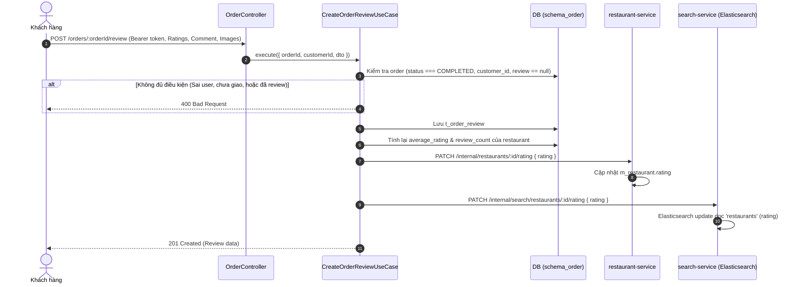

# 📋 Kế Hoạch Triển Khai: Hệ Thống Đánh Giá & Xếp Hạng 3 Bên (Review & Rating) Đồng Bộ Elasticsearch

`[COMPLETED]` • **Issue liên kết:** [#74](https://github.com/DuyBinh2003/FoodDelivery/issues/74) • **Phân loại:** `customer` • **Ngày khởi tạo:** 2026-10-21

---

## 1. 🎯 Tổng Quan & Mục Tiêu

### 1.1. Hiện trạng & Khoảng trống nghiệp vụ
- Khách hàng sau khi nhận đồ ăn (`COMPLETED`) chưa có giao diện và endpoint hoàn chỉnh để chấm điểm món ăn, nhà hàng và tài xế.
- Dù bảng `t_order_review` đã được thiết kế sẵn trong database `schema_order`, `order-service` chưa công khai endpoint `POST /orders/:orderId/review` trên `orders.controller.ts`.
- Điểm đánh giá nhà hàng chưa được cập nhật tự động vào bảng `m_restaurant` trong `restaurant-service` và chưa được đồng bộ tức thì sang Elasticsearch index `restaurants` trong `search-service` để phục vụ bộ lọc tìm kiếm theo số sao (rating filter).

### 1.2. Mục tiêu đạt được
1. **Flow Đánh giá hoàn chỉnh cho Khách hàng**:
   - Khách hàng gửi đánh giá cho đơn hàng đã hoàn tất: Chấm sao nhà hàng (1-5), chấm sao món ăn (1-5), chấm sao tài xế (1-5), kèm nhận xét và danh sách ảnh chụp món ăn (S3 URLs).
   - Kiểm soát tính hợp lệ: Chỉ đơn hàng thuộc về chính khách hàng đó, đã ở trạng thái `COMPLETED` và chưa từng được đánh giá (Idempotent single review).
2. **Tính toán & Cập nhật Điểm Đánh giá Trung bình (Average Rating Calculation)**:
   - Khi có review mới, `order-service` tính lại điểm trung bình cộng và tổng số lượt đánh giá của quán.
   - Đồng bộ sang `restaurant-service` qua internal API `PATCH /internal/restaurants/:id/rating`.
3. **Đồng Bộ Thời Gian Thực Sang Elasticsearch (`search-service`)**:
   - `search-service` cung cấp internal API `PATCH /internal/search/restaurants/:id/rating` để cập nhật trực tiếp `rating` của quán trong Elasticsearch index `restaurants`.
   - Kết quả tìm kiếm và bộ lọc quán ăn ngon theo sao phản ánh ngay điểm đánh giá mới nhất.
4. **API Xem Đánh Giá Của Nhà Hàng (Public View)**:
   - `GET /orders/restaurants/:restaurantId/reviews`: Phân trang, trả về danh sách đánh giá, hình ảnh, thời gian và thống kê phân bổ số sao (Breakdown 5, 4, 3, 2, 1 sao).

---

## 2. 🔍 Khảo Sát Hiện Trạng Codebase

| File / Component | Hiện trạng | Hành động cần thực hiện |
| :--- | :--- | :--- |
| [`backend/apps/order-service/src/modules/orders/orders.controller.ts`](file:///d:/code/FoodDelivery/backend/apps/order-service/src/modules/orders/orders.controller.ts) | Chưa có endpoint gửi review đơn hàng và xem review quán. | Khai báo `POST /orders/:orderId/review` và `GET /orders/restaurants/:restaurantId/reviews`. |
| [`backend/apps/order-service/src/modules/orders/usecases/create-order-review.usecase.ts`](file:///d:/code/FoodDelivery/backend/apps/order-service/src/modules/orders/usecases/create-order-review.usecase.ts) | Có code cũ dùng `as any`, chưa tính điểm trung bình và chưa đồng bộ sang các service khác. | Tái cấu trúc chuẩn TypeScript không `any`, tính điểm trung bình quán và gọi sync rating. |
| [`backend/apps/restaurant-service/src/modules/restaurants/restaurants.internal.controller.ts`](file:///d:/code/FoodDelivery/backend/apps/restaurant-service/src/modules/restaurants/restaurants.internal.controller.ts) | Chưa có endpoint cập nhật `rating`. | Bổ sung `PATCH /internal/restaurants/:id/rating`. |
| [`backend/apps/search-service/src/modules/search/search.controller.ts`](file:///d:/code/FoodDelivery/backend/apps/search-service/src/modules/search/search.controller.ts) | Chỉ có `POST /search/sync` toàn sàn. | Bổ sung `PATCH /internal/search/restaurants/:id/rating` cập nhật điểm lẻ từng quán trong Elasticsearch. |
| [`backend/apps/order-service/src/modules/orders/repositories/order.read.repository.ts`](file:///d:/code/FoodDelivery/backend/apps/order-service/src/modules/orders/repositories/order.read.repository.ts) | Chưa có query lấy review theo `restaurantId`. | Bổ sung query phân trang review của nhà hàng kèm thống kê sao. |

---

## 3. 🛠️ Thiết Kế Chi Tiết

### 3.1. Luồng Hoạt Động (End-to-End Sequence Diagram)


### 3.2. DTO & Validation Specifications
```typescript
export class CreateOrderReviewDto {
  @IsInt()
  @Min(1)
  @Max(5)
  restaurant_rating: number;

  @IsInt()
  @Min(1)
  @Max(5)
  driver_rating: number;

  @IsInt()
  @Min(1)
  @Max(5)
  food_rating: number;

  @IsOptional()
  @IsString()
  @MaxLength(1000)
  comment?: string;

  @IsOptional()
  @IsArray()
  @IsString({ each: true })
  image_urls?: string[];
}
```

---

## 4. 📂 Danh Sách File Tác Động (Impacted Files Matrix)

| Đường dẫn file | Thao tác | Mô tả thay đổi |
| :--- | :---: | :--- |
| `backend/apps/order-service/src/modules/orders/dto/create-order-review.dto.ts` | `MODIFY` | Chuẩn hóa validation (1-5 sao, max 1000 chars, image_urls array). |
| `backend/apps/order-service/src/modules/orders/dto/restaurant-reviews-query.dto.ts` | `CREATE` | DTO phân trang lấy danh sách đánh giá của nhà hàng. |
| `backend/apps/order-service/src/modules/orders/usecases/create-order-review.usecase.ts` | `MODIFY` | Loại bỏ `any`, lưu review, tính toán rating trung bình và bắn HTTP sync. |
| `backend/apps/order-service/src/modules/orders/usecases/get-restaurant-reviews.usecase.ts` | `CREATE` | Use Case lấy danh sách reviews của quán kèm phân bổ số sao. |
| `backend/apps/order-service/src/modules/orders/orders.controller.ts` | `MODIFY` | Expose `POST /orders/:orderId/review` và `GET /orders/restaurants/:restaurantId/reviews`. |
| `backend/apps/order-service/src/modules/orders/orders.module.ts` | `MODIFY` | Đăng ký usecases mới. |
| `backend/apps/restaurant-service/src/modules/restaurants/restaurants.internal.controller.ts` | `MODIFY` | Thêm `PATCH /internal/restaurants/:id/rating`. |
| `backend/apps/search-service/src/modules/search/search.controller.ts` | `MODIFY` | Thêm `PATCH /internal/search/restaurants/:id/rating`. |
| `backend/apps/search-service/src/modules/search/repositories/elasticsearch.repository.ts` | `MODIFY` | Bổ sung hàm `updateRestaurantRating(id, rating)`. |
| `backend/apps/order-service/src/modules/orders/tests/order-review-system.spec.ts` | `CREATE` | Vitest 3 nhánh kiểm thử hệ thống review. |
| `docs/plans/README.md` | `MODIFY` | Cập nhật Master Query Matrix. |
| `docs/services/order-service.md` | `MODIFY` | Bổ sung tài liệu REST API Reviews. |

---

## 5. 🧪 Kịch Bản Kiểm Thử 3 Nhánh (Testing Checklist)

### 🌿 Nhánh 1: Happy Path (Kịch bản chuẩn)
- [ ] **HP-01**: Khách hàng gửi đánh giá thành công cho đơn đã `COMPLETED` $\rightarrow$ Trả về HTTP 201 kèm đầy đủ thông tin review (3 tiêu chí sao, comment, images).
- [ ] **HP-02**: Hệ thống tính toán chính xác điểm trung bình cộng số sao nhà hàng và gọi cập nhật đồng bộ sang `restaurant-service` & `search-service`.
- [ ] **HP-03**: Khách hàng gọi `GET /orders/restaurants/:id/reviews` $\rightarrow$ Nhận danh sách đánh giá phân trang và thống kê số sao (VD: averageRating 4.8, 5 sao: 80%, 4 sao: 20%).

### ⚠️ Nhánh 2: Edge Cases (Biên & Tải)
- [ ] **EC-01**: Đánh giá không gửi nhận xét (`comment`) và không có ảnh $\rightarrow$ Vẫn ghi nhận điểm số sao hợp lệ.
- [ ] **EC-02**: Quán ăn chỉ mới có đúng 1 review 5 sao $\rightarrow$ Điểm trung bình là 5.0. Sau đó có thêm 1 review 4 sao $\rightarrow$ Điểm cập nhật chính xác thành 4.5.
- [ ] **EC-03**: Nhiều review được gửi cùng lúc $\rightarrow$ Không xảy ra deadlock hoặc race condition tính sai điểm số.

### 🛑 Nhánh 3: Error / Security Flow (Xử lý lỗi & Bảo mật)
- [ ] **EF-01**: Đơn hàng chưa hoàn tất (đang ở trạng thái `COOKING` hoặc `DELIVERING`) $\rightarrow$ Từ chối với `400 Bad Request (You can only review completed orders)`.
- [ ] **EF-02**: Người dùng khác cố tình đánh giá đơn của người khác $\rightarrow$ Bị chặn với `400 Bad Request (You do not have permission to review this order)`.
- [ ] **EF-03 (Chống Spam)**: Đơn hàng đã được đánh giá trước đó gửi tiếp review lần 2 $\rightarrow$ Bị chặn ngay với `400 Bad Request (This order has already been reviewed)`.
- [ ] **EF-04**: Số sao vượt ngoài dải 1 đến 5 (VD: 0 sao hoặc 6 sao) $\rightarrow$ DTO Validation chặn trả về `400 Bad Request`.

---

## 6. 🏁 Local CI Gate & Tiêu Chí Nghiệm Thu

1. **Linter**: `npm run lint` trên backend đạt **0 warnings, 0 errors**.
2. **Type Check**: `npx tsc --noEmit` đạt **0 errors** (cấm mọi dạng `any`).
3. **Unit Tests**: `npm test` đạt **100% pass**, file `order-review-system.spec.ts` pass toàn bộ các kịch bản HP, EC, EF.
4. **Docs Sync**: Cập nhật đồng bộ `docs/services/order-service.md` và `docs/plans/README.md`.
