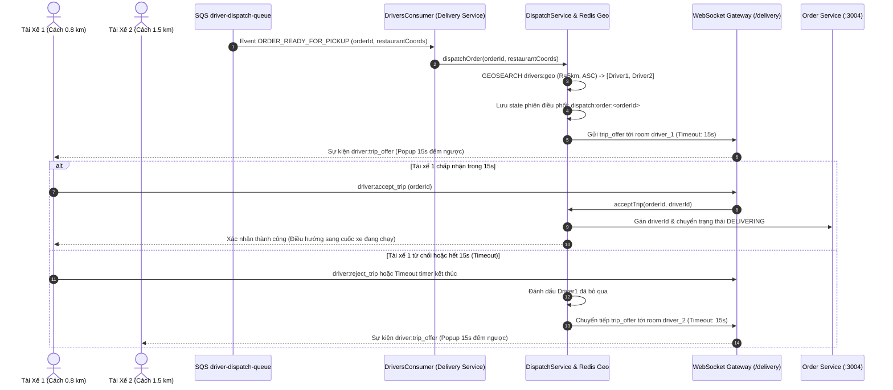

# Kế Hoạch Triển Khai: Thuật Toán Chia Cuốc & Tự Động Điều Phối Đơn Hàng (Order Routing & Auto-Dispatch)

> Trạng thái: `[DRAFT]`  
> Mã Task: `driver-order-routing-dispatch`  
> Phân hệ: `driver` / `delivery`  
> Tham chiếu Issue: [#29](https://github.com/DuyBinh2003/FoodDelivery/issues/29)  
> Phụ trách: Master Orchestrator & Planner  

---

## 1. Bối Cảnh & Mục Tiêu Nghiệp Vụ (Context & Objectives)

### 1.1. Hiện Trạng
- Hiện tại, đơn hàng khi chuyển sang trạng thái `READY_FOR_PICKUP` chỉ nằm trong danh sách chờ của Redis in-flight orders.
- Tài xế phải mở ứng dụng thủ công vào tab "Chuyến xe có sẵn" để bấm nút nhận cuốc (cơ chế Pull / Polling).
- Chưa có cơ chế **Đẩy Đơn Tự Động (Push Auto-Dispatching)** đến các tài xế đang Trực tuyến (`ONLINE`) trong bán kính lân cận nhà hàng.
- Thiếu cơ chế giới hạn thời gian phản hồi: Tài xế có **15 giây** để chấp nhận (`Accept`) hoặc từ chối (`Reject`). Nếu hết 15 giây mà không phản hồi, hệ thống phải tự động chuyển cuốc cho tài xế gần tiếp theo (Failover / Escalation).

### 1.2. Mục Tiêu Cốt Lõi
1. **Lưu Vết Vị Trí Địa Lý Bằng Redis Geospatial (`drivers:geo`)**:
   - Khi tài xế bật Trực tuyến (`ONLINE`), định vị GPS của họ được thêm vào tập hợp địa lý `drivers:geo` qua lệnh `GEOADD`.
   - Khi tài xế Tắt trực tuyến (`OFFLINE`), vị trí được tự động gỡ khỏi `drivers:geo` qua `ZREM`.
2. **Thuật Toán Tìm Kiếm & Lọc Tài Xế Gần Nhất**:
   - Khi đơn sẵn sàng lấy món (`ORDER_READY_FOR_PICKUP`), hệ thống quét bán kính $R = 5$km quanh nhà hàng bằng `GEOSEARCH ... BYRADIUS 5 km ASC WITHDIST`.
   - Loại trừ các tài xế đang bận cuốc khác hoặc đã từ chối đơn này trong phiên điều phối.
3. **Cơ Chế Bắn Cuốc Thời Gian Thực & Countdown 15s**:
   - WebSocket Gateway `/delivery` phát sự kiện `driver:trip_offer` tới room cá nhân của tài xế gần nhất (`driver_<driverId>`).
   - Giao diện tài xế hiển thị **Modal Nhận Cuốc Nổi (Incoming Trip Modal)** với thanh đếm ngược 15 giây, thông tin quán ăn, khoảng cách, cước thực nhận.
   - Nếu tài xế bấm **Chấp nhận**: Khóa đơn nguyên tử (Atomic Lock) gán tài xế, chuyển trạng thái đơn sang `DELIVERING`.
   - Nếu tài xế bấm **Từ chối** hoặc **Hết 15 giây**: Tự động chuyển cuốc (Failover) tới tài xế gần thứ 2 trong danh sách.

---

## 2. Kiến Trúc Hệ Thống & Luồng Tương Tác

---

## 3. Chi Tiết File Thay Đổi (Proposed Changes)

### 3.1. Backend (`backend/apps/delivery-service`)
- `src/modules/dispatch/dispatch.module.ts` [NEW]:
  - Module quản lý luồng điều phối cuốc xe.
- `src/modules/dispatch/repositories/driver-geo.redis.repository.ts` [NEW]:
  - Quản lý tập hợp địa lý `drivers:geo`: `updateDriverLocationGeo`, `removeDriverGeo`, `findNearbyDrivers(lat, lng, radiusKm)`.
  - Quản lý phiên điều phối `dispatch:order:<id>`: `initDispatchSession`, `getCurrentCandidate`, `recordRejection`, `clearDispatchSession`.
- `src/modules/dispatch/dispatch.service.ts` [NEW]:
  - Xử lý nghiệp vụ quét tài xế, khởi tạo timer 15s, xử lý `acceptTrip`, `rejectTrip`, và tự động chuyển cuốc kế tiếp (`escalateToNextDriver`).
- `src/modules/dispatch/dispatch.controller.ts` [NEW]:
  - REST Endpoints:
    - `POST /delivery/driver/location`: Cập nhật vị trí tài xế vào Redis Geo.
    - `POST /delivery/driver/status`: Bật Trực tuyến / Ngoại tuyến.
    - `POST /delivery/orders/:orderId/accept`: API nhận đơn.
    - `POST /delivery/orders/:orderId/reject`: API từ chối đơn.
- `src/modules/tracking/tracking.gateway.ts` [MODIFY]:
  - Bổ sung phòng room `driver_<driverId>`.
  - Xử lý các sự kiện socket: `driver:join`, `driver:accept_trip`, `driver:reject_trip`.
  - Bắn sự kiện `driver:trip_offer` kèm payload cuốc xe và countdown 15s.
- `src/modules/drivers/drivers.consumer.ts` [MODIFY]:
  - Kích hoạt `dispatchService.dispatchOrder` khi nhận sự kiện `ORDER_READY_FOR_PICKUP`.
- `src/app.module.ts` [MODIFY]:
  - Đăng ký `DispatchModule`.

### 3.2. Frontend (`frontend/src/features/driver`)
- `components/driver-dashboard/incoming-trip-modal.tsx` [NEW]:
  - Modal thông báo cuốc xe tới với **Đồng hồ đếm ngược 15s** (Circular / Linear Progress Bar chuyển màu từ Xanh $\rightarrow$ Vàng $\rightarrow$ Đỏ).
  - Chi tiết quán ăn, cự ly giao hàng, cước phí thực nhận, nút "Nhận Cuốc Ngay" (Chính) và "Bỏ Qua" (Phụ).
  - Tự động đóng và kích hoạt reject khi hết 15 giây.
- `hooks/useDriverDispatch.ts` [NEW]:
  - Hook kết nối Socket.IO `/delivery`, join room `driver_<driverId>`, lắng nghe `driver:trip_offer`.
  - Quản lý state cuốc xe đang mời, countdown timer, và gửi request accept/reject.
- `components/driver-dashboard/driver-dashboard.tsx` [MODIFY]:
  - Tích hợp `useDriverDispatch` và nhúng `IncomingTripModal`.
  - Tự động gửi tọa độ GPS định kỳ khi tài xế đang `ONLINE`.

---

## 4. Kịch Bản Kiểm Thử 3 Nhánh (Testing Matrix)

### Kịch bản 1: Nhánh Thuận Lợi (Happy Path)
1. **Thêm vị trí và tìm kiếm tài xế trong bán kính**:
   - Driver A (ONLINE, tọa độ cách quán 1.2 km) và Driver B (ONLINE, tọa độ cách quán 3.5 km).
   - `GEOSEARCH` trả về danh sách sắp xếp tăng dần theo khoảng cách: [Driver A (1.2km), Driver B (3.5km)].
2. **Bắn cuốc tới tài xế gần nhất**:
   - Hệ thống gửi sự kiện `driver:trip_offer` tới Driver A.
   - Driver A bấm `accept` trong 15s $\rightarrow$ Đơn hàng gán thành công cho Driver A, phiên điều phối hoàn tất.
3. **Cập nhật trạng thái Trực tuyến / Ngoại tuyến**:
   - Khi tài xế chuyển `OFFLINE`, lệnh `ZREM` xóa tài xế khỏi `drivers:geo` $\rightarrow$ Quét tìm kiếm không còn xuất hiện.

### Kịch bản 2: Nhánh Biên & Ranh Giới (Edge Cases)
1. **Không có tài xế nào trong bán kính 5km**:
   - Hệ thống ghi nhận log, giữ đơn ở trạng thái chờ (`WAITING_FOR_DRIVER`) để quét lại hoặc cho phép nhận tự do trên tab "Chuyến xe có sẵn".
2. **Hai tài xế ở cùng một vị trí tọa độ**:
   - Thuật toán sắp xếp ổn định, chọn 1 tài xế để ping trước, không bị crash hay gửi trùng.
3. **Tài xế bấm nhận khi đồng hồ vừa chạm 0 giây**:
   - Kiểm tra khóa phiên điều phối an toàn: Nếu server chưa kích hoạt failover thì chấp nhận thành công, nếu đã timeout thì thông báo lịch sự "Cuốc xe đã chuyển cho tài xế khác".

### Kịch bản 3: Nhánh Ngoại Lệ & Chuyển Tiếp (Error & Failover Flow)
1. **Tài xế 1 từ chối cuốc (`reject`)**:
   - Hệ thống lập tức hủy timer của Driver 1, đánh dấu Driver 1 đã từ chối, và tự động bắn `trip_offer` tới Driver 2 trong danh sách.
2. **Tài xế 1 không phản hồi (Hết 15 giây Timeout)**:
   - Timer 15s của backend kích hoạt $\rightarrow$ Bắn sự kiện hủy tới Driver 1 và chuyển tiếp cuốc tới Driver 2.
3. **Toàn bộ tài xế trong bán kính đều từ chối**:
   - Phiên điều phối kết thúc an toàn, đơn chuyển về danh sách mở công khai để bất kỳ tài xế nào trực tuyến đều có thể claim.

---

## 5. Local CI Gate Checklist
- [ ] Backend: `npm run lint` (0 warnings/errors, absolute `@/` imports).
- [ ] Backend Type Check: `npx tsc --noEmit` (0 errors).
- [ ] Backend Unit Tests: `npm test` (100% pass trên toàn bộ test suites, gồm `order-dispatch.spec.ts`).
- [ ] Frontend: `npm run lint` (0 warnings/errors).
- [ ] Frontend Type Check: `npx tsc --noEmit` (0 errors).
- [ ] Frontend Tests: `npm test` (100% pass trên toàn bộ test suites).
- [ ] Frontend Build Check: `npm run build` (Biên dịch thành công 100%).
