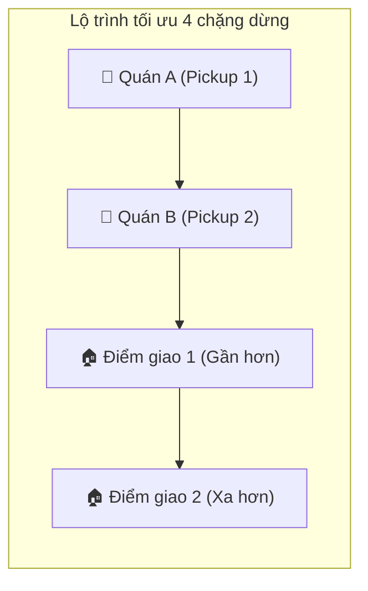

# Kế Hoạch Triển Khai: Thuật Toán Gom Đơn / Ghép Cuốc (Order Stacking) Cho Tài Xế Theo Lộ Trình OSRM

> **Mã công việc (Task Code):** `driver-order-stacking-osrm`  
> **Trạng thái:** `[COMPLETED]`  
> **Tác giả:** `@planner` (Điều phối bởi `@orchestrator`)  
> **Nhánh phát triển:** `feature/issue-78-driver-order-stacking`  
> **GitHub Issue:** [#78](https://github.com/DuyBinh2003/FoodDelivery/issues/78)  
> **Tài liệu tham chiếu:** `docs/services/driver-service.md`, `docs/services/order-service.md`, `docs/plans/driver/street-routing-turn-by-turn-map.md`

---

## 1. Bối Cảnh & Mục Tiêu Nghiệp Vụ (Context & Business Objectives)

Trong giờ cao điểm trưa hoặc tối, nhu cầu đặt món tăng đột biến trong khi số lượng tài xế trực tuyến có hạn. Mô hình phân phối đơn lẻ 1-tài-xế / 1-đơn khiến nhiều đơn hàng bị trễ và tài xế phải chạy xe rỗng nhiều quãng đường. 

Thuật toán **Gom đơn / Ghép cuốc (Order Stacking Engine)** cho phép ghép 2 đơn hàng có cùng tuyến đường cho một tài xế nhằm:
- **Tăng thu nhập tài xế**: Kiếm thêm 60-80% cước phí của đơn thứ 2 trên cùng một cung đường di chuyển.
- **Giảm thời gian chờ của khách hàng**: Tận dụng tài xế đang ở gần khu vực nhà hàng để lấy món ngay lập tức.
- **Tiết kiệm chi phí vận hành nền tảng**: Tối ưu hóa hiệu suất giao nhận trên mỗi km di chuyển.

### Tiêu chí ghép cuốc an toàn (Stacking Eligibility Criteria):
1. **Cự ly giữa 2 quán ăn (Pickup Proximity)**: Khoảng cách giữa Nhà hàng A và Nhà hàng B $\le$ 800m (hoặc cùng tòa nhà/khu ẩm thực).
2. **Cự ly đường vòng thêm (Detour Distance)**: Tổng quãng đường khi ghép 2 đơn không được dài hơn $1.4 \times$ quãng đường đơn lẻ, và quãng đường đi thêm $\le$ 2.5km.
3. **Độ lệch hướng (Angle / Bearing Deviation)**: Hướng di chuyển từ điểm lấy hàng đến điểm trả hàng của 2 đơn không được ngược chiều nhau (góc lệch vector $\le 45^\circ$).
4. **Thời gian chế biến (Preparation Synchrony)**: Cả 2 quán đều chuẩn bị xong hoặc thời điểm sẵn sàng món lệch nhau không quá 10 phút.

---

## 2. Kiến Trúc Kỹ Thuật & Thứ Tự Chặng Dừng (Multi-Stop Route Optimization)

### Nguyên tắc sắp xếp chặng dừng:
- **Nguyên tắc bất biến**: Món ăn của quán nào thì phải đến quán đó lấy trước khi giao đến tay khách hàng của đơn đó (`P1` trước `D1`, `P2` trước `D2`).
- **Thứ tự lấy hàng**: Luôn ưu tiên lấy hết món (`P1` $\rightarrow$ `P2`) nếu khoảng cách 2 quán gần nhau ($< 800m$), sau đó giao theo điểm trả hàng gần nhất trên lộ trình OSRM.

---

## 3. Cấu Trúc Dữ Liệu & Thực Thể (Database Schema)

### 3.1. Bảng Transaction: `t_stacked_trip` (`schema_delivery`)
| Tên cột | Kiểu dữ liệu | Ràng buộc | Diễn giải |
| :--- | :--- | :--- | :--- |
| `id` | UUID | PK, default uuidv4 | Mã chuyến xe ghép |
| `driver_id` | UUID | NOT NULL, INDEX | Mã tài xế thực hiện chuyến ghép |
| `primary_order_id` | UUID | NOT NULL | Mã đơn hàng thứ nhất |
| `secondary_order_id` | UUID | NOT NULL | Mã đơn hàng thứ hai ghép thêm |
| `status` | VARCHAR(30) | NOT NULL | `ACTIVE` \| `COMPLETED` \| `CANCELLED` |
| `waypoints` | JSONB | NOT NULL | Danh sách 4 chặng dừng kèm tọa độ & thứ tự |
| `current_waypoint_index` | INTEGER | DEFAULT 0 | Chặng dừng hiện tại tài xế đang thực hiện (0 - 3) |
| `total_distance_km` | NUMERIC(10,2) | NOT NULL | Tổng cự ly hành trình ghép |
| `estimated_duration_minutes` | INTEGER | NOT NULL | Thời gian ước tính hoàn thành cả 2 đơn |
| `driver_bonus_earnings` | NUMERIC(15,2) | DEFAULT 0 | Tiền thưởng ghép cuốc cho tài xế |
| `created_at` | TIMESTAMPTZ | DEFAULT NOW() | Thời điểm tạo |
| `completed_at` | TIMESTAMPTZ | NULLABLE | Thời điểm hoàn thành |

---

## 4. Danh Sách API Triển Khai

| Phương thức | Đường dẫn | Phân quyền | Mô tả |
| :--- | :--- | :--- | :--- |
| `POST` | `/delivery/stacking/evaluate` | Internal / Dispatch | Đánh giá 2 đơn hàng có đủ điều kiện gom hay không |
| `POST` | `/delivery/stacking/optimize-route` | Internal / Dispatch | Tính toán lộ trình 4 chặng dừng tối ưu nhất |
| `POST` | `/delivery/stacking/create` | Internal / Dispatch | Khởi tạo chuyến xe ghép và gán cho tài xế |
| `GET` | `/delivery/drivers/:driverId/stacked-trip` | Driver / Jwt | Lấy thông tin chuyến ghép hiện tại của tài xế |
| `PATCH` | `/delivery/stacking/:tripId/next-waypoint` | Driver / Jwt | Tài xế hoàn thành chặng hiện tại và chuyển chặng tiếp theo |

---

## 5. Kịch Bản Kiểm Thử 3 Nhánh (Vitest Test Suite)

Tất cả các ca kiểm thử được đặt tại `backend/apps/delivery-service/src/modules/dispatch/tests/order-stacking.spec.ts` có gắn Traceability Header.

### Nhánh 1: Luồng chuẩn thành công (Happy Path)
- **HP-01**: Đánh giá 2 đơn hàng đủ điều kiện gom (2 quán cách nhau 300m, 2 điểm giao cùng hướng lệch 15 độ, detour < 1.5km) -> trả về `eligible: true`.
- **HP-02**: Tối ưu hóa thứ tự 4 chặng dừng chính xác (`P1 -> P2 -> D1 -> D2` hoặc `P1 -> P2 -> D2 -> D1` theo khoảng cách).
- **HP-03**: Khởi tạo chuyến ghép `t_stacked_trip` thành công và phân bổ thu nhập thưởng cho tài xế.
- **HP-04**: Cập nhật tiến độ chuyến xe: chuyển lần lượt từ chặng 0 đến chặng 3 và tự động hoàn thành chuyến (`COMPLETED`).

### Nhánh 2: Các trường hợp biên (Edge Cases)
- **EC-01**: Cự ly 2 quán ăn vừa chạm đúng ngưỡng giới hạn 800m.
- **EC-02**: Quãng đường đi thêm chạm đúng trần cho phép (detour = 2.5km).
- **EC-03**: Hai đơn hàng có cùng điểm trả khách (ví dụ cùng tòa nhà chung cư) -> gom đơn tối ưu với cùng điểm dropoff.
- **EC-04**: Điểm giao khách 2 nằm trên đường đi tới điểm giao khách 1 -> tự động đảo thứ tự giao (`P1 -> P2 -> D2 -> D1`).

### Nhánh 3: Luồng lỗi & Từ chối vi phạm (Error / Rejection Flow)
- **ERR-01**: Hai quán ăn cách nhau quá xa (> 800m) -> từ chối gom đơn (`REASON: RESTAURANTS_TOO_FAR`).
- **ERR-02**: Hai điểm giao ngược hướng nhau (góc lệch > 45 độ hoặc quay đầu 180 độ) -> từ chối gom đơn (`REASON: OPPOSITE_DIRECTIONS`).
- **ERR-03**: Quãng đường đi thêm quá lớn (> 2.5km) -> từ chối gom đơn (`REASON: DETOUR_TOO_LONG`).
- **ERR-04**: Cập nhật chặng vượt quá số lượng chặng dừng tối đa -> ném `BadRequestException`.
- **ERR-05**: Gom trùng một đơn hàng cho chính nó (`primaryOrderId === secondaryOrderId`) -> ném `BadRequestException`.

---

## 6. Bộ Tứ Kiểm Soát CI Nội Bộ (Local CI Gate)
1. **Linter**: `npm run lint` (0 warning, 0 error).
2. **Type Check**: `npx tsc -p apps/delivery-service/tsconfig.json --noEmit` (0 error).
3. **Unit Tests**: `npm test` với Vitest (100% pass trên toàn bộ test suite).
4. **Build Check**: `npm run build` (Biên dịch thành công).
