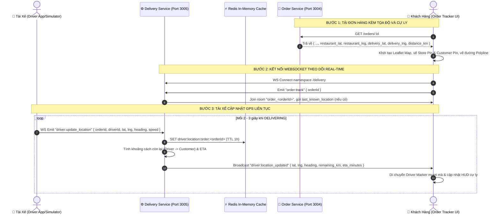

# Kế Hoạch Triển Khai: Bản Đồ Đo Cự Ly Giao Hàng & Định Vị Tài Xế Thời Gian Thực (Real-time GPS Driver Tracking & Map)

> **Mã công việc (Task Code):** `driver-tracking-realtime-gps`  
> **Trạng thái:** `[COMPLETED]`  
> **Tác giả:** `@planner` (Điều phối bởi `@orchestrator`)  
> **Miền nghiệp vụ:** `driver`  
> **Issue liên kết:** [#28 (Driver Tracking - Real-time GPS)](https://github.com/DuyBinh2003/FoodDelivery/pull/65)  
> **Tài liệu tham chiếu:** `docs/services/driver-service.md`, `docs/services/order-service.md`, `docs/architecture/`  

---

## 1. Bối Cảnh & Mục Tiêu Nghiệp Vụ (Context & Objectives)

Hiện tại, màn hình theo dõi đơn hàng (`/orders/[id]`) của khách hàng mới chỉ có thanh lộ trình 1D mô phỏng đơn giản (`OrderVisualRoute`) với các mốc phần trăm cố định (`vehiclePercent = 65%`). Khách hàng chưa thấy được bản đồ địa lý thực tế, chưa biết chính xác cự ly (số km) giữa quán ăn và điểm nhận hàng, cũng như chưa thể theo dõi vị trí di chuyển trực tiếp của tài xế khi cuốc xe đang được giao (`DELIVERING`).

### Mục tiêu triển khai
1. **Bản đồ tương tác đa năng (Interactive Real-time Leaflet Map)**:
   - Tích hợp trực tiếp vào khối Lộ trình của màn hình Order Tracker (`/orders/[id]`).
   - Thiết kế giao diện cao cấp (Dark Mode Glassmorphism) đồng bộ với toàn bộ ứng dụng.
   - Hiển thị 3 mốc tọa độ chính xác:
     * 🏪 **Điểm Lấy Hàng (Restaurant Marker)**: Icon cửa hàng phát sáng màu cam neon, hiển thị tên và địa chỉ quán.
     * 🏠 **Điểm Giao Hàng (Customer Marker)**: Icon ngôi nhà phát sáng màu xanh ngọc (emerald), hiển thị địa chỉ người nhận.
     * 🛵 **Tài Xế Di Chuyển (Driver GPS Marker)**: Icon xe máy nổi bật với hiệu ứng vòng sóng xung (Radar Pulse) và góc xoay hướng di chuyển (heading/rotation).
2. **Tính toán số km và thời gian giao hàng (Distance & ETA Calculation)**:
   - Tự động tính cự ly đường chim bay chuẩn WGS84 (Haversine) từ Nhà hàng đến Điểm giao hàng và hiển thị trên thẻ chỉ số (HUD Badge): ví dụ `Cự ly: 3.2 km`.
   - Tính toán khoảng cách thời gian thực từ vị trí hiện tại của tài xế đến điểm giao và ước tính thời gian còn lại (ETA: `~8-12 phút`).
3. **Cơ chế truyền nhận tọa độ thời gian thực (Real-time GPS via WebSocket)**:
   - Dịch vụ `delivery-service` (Port 3005) mở cổng WebSocket Gateway `@WebSocketGateway({ namespace: 'delivery' })`.
   - Cơ chế Room-based: Mỗi đơn hàng là một phòng theo dõi riêng biệt `order_<orderId>`.
   - Tài xế liên tục đẩy tọa độ GPS lên hệ thống qua sự kiện `driver:update_location` (hoặc REST fallback `POST /delivery/orders/:orderId/location`).
   - Gateway lưu vị trí mới nhất vào Redis Cache (TTL) và broadcast tức thì sự kiện `driver:location_updated` cho khách hàng đang mở đơn hàng đó.
4. **Bộ công cụ mô phỏng di chuyển GPS (Driver GPS Route Simulator)**:
   - Hỗ trợ công cụ mô phỏng di chuyển mượt mà trên UI để người dùng/QA có thể trực tiếp trải nghiệm và kiểm thử xe máy chạy từ quán ăn đến nhà khách hàng từng giây mà không cần thiết bị GPS vật lý ngoài đường.

---

## 2. Kiến Trúc Hệ Thống & Luồng Tương Tác (Architecture & Flow)

---

## 3. Đặc Tả Kỹ Thuật (Technical Specifications)

### A. Backend: `delivery-service` (Port 3005)

1. **WebSocket Gateway (`TrackingGateway`)**:
   - Namespace: `/delivery`
   - CORS: Phù hợp với frontend domain (`*` hoặc từ `ConfigService`).
   - Sự kiện tiếp nhận (Incoming Events):
     * `order:track`: `{ orderId: string }` ➡️ Client gia nhập room `order_${orderId}` và nhận vị trí hiện tại.
     * `driver:update_location`: `{ orderId: string, driverId: string, lat: number, lng: number, heading?: number, speed?: number }` ➡️ Cập nhật vị trí, lưu cache và phát cho room.
   - Sự kiện phát đi (Outgoing Events):
     * `driver:location_current`: Gửi vị trí tức thời vừa lưu trong cache cho client mới join.
     * `driver:location_updated`: Gửi dữ liệu GPS mới kèm cự ly còn lại (`remaining_km`) và ETA (`eta_minutes`).

2. **REST Endpoints (`TrackingController`)**:
   - `GET /delivery/orders/:orderId/location`:
     * Lấy vị trí GPS hiện tại của tài xế đang giao đơn hàng.
     * Phản hồi: `{ orderId, driverId, lat, lng, heading, speed, updatedAt }`.
   - `POST /delivery/orders/:orderId/location`:
     * Endpoint dự phòng cho tài xế cập nhật GPS qua HTTP REST (Payload: `UpdateDriverLocationDto`).
   - `POST /delivery/estimate-distance`:
     * Tính toán khoảng cách và thời gian dự kiến giữa 2 điểm bất kỳ (Payload: `EstimateDistanceDto` gồm `origin_lat, origin_lng, destination_lat, destination_lng`).
     * Phản hồi: `{ distance_km: number, estimated_duration_minutes: number }`.

3. **Redis Caching Strategy (`DriverLocationRedisRepository`)**:
   - Key: `driver:location:order:<orderId>` (Giá trị JSON vị trí GPS tài xế, TTL = 3600s).
   - Key: `driver:location:driver:<driverId>` (Vị trí mới nhất của tài xế).

### B. Backend: `order-service` (Port 3004)

1. Cập nhật `GetOrderUseCase`:
   - Truy vấn thông tin quán ăn từ `restaurant-service` để lấy `lat` và `lon`.
   - Trả về trong payload chi tiết đơn hàng:
     * `restaurant_lat`: number | null
     * `restaurant_lng`: number | null
     * `delivery_lat`: number | null
     * `delivery_lng`: number | null
     * `distance_km`: number | null (tính theo Haversine formula)

### C. Frontend: Next.js App (`frontend/src/features/orders`)

1. **Hook `useDriverTracking` (`hooks/useDriverTracking.ts`)**:
   - Kết nối tới `NEXT_PUBLIC_DELIVERY_SERVICE_URL` namespace `/delivery` qua `socket.io-client`.
   - Lắng nghe tọa độ GPS tài xế và tính toán trạng thái kết nối (`isConnected`, `driverLocation`, `remainingKm`, `etaMinutes`).
2. **Component `OrderTrackingMap` (`components/order-tracking-map.tsx`)**:
   - Sử dụng Leaflet Map với Dark-mode tiles bắt mắt.
   - Glowing Custom Icons:
     * Quán ăn: Pin màu cam kèm icon cửa hàng.
     * Điểm nhận hàng: Pin màu xanh lá kèm icon ngôi nhà.
     * Tài xế: Pin xe máy màu xanh ngọc kèm radar pulse animation.
   - Polyline: Nối lộ trình từ Quán ăn ➔ Tài xế ➔ Điểm giao.
   - Thẻ chỉ số HUD Floating:
     * Tổng số km giao hàng: `~X.X km`.
     * Khoảng cách tài xế đến đích: `~Y.Y km`.
     * Thời gian giao hàng dự kiến (ETA): `~Z phút`.
     * Huy hiệu trạng thái: "Đang truyền GPS thời gian thực (Live GPS)".
   - Nút chức năng: Phóng to toàn cảnh (Fit bounds), Đặt lại tâm bản đồ vào tài xế (Center to driver).
3. **Nâng cấp `OrderVisualRoute` (`components/order-visual-route.tsx`)**:
   - Hỗ trợ 2 chế độ hiển thị linh hoạt (Toggle Tabs):
     * **Bản đồ số trực quan (Live Map)**: Chế độ Leaflet Map đầy đủ tính năng.
     * **Sơ đồ tiến độ (Timeline Track)**: Chế độ thanh tiến độ đơn giản hiện tại.
4. **Widget mô phỏng GPS (`driver-gps-simulator.tsx`)**:
   - Cho phép chạy mô phỏng di chuyển theo lộ trình với thanh điều khiển tốc độ (1x, 2x, 5x) để kiểm thử luồng realtime ngay lập tức.

---

## 4. Kịch Bản Kiểm Thử 3 Nhánh Bắt Buộc (Test Scenarios)

### Nhánh 1: 🟢 Happy Path (Luồng Chuẩn Thành Công)
1. **Tính cự ly Haversine chuẩn xác**:
   - Nhập tọa độ Quán (10.7725, 106.7027) và Nhà (10.7765, 106.7009) ➡️ Tính ra cự ly hợp lệ ~0.5 km.
2. **Kết nối WebSocket & Cập nhật GPS liên tục**:
   - Khách hàng kết nối vào room `order_123` ➡️ Nhận sự kiện `driver:location_current`.
   - Tài xế bắn sự kiện `driver:update_location` ➡️ Khách hàng nhận được `driver:location_updated` với tọa độ mới, `remaining_km` và `eta_minutes` được cập nhật tức thì.
3. **Hiển thị đầy đủ Markers & Polyline trên Bản đồ**:
   - Bản đồ hiển thị cả 3 marker với vị trí chính xác và vẽ đường nối thông suốt giữa các điểm.

### Nhánh 2: 🟡 Edge Cases (Trường Hợp Biên & Giới Hạn)
1. **Đơn hàng chưa có tọa độ GPS (Đơn cũ hoặc dữ liệu thiếu sót)**:
   - Hệ thống tự động fallback an toàn về chế độ Sơ đồ tiến độ thanh trượt (Timeline Track), không xảy ra crash màn hình hoặc lỗi JavaScript.
2. **Tọa độ tài xế trùng với điểm đến**:
   - Cự ly còn lại trả về `0 km`, ETA trả về `1 phút` (đã đến nơi), không bị lỗi chia cho 0.
3. **Mất kết nối mạng / WebSocket gián đoạn**:
   - Thẻ HUD hiển thị trạng thái "Mất kết nối GPS, đang tự động kết nối lại...", lưu giữ vị trí cuối cùng được ghi nhận và tự khôi phục khi có mạng.

### Nhánh 3: 🔴 Error / Rejection Flow (Bảo Vệ & Chống Lỗi)
1. **Tọa độ GPS không hợp lệ (Vượt dải vĩ độ/kinh độ hoặc NaN)**:
   - DTO Validation chặn đứng với lỗi `400 Bad Request` khi `lat < -90` hoặc `lat > 90`.
2. **Yêu cầu theo dõi đơn hàng không tồn tại**:
   - REST API trả về `404 Not Found`, WebSocket phát cảnh báo lỗi không tìm thấy đơn hàng.
3. **Tài xế lạ cố tình gửi tọa độ cho đơn không phụ trách**:
   - Từ chối cập nhật tọa độ nếu `driver_id` không khớp với tài xế nhận cuốc.

---

## 5. Danh Sách Tập Tin Tác Động (File Scope)

### Backend (`delivery-service` & `order-service`):
- `backend/apps/delivery-service/src/modules/tracking/dto/update-location.dto.ts` (Mới)
- `backend/apps/delivery-service/src/modules/tracking/dto/estimate-distance.dto.ts` (Mới)
- `backend/apps/delivery-service/src/modules/tracking/repositories/driver-location.redis.repository.ts` (Mới)
- `backend/apps/delivery-service/src/modules/tracking/tracking.service.ts` (Mới)
- `backend/apps/delivery-service/src/modules/tracking/tracking.controller.ts` (Mới)
- `backend/apps/delivery-service/src/modules/tracking/tracking.gateway.ts` (Mới)
- `backend/apps/delivery-service/src/modules/tracking/tracking.module.ts` (Mới)
- `backend/apps/delivery-service/src/app.module.ts` (Chỉnh sửa: Import TrackingModule)
- `backend/apps/delivery-service/src/modules/tracking/tests/driver-tracking.spec.ts` (Mới: Vitest 3 nhánh)
- `backend/apps/order-service/src/modules/orders/usecases/get-order.usecase.ts` (Chỉnh sửa: Bổ sung tọa độ và cự ly vào response)

### Frontend (`frontend`):
- `frontend/src/features/orders/types/index.ts` (Chỉnh sửa: Thêm `restaurant_lat`, `restaurant_lng`, `delivery_lat`, `delivery_lng`, `distance_km`)
- `frontend/src/features/orders/hooks/useDriverTracking.ts` (Mới: Hook kết nối WebSocket `/delivery`)
- `frontend/src/features/orders/components/order-tracker/components/order-tracking-map.tsx` (Mới: Bản đồ tương tác Leaflet)
- `frontend/src/features/orders/components/order-tracker/components/driver-gps-simulator.tsx` (Mới: Thanh điều khiển mô phỏng GPS)
- `frontend/src/features/orders/components/order-tracker/components/order-visual-route.tsx` (Chỉnh sửa: Nhúng bản đồ và toggle mode)
- `frontend/src/features/orders/components/order-tracker/order-tracker.tsx` (Chỉnh sửa: Chuyển tiếp tọa độ và ID đơn hàng)
- `frontend/src/features/orders/tests/driver-tracking-map.test.ts` (Mới: Unit test frontend)

### Documentation:
- `docs/plans/driver/driver-tracking-realtime-gps.md` (Mới: File kế hoạch này)
- `docs/plans/README.md` (Chỉnh sửa: Cập nhật Master Query Matrix)
- `docs/services/driver-service.md` (Chỉnh sửa sau khi hoàn thành: Cập nhật API và WebSocket spec)
