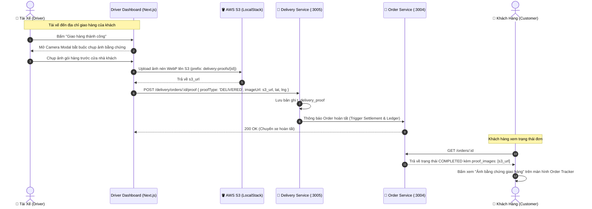

# 📋 Kế Hoạch Triển Khai: Bằng Chứng Giao Hàng & Xác Thực Ảnh Chụp (Proof of Delivery - POD)

`[DRAFT]` • **Issue liên kết:** #D3 • **Phân loại:** `driver` • **Ngày khởi tạo:** 2026-11-09

---

## 1. 🎯 Tổng Quan & Bài Toán Cần Giải Quyết

### 1.1. Hiện trạng & Rủi ro Vận hành (The Non-POD & False Claim Dispute)
- **Hiện trạng:**
  - Tài xế tại cổng `/driver/dashboard` chỉ cần bấm nút "Đã lấy món" và "Đã giao thành công" là đơn hàng lập tức hoàn tất và chuyển tiền.
- **Rủi ro vận hành nghiêm trọng:**
  - **Gian lận khách hàng (False Delivery Claim):** Khách nhận món xong báo lên tổng đài "Chưa từng nhận được đồ ăn" để đòi hoàn tiền (Refund Scam). Nền tảng không có bằng chứng đối soát, phải bồi thường thiệt hại.
  - **Tài xế bấm nhầm hoặc bỏ rơi đơn:** Tài xế chưa đến nơi hoặc giao nhầm địa chỉ (nhầm số nhà, giao cho bảo vệ) nhưng vẫn bấm "Hoàn tất". Khách hàng bức xúc vì không biết đơn hàng đang ở đâu.
  - **Tranh chấp món ăn bị đổ/vỡ khi lấy từ quán:** Tài xế nhận đồ ăn đã bị đổ hoặc quán giao thiếu, đến khi giao khách đổ lỗi cho tài xế làm hỏng.

### 1.2. Mục tiêu kỹ thuật
1. **Quy trình Xác thực 2 Chặng (Two-Stage Photo Verification)**:
   - Chặng 1 (Tại Nhà hàng): Bắt buộc chụp ảnh gói đồ ăn/hóa đơn trước khi rời quán (`PICKED_UP_PHOTO`).
   - Chặng 2 (Tại Điểm giao khách): Bắt buộc chụp ảnh đồ ăn trao tận tay hoặc đặt tại cửa nhà/bàn lễ tân có kèm biển số nhà (`DELIVERED_PHOTO`).
2. **Lưu trữ Ảnh Bất biến trên AWS S3 (LocalStack)**:
   - Ảnh chụp được nén trực tiếp phía client (WebP/JPEG max 1MB) và upload thẳng lên S3 Bucket qua `S3StorageModule` dùng chung.
   - Lưu trữ URL ảnh và Geolocation timestamp vào bảng `t_delivery_proof`.
3. **Hiển thị Minh bạch cho Khách hàng & Bộ phận CS**:
   - Khách hàng trên trang `/orders/[id]/tracking` có thể bấm xem ảnh bằng chứng giao hàng khi đơn chuyển sang `COMPLETED`.
   - Admin/CS Portal tra cứu ảnh chụp trong 1 cú click khi tiếp nhận khiếu nại.

---

## 2. 🔍 Khảo Sát Hiện Trạng Codebase

| File / Component | Hiện trạng | Hành động cần thực hiện |
| :--- | :--- | :--- |
| [`backend/apps/delivery-service/src/modules/delivery`](file:///d:/code/FoodDelivery/backend/apps/delivery-service) | Chỉ có API đổi status `DELIVERING` -> `COMPLETED`. | Bổ sung API `POST /delivery/orders/:id/proof`, validate upload ảnh S3 và lưu metadata. |
| [`backend/libs/common/src/storage`](file:///d:/code/FoodDelivery/backend/libs/common/src/storage) | Có sẵn `S3StorageModule` và `S3StorageService`. | Tái sử dụng để upload ảnh bằng chứng giao hàng vào prefix `delivery-proofs/{orderId}/`. |
| [`frontend/src/features/driver/components/DriverActiveTrip.tsx`](file:///d:/code/FoodDelivery/frontend/src/features/driver) | Nút "Hoàn tất" chỉ trigger PATCH status đơn giản. | Tích hợp Popup chụp ảnh / tải ảnh bằng camera điện thoại trước khi cho phép bấm hoàn tất. |
| [`frontend/src/features/order/components/OrderTracker.tsx`](file:///d:/code/FoodDelivery/frontend/src/features/order) | Đơn completed chỉ hiển thị icon thành công. | Hiển thị thumbnail ảnh "Xem bằng chứng giao hàng" kèm lightbox xem phóng to. |

---

## 3. 🛠️ Thiết Kế Chi Tiết & Giải Pháp Kỹ Thuật

### 3.1. Sơ Đồ Luồng Xác Thực Bằng Chứng Giao Nhận (Sequence Diagram)



### 3.2. Cấu Trúc Bảng Dữ Liệu (`schema_delivery.t_delivery_proof`)
```sql
CREATE TABLE schema_delivery.t_delivery_proof (
    id UUID PRIMARY KEY DEFAULT gen_random_uuid(),
    order_id UUID NOT NULL,
    driver_id UUID NOT NULL,
    proof_type VARCHAR(30) NOT NULL CHECK (proof_type IN ('PICKED_UP', 'DELIVERED')),
    image_url VARCHAR(500) NOT NULL,
    captured_lat NUMERIC(10, 7) NOT NULL,
    captured_lng NUMERIC(10, 7) NOT NULL,
    notes TEXT,
    created_at TIMESTAMP WITH TIME ZONE DEFAULT NOW()
);

CREATE INDEX idx_delivery_proof_order ON schema_delivery.t_delivery_proof(order_id);
```

### 3.3. Thiết Kế Trải Nghiệm Người Dùng Phía Frontend (Next.js UI/UX Integration)

1. **Giao Diện Tài Xế (`/driver/dashboard`)**:
   - Khi đơn ở trạng thái `DELIVERING`, nút `[Xác nhận đã giao]` mở Modal `ProofOfDeliveryDialog`:
     - Tích hợp HTML5 Camera Stream (`navigator.mediaDevices.getUserMedia`) hoặc bộ chọn file ảnh từ thư viện thiết bị.
     - Khung ngắm chụp ảnh với hướng dẫn: *"Vui lòng chụp rõ gói hàng và số nhà hoặc vị trí bàn giao"*.
     - Tự động nén ảnh xuống $< 800\text{KB}$ trước khi upload, hiển thị thanh tiến trình tải ảnh (`Uploading... 85%`).
     - Nút `[Gửi bằng chứng & Hoàn tất]` chỉ sáng khi ảnh đã được tải lên S3 thành công.
2. **Giao Diện Khách Hàng (`/orders/[id]/tracking`)**:
   - Khi đơn hoàn tất, hiển thị thẻ thông báo: `"Đơn hàng đã được giao thành công vào lúc 12:45"`.
   - Nút `[Xem ảnh bàn giao]`: Mở Lightbox modal hiển thị ảnh tài xế chụp gói hàng, tọa độ bàn giao và thời gian chính xác, giúp khách dễ dàng tìm đồ ăn nếu được gửi tại quầy lễ tân/bảo vệ.

---

## 4. 🧪 Kịch Bản Kiểm Thử 3 Nhánh (Testing Policy Compliance)

### 4.1. Nhánh 1: Happy Path (Dòng Chảy Chuẩn)
- **Kịch bản**: Tài xế chụp ảnh hợp lệ, upload lên S3 thành công và gửi request hoàn tất đơn với đầy đủ tọa độ GPS.
- **Kỳ vọng**: 
  - Lưu thành công bản ghi vào `t_delivery_proof`.
  - Đơn hàng chuyển sang `COMPLETED`.
  - Phản hồi HTTP 201 Created.

### 4.2. Nhánh 2: Edge Cases (Biên & Giới Hạn)
- **Kịch bản 1 (File ảnh kích thước quá lớn)**: Tài xế tải ảnh gốc độ phân giải 4K ($> 15\text{MB}$).
- **Kỳ vọng**: Frontend nén ảnh tự động canvas resize xuống dưới 1MB; backend ném `413 Payload Too Large` nếu file vượt quá 5MB để bảo vệ băng thông server.
- **Kịch bản 2 (Tài xế giao hàng quá xa địa chỉ khách)**: Tọa độ chụp ảnh cách địa chỉ nhận hàng $> 500\text{m}$.
- **Kỳ vọng**: Hệ thống hiển thị cảnh báo màu vàng cho tài xế: *"Vị trí của bạn đang cách điểm giao 520m, bạn có chắc chắn đã giao đúng địa chỉ?"* và ghi log cờ cảnh báo cho Admin.

### 4.3. Nhánh 3: Error & Rejection Flow (Ngoại Lệ & Khắc Phục)
- **Kịch bản**: Tài xế cố tình hoàn tất đơn mà không đính kèm `imageUrl` hoặc gửi URL giả mạo.
- **Kỳ vọng**: Backend Validation Pipe chặn đứng với lỗi `400 Bad Request: Bằng chứng ảnh giao hàng là bắt buộc`, không chuyển trạng thái đơn hàng.

---

## 5. ✅ Checklist Tiêu Chuẩn Cần Vượt Qua (Local CI Gate)

- [ ] **Linter**: `npm run lint` đạt 0 warnings, 0 errors.
- [ ] **Type Check**: `npx tsc --noEmit` đạt 0 errors (nghiêm cấm `any`).
- [ ] **Unit Tests (Vitest)**:
  - [ ] `delivery-service/tests/delivery-proof.spec.ts` pass 100%.
  - [ ] `frontend/src/features/driver/tests/proof-of-delivery-dialog.spec.ts` pass 100%.
  - [ ] `frontend/src/features/order/tests/delivery-proof-viewer.spec.ts` pass 100%.
- [ ] **Build Check**: `npm run build` thành công.
- [ ] **Traceability Header**: Đầy đủ `[Requirement/Issue]`, `[Branch: Happy|Edge|Error]`, `[Expected Output]`.

