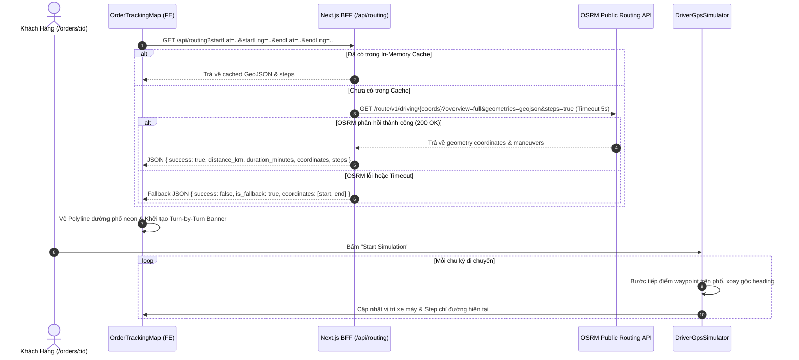

# Kế Hoạch Triển Khai: Tích Hợp Định Tuyến Đường Phố Thực Tế (OSRM Street Routing) & Chỉ Đường Turn-by-Turn Cho Bản Đồ Đơn Hàng

> Trạng thái: `[COMPLETED]`  
> Mã Task: `street-routing-turn-by-turn-map`  
> Phân hệ: `driver` / `customer`  
> Tham chiếu Issue: [#28](https://github.com/DuyBinh2003/FoodDelivery/pull/65)  
> Phụ trách: Master Orchestrator & Planner  

---

## 1. Bối Cảnh & Mục Tiêu Nghiệp Vụ (Context & Objectives)

### 1.1. Hiện Trạng
- Bản đồ theo dõi đơn hàng (`/orders/:id`) hiện đang kết nối Quán ăn $\rightarrow$ Shipper $\rightarrow$ Điểm giao hàng bằng đường thẳng chim bay (Haversine polyline) và nội suy tọa độ tuyến tính.
- Đường thẳng cắt ngang qua nhà dân, công trình, không phản ánh cự ly thực tế trên mạng lưới đường bộ (thực tế đường phố xa hơn 20% - 30% so với đường chim bay).
- Người dùng chưa có trải nghiệm chỉ đường rẽ (turn-by-turn maneuvers) như các ứng dụng gọi xe/giao đồ ăn công nghệ hàng đầu (Grab, ShopeeFood).

### 1.2. Mục Tiêu
1. **Next.js Route Handler Proxy (`/api/routing`)**:
   - Tích hợp **OSRM (Open Source Routing Machine)** định tuyến theo mạng lưới giao thông đường bộ OpenStreetMap.
   - Cơ chế In-Memory Cache (TTL 15 phút) chống spam/rate limit.
   - Cơ chế Graceful Fallback tự động quay về Haversine nếu OSRM timeout (5 giây) hoặc gặp sự cố mạng.
2. **Hiển thị Polyline Đường Phố & Cự Ly Thực Tế (Road km)**:
   - Thay thế đường thẳng bằng Polyline uốn lượn neon chuẩn xác theo từng con đường, ngã rẽ.
   - Cập nhật số km đường bộ và thời gian di chuyển (ETA) thực tế.
3. **Thanh Chỉ Dẫn Rẽ Từng Bước (Turn-by-Turn Navigation Banner)**:
   - Hiển thị banner nổi sang trọng trên bản đồ: icon rẽ (trái, phải, đi thẳng, quay đầu), tên đường và khoảng cách tới ngã rẽ kế tiếp.
4. **Nâng Cấp GPS Route Simulator**:
   - Xe máy shipper di chuyển bám sát từng khúc quanh của đường phố thực tế.
   - Tự động xoay góc `heading` theo góc nghiêng của con đường, và tự động nhảy bước rẽ trên Banner theo thời gian thực.

---

## 2. Thiết Kế Kiến Trúc & Luồng Dữ Liệu

---

## 3. Chi Tiết File Thay Đổi (Proposed Changes)

### 3.1. Frontend Next.js BFF & Utils
- `frontend/src/app/api/routing/route.ts` [NEW]:
  - Route handler xử lý request routing, cache in-memory, timeout 5s, chuẩn hóa tọa độ và maneuver steps sang tiếng Việt.
- `frontend/src/features/orders/utils/geo-map.utils.ts` [MODIFY]:
  - Thêm kiểu `StreetRouteStep`, `StreetRouteResult`.
  - Thêm hàm `fetchStreetRoute(startLat, startLng, endLat, endLng)`.
  - Thêm hàm `translateManeuver(type, modifier, name)` sang tiếng Việt chuẩn giao thông.
  - Thêm hàm `findCurrentStep(currentCoords, steps)`.
- `frontend/src/features/orders/hooks/useStreetRouting.ts` [NEW]:
  - Custom hook quản lý trạng thái fetch route OSRM, caching theo key tọa độ, huỷ request khi unmount.

### 3.2. Frontend UI Components
- `frontend/src/features/orders/components/order-tracker/components/order-tracking-map.tsx` [MODIFY]:
  - Render Polyline bám sát đường phố với 2 lớp neon cyan (glow + core).
  - Hiển thị Turn-by-Turn Navigation Banner ở đỉnh bản đồ.
  - Cập nhật số km đường bộ trên floating HUD.
- `frontend/src/features/orders/components/order-tracker/components/driver-gps-simulator.tsx` [MODIFY]:
  - Tiếp nhận `streetCoordinates` và `steps`.
  - Xe máy di chuyển bám sát từng khúc cua của đường phố.
  - Đồng bộ bước rẽ với Banner chỉ dẫn.
- `frontend/src/features/orders/components/order-tracker/components/order-visual-route.tsx` [MODIFY]:
  - Kết nối hook `useStreetRouting` và đồng bộ state với `OrderTrackingMap` và `DriverGpsSimulator`.

---

## 4. Kịch Bản Kiểm Thử 3 Nhánh (Testing Matrix)

### Kịch bản 1: Nhánh Thuận Lợi (Happy Path)
1. **Truy vấn Route OSRM thành công**:
   - Gửi tọa độ Quán ăn và Điểm giao hợp lệ.
   - Nhận về danh sách tọa độ GeoJSON chi tiết bám sát mạng lưới đường phố.
   - Nhận về các bước rẽ (steps) kèm cự ly và thời gian di chuyển.
2. **Vẽ Polyline & Hiển thị Turn-by-Turn**:
   - Bản đồ hiển thị đường polyline uốn lượn chuẩn xác.
   - Banner Turn-by-Turn hiển thị bước đầu tiên (ví dụ: "Xuất phát từ đường Nguyễn Huệ").
3. **Mô phỏng Simulator theo đường phố**:
   - Xe máy bắt đầu chạy từ Quán ăn theo đúng đường phố, chuyển động góc xoay mượt mà, chạm mốc giao hàng đúng 100%.

### Kịch bản 2: Nhánh Biên & Ranh Giới (Edge Cases)
1. **Tọa độ Quán ăn và Điểm giao trùng nhau**: Cự ly = 0 km, steps = 1 bước "Đã đến nơi", không bị lỗi chia cho 0 hay loop vô tận.
2. **Tọa độ cực gần (< 20 mét)**: OSRM trả về 0 step rẽ, hệ thống tự động hiển thị "Đi thẳng đến điểm giao".
3. **Cache In-Memory Hit**: Gọi lần 2 với cùng cặp tọa độ trả về kết quả ngay lập tức (< 2ms) mà không gọi lại OSRM.

### Kịch bản 3: Nhánh Ngoại Lệ & Dự Phòng (Error & Graceful Fallback Flow)
1. **OSRM Timeout (> 5s)**: AbortController kích hoạt, Route Handler tự động trả về fallback cự ly Haversine và đường thẳng, UI không bị crash.
2. **OSRM Server Error (HTTP 500/503)**: Trả về `is_fallback: true`, bản đồ hiển thị đường thẳng kèm thông báo cảnh báo nhẹ trên console.
3. **Tham số tọa độ không hợp lệ (NaN, ngoài khoảng [-90, 90])**: Trả về HTTP 400 Bad Request với thông điệp lỗi rõ ràng.

---

## 5. Local CI Gate Checklist
- [x] Backend: `npm run lint` (0 warnings/errors, absolute `@/` imports).
- [x] Frontend: `npm run lint` (0 warnings/errors).
- [x] Frontend Type Check: `npx tsc --noEmit` (0 errors).
- [x] Vitest/Node Suite: `npm test` (100% pass trên toàn bộ 34 tests in 12 suites, gồm `street-routing.test.ts`).
- [x] Frontend Build Check: `npm run build` (Biên dịch thành công 100% 24 routes).

