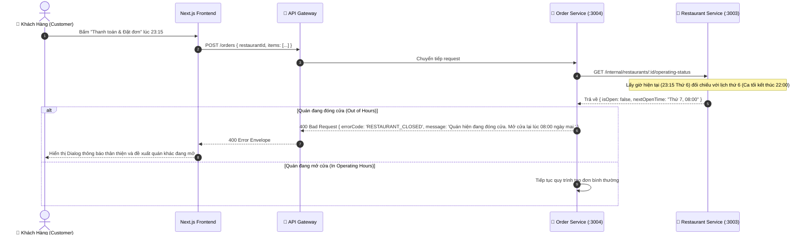

# 📋 Kế Hoạch Triển Khai: Quản Lý Khung Giờ Hoạt Động & Tự Động Đóng/Mở Quán (Restaurant Operating Hours & Auto-Closing)

`[DRAFT]` • **Issue liên kết:** #R2 • **Phân loại:** `partner` • **Ngày khởi tạo:** 2026-11-09

---

## 1. 🎯 Tổng Quan & Bài Toán Cần Giải Quyết

### 1.1. Hiện trạng & Trải Nghiệm Khách Hàng Bị Gãy (The 24/7 Ghost Restaurant Problem)
- **Hiện trạng:**
  - Nhà hàng trong hệ thống chỉ có một trạng thái boolean thô `is_active = true/false`.
  - Nếu chủ quán quên tắt công tắc này khi đóng cửa đi ngủ vào ban đêm, quán vẫn hiển thị nhận đơn 24/7 trên trang chủ.
- **Hậu quả:**
  - Khách hàng nửa đêm đặt món, thanh toán trừ tiền thành công.
  - Tuy nhiên, bếp không có ai nấu, tài xế đến nơi thấy quán đóng cửa then cài, đơn hàng bị treo và khách phải hủy đơn trong bức xúc.

### 1.2. Mục tiêu kỹ thuật
1. **Cấu Hình Khung Giờ Mở Cửa Theo Từng Ngày Trong Tuần (Weekly Operating Schedule)**:
   - Cho phép đối tác thiết lập giờ mở - đóng cửa chi tiết cho từng thứ trong tuần (Thứ Hai đến Chủ Nhật).
   - Hỗ trợ nhiều ca trong một ngày (ví dụ: Ca trưa: 10:00 - 14:00, Ca tối: 17:00 - 22:30).
2. **Cơ Chế Chặn Đơn Tự Động Tại Cổng Tiếp Nhận (Automated Order Ingestion Guard)**:
   - Khi khách hàng bấm đặt đơn, `order-service` tự động đối chiếu thời gian đặt hàng hiện tại (`CURRENT_TIME` theo múi giờ `Asia/Ho_Chi_Minh`) với lịch hoạt động của quán.
   - Nếu ngoài giờ mở cửa hoặc quán đang trong giờ nghỉ giữa ca: Chặn ngay lập tức với mã lỗi `RESTAURANT_CLOSED`.
3. **Trải Nghiệm Đồng Bộ Trên Giao Diện Frontend (Next.js UI Sync)**:
   - Trang chủ và trang thực đơn tự động hiển thị nhãn `Tạm đóng cửa` (Kèm thời gian: *"Mở cửa lại lúc 17:00"*).
   - Vô hiệu hóa nút thêm vào giỏ hàng hoặc đặt đơn khi quán đóng cửa để bảo vệ người dùng không mất thời gian chọn món vô ích.

---

## 2. 🔍 Khảo Sát Hiện Trạng Codebase

| File / Component | Hiện trạng | Hành động cần thực hiện |
| :--- | :--- | :--- |
| [`backend/apps/restaurant-service/src/modules/restaurant`](file:///d:/code/FoodDelivery/backend/apps/restaurant-service) | Bảng `m_restaurant` chỉ có `is_active`. | Tạo bảng `m_restaurant_operating_hour` và Service kiểm tra trạng thái mở cửa theo thời gian thực. |
| [`backend/apps/order-service/src/modules/order`](file:///d:/code/FoodDelivery/backend/apps/order-service) | Chỉ kiểm tra `restaurant.is_active`. | Bổ sung validator kiểm tra quán có đang trong khung giờ mở cửa trước khi cho phép tạo đơn. |
| [`frontend/src/features/partner`](file:///d:/code/FoodDelivery/frontend/src/features/partner) | Chỉ có nút gạt bật/tắt quán thủ công. | Bổ sung giao diện cài đặt lịch mở cửa hàng tuần (`OperatingHoursSettings`). |
| [`frontend/src/features/restaurant`](file:///d:/code/FoodDelivery/frontend/src/features/restaurant) | Trang menu cho phép đặt món bất kể giờ giấc. | Hiển thị Banner "Quán hiện đang đóng cửa" và disable nút thêm món. |

---

## 3. 🛠️ Thiết Kế Chi Tiết & Giải Pháp Kỹ Thuật

### 3.1. Sơ Đồ Kiểm Tra Giờ Hoạt Động Khi Đặt Đơn (Sequence Diagram)



### 3.2. Cấu Trúc Bảng Dữ Liệu (`schema_restaurant.m_restaurant_operating_hour`)
```sql
CREATE TABLE schema_restaurant.m_restaurant_operating_hour (
    id UUID PRIMARY KEY DEFAULT gen_random_uuid(),
    restaurant_id UUID NOT NULL REFERENCES schema_restaurant.m_restaurant(id) ON DELETE CASCADE,
    day_of_week INT NOT NULL CHECK (day_of_week BETWEEN 0 AND 6), -- 0: Chủ Nhật, 1: Thứ Hai, ..., 6: Thứ Bảy
    open_time TIME NOT NULL, -- vd: '08:00:00'
    close_time TIME NOT NULL, -- vd: '22:00:00'
    is_closed_all_day BOOLEAN NOT NULL DEFAULT FALSE,
    created_at TIMESTAMP WITH TIME ZONE DEFAULT NOW(),
    updated_at TIMESTAMP WITH TIME ZONE DEFAULT NOW(),
    CONSTRAINT chk_valid_time_range CHECK (open_time < close_time OR is_closed_all_day = TRUE)
);

CREATE INDEX idx_operating_hour_rest_day ON schema_restaurant.m_restaurant_operating_hour(restaurant_id, day_of_week);
```

### 3.3. Thiết Kế Trải Nghiệm Người Dùng Phía Frontend (Next.js UI/UX Integration)

1. **Phía Đối Tác Nhà Hàng (`OperatingHoursSettings`)**:
   - Màn hình cài đặt lịch mở cửa trực quan theo dạng bảng 7 ngày trong tuần.
   - Mỗi ngày có:
     - Nút gạt: `Mở cửa cả ngày` hoặc `Đóng cửa cả ngày (Nghỉ định kỳ)`.
     - Bộ chọn giờ dạng TimePicker: `Giờ mở cửa` - `Giờ đóng cửa`.
     - Nút `[+ Thêm khung giờ]`: Hỗ trợ tách 2 ca (Ca sáng và Ca tối).
     - Nút `[Áp dụng cho tất cả các ngày]`: Sao chép nhanh lịch của Thứ Hai cho cả tuần trong 1 cú click.
2. **Phía Khách Hàng (`RestaurantPage` & `Homepage`)**:
   - **Thẻ quán trên Trang chủ:**
     - Nếu quán đang đóng cửa: Hình ảnh bị phủ lớp màu tối nhẹ kèm huy hiệu màu xám: `Tạm đóng cửa (Mở lúc 10:00)`.
   - **Trang Chi Tiết Thực Đơn (`/restaurant/[id]`):**
     - Banner cảnh báo nổi bật trên đầu trang: `🌙 Quán hiện chưa mở cửa. Thời gian hoạt động hôm nay: 10:00 - 14:00 và 17:00 - 22:00`.
     - Nút `[Thêm vào giỏ]` chuyển sang trạng thái `disabled` và tooltip hiển thị: *"Quán đang nghỉ, bạn không thể thêm món lúc này"*.
     - Giữ nguyên trải nghiệm xem menu và bảng giá để khách tham khảo món trước.

---

## 4. 🧪 Kịch Bản Kiểm Thử 3 Nhánh (Testing Policy Compliance)

### 4.1. Nhánh 1: Happy Path (Dòng Chảy Chuẩn)
- **Kịch bản**: Khách đặt món lúc 11:30 sáng Thứ Tư; nhà hàng cấu hình giờ mở cửa Thứ Tư từ 08:00 đến 22:00.
- **Kỳ vọng**: 
  - Validator xác định quán đang mở cửa (`isOpen = true`).
  - Đơn hàng được tạo thành công, trả về HTTP 201 Created.

### 4.2. Nhánh 2: Edge Cases (Biên & Giới Hạn)
- **Kịch bản 1 (Đặt đơn vào phút cuối cùng trước khi đóng cửa)**: Quán đóng cửa lúc 22:00:00, khách bấm đặt đơn lúc 21:59:50.
- **Kỳ vọng**: Đơn hàng vẫn được chấp nhận hợp lệ vì thời gian đặt hàng nhỏ hơn `close_time`.
- **Kịch bản 2 (Đặt đơn rơi vào khoảng nghỉ giữa 2 ca)**: Quán mở ca sáng 10:00 - 14:00 và ca chiều 17:00 - 22:00. Khách đặt món lúc 15:30.
- **Kỳ vọng**: Hệ thống từ chối nhận đơn, thông báo rõ: `"Quán đang trong giờ nghỉ giữa ca. Ca tiếp theo sẽ mở lúc 17:00"`.

### 4.3. Nhánh 3: Error & Rejection Flow (Ngoại Lệ & Khắc Phục)
- **Kịch bản**: Chủ quán kích hoạt chế độ "Nghỉ cả ngày" vào dịp lễ Tết (`is_closed_all_day = true`).
- **Kỳ vọng**: Mọi request tạo đơn gửi đến quán trong ngày đó đều bị từ chối ngay tại cửa với mã lỗi `RESTAURANT_CLOSED_ALL_DAY`, không trừ tiền hoặc tạo dữ liệu rác.

---

## 5. ✅ Checklist Tiêu Chuẩn Cần Vượt Qua (Local CI Gate)

- [ ] **Linter**: `npm run lint` đạt 0 warnings, 0 errors.
- [ ] **Type Check**: `npx tsc --noEmit` đạt 0 errors (nghiêm cấm `any`).
- [ ] **Unit Tests (Vitest)**:
  - [ ] `restaurant-service/tests/operating-hours-validation.spec.ts` pass 100%.
  - [ ] `order-service/tests/order-restaurant-open-guard.spec.ts` pass 100%.
  - [ ] `frontend/src/features/partner/tests/operating-hours-settings.spec.ts` pass 100%.
  - [ ] `frontend/src/features/restaurant/tests/restaurant-closed-banner.spec.ts` pass 100%.
- [ ] **Build Check**: `npm run build` thành công.
- [ ] **Traceability Header**: Đầy đủ `[Requirement/Issue]`, `[Branch: Happy|Edge|Error]`, `[Expected Output]`.

