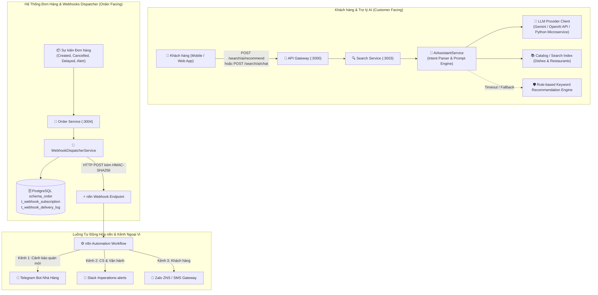

# Kế Hoạch Triển Khai: Trợ Lý AI Gợi Ý Món Ăn & Luồng Tự Động Hóa Thông Báo Qua Webhooks & n8n

> **Mã công việc (Task Code):** `ai-assistant-notification-workflows`  
> **Trạng thái:** `[COMPLETED]`  
> **Tác giả:** `@planner` (Điều phối bởi `@orchestrator`)  
> **Nhánh phát triển:** `feature/issue-86-ai-assistant-notification-workflows`  
> **GitHub Issue:** [#86](https://github.com/DuyBinh2003/FoodDelivery/issues/86)  
> **GitHub PR:** [#87](https://github.com/DuyBinh2003/FoodDelivery/pull/87)  
> **Tài liệu tham chiếu:** `docs/services/search-service.md`, `docs/services/order-service.md`

---

## 1. Bối Cảnh & Mục Tiêu Nghiệp Vụ (Context & Business Objectives)

Trong kỷ nguyên cá nhân hóa thông minh và tối ưu hóa vận hành, hai mắt xích cốt lõi giúp nền tảng Food Delivery bứt phá trải nghiệm người dùng và đối tác là:
1. **Trợ lý AI Gợi ý Món ăn (AI-Powered Food Recommendation Assistant)**:
   - Giúp khách hàng vượt qua trở ngại tâm lý "hôm nay ăn gì?" thông qua tương tác ngôn ngữ tự nhiên (Natural Language Chat & Prompting).
   - Hiểu sâu sở thích ẩm thực, ngữ cảnh sức khỏe, ngân sách, vị trí địa lý và các hạn chế ăn kiêng (ăn chay, dị ứng, giảm cân, món nước ấm bụng khi ốm).
   - Tự động sinh câu trả lời đàm thoại thân thiện kèm danh sách món ăn/quán ăn thực tế từ cơ sở dữ liệu hệ thống, có cơ chế Fallback an toàn (Graceful Degradation) khi dịch vụ AI bên ngoài gặp sự cố.

2. **Luồng Tự động hóa Thông báo qua Webhooks & n8n (Automated Notification Workflows)**:
   - Cầu nối liền mạch giữa các sự kiện vòng đời đơn hàng (`order.created`, `order.cancelled`, `order.delayed`, `merchant.alert`) trong NestJS backend với hệ sinh thái công cụ ngoại vi thông qua n8n.
   - Tự động cảnh báo tới chủ quán qua Telegram Bot/Zalo ZNS ngay khi có đơn mới hoặc sự cố nguyên liệu, giúp quán không bị lỡ đơn hàng.
   - Bắn tin cảnh báo tức thời tới Slack channel cho đội ngũ CS/Vận hành khi phát hiện đơn hàng bị trễ hoặc tranh chấp.
   - Cơ chế bảo mật chữ ký số HMAC-SHA256 (`X-Webhook-Signature`) và xử lý Retry lũy tiến (Exponential Backoff).

---

## 2. Kiến Trúc Kỹ Thuật (Technical Architecture)

---

## 3. Chi Tiết Thiết Kế Kỹ Thuật & Cấu Trúc Dữ Liệu

### A. Phân Hệ 1: AI Food Recommendation Assistant (`search-service`)

1. **DTOs & Interfaces**:
   - `RecommendDishDto`:
     - `prompt`: string (bắt buộc, ví dụ: "tôi bị ốm muốn ăn cháo hoặc súp nóng quanh quận 1 dưới 60k")
     - `lat`: number (tùy chọn)
     - `lng`: number (tùy chọn)
     - `budget`: number (tùy chọn, ngân sách tối đa VND)
     - `dietary`: string[] (tùy chọn: `['VEGETARIAN', 'SEAFOOD_FREE', 'LOW_CALORIE']`)
   - `AiRecommendationResult`:
     - `message`: string (lời tư vấn tự nhiên của AI)
     - `extractedPreferences`: `{ category?: string; maxPrice?: number; mood?: string; keywords: string[] }`
     - `suggestedDishes`: Array of `{ dishId, dishName, restaurantId, restaurantName, price, rating, matchReason }`
     - `source`: `'LLM_POWERED' | 'FALLBACK_RULE_BASED'`

2. **Dịch Vụ AI (`AiAssistantService`)**:
   - **Tách Intent & Trích xuất thực thể**:
     - Phân tích từ khóa sức khỏe (ốm, cảm, sốt $\rightarrow$ cháo, súp, trà gừng).
     - Phân tích thời điểm trong ngày (sáng $\rightarrow$ bún bò, phở; trưa $\rightarrow$ cơm tấm, cơm văn phòng; khuya $\rightarrow$ cháo, mì).
     - Phân tích ngân sách và khoảng giá.
   - **Tích hợp LLM Provider**:
     - Client giao tiếp API LLM (Google Gemini / OpenAI / REST Python AI service) với system prompt chuẩn ẩm thực Việt Nam, sinh JSON có cấu trúc.
     - Kiểm soát timeout (tối đa 4000ms).
   - **Fallback Engine (Graceful Degradation)**:
     - Nếu không có `AI_API_KEY` hoặc request bị timeout/lỗi 5xx, tự động chuyển sang Rule-based matching dựa trên catalog món ăn có sẵn, đảm bảo API luôn trả về 200 OK với kết quả chất lượng.

3. **REST Endpoints (`search-service`)**:
   - `POST /search/ai/recommend`: Gợi ý món ăn thông minh theo ngữ cảnh prompt.
   - `POST /search/ai/chat`: Hội thoại tương tác nhiều lượt (Multi-turn chat) với trợ lý ảo.

---

### B. Phân Hệ 2: Automated Notification Workflows via Webhooks & n8n (`order-service`)

1. **Thực Thể Cơ Sở Dữ Liệu (`schema_order`)**:
   - **Bảng `m_webhook_subscription`**:
     - `id`: UUID (Khóa chính)
     - `target_name`: Varchar(100) (Ví dụ: "n8n Merchant Order Alert", "n8n Ops Slack Alert")
     - `target_url`: Text (Ví dụ: `https://n8n.fooddelivery.local/webhook/order-events`)
     - `subscribed_events`: Text[] (Ví dụ: `['order.created', 'order.cancelled', 'order.delayed', 'merchant.alert']`)
     - `secret_key`: Varchar(255) (Khóa bí mật dùng để sinh mã HMAC-SHA256)
     - `is_active`: Boolean (Mặc định `true`)
     - `created_at`, `updated_at`: Timestamp
   - **Bảng `t_webhook_delivery_log`**:
     - `id`: UUID (Khóa chính)
     - `subscription_id`: UUID
     - `event_type`: Varchar(50)
     - `event_id`: UUID
     - `payload`: JSONB
     - `status`: Varchar(20) (`SUCCESS`, `FAILED`, `RETRYING`)
     - `http_status_code`: Integer
     - `response_body`: Text
     - `attempt_count`: Integer
     - `last_attempt_at`: Timestamp
     - `created_at`: Timestamp

2. **Dịch Vụ Phát Webhook (`WebhookDispatcherService`)**:
   - **Ký Chữ Ký Số Bảo Mật**:
     - `signature = 'sha256=' + HMAC_SHA256(JSON.stringify(payload), secretKey)`
     - Gắn vào Header: `X-Webhook-Signature`, `X-Webhook-Event`, `X-Webhook-Timestamp`, `X-Webhook-Delivery-Id`.
   - **Cơ Chế Retry Với Exponential Backoff**:
     - Khi endpoint n8n trả mã lỗi 5xx hoặc timeout, tự động retry tối đa 3 lần với khoảng thời gian dãn cách: $1s \rightarrow 2s \rightarrow 4s$.
     - Ghi nhận đầy đủ log giao vận vào `t_webhook_delivery_log`.

3. **Tương Tác Sự Kiện Trong Hệ Thống**:
   - Khi `CreateOrderUseCase` tạo đơn thành công $\rightarrow$ Trigger event `order.created`.
   - Khi đơn bị hủy hoặc trễ quá 30 phút $\rightarrow$ Trigger event `order.cancelled` / `order.delayed`.
   - Khi quán cập nhật trạng thái món sắp hết hoặc quá tải $\rightarrow$ Trigger event `merchant.alert`.

4. **REST Endpoints Quản Trị Webhooks (`order-service`)**:
   - `POST /orders/webhooks/subscriptions`: Đăng ký Webhook endpoint n8n.
   - `GET /orders/webhooks/subscriptions`: Danh sách các subscription đang kích hoạt.
   - `POST /orders/webhooks/test-dispatch`: Gửi thử nghiệm sự kiện mẫu tới webhook n8n để kiểm tra kết nối (Ping/Pong check).

5. **Mẫu Cấu Hình Workflow n8n (`docs/workflows/n8n-order-notification-flow.json`)**:
   - Cung cấp file workflow JSON n8n hoàn chỉnh để import trực tiếp vào n8n, gồm các node:
     - `Webhook Node`: Nhận POST request và xác thực HMAC signature.
     - `Switch Node`: Phân loại sự kiện (`order.created` vs `order.delayed` vs `merchant.alert`).
     - `Telegram Node`: Soạn tin nhắn định dạng HTML sinh động và gửi tới Telegram Bot của chủ quán.
     - `Slack Node`: Bắn thông báo tới kênh điều hành `#operations-alerts`.

---

## 4. Thiết Kế Giao Diện Người Dùng & Trải Nghiệm (Frontend UI/UX Implementation)

Để tính năng AI và Luồng tự động hóa thông báo không chỉ dừng lại ở tầng API backend, hệ thống được trang bị 2 phân hệ giao diện hoàn chỉnh trên Frontend Next.js:

### 4.1. Trợ Lý AI Gợi Ý Món Ăn (`AiAssistantWidget` & `AiFoodDialog`)
- **Vị trí tích hợp**:
  - Nút nổi **Floating Action Button (FAB)** với icon Sparkles & Robot ở góc phải dưới màn hình (áp dụng tại Trang chủ `/`, Thực đơn `/menu`, và Chi tiết quán `/restaurant/[id]`).
  - Thanh tìm kiếm thông minh tại Trang chủ: Tích hợp chế độ "Hỏi Trợ lý AI" cho phép người dùng nhập trực tiếp câu hỏi ẩm thực tự nhiên.
- **Cửa sổ Chat Modal (`AiFoodDialog`)**:
  - Thiết kế Dark Mode Glassmorphism cao cấp (`bg-slate-900/90 border border-slate-800 backdrop-blur-xl shadow-2xl`), hiệu ứng phát sáng gradient neon tinh tế (Emerald & Indigo).
  - Thanh gợi ý nhanh (**Quick Prompt Pills**):
    - *"Hôm nay ốm, muốn ăn món gì ấm bụng?"*
    - *"Cơm trưa văn phòng no nê dưới 45k"*
    - *"Thèm đồ ngọt & trà sữa quanh đây"*
    - *"Món chay thanh đạm, ít dầu mỡ"*
  - Hiệu ứng thị giác: **Typing Indicator** (ba chấm lượn sóng) khi AI đang phân tích và tìm món.
- **Thẻ Món Ăn Đề Xuất Trực Tiếp (`AiDishCard`)**:
  - Hiển thị ngay trong dòng tin nhắn chat: Ảnh món chất lượng cao, tên quán ăn, khoảng cách GPS, giá tiền sau ưu đãi và rating sao vàng.
  - **Lý do đề xuất (Match Reason Badge)**: Gắn thẻ nổi bật giải thích tại sao AI gợi ý món này (Ví dụ: *"Phù hợp ngân sách < 50k"*, *"Cháo tía tô giải cảm ấm bụng"*).
  - **Tương tác 1-chạm**:
    - Nút **"+ Thêm vào giỏ"**: Đưa ngay món ăn vào Giỏ hàng toàn cục (Cart Store) kèm toast thông báo mà không cần rời màn hình chat.
    - Nút **"Xem quán ăn"**: Chuyển hướng tới trang chi tiết thực đơn của quán.

### 4.2. Trung Tâm Thông Báo & Cảnh Báo Tức Thời (`NotificationCenterPopover` & Live Toasts)
- **Chuông Thông Báo trên Header (`NotificationBell`)**:
  - Đặt cạnh Avatar người dùng trên Header, hiển thị Badge đỏ đếm số lượng thông báo mới chưa đọc.
  - Nhấp vào chuông bật ra Popover danh sách các thông báo tự động (Đơn hàng đã được quán nhận, tài xế nhận cuốc, cảnh báo trễ đơn, hoặc ưu đãi cá nhân hóa từ AI).
- **Toast Cảnh Báo Động (Live Alert Toasts)**:
  - Khi có sự kiện webhook quan trọng liên quan đến đơn hàng (như n8n trigger cập nhật trạng thái đơn), màn hình sẽ bật Toast với icon động và âm thanh nhẹ nhàng để thông báo cho khách hàng/chủ quán.

---

## 5. Danh Sách Tập Tin Tác Động (File Scope)

### Backend Services:
1. `backend/apps/search-service/src/modules/search/dto/recommend-dish.dto.ts` (Mới)
2. `backend/apps/search-service/src/modules/search/dto/ai-chat.dto.ts` (Mới)
3. `backend/apps/search-service/src/modules/search/services/ai-assistant.service.ts` (Mới)
4. `backend/apps/search-service/src/modules/search/ai-assistant.controller.ts` (Mới)
5. `backend/apps/order-service/src/modules/orders/entities/webhook-subscription.entity.ts` (Mới)
6. `backend/apps/order-service/src/modules/orders/entities/webhook-delivery-log.entity.ts` (Mới)
7. `backend/apps/order-service/src/modules/orders/dto/create-webhook-subscription.dto.ts` (Mới)
8. `backend/apps/order-service/src/modules/orders/dto/dispatch-webhook.dto.ts` (Mới)
9. `backend/apps/order-service/src/modules/orders/services/webhook-dispatcher.service.ts` (Mới)
10. `backend/apps/order-service/src/modules/orders/webhooks.controller.ts` (Mới)

### Frontend Client:
1. `frontend/src/features/search/types/ai.types.ts` (Mới: Kiểu dữ liệu AI Prompt, Response, Suggested Dish)
2. `frontend/src/features/search/api/ai-assistant-api.ts` (Mới: Hàm gọi API `/search/ai/recommend` & `/search/ai/chat`)
3. `frontend/src/features/search/components/ai-assistant-widget.tsx` (Mới: Floating Widget & Chat Dialog)
4. `frontend/src/features/search/components/ai-dish-card.tsx` (Mới: Thẻ món ăn tương tác trong chat)
5. `frontend/src/components/layout/notification-center-popover.tsx` (Mới: Chuông thông báo & danh sách thông báo đơn hàng)
6. `frontend/src/app/layout.tsx` (Chỉnh sửa: Nhúng AiAssistantWidget toàn cục để hỗ trợ mọi trang)
7. `frontend/src/features/search/tests/ai-assistant-ui.test.ts` (Mới: Test suite 3 nhánh cho UI trợ lý AI)

---

## 6. Kịch Bản Kiểm Thử Toàn Diện (Test Scenarios - 3 Nhánh Bắt Buộc)

### Nhánh 1: 🟢 Happy Path (Kịch bản hoạt động chuẩn)
1. **Backend AI Recommendation (LLM Engine)**:
   - Gửi prompt: "trưa nay tôi muốn ăn cơm sườn nướng ít mỡ dưới 50k gần quận 1".
   - Kết quả: Phân tích đúng intent, truy vấn được món ăn phù hợp trong catalog, trả về thông điệp gợi ý tự nhiên cùng danh sách gợi ý chuẩn cấu trúc JSON.
2. **Backend Webhook Dispatcher**:
   - Kích hoạt sự kiện `order.created`, WebhookDispatcher tìm thấy subscription khớp sự kiện, sinh chữ ký `X-Webhook-Signature` HMAC-SHA256 hợp lệ, gửi thành công HTTP 200 tới n8n và ghi log `status = SUCCESS`.
3. **Frontend UI - Tương tác Trợ lý AI**:
   - Khách hàng bấm nút Floating Action Button AI ở góc màn hình: Modal mở mượt mà với các chip gợi ý nhanh.
   - Nhấp vào chip gợi ý hoặc gõ prompt: Hiển thị Typing indicator, sau đó trả lời kèm danh sách thẻ `AiDishCard`.
   - Bấm "+ Thêm vào giỏ" trên thẻ món: Món ăn được nạp ngay vào giỏ hàng, số lượng trên Cart Badge tăng lên chính xác.
4. **Frontend UI - Thông báo Đơn hàng**:
   - Chuông thông báo hiển thị badge số lượng thông báo mới, mở popover xem danh sách các sự kiện cập nhật trạng thái đơn hàng.

### Nhánh 2: 🟡 Edge Cases (Trường hợp biên & Ngưỡng)
1. **Backend AI Fallback khi không có API Key hoặc LLM Timeout**:
   - Giả lập gọi LLM bị timeout quá 4000ms hoặc không cấu hình LLM API Key.
   - Kết quả: Hệ thống kích hoạt Rule-based Keyword Engine một cách trong suốt, trả về danh sách món ăn ăn khớp với `source: 'FALLBACK_RULE_BASED'` mà không làm sập request của người dùng.
2. **Backend Webhook Payload lớn & Tiếng Việt có dấu**:
   - Chuỗi JSON payload tiếng Việt có dấu được tính toán HMAC chính xác tuyệt đối, khớp chữ ký tại phía nhận n8n.
3. **Frontend UI Edge Cases**:
   - Prompt quá ngắn ("đói", "ăn") hoặc câu hỏi không liên quan ẩm thực: AI phản hồi lịch sự kèm gợi ý các món thịnh hành nhất mà giao diện không bị giật lag hay vỡ khung.
   - Khi món ăn gợi ý tạm thời hết hàng (`is_available = false`): Thẻ món hiển thị mờ với nhãn "Tạm hết món" và vô hiệu hóa nút thêm giỏ hàng an toàn.
   - Màn hình mobile cỡ nhỏ (375px): Cửa sổ chat AI tự động co giãn full-screen bottom sheet mượt mà, không bị che thanh điều hướng.

### Nhánh 3: 🔴 Error & Rejection Flow (Luồng lỗi & Từ chối)
1. **Backend Invalid Target URL & Connection Refused**:
   - Đăng ký subscription với URL không hợp lệ $\rightarrow$ Ném ngoại lệ HTTP 400 Bad Request.
   - Gửi webhook tới endpoint n8n bị sập $\rightarrow$ Ghi nhận retry và chuyển log sang `FAILED` kèm thông điệp lỗi bảo toàn trong `{ cause: error }`.
2. **Backend Chữ ký Webhook không khớp (Verification Failure)**:
   - Test utility xác thực chữ ký phát hiện signature giả mạo và từ chối xử lý payload.
3. **Frontend UI Error Handling**:
   - Mất kết nối mạng hoặc Backend Search Service offline (503): Giao diện chat hiển thị hộp thông báo lỗi thân thiện với nút "Thử gửi lại", không gây crash trang ứng dụng.
   - Thêm món vào giỏ khi nhà hàng đang đóng cửa: Báo toast cảnh báo "Nhà hàng hiện đang nghỉ bán" và giữ nguyên giỏ hàng.

---

## 7. Kế Hoạch Triển Khai Từng Bước (Implementation Steps)

1. **Bước 1 (Backend AI Module - `search-service`)**:
   - Tạo DTOs (`recommend-dish.dto.ts`, `ai-chat.dto.ts`).
   - Xây dựng `AiAssistantService` với bộ phân tích intent, tích hợp LLM client và Rule-based fallback engine.
   - Tạo `AiAssistantController` đăng ký các route `/search/ai/recommend` và `/search/ai/chat`.
   - Đăng ký vào `SearchModule`.
2. **Bước 2 (Backend Webhooks & n8n Module - `order-service`)**:
   - Tạo thực thể `m_webhook_subscription` và `t_webhook_delivery_log`.
   - Tạo DTOs (`create-webhook-subscription.dto.ts`, `dispatch-webhook.dto.ts`).
   - Xây dựng `WebhookDispatcherService` với hàm ký HMAC-SHA256, gửi HTTP request và cơ chế Retry.
   - Tạo `WebhooksController` quản lý subscriptions và endpoint test dispatch.
   - Đăng ký vào `OrdersModule`.
3. **Bước 3 (Frontend UI Implementation)**:
   - Xây dựng kiểu dữ liệu `ai.types.ts` và API client `ai-assistant-api.ts`.
   - Phát triển component thẻ món ăn thông minh `AiDishCard` hỗ trợ thêm nhanh vào giỏ hàng.
   - Phát triển Floating Widget & Chat Dialog `AiAssistantWidget` với hiệu ứng typing, chips gợi ý và responsive sheet.
   - Phát triển `NotificationCenterPopover` hiển thị lịch sử thông báo đơn hàng và webhook events trên Header.
   - Nhúng Widget toàn cục vào `frontend/src/app/layout.tsx`.
4. **Bước 4 (Kiểm thử Toàn diện & Local CI Gate)**:
   - Viết test backend Vitest 3 nhánh: `apps/search-service/src/modules/search/tests/ai-assistant.spec.ts` & `apps/order-service/src/modules/orders/tests/webhook-dispatcher.spec.ts`.
   - Viết test frontend UI 3 nhánh: `frontend/src/features/search/tests/ai-assistant-ui.test.ts`.
   - Chạy bộ tứ kiểm soát Local CI Gate: Lint (0 warnings/errors), Typecheck (0 errors), Tests (100% pass), Build (thành công).
5. **Bước 5 (Tài liệu & Đồng bộ)**:
   - Tạo file workflow mẫu `docs/workflows/n8n-order-notification-flow.json`.
   - Cập nhật `docs/services/search-service.md`, `docs/services/order-service.md`, và `docs/plans/README.md`.
