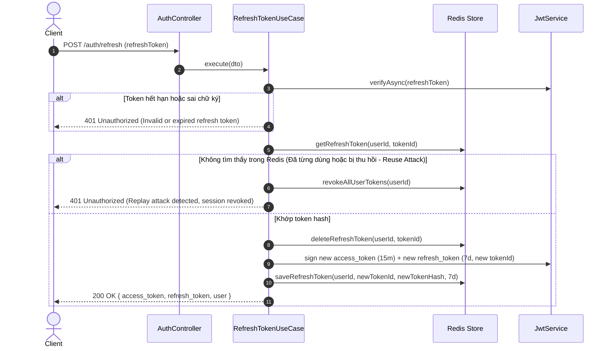
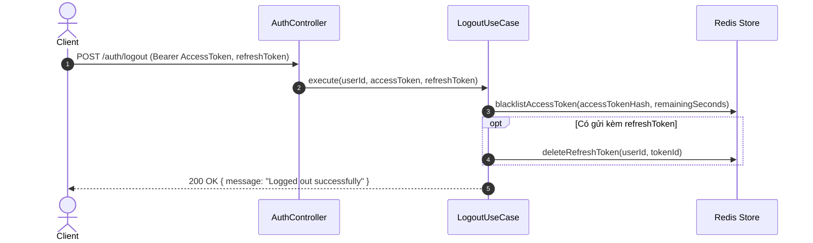

# 📋 Kế Hoạch Triển Khai: Quản Lý Phiên Đăng Nhập Với Refresh Token Rotation (RTR) & Redis Blacklist

`[DRAFT]` • **Issue liên kết:** [#73](https://github.com/DuyBinh2003/FoodDelivery/issues/73) • **Phân loại:** `platform` • **Ngày khởi tạo:** 2026-10-21

---

## 1. 🎯 Tổng Quan & Mục Tiêu

### 1.1. Hiện trạng & Lỗ hổng bảo mật
- Hiện tại, `user-service` phát hành Stateless JWT duy nhất với thời hạn sống dài (`7d`).
- Khi người dùng đăng xuất (`logout`) hoặc nghi ngờ lộ tài khoản:
  - Token cũ vẫn còn hiệu lực đầy đủ cho đến khi tự hết hạn (không có cơ chế thu hồi tức thì).
  - Không có cặp Access Token (ngắn hạn) và Refresh Token (dài hạn).
  - Thiếu cơ chế **Refresh Token Rotation (RTR)**: nguy cơ bị Replay Attack khi refresh token bị đánh cắp.

### 1.2. Mục tiêu đạt được
1. **Cặp Tokens Chuẩn**:
   - `access_token`: Thời gian sống ngắn (15 phút), dùng để xác thực request thông thường.
   - `refresh_token`: Thời gian sống dài (7 ngày), chứa định danh `jti` (UUID) và được lưu trữ có kiểm soát trong Redis.
2. **Refresh Token Rotation (RTR)**:
   - Mỗi lần đổi token (`POST /auth/refresh`), token cũ bị hủy và thay thế bằng refresh token hoàn toàn mới.
   - **Phát hiện tái sử dụng (Reuse Detection)**: Nếu phát hiện một refresh token cũ đã từng được đổi lại được gửi lên, lập tức thu hồi toàn bộ session của tài khoản đó trong Redis (buộc đăng nhập lại toàn diện).
3. **Cơ chế Thu Hồi & Blacklist Tức Thời (`POST /auth/logout`)**:
   - Đưa Access Token hiện tại vào Redis Blacklist với TTL bằng thời gian sống còn lại.
   - Xóa Refresh Token tương ứng khỏi Redis.
4. **Kiểm Tra Blacklist Tại `JwtStrategy`**:
   - Ngăn chặn mọi Access Token đã nằm trong Blacklist, trả về `401 Unauthorized`.
5. **Tuân thủ quy chuẩn dự án**:
   - TypeScript Strict, loại bỏ hoàn toàn `any`.
   - Bắt lỗi chuẩn mực, không nuốt exception.

---

## 2. 🔍 Khảo Sát Hiện Trạng Codebase

| File / Component | Hiện trạng | Hành động cần thực hiện |
| :--- | :--- | :--- |
| [`backend/apps/user-service/src/modules/auth/auth.controller.ts`](file:///d:/code/FoodDelivery/backend/apps/user-service/src/modules/auth/auth.controller.ts) | Chỉ có `POST /auth/register` và `POST /auth/login`. | Thêm `POST /auth/refresh` và `POST /auth/logout`. |
| [`backend/apps/user-service/src/modules/auth/usecases/login.usecase.ts`](file:///d:/code/FoodDelivery/backend/apps/user-service/src/modules/auth/usecases/login.usecase.ts) | Trả về `access_token` duy nhất. | Cấp cả `access_token` và `refresh_token`, lưu hash vào Redis. |
| [`backend/apps/user-service/src/modules/auth/strategies/jwt.strategy.ts`](file:///d:/code/FoodDelivery/backend/apps/user-service/src/modules/auth/strategies/jwt.strategy.ts) | Dùng `payload: any`, không check blacklist. | Định nghĩa `JwtPayload` type-safe, kiểm tra token trong Redis Blacklist. |
| [`backend/apps/user-service/src/modules/auth/auth.module.ts`](file:///d:/code/FoodDelivery/backend/apps/user-service/src/modules/auth/auth.module.ts) | `signOptions: { expiresIn: configService.get<any>('jwt.expiresIn') }`. | Sửa `any` thành type rõ ràng, đăng ký `AuthRedisRepository`, `RefreshTokenUseCase`, `LogoutUseCase`. |

---

## 3. 🛠️ Thiết Kế Chi Tiết

### 3.1. Cấu Trúc Khóa Lưu Trữ Trong Redis
- `auth:refresh:<userId>:<tokenId>`: Lưu `tokenHash` (SHA-256) của refresh token hợp lệ, TTL 7 ngày (604800s).
- `auth:user_tokens:<userId>`: `Set` chứa danh sách các `tokenId` đang hoạt động của user (phục vụ thu hồi hàng loạt khi phát hiện replay attack).
- `auth:blacklist:<tokenHash>`: Giá trị `'1'`, TTL bằng số giây còn lại của Access Token (tối đa 900s).

### 3.2. Luồng Xử Lý Refresh Token (Rotation Flow)

### 3.3. Luồng Xử Lý Logout

---

## 4. 📂 Danh Sách File Tác Động (Impacted Files Matrix)

| Đường dẫn file | Thao tác | Mô tả thay đổi |
| :--- | :---: | :--- |
| `backend/apps/user-service/src/modules/auth/repositories/auth.redis.repository.ts` | `CREATE` | Quản lý Redis CRUD cho Refresh Tokens và Access Token Blacklist. |
| `backend/apps/user-service/src/modules/auth/dto/refresh-token.dto.ts` | `CREATE` | DTO validate `refreshToken` đầu vào. |
| `backend/apps/user-service/src/modules/auth/dto/logout.dto.ts` | `CREATE` | DTO cho endpoint đăng xuất. |
| `backend/apps/user-service/src/modules/auth/interfaces/jwt-payload.interface.ts` | `CREATE` | Interface chuẩn cho JWT Payload (loại bỏ `any`). |
| `backend/apps/user-service/src/modules/auth/usecases/refresh-token.usecase.ts` | `CREATE` | Use Case xoay vòng token và phát hiện replay attack. |
| `backend/apps/user-service/src/modules/auth/usecases/logout.usecase.ts` | `CREATE` | Use Case thu hồi token và blacklist. |
| `backend/apps/user-service/src/modules/auth/usecases/login.usecase.ts` | `MODIFY` | Sinh cặp Access + Refresh token và lưu Redis. |
| `backend/apps/user-service/src/modules/auth/strategies/jwt.strategy.ts` | `MODIFY` | Loại bỏ `any`, kiểm tra token blacklist trong Redis. |
| `backend/apps/user-service/src/modules/auth/auth.controller.ts` | `MODIFY` | Thêm các endpoint `/auth/refresh` và `/auth/logout`. |
| `backend/apps/user-service/src/modules/auth/auth.module.ts` | `MODIFY` | Khai báo các use cases và repository mới, loại bỏ `any`. |
| `backend/apps/user-service/src/modules/auth/tests/auth-refresh-token-rotation.spec.ts` | `CREATE` | Unit test 3 nhánh bám sát kịch bản. |
| `docs/plans/README.md` | `MODIFY` | Cập nhật Master Query Matrix. |
| `docs/services/user-service.md` | `MODIFY` | Bổ sung tài liệu REST API `/auth/refresh` và `/auth/logout`. |

---

## 5. 🧪 Kịch Bản Kiểm Thử 3 Nhánh (Testing Checklist)

### 🌿 Nhánh 1: Happy Path (Kịch bản chuẩn)
- [ ] **HP-01**: Đăng nhập (`login`) thành công trả về cả `access_token` (15m), `refresh_token` (7d) và thông tin user.
- [ ] **HP-02**: Gọi `POST /auth/refresh` với refresh token hợp lệ $\rightarrow$ Trả về cặp `access_token` mới và `refresh_token` mới khác hoàn toàn token cũ.
- [ ] **HP-03**: Gọi `POST /auth/logout` $\rightarrow$ Access token được đưa vào blacklist, refresh token bị xóa khỏi Redis.

### ⚠️ Nhánh 2: Edge Cases (Trường hợp biên & Tải)
- [ ] **EC-01**: Refresh token cận ngày hết hạn (ví dụ còn 5 giây) $\rightarrow$ Vẫn được đổi thành công sang cặp token mới với đủ 7 ngày TTL.
- [ ] **EC-02**: Người dùng đăng xuất khi Access Token chỉ còn 3 giây hiệu lực $\rightarrow$ TTL trong Redis Blacklist được tính chính xác là 3 giây (tránh lưu trữ rác vĩnh viễn).
- [ ] **EC-03**: Người dùng đăng nhập trên 2 thiết bị khác nhau (Device A & Device B) $\rightarrow$ Cả 2 refresh token đều hoạt động độc lập không ghi đè nhau.

### 🛑 Nhánh 3: Error / Security Flow (Xử lý lỗi & Bảo mật)
- [ ] **EF-01**: Gửi refresh token bị lỗi cú pháp / sai chữ ký $\rightarrow$ Trả về `401 Unauthorized` ngay lập tức.
- [ ] **EF-02 (Replay Attack)**: Kẻ xấu đánh cắp token cũ đã được xoay vòng và cố tình gửi lại $\rightarrow$ Hệ thống phát hiện tái sử dụng, lập tức thu hồi toàn bộ phiên đăng nhập của user và trả về `401 Unauthorized`.
- [ ] **EF-03**: Gửi Access Token đã bị Blacklist trong header `Authorization: Bearer <token>` $\rightarrow$ `JwtStrategy` từ chối với `401 Unauthorized (Token has been revoked)`.

---

## 6. 🏁 Local CI Gate & Tiêu Chí Nghiệm Thu

1. **Linter**: `npm run lint` trên backend đạt **0 warnings, 0 errors**.
2. **Type Check**: `npx tsc -p apps/user-service/tsconfig.json --noEmit` đạt **0 errors** (cấm mọi dạng `any`).
3. **Unit Tests**: `npm test` đạt **100% pass**, đặc biệt file `auth-refresh-token-rotation.spec.ts` pass toàn bộ các kịch bản HP, EC, EF.
4. **Docs Sync**: Cập nhật đồng bộ `docs/services/user-service.md` và `docs/plans/README.md`.
