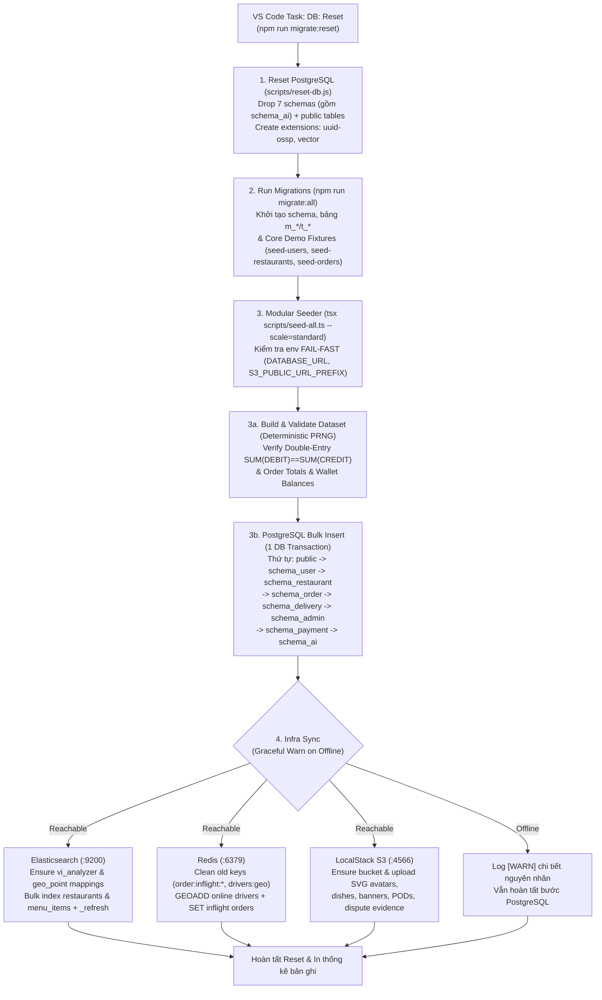
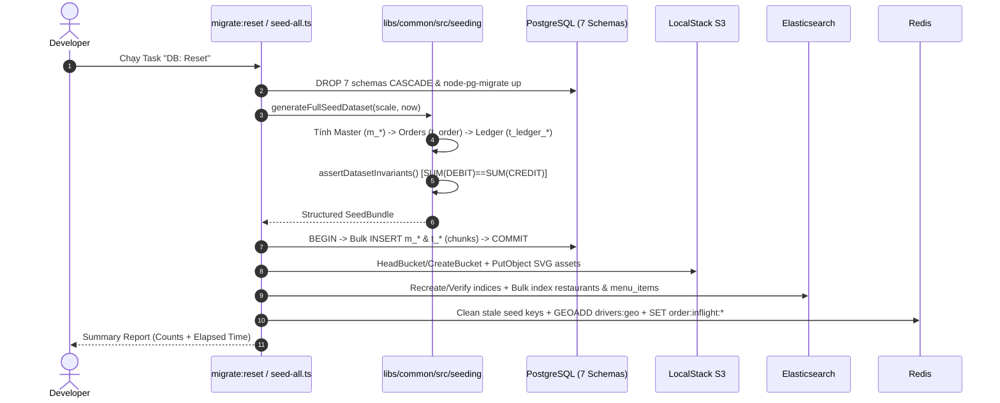

# Kế Hoạch Triển Khai: Hệ Thống Seed Dữ Liệu Quy Mô Lớn & Tích Hợp Vào Task Reset DB

> **Trạng thái:** `[COMPLETED]`  
> **Phân loại:** `platform` | **Truy vết:** Sinh từ phiên `/grill-me` ngày 2026-11-25  
> **Mục tiêu:** Xây dựng hệ thống Seeder chuẩn hóa cho toàn bộ 7 schemas cơ sở dữ liệu (từ bảng Master `m_*` tới Transaction `t_*`), đảm bảo bất biến nghiệp vụ FinTech Sổ cái kép, làm giàu dữ liệu cho 6 tài khoản Demo, tích hợp trực tiếp vào `npm run migrate:reset` / task VS Code `DB: Reset`, đồng thời đồng bộ tự động Elasticsearch, Redis và LocalStack S3.

---

## 1. Tóm Tắt Quyết Định Thiết Kế (Resolved Design Decisions)

| Nhạng mục | Quyết định đã thống nhất |
|---|---|
| **Quy mô mặc định & Scale Preset** | Preset mặc định (`standard`) tối ưu Dev/Demo trong ~5–10s: ~100 Users, ~150 Restaurants, ~1.500 Menu Items, ~600 Orders, ~1.500+ Ledger Entries. Hỗ trợ `--scale=large` (`npm run migrate:reset:large` / `npm run seed:large`) nâng lên ~500 Restaurants, ~5.000+ Menu Items, ~3.000+ Orders. |
| **Reset Schema & Infra Sync** | Sửa `reset-db.js` drop sạch cả **7 schemas** (bổ sung `schema_ai` vốn đang bị thiếu). Sau `migrate:all`, tự động re-index Elasticsearch (`restaurants`, `menu_items` đúng mapping Tiếng Việt/geo_point), dọn & nạp Redis (`drivers:geo`, `order:inflight:*`), sync SVG lên LocalStack S3. Áp dụng **Graceful Warn** nếu ES/Redis/LocalStack đang tắt. |
| **Tài khoản Demo & Media S3** | Giữ nguyên UUID cố định của 6 tài khoản Demo trên màn hình Login (`customer@fooddelivery.com`, `driver1`, `driver2`, `owner@phobien.com`, `owner@bunbo.com`, `admin@fooddelivery.com`) và ưu tiên phân bổ dữ liệu đa dạng (đơn đủ 7 trạng thái, ví, voucher, điểm thưởng, khiếu nại, POD, chat AI). Toàn bộ ảnh dùng SVG tự sinh đồng bộ trên LocalStack S3 (`S3_PUBLIC_URL_PREFIX`), không chết link khi offline. |
| **Tổ chức Code & Benchmark** | Kiến trúc 2 tầng: giữ 3 migration `seed-*` làm **Core Demo Fixtures**; xây dựng **Modular Seeder Engine** bằng TypeScript strict tại `backend/libs/common/src/seeding/` + runner tại `backend/scripts/seed-all.ts` (idempotent). Tách benchmark search ra `backend/scripts/benchmark-search.ts` (dùng port `:4006` / NGINX `:8080/api/search`, bỏ URL `:3006` cũ). |

---

## 2. Sơ Đồ Luồng Thực Thi `DB: Reset` (End-to-End Pipeline)

---

## 3. Phạm Vi Dữ Liệu Toàn Diện (7 Schemas: `m_*` & `t_*`)

### 3.1 Ma Trận Sản Lượng Theo Preset

| Schema | Bảng | Loại | Standard (`DB: Reset`) | Large (`--scale=large`) | Quy tắc nghiệp vụ & Ràng buộc |
|---|---|---:|---:|---:|---|
| `public` | `m_system_config` | `m_` | 5–6 keys | 5–6 keys | Giữ 3 rate chuẩn (`RESTAURANT_COMMISSION_RATE=20`, `DRIVER_FEE_RATE=10`, `TAX_RATE=8`) + bổ sung config hiển thị |
| `schema_user` | `m_user` | `m_` | ~200 | ~650 | 6 Demo Users + ~80 Customers + ~25 Drivers + 150 (hoặc 500) Owners (1-1 với Quán) + Admins |
| `schema_user` | `m_customer_profile` | `m_` | ~200 | ~650 | 100% users đều có hồ sơ tên Việt & SĐT hợp lệ `09xxxxxxxx` |
| `schema_user` | `m_driver_profile` | `m_` | ~25 | ~80 | Đủ `ONLINE` (`APPROVED`, tọa độ quanh TP.HCM), `OFFLINE` (`APPROVED`), `PENDING`/`REJECTED` |
| `schema_user` | `m_user_address` | `m_` | ~160 | ~400 | Mỗi Customer có 1–3 địa chỉ (`HOME`, `WORK`, `OTHER`), 1 địa chỉ `is_default = true` |
| `schema_user` | `m_loyalty_wallet` | `m_` | ~90 | ~220 | Mỗi Customer 1 ví (`BRONZE`, `SILVER`, `GOLD`, `PLATINUM`); `available_points` khớp lịch sử `t_loyalty_transaction` |
| `schema_user` | `t_registration_request` | `t_` | ~35 | ~100 | Hồ sơ `DRIVER` & `RESTAURANT` đủ trạng thái `PENDING`, `APPROVED`, `REJECTED` (Admin KYC Queue) |
| `schema_user` | `t_loyalty_transaction` | `t_` | ~350 | ~1.500 | `EARN`, `REDEEM_ORDER`, `REFUND` khớp `idempotency_key`, `balance_after` liên hoàn |
| `schema_restaurant` | `m_category` | `m_` | 10 | 10 | Phở, Bún Bò, Giải khát, Cơm Tấm, Trà Sữa, Gà Rán & Burger, Bánh Mì, Pizza & Mì Ý, Món Chay, Cà Phê & Bánh |
| `schema_restaurant` | `m_tag` | `m_` | 16 | 16 | Giữ nguyên 16 tag chuẩn (Món Nước, Bò, Gà, Ăn Vặt, Hải Sản, Cay Nồng, Healthy, Bán Chạy...) |
| `schema_restaurant` | `m_restaurant` | `m_` | ~150 | ~500 | Mỗi quán gắn `owner_id` duy nhất 1-1 trỏ đúng `m_user`; phân bổ tọa độ thực tế TP.HCM; rating đối soát từ `t_order_review` |
| `schema_restaurant` | `m_restaurant_category` | `m_` | ~220 | ~750 | 1–2 danh mục cho mỗi nhà hàng |
| `schema_restaurant` | `m_restaurant_operating_hour` | `m_` | ~1.050 | ~3.500 | Đủ 7 ngày (`0..6`) cho 100% nhà hàng để API check mở cửa/đóng cửa hoạt động đúng |
| `schema_restaurant` | `m_menu_item` | `m_` | ~1.500 | ~5.000+ | Đủ `original_price`, JSONB `options` (Size/Topping/Đá-Đường), ~95% available & ~5% sold-out (`is_available=false`) |
| `schema_restaurant` | `m_menu_item_tag` | `m_` | ~4.500 | ~15.000+ | 2–4 tags mỗi món ăn phục vụ filter Search & Menu |
| `schema_order` | `m_campaign` | `m_` | 5 | 8 | `CO_FUNDED`, `PLATFORM`, `MERCHANT`; có cả campaign sắp hết/đang chạy/`emergency_killed=false` |
| `schema_order` | `m_merchant_campaign_budget` | `m_` | ~40 | ~120 | Ngân sách đồng tài trợ cho các quán tham gia campaign |
| `schema_order` | `m_voucher` | `m_` | 16 | 30 | Đủ 4 loại (`PLATFORM_DISCOUNT`, `MERCHANT_DISCOUNT`, `FREE_SHIPPING`, `PAYMENT_DISCOUNT`) + `COLLECTIBLE` & `PROMO_CODE` |
| `schema_order` | `m_voucher_rule` | `m_` | ~24 | ~50 | Rules theo `PAYMENT_METHOD`, `USER_SEGMENT`, `MENU_CATEGORY`, `GEO_FENCE` |
| `schema_order` | `t_user_voucher` | `m_`/`t_` | ~180 | ~600 | Đủ `AVAILABLE`, `USED`, `EXPIRED`, `RESERVED` trong ví khách hàng (ưu tiên demo customer) |
| `schema_order` | `t_order` | `t_` | ~600 | ~3.000 | Đủ 7 trạng thái (`COMPLETED` ~65%, `DELIVERING`/`READY_FOR_PICKUP`/`COOKING`/`ACCEPTED`/`PENDING` ~25%, `CANCELLED` ~10%), trải đều **30 ngày qua + hôm nay + realtime** |
| `schema_order` | `t_order_item` | `t_` | ~1.500 | ~7.500 | 1–4 món / đơn; `SUM(quantity * unit_price)` bằng đúng `t_order.subtotal` |
| `schema_order` | `t_order_review` | `t_` | ~320 | ~1.500 | Chỉ gắn cho đơn `COMPLETED`, rating 1–5 (thực tế 3–5*), comment tiếng Việt + `image_urls` S3 |
| `schema_order` | `t_voucher_usage` | `t_` | ~140 | ~700 | Khớp các đơn có dùng voucher (`APPLIED` / `REVERTED` cho đơn hủy) |
| `schema_order` | `t_voucher_reservation` | `t_` | ~15 | ~50 | Lock TTL cho các đơn đang xử lý (`LOCKED` / `COMMITTED` / `RELEASED`) |
| `schema_delivery` | `t_delivery_proof` | `t_` | ~450 | ~2.000 | Chặng `PICKED_UP` cho đơn đang giao & đã xong; chặng `DELIVERED` cho đơn `COMPLETED`, URL ảnh POD trên S3 |
| `schema_admin` | `t_order_dispute` | `t_` | ~35 | ~120 | Đủ 4 trạng thái `OPEN`, `INVESTIGATING`, `RESOLVED` (`FULL_REFUND`/`PARTIAL_REFUND`), `REJECTED`; độ ưu tiên `URGENT`/`HIGH`/`NORMAL` |
| `schema_payment` | `m_wallet_account` & `m_wallet_balance` | `m_` | ~260 | ~1.200 | Hệ thống (`SYS_REVENUE_PLATFORM_COMMISSION`, `SYS_ASSET_GATEWAY_VNPAY`, `SYS_ASSET_GATEWAY_MOMO`) + `WALLET_CUSTOMER_*` + `WALLET_DRIVER_*` + `WALLET_RESTAURANT_*` |
| `schema_payment` | `t_payment_intent` | `t_` | ~600 | ~3.000 | `COD` (`PENDING_COD`/`SUCCEEDED`) & `WALLET`/`VNPAY`/`MOMO` khớp 100% với `t_order` |
| `schema_payment` | `t_ledger_transaction` | `t_` | ~900+ | ~4.200+ | Gồm `WALLET_TOPUP`, `ORDER_SETTLEMENT`, `COMMISSION_FEE`, `REFUND`, `WITHDRAWAL` |
| `schema_payment` | `t_ledger_entry` | `t_` | ~2.200+ | ~10.000+ | Append-only, **bất biến `SUM(DEBIT) == SUM(CREDIT)`** cho mọi giao dịch; `balance_after` khớp `m_wallet_balance` |
| `schema_payment` | `t_withdrawal_request` | `t_` | ~35 | ~120 | Đủ `PENDING`, `APPROVED`, `PROCESSING`, `COMPLETED`, `REJECTED` từ Driver & Restaurant; tiền chờ duyệt khớp `locked_balance` |
| `schema_payment` | `t_outbox` & `t_idempotency_key` | `t_` | ~100 | ~400 | Sự kiện `PUBLISHED` & mẫu `PENDING` để inspect/giám sát Transactional Outbox |
| `schema_ai` | `m_knowledge_chunks` | `m_` | ~15+ | ~15+ | Đọc/chunk tự động từ `ai-python/knowledge-base/**/*.md` (kèm tùy chọn gọi `/internal/rag/embed` nếu LangGraph `:5002` đang bật) |
| `schema_ai` | `m_chat_sessions`, `t_chat_messages`, `t_chat_feedback` | `m_`/`t_` | ~20 / ~80 / ~25 | ~60 / ~240 / ~80 | Hội thoại tư vấn món, hỏi đơn hàng, chính sách hoàn tiền cho các tài khoản Demo & Customer |

---

## 4. Quy Chuẩn Kỹ Thuật & Bất Biến Dữ Liệu Bắt Buộc

1. **Deterministic Seed Generator (`SeedPrng`)**: Sử dụng Mulberry32 + UUIDv4 determinstic từ seed cố định (`20261125`) → mọi lần `DB: Reset` cho ra bộ dữ liệu nhất quán, dễ tái hiện bug/test, không tạo UUID trùng với prefix demo (`a0eebc99-...`, `b0eebc99-...`, `c0eebc99-...`, `d0eebc99-...`, `e0eebc99-...`, `f0eebc99-...`).
2. **Bảo toàn tuyệt đối Core Demo Data**:
   - Đọc/giữ đúng 6 Demo Users (`customer@fooddelivery.com`, `driver1@fooddelivery.com`, `driver2@fooddelivery.com`, `owner@phobien.com`, `owner@bunbo.com`, `admin@fooddelivery.com` — password `password123`).
   - Toàn bộ bảng/dòng seed thêm sử dụng `ON CONFLICT DO NOTHING` hoặc IDs tách dải khỏi `seed-*` migrations, đảm bảo an toàn khi chạy lại `npm run seed:all`.
   - Làm giàu riêng cho tài khoản Demo: `customer@fooddelivery.com` có tối thiểu 25+ đơn hàng ở đủ các trạng thái (kể cả đơn đang `DELIVERING`/`COOKING` trong Redis), số dư ví ~2.500.000đ, hạng `GOLD`, 6 voucher trong ví, 2–3 khiếu nại và lịch sử AI chat; `owner@phobien.com` & `owner@bunbo.com` có 40+ đơn trong 30 ngày + KDS live orders + doanh thu ví + payout history; `driver1@fooddelivery.com` luôn `ONLINE` trên Redis GEO kèm lịch sử 30+ cuốc + ví có doanh thu & lệnh rút tiền; `admin@fooddelivery.com` có ngay hàng đợi KYC (`PENDING`), đơn rút tiền chờ duyệt (`PENDING`), khiếu nại (`OPEN`/`INVESTIGATING`), và doanh thu Treasury cân bằng sổ cái.
3. **Bất biến Kế toán Sổ cái kép (`Double-Entry Bookkeeping`)**:
   - Mọi tính toán tiền dùng `Decimal` (`decimal.js`) tương đồng hoàn toàn với `LedgerWriteRepository`:
     - Tài khoản `ASSET` (`SYS_ASSET_GATEWAY_*`): `DEBIT` tăng, `CREDIT` giảm.
     - Tài khoản `LIABILITY` (`WALLET_*`) và `REVENUE` (`SYS_REVENUE_PLATFORM_COMMISSION`): `CREDIT` tăng, `DEBIT` giảm.
   - Bắt buộc chạy hàm `assertDatasetInvariants(bundle)` **trước khi chạm vào DB** để ném lỗi nếu phát hiện lệch tổng `DEBIT != CREDIT`, lệch `subtotal`, âm ví `CUSTOMER`/`RESTAURANT`, hoặc thiếu FK logic.
4. **Cấm Fallback Ngầm & Cấm `any` (`general-project-policy`)**:
   - Toàn bộ code TypeScript trong `backend/libs/common/src/seeding/` và `backend/scripts/*.ts` không dùng `any`, dùng đường dẫn tuyệt đối `@/common/...`.
   - `reset-db.js` và `seed-all.ts` fail-fast rõ ràng nếu thiếu `DATABASE_URL` hoặc cấu hình S3/ES bắt buộc sai định dạng; các hạ tầng phụ trợ (ES, Redis, LocalStack) khi kết nối bị lỗi phải log `[WARN]` với nguyên nhân cụ thể (`error instanceof Error ? error.message : String(error)`), tuyệt đối không nuốt lỗi im lặng.
5. **Tách Search Benchmark (`benchmark-search.ts`)**:
   - Không chạy benchmark tải lúc `DB: Reset`.
   - Tạo script `npm run benchmark:search` riêng, đọc URL từ `SEARCH_SERVICE_URL` / `PUBLIC_GATEWAY_URL` (mặc định qua biến env theo chuẩn cấu hình `.env`, không hardcode `:3006`).

---

## 5. Danh Sách File Dự Kiến Thay Đổi / Tạo Mới

| File | Hành động | Vai trò |
|---|---|---|
| `backend/libs/common/src/seeding/seed-types.ts` | Tạo mới | Interface chuẩn cho Scale Preset (`standard` \| `large`), Core Demo IDs, toàn bộ Record DTO của 7 schemas |
| `backend/libs/common/src/seeding/seed-prng.ts` | Tạo mới | Deterministic PRNG (Mulberry32), deterministic UUIDv4, bộ sinh tên/địa chỉ/tọa độ TP.HCM & timestamps |
| `backend/libs/common/src/seeding/seed-master-builders.ts` | Tạo mới | Sinh toàn bộ bảng Master (`m_*`), Categories, Tags, Restaurants, Operating Hours, Menu Items, Campaigns, Vouchers, Knowledge Chunks |
| `backend/libs/common/src/seeding/seed-ledger-builder.ts` | Tạo mới | Mô phỏng Sổ cái kép (`m_wallet_account`, `m_wallet_balance`, `t_ledger_transaction`, `t_ledger_entry`, `t_withdrawal_request`) chuẩn `Decimal` |
| `backend/libs/common/src/seeding/seed-transaction-builders.ts` | Tạo mới | Sinh toàn bộ Transaction (`t_*`): Orders, Items, Reviews, Proofs, Disputes, Vouchers Usage/Reservation, Loyalty Txns, AI Chats, Outbox |
| `backend/libs/common/src/seeding/seed-validators.ts` | Tạo mới | Kiểm tra bất biến trước khi insert (`SUM(DEBIT)==SUM(CREDIT)`, `total_amount` orders, FK logic, `locked_balance`) |
| `backend/libs/common/src/seeding/seed-s3-assets.ts` | Tạo mới | Sinh nội dung SVG hiện đại cho Categories/Dishes/Banners/Avatars/POD/Dispute Evidence & map key S3 |
| `backend/libs/common/src/seeding/seed-generator.ts` | Tạo mới | Hàm điều phối `generateSeedBundle(options)` kết hợp Master + Transactions + Ledger + Invariant Validation |
| `backend/libs/common/src/seeding/index.ts` | Tạo mới | Barrel export cho `@/common/seeding/index.js` |
| `backend/libs/common/src/seeding/tests/seed-generator.spec.ts` | Tạo mới | Vitest 3 nhánh (Happy / Edge / Error) có Traceability Header |
| `backend/scripts/reset-db.js` | Chỉnh sửa | Bổ sung `DROP SCHEMA IF EXISTS schema_ai CASCADE;` + giữ extensions `uuid-ossp`, `vector` |
| `backend/scripts/seed-all.ts` | Tạo mới | CLI runner nạp PostgreSQL (1 Transaction theo chunks) + Sync S3 LocalStack + Re-index ES + Clean/Seed Redis |
| `backend/scripts/sync-s3-seed.js` | Chỉnh sửa | Tái sử dụng template SVG mở rộng và hỗ trợ đồng bộ đầy đủ tài nguyên mặc định + mở rộng |
| `backend/scripts/seed-large-dataset.js` | Chỉnh sửa | Chuyển hướng/tái sử dụng engine mới (`--scale=large`) thay cho code cũ thiếu user/order/wallet |
| `backend/scripts/benchmark-search.ts` | Tạo mới | Script benchmark tìm kiếm Tiếng Việt, Geo-Ranking và 100 concurrent autocomplete qua `:4006` / Gateway |
| `backend/package.json` | Chỉnh sửa | Thêm `seed:all`, `migrate:reset:large`, `benchmark:search`; tích hợp `seed:all` vào cuối `migrate:reset` |
| `.vscode/tasks.json` | Chỉnh sửa | Cập nhật mô tả `"DB: Reset"` (reset + full seed + infra sync), thêm `"DB: Reset (Large)"` & `"DB: Seed All"` |
| `docs/plans/README.md` | Cập nhật | Đăng ký plan `[DRAFT]` -> `[COMPLETED]` khi nghiệm thu |
| `docs/architecture/database-schema-strategy.md` *(nếu cần sau khi nghiệm thu)* | Cập nhật | Đồng bộ tài liệu chiến lược seeding & reset DB theo `documentation-policy` |

---

## 6. Verification Plan (Kế Hoạch Kiểm Thử & Cổng Kiểm Soát CI)

### 6.1 Automated Tests (`backend/libs/common/src/seeding/tests/seed-generator.spec.ts`)
Tuân thủ `.agents/skills/testing-policy/SKILL.md` (Vitest 3 nhánh + Traceability Header):
- **🟢 Happy Path**:
  1. Preset `standard` sinh đủ số lượng kỳ vọng ở mọi bảng `m_*` (≥100 users, ≥150 restaurants, ≥1.500 menu items, 10 categories, 16 tags, 7 ngày giờ mở cửa/quán) và `t_*` (≥600 orders, reviews, proofs, disputes, withdrawals, loyalty, AI sessions).
  2. Tính tái lập tất định (Deterministic): Gọi `generateSeedBundle({ scale: 'standard', referenceDate })` 2 lần cho ra dữ liệu IDs và tổng tiền khớp 100%, không chứa giá trị trùng lặp PK/Unique (`email`, `owner_id`, `account_code`, `code`, `idempotency_key`, `order_id` trong review).
  3. Bất biến Sổ cái kép: `SUM(DEBIT) === SUM(CREDIT)` ở mọi `t_ledger_transaction`, và `m_wallet_balance.available_balance` bằng chính xác `balance_after` của bút toán cuối cùng từng ví.
  4. Tài khoản Demo (`customer@fooddelivery.com`, `driver1`, `owner@phobien.com`, `admin`) có đủ đơn hàng theo cả 7 trạng thái, số dư ví dương, loyalty, voucher, dispute và dữ liệu Redis (`order:inflight`, `drivers:geo`).
- **🟡 Edge Cases**:
  1. Preset `large` mở rộng lên 500 nhà hàng / 5.000+ món / 3.000+ đơn vẫn bảo toàn `owner_id` 1-1 unique, rating nhà hàng trong `[1.00, 5.00]`, `total_amount >= 0` khi điểm thưởng + voucher trừ sát subtotal.
  2. Ví tài xế có giao dịch cấn trừ hoa hồng COD (`COMMISSION_FEE`) xử lý chính xác cân bằng kép và xử lý đúng trạng thái `locked_balance` đối với lệnh rút tiền `PENDING`/`PROCESSING`.
  3. Đồng bộ hạ tầng phụ trợ (ES/Redis/LocalStack) xử lý graceful warning khi service target trả lỗi kết nối, không làm văng mất kết quả PostgreSQL.
- **🔴 Error & Rejection Flows**:
  1. Truyền `scale` không hợp lệ (vd `'invalid'`) ném lỗi cấu hình rõ ràng thay vì fallback ngầm.
  2. Hàm `assertDatasetInvariants` phát hiện và từ chối (`throw Error`) khi cố tình truyền một giao dịch lệch `DEBIT != CREDIT`, lệch `subtotal != sum(items)`, hoặc thiếu tài khoản chủ sở hữu `owner_id`.
  3. Thiếu biến môi trường bắt buộc (`DATABASE_URL` hoặc URL service khi chạy runner/benchmark) ném `ConfigError` fail-fast.

### 6.2 Local CI Gate & Kiểm Chứng Thực Tế (Live End-to-End)
1. **Local CI Gate (`backend/`)**:
   - `npm run lint` (`oxlint apps/ libs/ test/ && node scripts/check-imports.js`) → `0 warnings, 0 errors`.
   - `npx tsc --noEmit` → `0 errors`.
   - `npm test` → 100% pass (bao gồm toàn bộ test cũ + test suite seeding mới).
   - `npm run build` → biên dịch thành công tất cả 8 services + shared libs.
2. **Live `DB: Reset` Verification**:
   - Chạy thực tế `npm run migrate:reset` trên PostgreSQL + Redis + Elasticsearch + LocalStack đang chạy.
   - Truy vấn kiểm tra số dòng từng bảng trong 7 schemas, chạy SQL kiểm toán `SELECT SUM(CASE WHEN entry_type='DEBIT' THEN amount ELSE 0 END) - SUM(CASE WHEN entry_type='CREDIT' THEN amount ELSE 0 END) FROM schema_payment.t_ledger_entry;` (= `0`).
   - Gọi API thực tế qua NGINX `:8080`: `/api/search/restaurants`, `/api/orders/history/me`, `/api/wallets/...`, `/api/admin/...` để xác nhận UI/API nhận dữ liệu trơn tru không lỗi.
