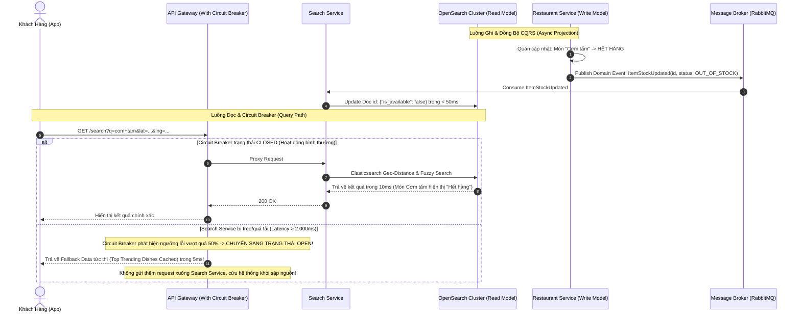

# 📋 Kế Hoạch Triển Khai: CQRS Search Catalog & Resilience Circuit Breaker Pattern

`[DRAFT]` • **Issue liên kết:** #85 • **Phân loại:** `platform` • **Ngày khởi tạo:** 2026-10-26

---

## 1. 🎯 Tổng Quan & Bài Toán Cần Giải Quyết

### 1.1. Hiện trạng & Kịch bản Thảm họa (The Catalog Bottleneck & Cascading Outage)
- **Kịch bản 1 - Tìm kiếm món ăn làm kiệt quệ Database (Search Bottleneck)**:
  - Khi ứng dụng đạt hàng triệu món ăn và hàng vạn quán ăn, khách hàng liên tục gõ tìm kiếm từ khóa ("cơm tấm sườn", "bún bò huế", "trà sữa gần đây").
  - Nếu query trực tiếp vào PostgreSQL bằng các phép toán `ILIKE '%...%'` kết hợp `JOIN` nhiều bảng (`m_restaurant`, `m_menu_item`, `m_category`, `t_review`), chi phí CPU và I/O tăng theo hàm số mũ. Chỉ cần vài trăm lượt tìm kiếm đồng thời là cơ sở dữ liệu chính sẽ bị treo cứng.
- **Kịch bản 2 - Sập dây chuyền do phụ thuộc Microservices (Cascading Outage)**:
  - Khi `search-service` hoặc `recommendation-service` bị quá tải và chậm chạp (latency vọt từ 50ms lên 5.000ms), API Gateway và các service gọi sang (`user-service`, `order-service`) sẽ giữ các kết nối HTTP chờ đợi (thread starvation).
  - Kết quả: Toàn bộ Thread Pool và Socket descriptor của các service khác bị cạn kiệt, kéo sập toàn bộ hệ thống từ ngoài vào trong dù các chức năng cốt lõi (như thanh toán, giao hàng) không hề bị lỗi.

### 1.2. Mục tiêu kỹ thuật
1. **CQRS Architecture (Tách Biệt Triệt Để Đường Ghi và Đường Đọc)**:
   - **Command Path (Đường Ghi)**: Ghi vào PostgreSQL với schema chuẩn hóa cao (3NF) để đảm bảo toàn vẹn dữ liệu ACID.
   - **Query Path (Đường Đọc)**: Đồng bộ bất đồng bộ sang **OpenSearch / Elasticsearch** và Redis Read-Model (phẳng hóa dữ liệu JSON). Toàn bộ thao tác tìm kiếm, lọc danh mục, sắp xếp theo khoảng cách và rating được phục vụ hoàn toàn bởi Read-Model với độ trễ cực thấp ($< 15\text{ms}$).
   - **Zero Data Inconsistency**: Sử dụng CDC (Change Data Capture) hoặc Event-Driven Projection: Khi quán ăn bấm "Hết món" hoặc đổi giá, Domain Event `MenuItemStockChangedEvent` lập tức cập nhật Read-Model trong vòng $< 100\text{ms}$.
2. **Resilience & Circuit Breaker Pattern (Bảo Vệ Hệ Thống Chống Sập Dây Chuyền)**:
   - Tích hợp Circuit Breaker chuẩn hóa (mô hình 3 trạng thái: `CLOSED`, `OPEN`, `HALF-OPEN`) tại Gateway và các HTTP/gRPC Client nội bộ.
   - Khi tỷ lệ lỗi hoặc latency vượt ngưỡng (ví dụ: $> 50\%$ request thất bại hoặc latency $> 2.000\text{ms}$ trong cửa sổ 10 giây): Circuit Breaker chuyển sang trạng thái `OPEN`, lập tức ngắt các cuộc gọi tiếp theo và trả về Graceful Fallback (kết quả cache tĩnh hoặc danh sách món ăn phổ biến) mà không chờ timeout.
   - Sau thời gian Reset Timeout (ví dụ: 30 giây), mạch chuyển sang `HALF-OPEN` để thử nghiệm một số lượng nhỏ request nhằm tự động phục hồi nếu service con đã khỏe lại.
3. **Mức độ Tái sử dụng Code (Reusability & Shared Kernel)**:
   - Xây dựng `@UseCircuitBreaker()` decorator và `BaseElasticsearchProjection<T>` trong `backend/libs/common` để bất kỳ service nào cũng có thể cấu hình Circuit Breaker và đồng bộ CQRS dễ dàng.

---

## 2. 🔍 Khảo Sát Hiện Trạng Codebase

| File / Component | Hiện trạng | Hành động cần thực hiện |
| :--- | :--- | :--- |
| [`backend/apps/search-service`](file:///d:/code/FoodDelivery/backend/apps/search-service) | Chưa đồng bộ hoàn chỉnh các sự kiện thay đổi tồn kho và trạng thái món thời gian thực từ `restaurant-service`. | Xây dựng Kafka/RabbitMQ consumer lắng nghe `MenuEvents` để cập nhật Elasticsearch Index. |
| [`backend/libs/common/src`](file:///d:/code/FoodDelivery/backend/libs/common) | Thiếu interceptor/decorator quản lý Circuit Breaker phân tán. | Xây dựng `CircuitBreakerModule` tích hợp thư viện `opossum` hoặc in-house state machine. |
| [`gateway/nginx.conf`](file:///d:/code/FoodDelivery/gateway) | Chưa cấu hình timeout chặt chẽ và trang lỗi fallback khi upstream service bị nghẽn. | Cấu hình proxy timeouts và custom 502/504 fallback handling. |

---

## 3. 🛠️ Thiết Kế Chi Tiết & Sơ Đồ Kiến Trúc

### 3.1. Luồng Đồng Bộ CQRS & Circuit Breaker Bảo Vệ

---

## 4. 🧪 Kịch Bản Kiểm Thử 3 Nhánh (Testing Policy Compliance)

### 4.1. Nhánh 1: Happy Path (Dòng Chảy Chuẩn)
- **Kịch bản**: Quán ăn cập nhật giá món từ 40k lên 45k tại `restaurant-service`. Khách hàng thực hiện tìm kiếm món ăn tại `search-service`.
- **Kỳ vọng**: 
  - Ghi nhận thành công vào PostgreSQL.
  - Sự kiện bắn qua Message Broker cập nhật Elasticsearch Index trong vòng $< 100\text{ms}$.
  - Kết quả tìm kiếm trả về giá mới 45k chính xác.

### 4.2. Nhánh 2: Edge Cases (Biên & Giới Hạn)
- **Kịch bản 1 (Mạng chập chờn khi cập nhật OpenSearch)**: Node OpenSearch bị nghẽn I/O khiến việc sync index thất bại.
- **Kỳ vọng**: Sự kiện được đẩy vào Dead Letter Queue (DLQ), kích hoạt cơ chế retry 3 lần với exponential backoff mà không làm mất dữ liệu cập nhật.
- **Kịch bản 2 (Chuyển trạng thái Circuit Breaker Half-Open)**: Sau 30 giây ở trạng thái OPEN, hệ thống cho phép 5 request thăm dò (canary requests) đi qua. Nếu cả 5 đều thành công với latency $< 100\text{ms}$, mạch tự động đóng (`CLOSED`) trở lại bình thường.

### 4.3. Nhánh 3: Error & Rejection Flow (Ngoại Lệ & Khắc Phục)
- **Kịch bản**: `search-service` bị ngắt kết nối hoàn toàn (Connection Refused).
- **Kỳ vọng**: Circuit Breaker ngay lập tức trip sang `OPEN`, ném fallback response chuẩn cấu trúc JSON mà không làm treo các request của các service khác trong hệ thống.

---

## 5. ✅ Checklist Tiêu Chuẩn Cần Vượt Qua (Local CI Gate)

- [ ] **Linter**: `npm run lint` đạt 0 warnings, 0 errors.
- [ ] **Type Check**: `npx tsc --noEmit` đạt 0 errors.
- [ ] **Unit Tests (Vitest)**:
  - [ ] `libs/common/tests/circuit-breaker.spec.ts` pass 100%.
  - [ ] `search-service/tests/elasticsearch-sync-projection.spec.ts` pass 100%.
  - [ ] `search-service/tests/circuit-breaker-fallback.spec.ts` pass 100%.
- [ ] **Build Check**: `npm run build` thành công.
- [ ] **Traceability Header**: Đầy đủ `[Requirement/Issue]`, `[Branch: Happy|Edge|Error]`, `[Expected Output]`.
