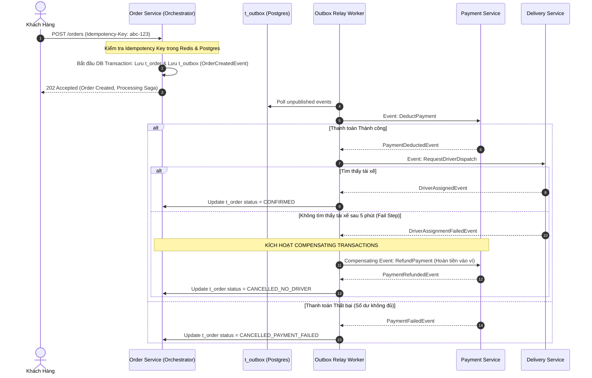

# 📋 Kế Hoạch Triển Khai: Distributed Transaction, Saga Orchestration & Idempotency Engine

`[DRAFT]` • **Issue liên kết:** #82 • **Phân loại:** `platform` • **Ngày khởi tạo:** 2026-10-26

---

## 1. 🎯 Tổng Quan & Bài Toán Cần Giải Quyết

### 1.1. Hiện trạng & Kịch bản Thảm họa (The Double-Spending & Inconsistent State Disaster)
- **Kịch bản 1 - Trừ tiền 2 lần (Double Deduct / Replay)**:
  - Khách hàng bấm nút "Thanh toán đơn hàng 250.000đ" trong lúc mạng di động 4G chập chờn.
  - Request 1 gửi đi, server đang xử lý nhưng kết nối HTTP bị timeout ở phía client. 
  - Khách hàng sốt ruột bấm nút "Thanh toán" lần 2. Do thiếu cơ chế Idempotency phân tán, hệ thống trừ tiền trong ví điện tử 2 lần (tổng 500.000đ) và tạo ra 2 đơn hàng trùng lặp.
- **Kịch bản 2 - Lệch trạng thái phân tán (Dual-write failure)**:
  - `order-service` cập nhật trạng thái đơn thành `CONFIRMED`.
  - Ngay sau đó, `order-service` gửi message sang RabbitMQ để thông báo cho `delivery-service` tìm tài xế. Tuy nhiên, đúng lúc này server bị restart (hoặc broker quá tải rớt mạng).
  - Kết quả: Dữ liệu đơn đã lưu trong DB của `order-service`, khách đã bị trừ tiền, nhưng sự kiện không bao giờ tới được `delivery-service`. Không có tài xế nào được điều phối, đơn hàng bị "treo" vô thời hạn.

### 1.2. Mục tiêu kỹ thuật
1. **Two-Tier Idempotency Key Engine (Cơ chế chống lặp request 2 tầng)**:
   - Client bắt buộc gửi kèm header `Idempotency-Key` (UUIDv4) cho mọi request làm thay đổi trạng thái (POST/PUT/PATCH liên quan đến đặt hàng, thanh toán, ví).
   - Tầng 1: Redis atomic check với `SET key token NX PX 120000` (khóa 120 giây). Request đến sau nếu đang xử lý sẽ nhận HTTP `409 Conflict` (hoặc chờ kết quả request gốc); nếu request gốc đã hoàn tất, trả về cached response ban đầu với header `X-Cache-Lookup: HIT`.
   - Tầng 2: PostgreSQL Unique Constraint trên bảng `t_idempotency_log`.
2. **Transactional Outbox Pattern (Đảm bảo Zero Data Loss cho Event Bus)**:
   - Tuyệt đối không publish message ra ngoài trong khi đang mở DB Transaction.
   - Lưu Domain Event vào bảng `t_outbox` trong cùng transaction ACID với bảng nghiệp vụ (`t_order`).
   - Một background worker (Outbox Relay) đọc bảng `t_outbox` và publish sang message broker với cơ chế At-least-once delivery và Exponential Backoff Retry.
3. **Saga Orchestrator with Compensating Transactions (Quản lý giao dịch phân tán)**:
   - Triển khai mô hình Saga Orchestration: `CreateOrder -> ReserveInventory -> DeductWallet -> DispatchDriver`.
   - Nếu bất kỳ bước nào thất bại (ví dụ: không tìm thấy tài xế), Orchestrator sẽ kích hoạt chuỗi hành động bù trừ (Compensating Transactions): Hoàn tiền lại ví khách, hoàn lại tồn kho món ăn, chuyển trạng thái đơn sang `FAILED`.

---

## 2. 🔍 Khảo Sát Hiện Trạng Codebase

| File / Component | Hiện trạng | Hành động cần thực hiện |
| :--- | :--- | :--- |
| [`backend/libs/common/src/guards`](file:///d:/code/FoodDelivery/backend/libs/common) | Chưa có Guard/Interceptor xử lý `Idempotency-Key` chuẩn hóa. | Xây dựng `@UseIdempotency()` Guard + Interceptor tự động lưu và cache kết quả request. |
| [`backend/apps/order-service/src/modules/order`](file:///d:/code/FoodDelivery/backend/apps/order-service) | Gọi trực tiếp `PaymentService` qua HTTP/Event không có cơ chế Outbox bền vững. | Tích hợp bảng `t_outbox` và module `TransactionalOutboxService`. |
| [`backend/apps/payment-service/src/modules/payment`](file:///d:/code/FoodDelivery/backend/apps/payment-service) | Chưa có bộ lưu vết Idempotency kép cho webhook MoMo/VNPay. | Bổ sung bảng ghi nhận `t_payment_idempotency` kiểm tra chữ ký số và replay payload. |

---

## 3. 🛠️ Thiết Kế Chi Tiết & Giải Pháp Kỹ Thuật

### 3.1. Sơ Đồ Luồng Saga Orchestrator & Compensating Transactions

### 3.2. Cấu Trúc Bảng Database Chuẩn (`t_outbox` & `t_idempotency_log`)
- **Bảng Transactional Outbox (`t_outbox`)**:
  - `id`: UUID (Primary Key).
  - `aggregate_type`: VARCHAR(50) (vd: `'ORDER'`).
  - `aggregate_id`: UUID (vd: `order_id`).
  - `event_type`: VARCHAR(100) (vd: `'OrderCreatedDomainEvent'`).
  - `payload`: JSONB (Nội dung chi tiết của sự kiện).
  - `status`: VARCHAR(20) (`'PENDING'`, `'PUBLISHED'`, `'FAILED'`).
  - `retry_count`: INT (Mặc định = 0).
  - `created_at`: TIMESTAMP WITH TIME ZONE.
  - `published_at`: TIMESTAMP WITH TIME ZONE NULL.

---

## 4. 🧪 Kịch Bản Kiểm Thử 3 Nhánh (Testing Policy Compliance)

### 4.1. Nhánh 1: Happy Path (Dòng Chảy Chuẩn)
- **Kịch bản**: Khách gửi request tạo đơn kèm `Idempotency-Key: e4b2...`. Sau 500ms, khách gửi lại chính xác request đó.
- **Kỳ vọng**: 
  - Request 1 xử lý hoàn tất, ghi vào outbox và DB.
  - Request 2 không tạo thêm bất kỳ bản ghi nào trong DB, nhận lại response HTTP 200/201 giống hệt request 1 với header `X-Idempotent-Replay: true`.

### 4.2. Nhánh 2: Edge Cases (Biên & Giới Hạn)
- **Kịch bản 1 (Concurrent Replay)**: 2 requests với cùng `Idempotency-Key` gửi đến server trong cùng 1 mili-giây.
- **Kỳ vọng**: Đúng 1 request nhận lock Redis và xử lý; request thứ 2 bị chặn bởi Redis NX lock và nhận phản hồi `409 Conflict: Request is already being processed`.
- **Kịch bản 2 (Saga Rollback khi service con sập)**: `delivery-service` sập không thể phản hồi sau khi `payment-service` đã trừ tiền.
- **Kỳ vọng**: Saga Orchestrator kích hoạt timeout sau 3 lần retry, tự động dispatch compensating event hoàn tiền vào ví khách, trạng thái đơn là `CANCELLED`.

### 4.3. Nhánh 3: Error & Rejection Flow (Ngoại Lệ & Khắc Phục)
- **Kịch bản**: Outbox Relay worker bị gián đoạn mạng không kết nối được RabbitMQ.
- **Kỳ vọng**: Transaction của người dùng vẫn commit thành công (không bị rollback). Sự kiện vẫn nằm an toàn trong bảng `t_outbox`. Khi mạng phục hồi, worker tự động quét và gửi lại mà không mất dữ liệu.

---

## 5. ✅ Checklist Tiêu Chuẩn Cần Vượt Qua (Local CI Gate)

- [ ] **Linter**: `npm run lint` đạt 0 warnings, 0 errors.
- [ ] **Type Check**: `npx tsc --noEmit` đạt 0 errors.
- [ ] **Unit Tests (Vitest)**:
  - [ ] `libs/common/tests/idempotency-interceptor.spec.ts` pass 100%.
  - [ ] `libs/common/tests/transactional-outbox.spec.ts` pass 100%.
  - [ ] `order-service/tests/saga-order-orchestrator.spec.ts` pass 100%.
- [ ] **Build Check**: `npm run build` thành công toàn diện.
- [ ] **Traceability Header**: Đầy đủ `[Requirement/Issue]`, `[Branch: Happy|Edge|Error]`, `[Expected Output]`.
