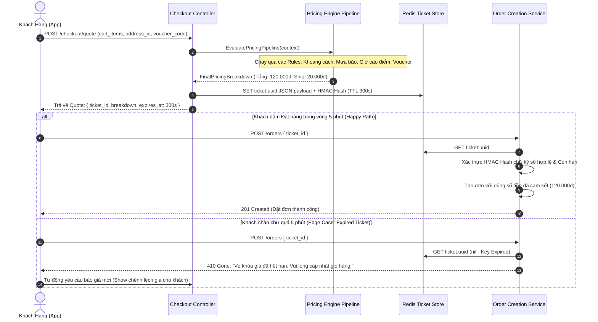

# 📋 Kế Hoạch Triển Khai: Dynamic Surge Pricing & Cart Versioning (Price Lock Ticket) Engine

`[DRAFT]` • **Issue liên kết:** #84 • **Phân loại:** `platform` • **Ngày khởi tạo:** 2026-10-26

---

## 1. 🎯 Tổng Quan & Bài Toán Cần Giải Quyết

### 1.1. Hiện trạng & Kịch bản Thảm họa (The Surge Shock & Cart Desync Disaster)
- **Kịch bản 1 - Phụ phí tăng vọt giữa phiên đặt món (Price Jump Shock)**:
  - Khách hàng thêm món vào giỏ lúc 11h45 với phí giao hàng tiêu chuẩn là 15.000đ.
  - Đến 11h55, trời bất chợt đổ mưa to và nhu cầu đặt món tăng 400%, kích hoạt thuật toán Surge Pricing làm phí ship tăng lên 45.000đ.
  - Khách hàng bấm nút "Thanh toán" nhưng không hề biết phí đã thay đổi. Hệ thống trừ thẳng 45.000đ tiền ship. Khách hàng cảm thấy bị "lừa đảo" vì số tiền hiển thị trên màn hình trước đó khác hoàn toàn số tiền bị trừ trong tài khoản ngân hàng.
- **Kịch bản 2 - Thay đổi giá hoặc hết món giữa chừng (Merchant Menu Desync)**:
  - Nhà hàng cập nhật tăng giá món từ 50.000đ lên 65.000đ, hoặc tắt món do hết hàng ngay trong lúc khách đang ở trang Checkout.
  - Do giỏ hàng không có cơ chế Versioning và Khóa phiên giá (Price Locking Ticket), dữ liệu gửi lên server bị bất đồng bộ, gây ra lỗi hỏng tính toán tổng tiền hoặc đơn đặt thành công với giá cũ gây lỗ cho nhà hàng.

### 1.2. Mục tiêu kỹ thuật
1. **Cart Versioning & Price Lock Ticket Engine (TTL 5 Phút)**:
   - Khi người dùng bấm sang bước Checkout, server tính toán toàn bộ chi phí (giá món, topping, phí nền tảng, phí thời tiết, mã giảm giá) và phát hành một `PriceLockTicket` có thời hạn 5 phút (300 giây) lưu trong Redis.
   - Ticket chứa mã băm chữ ký toàn vẹn (HMAC SHA-256) của toàn bộ các khoản mục chi phí:
     $$\text{TicketHash} = \text{HMAC}(\text{CartId} + \text{Items} + \text{Fees} + \text{Discounts} + \text{ExpiresAt}, \text{SecretKey})$$
   - Trong vòng 5 phút, giá này được cam kết giữ nguyên 100% không đổi. Nếu quá 5 phút mà khách chưa thanh toán, ticket hết hạn và yêu cầu client refresh lại giỏ hàng với thông báo thay đổi giá trực quan (Diff Summary).
2. **Pluggable Rules Engine cho Định Giá Động (Dynamic Surge Pricing Pipeline)**:
   - Xây dựng hệ thống định giá theo kiến trúc Pipeline / Chain of Responsibility:
     $$\text{TotalShippingFee} = \text{BaseFee} \times \text{DistanceFactor} \times \text{SurgeMultiplier} + \text{WeatherFee} + \text{NightFee}$$
   - `SurgeMultiplier` được tính toán tự động dựa trên tỷ lệ Cung/Cầu theo thời gian thực tại từng khu vực:
     $$\text{SurgeMultiplier} = f\left(\frac{\text{ActiveOrdersInArea}}{\text{AvailableDriversInArea}}\right)$$
   - Các quy tắc (Rules) có thể bật/tắt hoặc điều chỉnh tham số linh hoạt từ Admin Portal mà không cần build/deploy lại code.
3. **Mức độ Tái sử dụng Code (Reusability & Shared Kernel)**:
   - Module `PricingEngine` được thiết kế hoàn toàn trừu tượng tại `backend/libs/common/pricing`, hỗ trợ cắm nhiều loại pipeline khác nhau: Đồ ăn (Food Delivery), Đi chợ hộ (Mart Delivery), Giao hàng siêu tốc (Parcel Delivery).

---

## 2. 🔍 Khảo Sát Hiện Trạng Codebase

| File / Component | Hiện trạng | Hành động cần thực hiện |
| :--- | :--- | :--- |
| [`backend/apps/order-service/src/modules/order`](file:///d:/code/FoodDelivery/backend/apps/order-service) | Tính phí ship cố định theo số km đơn giản, chưa có cơ chế giữ giá giỏ hàng. | Tích hợp `PriceLockTicketService` và cơ chế xác thực vé khóa giá khi đặt đơn. |
| [`backend/libs/common/src`](file:///d:/code/FoodDelivery/backend/libs/common) | Chưa có Rules Engine cho biểu phí và phụ phí động. | Xây dựng `PricingPipelineModule` với các Strategy độc lập (`WeatherRule`, `DemandRule`, `NightRule`). |
| [`frontend/src/features/checkout`](file:///d:/code/FoodDelivery/frontend) | Chưa xử lý thông báo khi vé giữ giá hết hạn hoặc giá bị biến động. | Thêm đếm ngược thời gian giữ giá 5:00 và popup xác nhận nếu phí ship thay đổi sau khi hết hạn. |

---

## 3. 🛠️ Thiết Kế Chi Tiết & Luồng Hoạt Động

### 3.1. Luồng Khóa Giá & Kiểm Tra Toàn Vẹn Phiên Đặt Món

---

## 4. 🧪 Kịch Bản Kiểm Thử 3 Nhánh (Testing Policy Compliance)

### 4.1. Nhánh 1: Happy Path (Dòng Chảy Chuẩn)
- **Kịch bản**: Khách hàng lấy báo giá lúc $T_0$, nhận `ticket_id` hợp lệ. Lúc $T_0 + 60\text{s}$, khách gửi request tạo đơn với `ticket_id`.
- **Kỳ vọng**: Đơn hàng được tạo với đúng 100% bảng phân rã chi phí trong ticket. HTTP 201 Created. Ticket được tiêu thụ (invalidate) để không thể dùng lại.

### 4.2. Nhánh 2: Edge Cases (Biên & Giới Hạn)
- **Kịch bản 1 (Ticket hết hạn đúng 1 giây)**: Khách gửi request tạo đơn tại giây thứ 301.
- **Kỳ vọng**: Hệ thống từ chối tạo đơn, trả về HTTP 410 Gone với mã lỗi `PRICE_TICKET_EXPIRED`. Không trừ tiền người dùng.
- **Kịch bản 2 (Giả mạo payload ticket - Tampering Attack)**: Hacker can thiệp sửa đổi giá tiền trong payload gửi lên.
- **Kỳ vọng**: Kiểm tra chữ ký HMAC SHA-256 phát hiện hash mismatch lập tức ném lỗi `403 Forbidden: Invalid Ticket Signature`.

### 4.3. Nhánh 3: Error & Rejection Flow (Ngoại Lệ & Khắc Phục)
- **Kịch bản**: Dịch vụ thời tiết bên thứ 3 (OpenWeather API) bị sập hoặc trả về timeout khi đang đánh giá rule thời tiết.
- **Kỳ vọng**: Rule thời tiết kích hoạt Graceful Fallback: Ghi log cảnh báo và áp dụng hệ số phụ phí an toàn mặc định (`SurgeMultiplier = 1.0x`) mà không làm gián đoạn toàn bộ luồng checkout của khách hàng.

---

## 5. ✅ Checklist Tiêu Chuẩn Cần Vượt Qua (Local CI Gate)

- [ ] **Linter**: `npm run lint` đạt 0 warnings, 0 errors.
- [ ] **Type Check**: `npx tsc --noEmit` đạt 0 errors.
- [ ] **Unit Tests (Vitest)**:
  - [ ] `libs/common/tests/pricing-pipeline-engine.spec.ts` pass 100%.
  - [ ] `libs/common/tests/price-lock-ticket.spec.ts` pass 100%.
  - [ ] `order-service/tests/checkout-price-integrity.spec.ts` pass 100%.
- [ ] **Build Check**: `npm run build` thành công.
- [ ] **Traceability Header**: Đầy đủ `[Requirement/Issue]`, `[Branch: Happy|Edge|Error]`, `[Expected Output]`.
