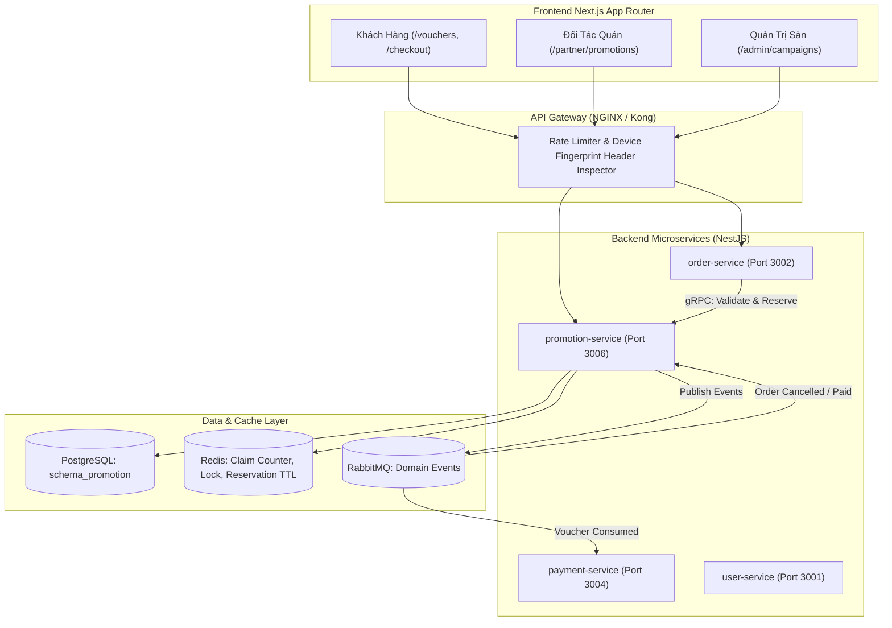
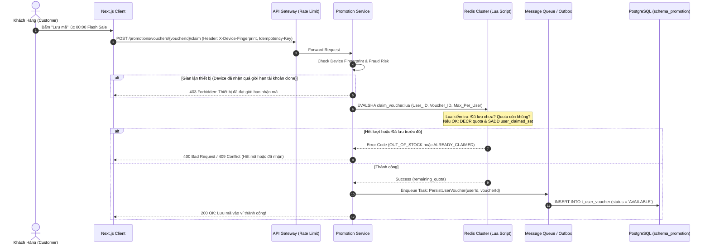
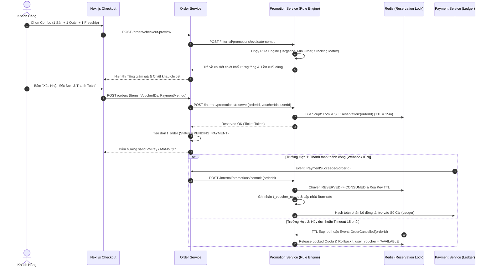

# Kế Hoạch Triển Khai: Hệ Thống Quản Lý Voucher & Khuyến Mại Doanh Nghiệp (Enterprise Voucher Engine)

> **Mã công việc (Task Code):** `enterprise-voucher-management-engine`  
> **Trạng thái:** `[COMPLETED]`  
> **Tác giả:** `@planner` (Phối hợp qua `/grill-me` và điều phối bởi `@orchestrator`)  
> **Nhánh phát triển:** `feature/issue-88-enterprise-voucher-engine`  
> **GitHub Issue:** #88  
> **Tài liệu tham chiếu:** `docs/services/order-service.md`, `docs/services/payment-service.md`, `docs/business/business-roadmap.md`, `docs/plans/platform/promotion-voucher-engine.md`  
> **Ngày hoàn thành nghiệm thu:** 2026-10-29  
> **Kết quả Local CI Gate:** Linter 0 warnings/errors, TypeScript 0 errors, Tests 100% pass (Backend 79/79, Frontend 134/134), Build thành công cả Backend & Frontend.

---

## 1. Bối Cảnh & Mục Tiêu Nghiệp Vụ (Context & Business Objectives)

Hệ thống Voucher cơ bản hiện hữu (tích hợp trong `order-service` theo Issue #75) chỉ mới đáp ứng việc nhập mã trực tiếp đơn lẻ với các điều kiện tĩnh. Để đáp ứng quy mô mở rộng hàng trăm nghìn đơn mỗi ngày và các chiến dịch Mega Flash Sale (11.11, Lương Về...), dự án cần một **Enterprise Voucher Management System** đạt chuẩn các nền tảng thương mại điện tử / giao đồ ăn lớn (ShopeeFood, GrabFood).

### 8 Trụ Cột Kiến Trúc Đã Được Thống Nhất Qua Phỏng Vấn Chuyên Sâu (/grill-me):
1. **Kiến trúc Dịch vụ Chuyên Biệt (Dedicated Microservice)**:
   - Xây dựng Microservice độc lập `promotion-service` tách rời khỏi `order-service`.
   - Đảm nhiệm toàn trình: Vòng đời Campaign, Kho Voucher, Động cơ Đánh giá Quy tắc (Rule Engine), Ví Voucher Người Dùng (User Voucher Wallet), và Giám sát Tốc độ Giải ngân (Budget Burn-Rate).
   - Giao tiếp đồng bộ độ trễ thấp (gRPC/REST) và bất đồng bộ bảo đảm tính nhất quán (Event-driven qua RabbitMQ / Redis Streams + Transactional Outbox).
2. **Mô hình Phân Phối Đa Chiều (Dual-Model Distribution)**:
   - **Kho Voucher Cá Nhân (User Voucher Wallet)**: Cho phép người dùng "Lưu mã / Giật mã" (Claim/Collect) trong các khung giờ vàng/Flash Sale trước khi sử dụng.
   - **Mã Nhập Trực Tiếp (Direct Promo Code)**: Nhập code thủ công tại trang thanh toán cho các chương trình đối tác ngoài sàn.
   - Chịu tải cao (High-Concurrency Claiming): Kiểm soát số lượng phát hành nguyên tử qua Redis Lua Script (`DECR` / atomic quota) và đẩy sự kiện đồng bộ bất đồng bộ xuống DB qua Transactional Outbox.
3. **Chính Sách Gộp Mã Đa Tầng (Multi-Layer Voucher Stacking)**:
   - Cho phép áp dụng tối đa **1 mã cho mỗi nhóm mục đích** trong 1 đơn hàng:
     - 1 Mã Giảm Giá Món từ Sàn (Platform Voucher)
     - 1 Mã Giảm Giá từ Nhà Hàng (Merchant Voucher)
     - 1 Mã Miễn/Giảm Phí Giao Hàng (Free Shipping Voucher)
     - 1 Mã Thanh Toán Đối Tác (Payment Method Voucher - Momo/VNPay/Ngân hàng)
   - Tự động chặn trùng loại (Mutual Exclusion cùng nhóm) và kết hợp với điểm thưởng Loyalty Points.
4. **Cơ Chế Giữ Chỗ Hai Pha (Two-Phase Voucher Reservation với TTL)**:
   - **Pha 1 (Reservation)**: Khi khách bấm "Thanh toán" và chờ chuyển khoản/cổng thanh toán (VNPay/MoMo), hệ thống khóa giữ chỗ voucher (`RESERVED`) với TTL 15 phút trên Redis để tránh overselling.
   - **Pha 2 (Commit)**: Khi thanh toán thành công (Webhook IPN), chuyển trạng thái sang `CONSUMED`.
   - **Pha 3 (Release/Rollback)**: Nếu đơn bị hủy, timeout hoặc thanh toán thất bại, tự động nhả khóa giữ chỗ và hoàn lại lượt dùng cho ví khách hàng ngay lập tức.
5. **Động Cơ Đánh Giá Quy Tắc Linh Hoạt (Modular Composite Rule Engine)**:
   - Thiết kế theo Strategy Pattern kết hợp JSON Schema định nghĩa linh hoạt:
     - Phân khúc khách hàng: Khách mới (First-order), Hạng thành viên Loyalty (Silver, Gold, Platinum), User Churn (không đặt đơn >30 ngày), Whitelist UID.
     - Phương thức thanh toán: Bắt buộc dùng VNPay, MoMo, Ví nội bộ hoặc loại trừ COD.
     - Phạm vi địa lý: Bán kính GPS, Quận/Huyện, Thành phố (Hà Nội, TP.HCM...).
     - Phạm vi thực đơn: Danh mục món ăn (Category), món ăn cụ thể, hoặc loại trừ món đang flash sale sâu.
6. **Bảo Mật Đa Tầng & Chống Gian Lận Săn Mã (Multi-Layer Anti-Abuse)**:
   - Sliding-Window Rate Limiting (Redis) kiểm soát tốc độ request trên từng User ID và IP.
   - Idempotency Key bảo đảm không thể trừ/claim voucher trùng lặp khi mạng chập chờn hoặc bấm đúp nút.
   - Kiểm soát Device Fingerprint (Hardware ID / Device Hash): Chặn triệt để hành vi tạo hàng loạt tài khoản clone trên cùng 1 thiết bị để trục lợi mã khách hàng mới (Sybil Attack).
7. **Quản Lý Ngân Sách, Đồng Tài Trợ & Cắt Lỗ Tức Thì (Budget Cap & Emergency Kill Switch)**:
   - Hỗ trợ mô hình đồng tài trợ linh hoạt: Sàn tài trợ, Quán tài trợ, hoặc Co-funded (% Sàn - % Quán - % Cổng thanh toán).
   - Real-time Burn-rate Monitoring: Theo dõi tốc độ đốt ngân sách theo từng phút.
   - **Emergency Kill Switch**: Tự động ngắt (Circuit Breaker) hoặc quản trị viên bấm ngắt khẩn cấp khi ngân sách chiến dịch đạt trần hoặc có dấu hiệu bị hack/lỗi giá.
   - Tích hợp hạch toán Sổ cái kép (Double-Entry Ledger) với `payment-service`.
8. **Trải Nghiệm Toàn Diện Cho Cả 3 Tác Nhân (3-Actor UI/UX)**:
   - **Customer**: Trang Kho Voucher (`/vouchers`) có tab Đã lưu/Săn mã/Hết hạn, thanh tiến trình % còn lại, animation giật mã. Modal Checkout tự động gợi ý "Combo tối ưu nhất" (Best Value 1-Click Apply) và giải thích rõ ràng lý do voucher chưa khả dụng.
   - **Merchant**: Giao diện Quản lý Khuyến mãi Quán, tạo voucher cho quán, đăng ký tham gia các chiến dịch Co-funded của Sàn.
   - **Admin**: Dashboard thời gian thực giám sát Burn-rate, tỷ lệ quy đổi (Conversion Rate), nút Emergency Kill Switch ngắt chiến dịch ngay tức khắc.

### 1.2. Mô Hình Dòng Tiền, Nguồn Gốc Voucher & Cơ Chế Phân Bổ Thất Thoát (Financial Liability Matrix)

Hệ thống phân định rành mạch 3 khía cạnh vận hành cốt lõi theo chuẩn ShopeeFood/GrabFood:

#### 1. Khách hàng nhận (GET / Claim) voucher ở đâu? (Contextual Touchpoints)
* 📍 **Trang Kho Voucher (`/vouchers`)**: Hub trung tâm tra cứu mọi loại mã (Sàn, Quán, Freeship, Ví điện tử), phân tab Khả dụng / Đã dùng / Hết hạn.
* 📍 **Đầu trang Menu Quán (`/restaurants/:id`)**: Banner Sticky hiển thị các voucher riêng của quán ("Lưu mã 25k") kích thích khách chọn món.
* 📍 **Banner Trang Chủ (`/`)**: Banner sự kiện Flash Sale khung giờ vàng, click là giật mã ngay vào ví cá nhân.
* 📍 **Drawer Chọn Mã tại Checkout (`/checkout`)**: Tự động load mã trong ví và gợi ý "Combo tối ưu nhất" (1-click Best Value).
* 📍 **Kênh bên ngoài (SMS/Mạng xã hội)**: Nhập tay mã Promo Code trực tiếp vào ô input tại Checkout.

#### 2. Nguồn gốc voucher xuất phát từ đâu? (Issuance & Sponsorship Origin)
* 🏢 **Sàn phát hành (Platform-Funded)**: Do Admin tạo trong các Mega Campaign (11.11, Lương về, Freeship Xtra).
* 🏪 **Nhà hàng phát hành (Merchant-Funded)**: Do chủ quán tự tạo từ Partner Portal để thu hút khách và đẩy món bán chậm.
* 🤝 **Đồng tài trợ (Co-Funded Campaign)**: Sàn mở chiến dịch lớn và mời các quán tham gia chia sẻ chi phí theo % cam kết.
* 💳 **Đối tác thanh toán (Payment Partner)**: MoMo, VNPay, Ngân hàng đối tác tài trợ khuyến khích thanh toán không dùng tiền mặt.

#### 3. Ai là người chịu khoản thất thoát / chi phí chiết khấu? (Financial Settlement & Loss Absorption)
* 💰 **Voucher Sàn (100% Platform)**: Sàn chịu 100%. Quán nhận đủ tiền món ăn. Sàn ghi nợ `EXPENSE_MARKETING_PROMOTION` trên Sổ Cái.
* 💰 **Voucher Quán (100% Merchant)**: Quán chịu 100%. Khấu trừ trực tiếp vào doanh thu quán trước khi chuyển tiền quyết toán. Sàn không mất chi phí.
* 💰 **Voucher Đồng Tài Trợ (Co-Funded)**:
  * Chia sẻ chi phí theo tỷ lệ (vd: Sàn 70% - Quán 30%).
  * **Cơ chế Merchant Budget Cap**: Mỗi quán cài trần chi phí tối đa (vd: 2.000.000đ/chiến dịch). Chạm trần -> Tự ngắt voucher riêng cho quán đó, bảo vệ quán không bị "cháy túi".
* 💰 **Phí Giao Hàng (Free Shipping Subsidy)**:
  * Sàn tài trợ 100% phần bù ship. **Tài xế luôn nhận đủ 100% cước phí giao hàng**.
* 💰 **Voucher Cổng Thanh Toán**:
  * Đối tác (MoMo/VNPay/Ngân hàng) chịu 100% và hoàn tiền lại cho Sàn trong kỳ đối soát (Reconciliation).

#### 4. Cơ chế Phân định Rủi ro khi Đơn Hàng Thất Bại / Bị Hủy (Fault-Based Risk Settlement)
* ⚠️ **Khách bùng đơn / Không nhận hàng**: Khách hàng **mất luôn voucher** (không hoàn lại ví). Quán (đã nấu xong) và Tài xế được bồi hoàn từ **Quỹ Dự Phòng Rủi Ro của Sàn (Platform Risk Fund)**. Quán không phải chịu thất thoát tiền món.
* ⚠️ **Lỗi do Quán hoặc Tài xế**: Hoàn trả 100% voucher về trạng thái `AVAILABLE` trong ví khách + Tặng voucher đền bù. Bên gây lỗi chịu phạt chế tài theo hợp đồng sàn.

---

## 2. Kiến Trúc Kỹ Thuật & Sơ Đồ Luồng (Architecture & Sequence Flows)

### 2.1. Sơ Đồ Tổng Thể Kiến Trúc Dịch Vụ (System Architecture)



---

### 2.2. Luồng Giật Mã Flash Sale Chịu Tải Cao (High-Concurrency Claim Flow)



---

### 2.3. Luồng Đặt Hàng Giữ Chỗ Hai Pha & Gộp Mã Đa Tầng (Two-Phase Stacking Checkout)



---

## 3. Thiết Kế Cơ Sở Dữ Liệu (Database Schema)

Cơ sở dữ liệu đặt tại Schema riêng biệt: `schema_promotion` (PostgreSQL), hoàn toàn độc lập với `schema_order`.

### 3.1. Bảng Chiến Dịch: `m_campaign`
| Tên cột | Kiểu dữ liệu | Ràng buộc | Diễn giải |
| :--- | :--- | :--- | :--- |
| `id` | UUID | PK, default uuidv4 | Mã định danh chiến dịch |
| `code` | VARCHAR(50) | UNIQUE, NOT NULL | Mã chiến dịch (vd: `MEGA_11_11_2026`) |
| `name` | VARCHAR(255) | NOT NULL | Tên chương trình |
| `sponsor_type` | VARCHAR(30) | NOT NULL | `PLATFORM` \| `MERCHANT` \| `CO_FUNDED` \| `PAYMENT_PARTNER` |
| `platform_share_ratio` | NUMERIC(5,2)| DEFAULT 100.00 | Tỷ lệ sàn tài trợ (vd: 70.00%) |
| `merchant_share_ratio` | NUMERIC(5,2)| DEFAULT 0.00 | Tỷ lệ nhà hàng tài trợ (vd: 30.00%) |
| `partner_share_ratio` | NUMERIC(5,2)| DEFAULT 0.00 | Tỷ lệ đối tác thanh toán tài trợ |
| `total_budget_amount` | NUMERIC(15,2)| NOT NULL | Hạn mức ngân sách tối đa (VND) |
| `current_spent_amount`| NUMERIC(15,2)| DEFAULT 0.00 | Ngân sách thực tế đã giải ngân |
| `emergency_killed` | BOOLEAN | DEFAULT false | Cờ ngắt khẩn cấp (Emergency Kill Switch) |
| `start_time` | TIMESTAMPTZ | NOT NULL | Thời điểm bắt đầu chiến dịch |
| `end_time` | TIMESTAMPTZ | NOT NULL | Thời điểm kết thúc chiến dịch |
| `created_at` | TIMESTAMPTZ | DEFAULT NOW() | Thời gian tạo |
| `updated_at` | TIMESTAMPTZ | DEFAULT NOW() | Thời gian cập nhật |

---

### 3.2. Bảng Master Voucher: `m_voucher`
| Tên cột | Kiểu dữ liệu | Ràng buộc | Diễn giải |
| :--- | :--- | :--- | :--- |
| `id` | UUID | PK, default uuidv4 | Mã định danh voucher |
| `campaign_id` | UUID | FK -> `m_campaign.id` | Thuộc chiến dịch nào |
| `code` | VARCHAR(50) | UNIQUE, NOT NULL | Mã code (vd: `FREESHIP50`, `BANHMI20`) |
| `title` | VARCHAR(255) | NOT NULL | Tiêu đề hiển thị |
| `description` | TEXT | NULLABLE | Điều kiện & thể lệ chi tiết |
| `voucher_category` | VARCHAR(30) | NOT NULL | `PLATFORM_DISCOUNT` \| `MERCHANT_DISCOUNT` \| `FREE_SHIPPING` \| `PAYMENT_DISCOUNT` |
| `discount_type` | VARCHAR(30) | NOT NULL | `PERCENTAGE` \| `FIXED_AMOUNT` |
| `discount_value` | NUMERIC(15,2)| NOT NULL | Giá trị giảm (% hoặc số tiền VND) |
| `max_discount_amount`| NUMERIC(15,2)| NULLABLE | Trần giảm tối đa cho voucher PERCENTAGE |
| `min_order_amount` | NUMERIC(15,2)| DEFAULT 0 | Giá trị đơn tối thiểu áp dụng |
| `total_issuance_quantity`| INTEGER | NOT NULL | Tổng số lượng mã phát hành ra |
| `claimed_quantity` | INTEGER | DEFAULT 0 | Số lượng người dùng đã lưu vào ví |
| `used_quantity` | INTEGER | DEFAULT 0 | Số lượng đã sử dụng thành công |
| `max_claims_per_user`| INTEGER | DEFAULT 1 | Số lần tối đa 1 user được lưu |
| `max_uses_per_user` | INTEGER | DEFAULT 1 | Số lần tối đa 1 user được dùng |
| `distribution_type` | VARCHAR(30) | NOT NULL | `COLLECTIBLE` (Săn mã vào ví) \| `PROMO_CODE` (Nhập tay) |
| `target_restaurant_id`| UUID | NULLABLE | Khóa ngoại quán ăn (nếu là voucher Quán) |
| `is_active` | BOOLEAN | DEFAULT true | Trạng thái kích hoạt |
| `created_at` | TIMESTAMPTZ | DEFAULT NOW() | Thời gian tạo |
| `updated_at` | TIMESTAMPTZ | DEFAULT NOW() | Thời gian cập nhật |

---

### 3.3. Bảng Quy Tắc Linh Hoạt: `m_voucher_rule`
| Tên cột | Kiểu dữ liệu | Ràng buộc | Diễn giải |
| :--- | :--- | :--- | :--- |
| `id` | UUID | PK, default uuidv4 | Mã quy tắc |
| `voucher_id` | UUID | FK -> `m_voucher.id` | Voucher áp dụng |
| `rule_type` | VARCHAR(50) | NOT NULL | `USER_SEGMENT` \| `PAYMENT_METHOD` \| `GEO_FENCE` \| `MENU_CATEGORY` |
| `operator` | VARCHAR(20) | NOT NULL | `EQUALS` \| `IN` \| `NOT_IN` \| `GREATER_THAN` |
| `rule_payload` | JSONB | NOT NULL | Cấu hình chi tiết (vd: `{"allowed_methods": ["VNPAY", "MOMO"]}`) |
| `error_message` | VARCHAR(255) | NOT NULL | Thông báo lỗi thân thiện khi user vi phạm |

---

### 3.4. Bảng Ví Voucher Cá Nhân: `t_user_voucher`
| Tên cột | Kiểu dữ liệu | Ràng buộc | Diễn giải |
| :--- | :--- | :--- | :--- |
| `id` | UUID | PK, default uuidv4 | Mã ví |
| `user_id` | UUID | NOT NULL, INDEX | Khách hàng sở hữu |
| `voucher_id` | UUID | NOT NULL, FK | Voucher được lưu |
| `device_fingerprint`| VARCHAR(255)| NOT NULL | Hash phần cứng thiết bị lúc claim mã |
| `status` | VARCHAR(30) | NOT NULL | `AVAILABLE` \| `RESERVED` \| `USED` \| `EXPIRED` |
| `claimed_at` | TIMESTAMPTZ | DEFAULT NOW() | Thời điểm lưu mã vào ví |
| `used_at` | TIMESTAMPTZ | NULLABLE | Thời điểm sử dụng |
| `expires_at` | TIMESTAMPTZ | NOT NULL | Thời điểm hết hạn voucher trong ví |

---

### 3.5. Bảng Giữ Chỗ & Sử Dụng: `t_voucher_reservation` & `t_voucher_usage`
- `t_voucher_reservation`: Lưu trạng thái Two-Phase Lock (OrderId, VoucherId, UserId, ReservedUntil, Status: `LOCKED`, `RELEASED`, `COMMITTED`).
- `t_voucher_usage`: Lưu vết lịch sử áp dụng đơn hàng, bao gồm: `order_id`, `voucher_id`, `actual_discount_amount`, `platform_funded_amount`, `merchant_funded_amount`, `partner_funded_amount`.

---

## 4. Thiết Kế Tầng Bộ Nhớ Đệm & Chống Tranh Chấp (Redis Architecture)

1. **Atomic Flash Sale Claim Script (`claim_voucher.lua`)**:
   - Sử dụng Redis Hash & Set kiểm soát song song: `HGET voucher:{id} remaining_quota` và `SISMEMBER voucher:{id}:users {userId}`.
   - Giảm quota nguyên tử, thêm User ID vào Claimed Set và cập nhật Device Hash Velocity: `INCR device:{fingerprint}:daily_claims`.
2. **Two-Phase Soft Lock Script (`reserve_vouchers.lua`)**:
   - Khóa nguyên tử danh sách Voucher IDs cho một `orderId` với `EXPIRE 900` (15 phút).
   - Tự động hoàn lại nếu một trong các voucher trong combo bị người khác giữ trước (All-or-Nothing Atomic Multi-Lock).
3. **Sliding-Window Rate Limiter**:
   - ZSET ghi nhận timestamp request của User & IP, tự động loại bỏ bản ghi cũ hơn 60s và chặn nếu vượt quá 30 req/phút khi gọi các endpoint nhạy cảm.

---

## 5. Danh Sách API Triển Khai (API Specifications)

### 5.1. Dành cho Khách Hàng (Customer APIs)
- `GET /api/v1/promotions/wallet`: Danh sách voucher trong ví của người dùng (lọc theo tab: Khả dụng, Đã dùng, Hết hạn).
- `GET /api/v1/promotions/feed`: Khám phá kho mã sàn & mã flash sale sắp diễn ra.
- `POST /api/v1/promotions/vouchers/:id/claim`: Lưu mã vào ví (Yêu cầu Header `X-Device-Fingerprint` và `Idempotency-Key`).
- `POST /api/v1/promotions/recommend-best-combo`: Tự động tính toán và gợi ý tổ hợp 4 tầng voucher (Freeship + Quán + Sàn + Cổng thanh toán) có số tiền giảm cao nhất cho giỏ hàng hiện tại.
- `POST /api/v1/promotions/validate-code`: Nhập mã promo code trực tiếp kiểm tra điều kiện.

### 5.2. Dành cho Đối Tác Nhà Hàng (Partner / Merchant APIs)
- `GET /api/v1/partner/promotions`: Danh sách các chương trình khuyến mãi do quán tự phát hành.
- `POST /api/v1/partner/promotions`: Tạo mã giảm giá của quán (Merchant-funded).
- `GET /api/v1/partner/campaigns/co-funded`: Danh sách chiến dịch của Sàn mời quán tham gia đồng tài trợ.
- `POST /api/v1/partner/campaigns/:id/join`: Đăng ký tham gia chiến dịch đồng tài trợ.

### 5.3. Dành cho Quản Trị Viên (Admin Portal APIs)
- `POST /api/v1/admin/campaigns`: Khởi tạo Campaign lớn và cấu hình ngân sách tài trợ.
- `GET /api/v1/admin/campaigns/:id/burn-rate`: Thống kê tốc độ đốt ngân sách theo thời gian thực (Biểu đồ Burn-rate / phút).
- `POST /api/v1/admin/campaigns/:id/emergency-kill`: **Emergency Kill Switch** ngắt tức thời mọi hoạt động của chiến dịch khi phát hiện bất thường.

### 5.4. Giao Tiếp Nội Bộ (Internal Service APIs)
- `POST /internal/promotions/reserve`: Giữ chỗ 2-phase khi bấm nút thanh toán.
- `POST /internal/promotions/commit`: Xác nhận trừ vĩnh viễn khi thanh toán thành công.
- `POST /internal/promotions/release`: Nhả chỗ lập tức khi thanh toán thất bại hoặc hủy đơn.

---

## 6. Thiết Kế Giao Diện & Tích Hợp Frontend (Frontend Integration & Component Architecture)

Mọi tính năng của Enterprise Voucher Engine đều được tích hợp sâu vào Frontend Next.js (App Router) với kiến trúc Feature-Based (`src/features/promotions/`, `src/features/admin/`, `src/features/restaurant/`).

### 6.1. Phân Rã Cấu Trúc Page & Component (Feature-Based Hierarchy)

```text
frontend/src/
├── app/
│   ├── (customer)/
│   │   ├── vouchers/page.tsx                  # 🧑 Trang Kho Voucher & Săn mã Flash Sale
│   │   └── checkout/page.tsx                  # 🧑 Trang Thanh toán tích hợp Drawer chọn combo
│   ├── partner/
│   │   └── promotions/page.tsx                # 🏪 Portal Quán: Quản lý voucher & Co-funded
│   └── admin/
│       └── campaigns/page.tsx                 # 👑 Portal Admin: Giám sát Burn-rate & Kill Switch
└── features/
    ├── promotions/                            # Feature Module: Khuyến mại & Ví Voucher
    │   ├── components/
    │   │   ├── voucher-wallet-tabs.tsx        # Bộ chuyển Tab: Khả dụng / Đã dùng / Hết hạn
    │   │   ├── voucher-feed-section.tsx       # Feed săn mã Flash sale, banner khung giờ vàng
    │   │   ├── voucher-card.tsx               # Thẻ voucher đa năng (Progress bar, Color badge)
    │   │   ├── claim-voucher-button.tsx       # Nút Giật mã Flash sale (Optimistic UI + Micro-anim)
    │   │   ├── promo-code-input-bar.tsx       # Thanh nhập Promo Code thủ công
    │   │   ├── voucher-selection-drawer.tsx   # Drawer/Modal chọn voucher 4 tầng tại Checkout
    │   │   ├── best-value-combo-banner.tsx    # Banner 1-click áp dụng combo giảm giá sâu nhất
    │   │   ├── stacking-category-accordion.tsx# 4 nhóm voucher (Freeship/Quán/Sàn/Ví) chặn trùng
    │   │   └── ineligible-voucher-item.tsx    # Voucher bị vô hiệu hóa kèm lý do minh bạch
    │   ├── hooks/
    │   │   ├── use-voucher-wallet.ts          # Hook quản lý danh sách voucher cá nhân
    │   │   ├── use-claim-voucher.ts           # Hook gửi claim kèm Device Fingerprint
    │   │   └── use-checkout-vouchers.ts       # Hook tính toán combo 4 tầng & lock 2-phase
    │   └── services/
    │       └── promotion-api.client.ts        # Typed API Client giao tiếp promotion-service
    ├── restaurant/
    │   └── components/
    │       ├── merchant-voucher-table.tsx     # Bảng danh sách mã giảm giá của quán
    │       ├── create-merchant-voucher-dialog.tsx # Form tạo voucher mới của nhà hàng
    │       └── co-funded-campaign-card.tsx    # Card tham gia chiến dịch đồng tài trợ Sàn
    └── admin/
        └── components/
            ├── campaign-data-table.tsx        # Bảng quản lý hạn mức & ngân sách chiến dịch
            ├── create-campaign-dialog.tsx     # Dialog khởi tạo Campaign & chia sẻ tỷ lệ tài trợ
            ├── burn-rate-chart.tsx            # Biểu đồ thời gian thực tốc độ giải ngân (VND/min)
            └── emergency-kill-switch-dialog.tsx # Nút gạt & hộp thoại xác nhận ngắt mạch tức thời
```

---

### 6.2. Bảng Ánh Xạ Tích Hợp API Vào Frontend (Frontend API Integration Matrix)

Bảng này quy định rõ Component nào tiêu thụ API nào, sự kiện kích hoạt, và cách quản lý trạng thái giao diện:

| STT | Component / File | Endpoint Backend | HTTP Method | Sự Kiện Kích Hoạt (Trigger) | Quản Lý Trạng Thái Giao Diện (UI States) |
| :---: | :--- | :--- | :---: | :--- | :--- |
| 1 | `VoucherWalletTabs`<br/>`voucher-wallet-tabs.tsx` | `/api/v1/promotions/wallet` | `GET` | Trang `/vouchers` mount hoặc chuyển tab (Khả dụng / Đã dùng / Hết hạn) | **Loading**: Shimmer Skeleton 3 thẻ voucher.<br/>**Empty**: Vector Art "Ví trống, hãy săn thêm mã!".<br/>**Error**: Alert thông báo kèm nút Thử lại. |
| 2 | `VoucherFeedSection`<br/>`voucher-feed-section.tsx` | `/api/v1/promotions/feed` | `GET` | Trang `/vouchers` load danh mục Flash Sale | **Loading**: Carousel Skeleton.<br/>**Empty**: "Chưa có khung giờ Flash Sale tiếp theo". |
| 3 | `ClaimVoucherButton`<br/>`claim-voucher-button.tsx` | `/api/v1/promotions/vouchers/:id/claim` | `POST` | Người dùng click nút "Lưu mã" / "Giật mã" | **Optimistic UI**: Chuyển ngay nút sang "Đang lưu..." kèm confetti burst.<br/>**Headers**: Tự động đính `X-Device-Fingerprint`, `Idempotency-Key`.<br/>**Success**: Toast "Đã lưu vào Ví!" & Disable nút.<br/>**Error 409/403**: Shake animation + Toast cảnh báo gian lận hoặc hết lượt. |
| 4 | `PromoCodeInputBar`<br/>`promo-code-input-bar.tsx` | `/api/v1/promotions/validate-code` | `POST` | Khách nhập code và bấm "Áp dụng" | **Loading**: Spinner trong input button.<br/>**Success**: Hiển thị badge voucher đã thêm vào ví.<br/>**Error**: Inline error text màu đỏ dưới ô nhập. |
| 5 | `BestValueComboBanner`<br/>`best-value-combo-banner.tsx` | `/api/v1/promotions/recommend-best-combo` | `POST` | Mở Drawer Voucher tại Checkout (payload: cart items, restaurantId, subtotal, deliveryFee) | **Loading**: Gradient pulse animation.<br/>**Success**: Hiển thị "Combo tốt nhất: Tiết kiệm X.000đ" + Nút "Áp dụng ngay". |
| 6 | `VoucherSelectionDrawer`<br/>`voucher-selection-drawer.tsx` | `/api/v1/promotions/wallet` & `/orders/checkout-preview` | `GET`<br/>`POST` | Mở Drawer Voucher tại Checkout | Hiển thị 4 phân nhóm (Accordion) riêng biệt; mỗi nhóm chỉ cho chọn 1 Radio. Cập nhật tức thời số tiền giảm giá giỏ hàng. |
| 7 | `IneligibleVoucherItem`<br/>`ineligible-voucher-item.tsx` | Phân tích từ response `recommend-best-combo` / rule engine | Client Filter | Render danh sách mã không áp dụng được | Thẻ voucher bị mờ (opacity 0.5), grayscale nhẹ, hiển thị Chip cảnh báo lý do (vd: *"Thiếu 25k để dùng"*, *"Chỉ áp dụng MoMo"*). |
| 8 | `MerchantVoucherTable`<br/>`merchant-voucher-table.tsx` | `/api/v1/partner/promotions` | `GET` | Vào trang Quản lý ưu đãi quán | **Loading**: Table skeleton 5 rows.<br/>**Empty**: "Quán chưa tạo voucher nào". |
| 9 | `CreateMerchantVoucherDialog`<br/>`create-merchant-voucher-dialog.tsx` | `/api/v1/partner/promotions` | `POST` | Đối tác submit form tạo mã ưu đãi | Form validation (Zod schema), disable submit button khi gửi, Toast thông báo thành công. |
| 10 | `CoFundedCampaignCard`<br/>`co-funded-campaign-card.tsx` | `/api/v1/partner/campaigns/:id/join` | `POST` | Đối tác bấm tham gia chiến dịch đồng tài trợ | Confirm Dialog nêu rõ điều khoản chia sẻ chi phí, Toast xác nhận tham gia. |
| 11 | `CampaignDataTable`<br/>`campaign-data-table.tsx` | `/api/v1/admin/campaigns` | `GET` | Admin truy cập danh mục chiến dịch | Hiển thị % tiến độ giải ngân ngân sách (Progress bar màu: Xanh <70%, Vàng 70-90%, Đỏ >90%). |
| 12 | `BurnRateChart`<br/>`burn-rate-chart.tsx` | `/api/v1/admin/campaigns/:id/burn-rate` | `GET` | Admin xem chi tiết chiến dịch (Auto-poll 10s) | Biểu đồ vùng (Area chart) hiển thị lượng tiền giải ngân theo từng phút, cảnh báo ngưỡng rủi ro. |
| 13 | `EmergencyKillSwitchDialog`<br/>`emergency-kill-switch-dialog.tsx` | `/api/v1/admin/campaigns/:id/emergency-kill` | `POST` | Admin gạt công tắc đỏ khẩn cấp | Dialog cảnh báo nguy hiểm cấp 1 (Yêu cầu gõ chữ `CONFIRM_KILL` để xác nhận), Toast thông báo toàn sàn ngắt chiến dịch ngay lập tức. |

---

### 6.3. Định Hướng Nghệ Thuật & Quy Chuẩn UI/UX (Art Direction & Design System)

- **Bảng Màu Nhận Diện 4 Tầng Voucher (Color Coding System)**:
  - 🟠 **Mã Giảm Giá Sàn (Platform Voucher)**: Gradient Cam Hổ Phách (`from-amber-500 to-orange-600`) - Tượng trưng cho ưu đãi chung toàn sàn.
  - 🟣 **Mã Giảm Giá Quán (Merchant Voucher)**: Tím Thạch Anh (`from-purple-600 to-indigo-700`) - Tượng trưng cho đặc quyền của quán ăn.
  - 🟢 **Mã Miễn Phí Vận Chuyển (Free Shipping)**: Xanh Lục Bảo (`from-emerald-500 to-teal-600`) - Tượng trưng cho dịch vụ giao hàng nhanh.
  - 🔵 **Mã Đối Tác Thanh Toán (Payment Partner)**: Xanh Dương Điện Tử (`from-blue-600 to-cyan-500`) - Tượng trưng cho ngân hàng/ví điện tử.
- **Thanh Tiến Độ Săn Mã (Scarcity & Social Proof Indicator)**:
  - Mỗi thẻ Flash Sale hiển thị thanh tiến độ số lượng: *"Đã lưu 85% - Sắp hết mã!"* kích thích quyết định lưu mã.
- **Micro-Animations Hiện Đại**:
  - Khi bấm giật mã Flash sale: Hiệu ứng bấm nảy (Scale 0.95 -> 1.05), xuất hiện vệt sáng lấp lánh (Shimmer shine effect) và icon tick xanh kèm hiệu ứng rung nhẹ (Haptic feedback nếu trên mobile web).

---

## 7. Kịch Bản Kiểm Thử 3 Nhánh Toàn Diện (Vitest Test Suite)

Tất cả các ca kiểm thử được cấu trúc tại:
`backend/apps/promotion-service/src/modules/promotions/tests/enterprise-voucher-engine.spec.ts`

```typescript
/**
 * TRACEABILITY HEADER
 * Task Code: enterprise-voucher-management-engine
 * Requirement: Enterprise Multi-Layer Stacking, High-Concurrency Claim, Two-Phase Reservation & Emergency Kill Switch
 * Implementation Plan: docs/plans/platform/enterprise-voucher-management-engine.md
 */
```

### Nhánh 1: Luồng chuẩn thành công (Happy Path)
- **HP-01 (Multi-Layer Stacking)**: Áp dụng thành công combo 4 tầng voucher (1 Sàn + 1 Quán + 1 Freeship + 1 Momo) cho đơn hàng 300.000đ; giảm giá được tính chính xác trên từng tầng và không vượt quá trần quy định.
- **HP-02 (Flash Sale Claim)**: Khách hàng claim voucher thành công vào ví trong khung giờ mở bán, Redis counter giảm chính xác và bản ghi `t_user_voucher` ở trạng thái `AVAILABLE`.
- **HP-03 (Two-Phase Commit)**: Giữ chỗ thành công 15 phút, khi nhận webhook thanh toán, trạng thái chuyển từ `RESERVED` sang `CONSUMED`, ghi nhận Sổ cái kép chính xác theo tỷ lệ co-funding (Sàn 70% - Quán 30%).
- **HP-04 (Best Value Recommendation)**: Engine tự động duyệt qua kho ví của người dùng và đề xuất combo có số tiền tiết kiệm lớn nhất cho giỏ hàng hiện tại.
- **HP-05 (Two-Phase Release)**: Khách hàng hủy đơn khi đang chờ thanh toán, slot giữ chỗ được giải phóng ngay lập tức trên Redis và voucher trả về trạng thái `AVAILABLE` trong ví người dùng.

### Nhánh 2: Các trường hợp biên (Edge Cases)
- **EC-01 (Race Condition Last Voucher)**: Còn đúng 1 lượt voucher cuối cùng, 1.000 requests claim đồng thời từ 1.000 users khác nhau -> Chỉ duy nhất 1 user thành công, 999 users nhận mã lỗi hết lượt (`OUT_OF_STOCK`), không bị âm kho.
- **EC-02 (Boundary Discount Ceiling)**: Giảm giá 50% cho đơn 1.000.000đ nhưng trần tối đa là 80.000đ -> Kết quả giảm đúng 80.000đ, không vượt quá giới hạn.
- **EC-03 (Subtotal Deduction Floor)**: Tổng số tiền giảm của combo voucher lớn hơn tổng tiền món ăn -> Tiền món ăn giảm về tối thiểu 0 VND, không để đơn hàng âm tiền.
- **EC-04 (Co-funding Rounding Precision)**: Tỷ lệ chia sẻ 33.33% và 66.67% trên số tiền lẻ được làm tròn đồng nhất với đơn vị tiền tệ VND, tổng phân bổ sổ cái khớp 100% không lệch 1 đồng.
- **EC-05 (Reservation Expiration Timeout)**: Quá thời gian 15 phút mà không có webhook thanh toán, worker tự động quét dọn trạng thái `RESERVED` và hoàn trả voucher về ví người dùng.

### Nhánh 3: Luồng lỗi & Chống vi phạm (Error / Rejection Flow)
- **ERR-01 (Mutual Exclusion Violation)**: Cố tình áp dụng 2 voucher cùng nhóm (ví dụ 2 mã Freeship cùng lúc) -> Hệ thống từ chối với lỗi `VOUCHER_CATEGORY_CONFLICT`.
- **ERR-02 (Emergency Kill Switch Active)**: Khi chiến dịch đã bị ngắt khẩn cấp (`emergency_killed = true`), mọi request claim và apply đều bị từ chối với thông báo tạm ngưng chiến dịch.
- **ERR-03 (Sybil Attack / Device Fingerprint Block)**: Một thiết bị đã dùng để claim mã khách mới trên tài khoản A, tiếp tục đăng nhập tài khoản B để claim mã -> Bị từ chối với mã lỗi `DEVICE_LIMIT_EXCEEDED`.
- **ERR-04 (Budget Cap Exceeded)**: Tổng tiền giải ngân của chiến dịch chạm trần `total_budget_amount` -> Hệ thống tự động khóa áp dụng voucher dù số lượng phát hành vẫn còn.
- **ERR-05 (Rule Engine Targeting Mismatch)**: Khách hàng cũ áp dụng mã dành riêng cho khách mới (First-order), hoặc áp dụng mã thanh toán VNPay nhưng lại chọn COD -> Rule Engine trả về lỗi và nêu rõ lý do không tương thích.
- **ERR-06 (Duplicate Idempotency Request)**: Bấm đúp liên tiếp trong 200ms -> Request thứ 2 được nhận diện trùng Idempotency-Key và trả về kết quả an toàn không bị trừ đúp lượt.

---

## 8. Cổng Kiểm Soát Chất Lượng Nội Bộ (Local CI Gate)

Trước khi nghiệm thu chuyển sang Review:
1. **Linter**: `npm run lint` đạt 0 warnings/errors trên cả backend và frontend.
2. **Type Check**: `npx tsc --noEmit` đạt 0 errors trên toàn bộ mono-repo.
3. **Unit Tests**: `npm test` với Vitest đạt 100% pass trên toàn bộ kịch bản 3 nhánh (HP, EC, ERR).
4. **Build Check**: `npm run build` biên dịch thành công toàn bộ microservices và frontend Next.js.
