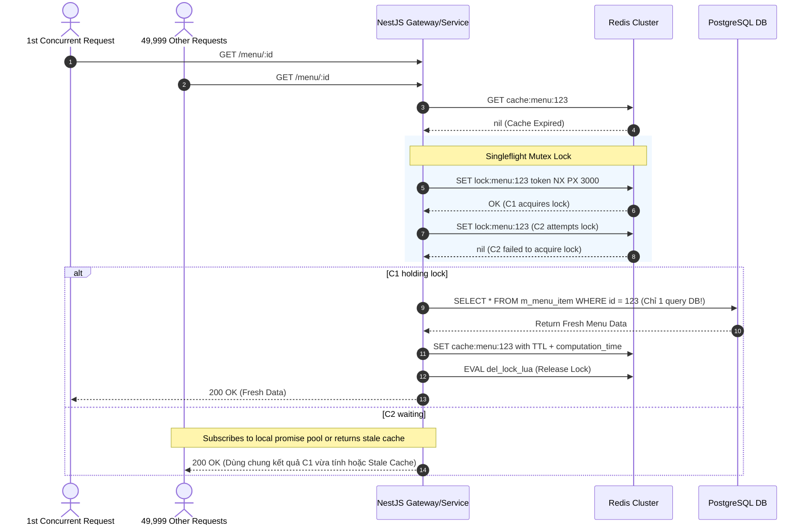

# 📋 Kế Hoạch Triển Khai: Chống Cache Stampede (50.000 RPS) & Atomic Lua Inventory Deduction

`[DRAFT]` • **Issue liên kết:** #81 • **Phân loại:** `platform` • **Ngày khởi tạo:** 2026-10-26

---

## 1. 🎯 Tổng Quan & Bài Toán Cần Giải Quyết

### 1.1. Hiện trạng & Kịch bản Thảm họa (The 50,000 RPS Thundering Herd Disaster)
- **Kịch bản**: Vào khung giờ vàng 12h00 trưa, chương trình Flash Sale tung ra món hot "Trà sữa 1đ" hoặc một chuỗi nhà hàng tung voucher hot. Dữ liệu món ăn/nhà hàng có thời gian sống trong cache Redis là 60 giây.
- **Điểm gãy 1 - Cache Stampede / Thundering Herd**:
  - Tại giây thứ 60, key cache hết hạn (TTL Expired).
  - Đúng thời điểm này, **50.000 requests/giây** ùa vào `restaurant-service` và `order-service`.
  - Cả 50.000 requests đồng loạt thấy Cache Miss, sau đó đồng thời gửi câu truy vấn SQL (kèm nhiều `JOIN`) xuống PostgreSQL.
  - Hậu quả: **PostgreSQL Connection Pool (thường đặt 20-50 connections) bị cạn kiệt ngay lập tức**, CPU database nhảy vọt 100%, IOPS bão hòa, toàn bộ hệ thống tê liệt và kéo sập dây chuyền (Cascading Failure).
- **Điểm gãy 2 - Race Condition & Bán âm hàng (Overselling)**:
  - Món Flash Sale chỉ còn 100 suất. 5.000 người dùng bấm "Đặt hàng" cùng một mili-giây.
  - Do cơ chế `SELECT stock FROM m_menu_item` và `UPDATE m_menu_item SET stock = stock - 1` chạy đồng thời không có khóa phân tán, dẫn đến tình trạng bán âm (-1.400 suất). Nhà hàng không thể phục vụ và phải hủy đơn hàng loạt, gây bức xúc tột cùng cho khách hàng.

### 1.2. Mục tiêu kỹ thuật
1. **Chống Cache Stampede đa tầng (Multi-tier Stampede Defense)**:
   - Áp dụng thuật toán **Probabilistic Early Expiration (XFetch)**: Tự động tính toán xác suất để làm mới cache ngầm trước khi key thực sự hết hạn.
   - Cơ chế **Singleflight / Distributed Mutex Lock**: Khi cache miss xảy ra, chỉ cho phép **1 request duy nhất** lấy lock Redis để truy vấn Database và cập nhật cache; 49.999 requests còn lại nhận stale cache hoặc chờ kết quả trong pool micro-task mà không làm phiền Database.
2. **Atomic Inventory Deduction (Trừ tồn kho nguyên tử bằng Redis Lua Script)**:
   - Chuyển toàn bộ logic kiểm tra và trừ tồn kho tức thời lên bộ nhớ Redis bằng Lua Script chạy đơn luồng nguyên tử (Atomic).
   - Đảm bảo 100% không bao giờ xảy ra Overselling dù có 50.000 requests cạnh tranh cùng 1 mili-giây.
   - Bất đồng bộ hóa (Eventual Consistency) việc cập nhật số tồn kho xuống PostgreSQL qua Message Queue (Kafka/RabbitMQ).
3. **Mức độ Tái sử dụng Code (Reusability & Shared Kernel)**:
   - Đóng gói toàn bộ logic thành Shared Decorator `@DistributedCache()` và `@AtomicInventory()` tại `backend/libs/common` để mọi service (`restaurant-service`, `order-service`, `payment-service`) có thể tái sử dụng chỉ bằng 1 dòng code.

---

## 2. 🔍 Khảo Sát Hiện Trạng Codebase

| File / Component | Hiện trạng | Hành động cần thực hiện |
| :--- | :--- | :--- |
| [`backend/libs/common/src/cache`](file:///d:/code/FoodDelivery/backend/libs/common) | Chưa có thư viện chuyên trách chống Stampede và Distributed Lock chuẩn Redlock. | Xây dựng `CacheStampedeModule`, cung cấp `SingleflightLockService` và decorator `@DistributedCache`. |
| [`backend/apps/restaurant-service/src/modules/menu`](file:///d:/code/FoodDelivery/backend/apps/restaurant-service) | Query menu trực tiếp từ database hoặc get cache đơn giản qua Redis `GET`/`SET`. | Tích hợp thuật toán XFetch và Singleflight Lock vào method lấy menu/món ăn. |
| [`backend/apps/order-service/src/modules/order/usecases/create-order.usecase.ts`](file:///d:/code/FoodDelivery/backend/apps/order-service) | Trừ tồn kho thông qua transaction DB trực tiếp (`UPDATE ... SET stock = stock - qty`). | Chuyển sang trừ tồn kho nguyên tử bằng Redis Lua Script trước khi ghi nhận đơn. |

---

## 3. 🛠️ Thiết Kế Chi Tiết & Giải Pháp Kỹ Thuật

### 3.1. Thuật toán Probabilistic Early Expiration (XFetch Algorithm)
Công thức xác định thời điểm làm mới cache ngầm:
$$-\beta \times \delta \times \ln(\text{rand}()) > \text{TTL}_{\text{remaining}}$$
- $\delta$ (delta): Thời gian (ms) cần thiết để tính toán/query lại dữ liệu từ DB.
- $\beta$ (beta): Hệ số quyết liệt (> 0, mặc định = 1.0). Càng lớn thì việc làm mới trước càng sớm.
- $\text{rand}()$: Giá trị ngẫu nhiên trong khoảng $(0, 1]$.
- Nếu điều kiện thỏa mãn: Request đó sẽ chủ động refresh cache trong nền, người dùng vẫn nhận dữ liệu ngay lập tức với độ trễ 0ms.

### 3.2. Luồng Xử Lý Chống Cache Stampede (Singleflight Sequence Diagram)


### 3.3. Atomic Lua Script Cho Trừ Tồn Kho (Inventory Deduction)
```lua
-- KEYS[1]: stock_key (vd: "inventory:item:456")
-- ARGV[1]: quantity_to_deduct (vd: 2)
local current_stock = redis.call('GET', KEYS[1])
if not current_stock then
    return -1 -- Lỗi: Không tìm thấy key tồn kho
end

local stock_num = tonumber(current_stock)
local deduct_num = tonumber(ARGV[1])

if stock_num < deduct_num then
    return 0 -- Thất bại: Hết hàng / Không đủ tồn kho
end

local remaining = redis.call('DECRBY', KEYS[1], deduct_num)
return remaining -- Thành công: Trả về số tồn kho còn lại
```

---

## 4. 🧪 Kịch Bản Kiểm Thử 3 Nhánh (Testing Policy Compliance)

Toàn bộ test phải có Traceability Header và bao phủ 100% 3 nhánh:

### 4.1. Nhánh 1: Happy Path (Dòng Chảy Chuẩn)
- **Kịch bản**: 100 requests đồng thời truy vấn menu khi cache rỗng.
- **Kỳ vọng**: 
  - Chỉ có đúng 1 query SQL gửi xuống PostgreSQL.
  - 99 requests còn lại nhận dữ liệu từ Singleflight in-flight promise.
  - Phản hồi HTTP 200 cho toàn bộ 100 requests.

### 4.2. Nhánh 2: Edge Cases (Biên & Giới Hạn)
- **Kịch bản 1 (Tồn kho sát nút)**: Món ăn chỉ còn 1 suất cuối cùng (`stock = 1`). 50 requests đồng thời cố gắng mua 1 suất.
- **Kỳ vọng**: Đúng 1 request thành công nhận HTTP 201 Created; 49 requests còn lại nhận lỗi HTTP 400 Bad Request ("Sản phẩm đã hết hàng"). Tồn kho Redis dừng lại chính xác ở số 0, không bao giờ rơi vào số âm.
- **Kịch bản 2 (Database bị lag đột biến)**: Request lấy lock gặp DB timeout (vượt quá 3.000ms). Lock tự động giải phóng (PX expiry) để không gây deadlock vĩnh viễn.

### 4.3. Nhánh 3: Error & Rejection Flow (Ngoại Lệ & Khắc Phục)
- **Kịch bản**: Redis Cluster gặp sự cố gián đoạn kết nối (EAI_AGAIN / Connection Refused).
- **Kỳ vọng**: Hệ thống không được crash hay nuốt ngoại lệ. Kích hoạt fallback circuit breaker có kiểm soát với Rate Limiting nghiêm ngặt để bảo vệ DB.

---

## 5. ✅ Checklist Tiêu Chuẩn Cần Vượt Qua (Local CI Gate)

- [ ] **Linter**: `npm run lint` đạt 0 warnings, 0 errors.
- [ ] **Type Check**: `npx tsc --noEmit` đạt 0 errors (nghiêm cấm `any`).
- [ ] **Unit Tests (Vitest)**:
  - [ ] `libs/common/tests/cache-stampede.spec.ts` pass 100%.
  - [ ] `libs/common/tests/atomic-inventory-lua.spec.ts` pass 100%.
  - [ ] `restaurant-service/tests/menu-singleflight.spec.ts` pass 100%.
- [ ] **Build Check**: `npm run build` thành công trên cả backend và frontend.
- [ ] **Traceability Header**: Đầy đủ `[Requirement/Issue]`, `[Branch: Happy|Edge|Error]`, `[Expected Output]` trong mọi test case.
