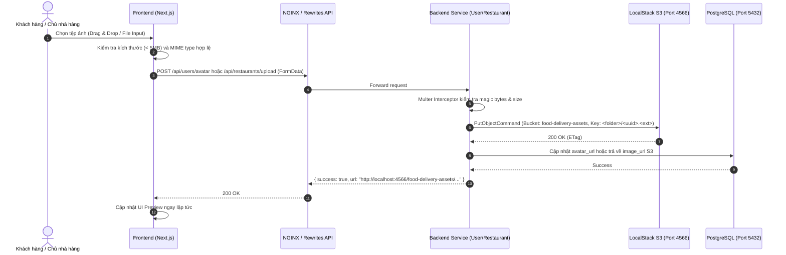

# Kế hoạch Triển khai: Lưu trữ Tài nguyên Tệp tin (Assets) với LocalStack AWS S3 (Issue #70)

> **Trạng thái**: `[COMPLETED]`  
> **Người thực hiện**: Sub-Agents (`@planner`, `@orchestrator`, `@coder`, `@tester`, `@reviewer`)  
> **Tham chiếu Issue**: [#70 - Sử dụng local stack resource S3 hỗ trợ lưu trữ asset thay vì hardcode url](https://github.com/DuyBinh2003/FoodDelivery/issues/70)  
> **Nhánh Git**: `70-localstack-s3-asset-storage`  
> **Thời gian tạo**: 2026-10-20  

---

## 1. Tổng Quan & Bối Cảnh Nghiệp Vụ (Context & Objectives)

### 1.1. Hiện trạng (Current State)
- Hiện tại, toàn bộ hình ảnh trong hệ thống (ảnh món ăn, banner nhà hàng, icon danh mục, avatar) đang phụ thuộc vào các đường dẫn URL bên ngoài (Unsplash, static icons) được hardcode trực tiếp trong migration seed và code frontend.
- Người dùng chưa có tính năng cập nhật ảnh đại diện cá nhân (Avatar) lưu trữ trên hạ tầng cloud của hệ thống.
- Chủ nhà hàng chưa thể tải ảnh thực tế cho món ăn khi tạo/sửa món trên màn hình quản lý đối tác (`menu-item-dialog.tsx`), cũng như chưa thể đổi ảnh banner quán ăn trên dashboard (`/partner/restaurant`).
- LocalStack container trong `docker-compose.yml` mới chỉ kích hoạt dịch vụ `sqs,sns` mà chưa mở dịch vụ `s3`, script khởi tạo `scripts/localstack-init.sh` chưa tạo S3 bucket lưu trữ assets.

### 1.2. Mục tiêu (Goals)
1. **Hạ tầng AWS S3 (LocalStack)**:
   - Kích hoạt dịch vụ `s3` trong LocalStack `docker-compose.yml`.
   - Cập nhật script `scripts/localstack-init.sh` tự động tạo bucket `food-delivery-assets` với chính sách public-read khi khởi động container.
2. **Backend NestJS Shared S3 Module (`backend/libs/common/src/storage`)**:
   - Cài đặt `@aws-sdk/client-s3`.
   - Xây dựng `S3StorageModule` và `S3StorageService`:
     - Tự động kiểm tra/tạo bucket nếu chưa tồn tại.
     - Hàm upload buffer/stream với MIME type tương ứng, sinh tên file ngẫu nhiên chống trùng lặp (`UUID.ext`).
     - Quản lý phân cấp thư mục rõ ràng: `avatars/`, `dishes/`, `banners/`, `defaults/`.
     - Trả về S3 public URL (`http://localhost:4566/food-delivery-assets/<key>`).
3. **Database Schema Enhancements**:
   - Thêm cột `avatar_url` (nullable `text`) vào bảng `schema_user.m_user`.
   - Thêm cột `banner_url` (nullable `text`) vào bảng `schema_restaurant.m_restaurant` (nếu chưa có).
4. **Backend Upload Endpoints (Microservices)**:
   - `user-service`: `POST /api/users/avatar` (Nhận file ảnh qua multipart/form-data, validate max 5MB, định dạng jpeg/png/webp, lưu vào S3 thư mục `avatars/`, cập nhật `m_user.avatar_url`).
   - `restaurant-service`: `POST /api/restaurants/upload` (Nhận file ảnh món ăn hoặc banner, validate, tải lên S3 `dishes/` hoặc `banners/`, trả về URL).
5. **Seed & Assets Migration Script**:
   - Script `backend/scripts/sync-s3-seed.cjs`: Tải sẵn bộ ảnh mẫu tiêu chuẩn vào bucket `food-delivery-assets/defaults/` trên LocalStack S3 và cập nhật các bản ghi món ăn trong database trỏ về URL S3 nội bộ.
6. **Frontend UI Integration**:
   - Trang cá nhân `/profile`: Hiển thị thông tin người dùng kèm bộ chọn ảnh Avatar và upload lên S3.
   - Hộp thoại tạo/sửa món ăn `menu-item-dialog.tsx`: Tích hợp bộ chọn ảnh món ăn với preview và tải trực tiếp lên S3.
   - Quản lý nhà hàng `/partner/restaurant`: Tích hợp upload banner nhà hàng.

---

## 2. Thiết Kế Kiến Trúc & Luồng Dữ Liệu (Architecture & Data Flow)

### 2.1. Sơ đồ Luồng Upload Trực Tiếp (Direct Upload Flow)

---

## 3. Kế Hoạch Triển Khai Chi Tiết (Implementation Steps)

### Bước 1: Cấu hình Hạ tầng LocalStack & Docker
- Cập nhật `docker-compose.yml`: Bổ sung `s3` vào biến môi trường `SERVICES=sqs,sns,s3`.
- Cập nhật `scripts/localstack-init.sh`:
  - Thêm lệnh `awslocal s3 mb s3://food-delivery-assets --region "$REGION"`.
  - Cấu hình public-read policy cho bucket.
- Cập nhật file `.env` và `backend/apps/*/.env`: Bổ sung `AWS_S3_BUCKET=food-delivery-assets`, `AWS_S3_ENDPOINT=http://localhost:4566`.

### Bước 2: Xây dựng Thư Viện Dùng Chung `S3StorageModule`
- Cài đặt `@aws-sdk/client-s3` trong `backend/package.json`.
- Tạo `backend/libs/common/src/storage/`:
  - `storage.module.ts`: NestJS Dynamic/Configurable Module.
  - `storage.service.ts`:
    - `uploadFile(buffer: Buffer, originalFilename: string, mimeType: string, folder: string): Promise<string>`
    - `deleteFile(fileUrlOrKey: string): Promise<void>`
    - `getPublicUrl(key: string): string`
  - Export từ `backend/libs/common/src/index.ts`.

### Bước 3: Database Migrations
- Migration `schema_user`: Thêm cột `avatar_url` vào `schema_user.m_user`.
- Migration `schema_restaurant`: Thêm cột `banner_url` vào `schema_restaurant.m_restaurant` (nếu cần).
- Cập nhật Entity TypeORM tương ứng trong `user-service` và `restaurant-service`.

### Bước 4: Backend Controllers & Endpoints
- **User Service (`apps/user-service`)**:
  - Endpoint `POST /api/users/avatar`: Upload avatar người dùng hiện tại (lấy `userId` từ token xác thực).
  - Cập nhật `UserRepository` và `GetProfileUseCase` để trả về `avatar_url`.
- **Restaurant Service (`apps/restaurant-service`)**:
  - Endpoint `POST /api/restaurants/upload`: Upload ảnh món ăn (`dishes/`) hoặc banner (`banners/`).
  - Hỗ trợ cập nhật banner trong `UpdateRestaurantUseCase`.

### Bước 5: Script Seed Assets Sang LocalStack S3
- Xây dựng `backend/scripts/sync-s3-seed.cjs`:
  - Tạo các ảnh SVG/PNG mẫu đại diện cho món ăn và avatar.
  - Upload lên bucket `food-delivery-assets/defaults/`.
  - Cập nhật dữ liệu seed trong `1789353917002_seed-restaurants.js` để trỏ vào URL S3 LocalStack.

### Bước 6: Frontend Integration
- **Trang cá nhân `/profile`**:
  - Tạo trang `frontend/src/app/profile/page.tsx`.
  - Cho phép xem thông tin cá nhân và tải lên avatar với preview, thanh tiến trình và thông báo Toast.
- **Hộp thoại món ăn `menu-item-dialog.tsx`**:
  - Thêm khu vực tải ảnh món ăn (Drag & Drop zone hoặc chọn file) gọi `POST /api/restaurants/upload`.
  - Hiển thị preview ảnh và nút xóa ảnh.
- **Quản lý nhà hàng `/partner/restaurant`**:
  - Thêm nút đổi banner quán ăn tải trực tiếp lên S3.

---

## 4. Kịch Bản Kiểm Thử 3 Nhánh (3-Branch Testing Strategy)

### Branch 1: Happy Path (Luồng Hoạt Động Tiêu Chuẩn)
1. **Upload Avatar thành công**: Khách hàng tải tệp ảnh PNG 500KB lên `/api/users/avatar` -> Nhận URL S3 hợp lệ dạng `http://localhost:4566/food-delivery-assets/avatars/...`, cơ sở dữ liệu `m_user.avatar_url` được cập nhật.
2. **Upload Ảnh Món Ăn thành công**: Chủ quán tải tệp ảnh WEBP 1.2MB qua `POST /api/restaurants/upload` -> Nhận URL S3 `dishes/...` và gán vào món ăn mới tạo thành công.
3. **Hiển thị hình ảnh từ S3**: Frontend hiển thị chính xác avatar trên Header/Profile và ảnh món ăn trên Menu từ URL LocalStack S3.

### Branch 2: Edge Cases (Các Trường Hợp Biên)
4. **Tải tệp chạm ngưỡng tối đa (5MB)**: Tải ảnh dung lượng chính xác 4.99MB -> Xử lý thành công không bị gián đoạn kết nối hay tràn bộ nhớ.
5. **Tên tệp chứa ký tự đặc biệt hoặc dấu cách tiếng Việt**: Tên tệp "ảnh món phở đặc biệt #1.png" -> Tự động chuẩn hóa và sinh tên mã hóa UUID an toàn trên S3.
6. **Thay thế ảnh cũ (Overwriting/Updating Avatar)**: Khi người dùng đổi avatar lần 2, hệ thống ghi đè hoặc dọn dẹp ảnh cũ, trả về URL mới nhất.

### Branch 3: Error & Rejection Flow (Luồng Lỗi & Từ Chối)
7. **Từ chối tệp vượt quá dung lượng (> 5MB)**: Người dùng tải ảnh 8MB -> Backend từ chối ngay với mã lỗi `400 Bad Request` ("Dung lượng tệp vượt quá giới hạn 5MB").
8. **Từ chối định dạng tệp không được phép**: Người dùng cố tình tải tệp `.pdf`, `.exe`, `.svg` chứa script -> Validator chặn và báo lỗi `400 Bad Request` ("Chỉ chấp nhận các định dạng ảnh: JPEG, PNG, WEBP, GIF").
9. **S3 Service ngắt kết nối (Network / LocalStack Down)**: Khi LocalStack S3 không phản hồi -> Bắt lỗi có log bảo toàn root cause, trả về `503 Service Unavailable` rõ ràng, không crash server.

---

## 5. Tiêu Chí Nghiệm Thu (Acceptance Criteria & Local CI Gate)

- [x] LocalStack S3 bucket `food-delivery-assets` được tạo tự động và hoạt động ổn định trên port `4566`.
- [x] `S3StorageModule` được kiểm thử đơn vị độc lập với Vitest mock `@aws-sdk/client-s3`.
- [x] Endpoints upload avatar và ảnh món ăn được bảo vệ với xác thực JWT và validation chặt chẽ.
- [x] Bộ tứ kiểm soát nội bộ (Local CI Gate) đạt 100% xanh:
  1. `npm run lint` (oxlint Backend 0 errors/warnings, ESLint Frontend 0 errors/warnings).
  2. `npx tsc --noEmit` (TypeScript 0 errors cả Backend và Frontend).
  3. `npm test` (100% test cases pass trên cả 2 test suites: 130 backend tests, 72 frontend tests).
  4. `npm run build` (Biên dịch production thành công).
