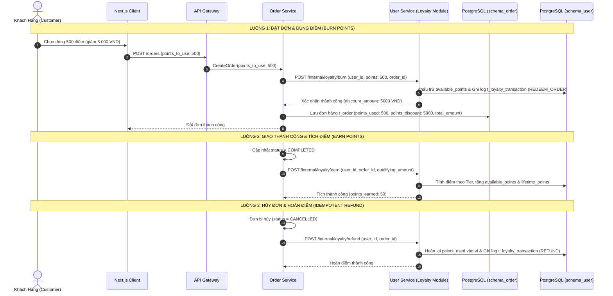

# Kế Hoạch Triển Khai: Hệ Thống Tích Điểm, Quy Đổi & Sử Dụng Điểm Thưởng (Loyalty Points & Rewards Engine)

> **Mã công việc (Task Code):** `loyalty-points-rewards-engine`  
> **Trạng thái:** `[COMPLETED]`  
> **Tác giả:** `@planner` (Điều phối bởi `@orchestrator`)  
> **Nhánh phát triển:** `19-promotionvoucher-engine` (PR #64)  
> **Tài liệu nghiệp vụ liên quan:** `docs/business/business-roadmap.md` (Issue C6 - Epic 2)

---

## 1. Bối Cảnh & Mục Tiêu Nghiệp Vụ (Context & Business Objectives)

Trong các ứng dụng giao đồ ăn quy mô lớn (GrabFood - GrabRewards, ShopeeFood - Shopee Xu, Starbucks Rewards), hệ thống tích điểm và khách hàng thân thiết (**Loyalty Points & Rewards**) là đòn bẩy sống còn để tăng tỷ lệ quay lại (Retention Rate), giá trị vòng đời khách hàng (LTV) và giá trị đơn hàng trung bình (AOV).

### Mục tiêu cốt lõi:
1. **Tích điểm minh bạch (Accrual)**: Tích điểm tự động dựa trên giá trị món ăn thực chi sau khi đơn hàng giao thành công (`ORDER_COMPLETED`), áp dụng hệ số nhân theo Hạng thành viên (Tier Multiplier).
2. **Quy đổi trực tiếp tại giỏ hàng (Burn on Checkout)**: Khách hàng được dùng điểm thưởng tích lũy để giảm trừ trực tiếp vào tổng tiền thanh toán với tỷ lệ quy đổi cố định (1 điểm = 10 VND), kèm trần khống chế an toàn (tối đa 50% Subtotal).
3. **Đổi Voucher thưởng (Voucher Exchange)**: Hỗ trợ dùng điểm để đổi các mã giảm giá / freeship độc quyền trong kho quà.
4. **Kế toán điểm Append-Only & Chống gian lận (Ledger & Anti-Fraud)**: Lưu nhật ký giao dịch điểm bất biến, hỗ trợ hoàn điểm tức thì và lũy đẳng (Idempotent Refund) khi đơn hàng bị hủy.

---

## 2. Kiến Trúc Kỹ Thuật & Phân Bổ Microservices

### Phân công trách nhiệm:
1. **`user-service` (Trung tâm Loyalty & Membership)**:
   - Quản lý ví điểm khách hàng (`m_loyalty_wallet`), lịch sử giao dịch điểm (`t_loyalty_transaction`), cấu hình hạng thành viên (`m_membership_tier`).
   - Cung cấp Public APIs cho Customer xem điểm, lịch sử, đổi voucher.
   - Cung cấp Internal APIs cho `order-service` gọi `burn`, `earn`, `refund`.
2. **`order-service` (Khách hàng tiêu & tích điểm)**:
   - Mở rộng bảng `t_order` lưu `points_used`, `points_discount`, `points_earned`.
   - Cập nhật `CreateOrderUseCase` validate và trừ điểm qua internal API.
   - Cập nhật `OrderMilestoneUseCase` & `UpdateDriverTripStatusUseCase` kích hoạt tích điểm khi `COMPLETED` và hoàn điểm khi `CANCELLED`.
3. **`frontend` (Giao diện người dùng)**:
   - Thêm widget điểm thưởng tại trang cá nhân / header.
   - Thêm tùy chọn "Dùng điểm tích lũy" tại màn hình giỏ hàng / Checkout.

---

## 3. Thiết Kế Cơ Sở Dữ Liệu (Database Schema Policy)

### Tại `schema_user` (PostgreSQL `user-service`)

#### Bảng 1: `m_loyalty_wallet` (Ví điểm thành viên)
| Cột | Kiểu dữ liệu | Ràng buộc | Mô tả |
| :--- | :--- | :--- | :--- |
| `id` | `uuid` | `PRIMARY KEY, DEFAULT gen_random_uuid()` | Khóa chính ví điểm |
| `user_id` | `uuid` | `UNIQUE, NOT NULL` | Tham chiếu `m_user(id)` |
| `available_points` | `integer` | `NOT NULL, DEFAULT 0, CHECK >= 0` | Số điểm khả dụng có thể tiêu |
| `lifetime_points` | `integer` | `NOT NULL, DEFAULT 0` | Tổng điểm tích lũy trọn đời (dùng xét Hạng) |
| `tier` | `varchar(20)` | `NOT NULL, DEFAULT 'BRONZE'` | Hạng: `BRONZE`, `SILVER`, `GOLD`, `PLATINUM` |
| `created_at` | `timestamptz` | `DEFAULT now()` | Ngày tạo |
| `updated_at` | `timestamptz` | `DEFAULT now()` | Ngày cập nhật |

#### Bảng 2: `t_loyalty_transaction` (Sổ cái giao dịch điểm bất biến - Append-Only)
| Cột | Kiểu dữ liệu | Ràng buộc | Mô tả |
| :--- | :--- | :--- | :--- |
| `id` | `uuid` | `PRIMARY KEY, DEFAULT gen_random_uuid()` | Khóa chính giao dịch |
| `wallet_id` | `uuid` | `NOT NULL, REFERENCES m_loyalty_wallet(id)` | Khóa ngoại ví điểm |
| `user_id` | `uuid` | `NOT NULL` | ID người dùng |
| `transaction_type`| `varchar(30)` | `NOT NULL` | `EARN`, `REDEEM_ORDER`, `REDEEM_VOUCHER`, `REFUND`, `EXPIRE` |
| `points` | `integer` | `NOT NULL` | Số điểm biến động (+ hoặc -) |
| `balance_after` | `integer` | `NOT NULL` | Số dư điểm sau giao dịch |
| `reference_type` | `varchar(30)` | `NOT NULL` | `ORDER`, `VOUCHER`, `MANUAL` |
| `reference_id` | `varchar(100)`| `NOT NULL` | ID đơn hàng hoặc mã voucher |
| `idempotency_key`| `varchar(100)`| `UNIQUE, NOT NULL` | Khóa chống lặp giao dịch (VD: `burn_order_<id>`) |
| `description` | `varchar(255)`| `NOT NULL` | Diễn giải giao dịch |
| `created_at` | `timestamptz` | `DEFAULT now()` | Thời điểm giao dịch |

### Tại `schema_order` (PostgreSQL `order-service`)
Cập nhật bảng `t_order`:
- `points_used` (`integer`, `DEFAULT 0`): Số điểm khách hàng đã sử dụng cho đơn.
- `points_discount` (`numeric(15,2)`, `DEFAULT 0`): Số tiền được giảm tương ứng từ điểm (VND).
- `points_earned` (`integer`, `DEFAULT 0`): Số điểm tích được sau khi hoàn tất đơn.

---

## 4. Đặc Tả Quy Tắc Nghiệp Vụ (Business Formulas)

1. **Tỷ lệ quy đổi tiền tệ**:
   - `1 Điểm = 10 VND` (Ví dụ: 1.000 điểm = 10.000 VND giảm trừ).
   - Tối thiểu 100 điểm mới được sử dụng.
2. **Khống chế trần đổi điểm**:
   - `max_points_discount = subtotal * 0.50` (Tối đa 50% tiền món).
   - `total_amount = max(0, subtotal - voucher_discount - points_discount) + delivery_fee`.
3. **Quy tắc tích điểm theo Hạng (Earning Rate)**:
   - Điểm cơ bản: `base_points = floor(qualifying_subtotal / 1000)` (Mỗi 1.000 VND = 1 điểm).
   - Hệ số nhân theo Tier:
     - `BRONZE` (0 - 9.999 điểm): 1.0x
     - `SILVER` (10.000 - 49.999 điểm): 1.25x
     - `GOLD` (50.000 - 99.999 điểm): 1.5x
     - `PLATINUM` (>= 100.000 điểm): 2.0x
   - Điểm thực nhận: `earned_points = floor(base_points * tier_multiplier)`.

---

## 5. Danh Sách APIs Cần Phát Triển

### A. Public Client APIs (`user-service`)
| Method | Endpoint | Auth | Mô tả |
| :--- | :--- | :---: | :--- |
| `GET` | `/loyalty/my-points` | `JwtAuthGuard` | Lấy số dư điểm, Hạng thành viên, tỷ lệ nhân điểm và 20 giao dịch gần nhất |
| `GET` | `/loyalty/rewards` | `JwtAuthGuard` | Lấy danh mục quà tặng / voucher có thể đổi bằng điểm |
| `POST` | `/loyalty/rewards/:id/exchange` | `JwtAuthGuard` | Đổi điểm lấy Voucher |

### B. Internal APIs (`user-service` ⬅️ `order-service`)
| Method | Endpoint | Auth | Mô tả |
| :--- | :--- | :---: | :--- |
| `POST` | `/internal/loyalty/burn` | Internal | Khấu trừ điểm khi khách đặt đơn (Kèm `idempotency_key`) |
| `POST` | `/internal/loyalty/earn` | Internal | Tích điểm cho khách khi đơn `COMPLETED` |
| `POST` | `/internal/loyalty/refund` | Internal | Hoàn điểm cho khách khi đơn `CANCELLED` |

---

## 6. Kịch Bản Kiểm Thử Bắt Buộc 3 Nhánh (Vitest Test Scenarios)

### Nhánh 1: 🟢 Happy Path (Luồng Thành Công Chuẩn)
1. Khách hàng tích điểm thành công sau khi đơn hoàn tất: Đơn hàng Subtotal 100.000 VND ➡️ Tích 100 điểm (hạng Bronze) hoặc 150 điểm (hạng Gold).
2. Khách hàng dùng 500 điểm tại giỏ hàng: Giảm chính xác 5.000 VND vào tổng tiền thanh toán, ví điểm bị trừ 500 điểm, tạo 1 bút toán `REDEEM_ORDER`.
3. Khách hàng hủy đơn hàng đã dùng điểm: Ví điểm được cộng lại đủ 500 điểm, tạo 1 bút toán `REFUND`.
4. Xem danh sách giao dịch và thông tin hạng thành viên phản ánh chính xác sau các giao dịch.

### Nhánh 2: 🟡 Edge Cases (Biên Dữ Liệu & Race Condition)
1. Đổi điểm vượt trần 50% Subtotal: Đơn 40.000 VND nhưng muốn dùng 3.000 điểm (30.000 VND) ➡️ Hệ thống chỉ cho phép dùng tối đa 2.000 điểm (20.000 VND).
2. Đổi điểm dưới mức tối thiểu (< 100 điểm) ➡️ Bị từ chối với thông báo rõ ràng.
3. Chống nạp/trừ trùng lặp (Idempotency): Gửi 2 request `burn` cùng một `idempotency_key` ➡️ Request thứ 2 trả kết quả cũ, không bị trừ 2 lần điểm.
4. Nâng hạng thành viên tự động: Khi `lifetime_points` vượt mốc 10.000 điểm ➡️ Tự động nâng từ `BRONZE` lên `SILVER`.

### Nhánh 3: 🔴 Error / Rejection Flow (Ngoại Lệ & Bảo Vệ)
1. Khách hàng tiêu điểm vượt quá số dư khả dụng (`available_points < points_to_use`) ➡️ Ném lỗi `BadRequestException('Số điểm tích lũy không đủ')`, không thay đổi số dư.
2. Hủy đơn nhưng đơn đó không dùng điểm ➡️ Bỏ qua không ném exception lỗi (`No-op` an toàn).
3. Người dùng chưa đăng nhập hoặc token hết hạn ➡️ `401 Unauthorized`.
4. Ví điểm bị khóa hoặc tài khoản không tồn tại ➡️ `NotFoundException`.

---

## 7. Danh Sách Tập Tin Tác Động (File Scope)

### Backend:
- `backend/apps/user-service/src/modules/loyalty/entities/loyalty-wallet.entity.ts` (Mới)
- `backend/apps/user-service/src/modules/loyalty/entities/loyalty-transaction.entity.ts` (Mới)
- `backend/apps/user-service/src/modules/loyalty/repositories/loyalty.repository.ts` (Mới)
- `backend/apps/user-service/src/modules/loyalty/usecases/burn-points.usecase.ts` (Mới)
- `backend/apps/user-service/src/modules/loyalty/usecases/earn-points.usecase.ts` (Mới)
- `backend/apps/user-service/src/modules/loyalty/usecases/refund-points.usecase.ts` (Mới)
- `backend/apps/user-service/src/modules/loyalty/usecases/get-loyalty-profile.usecase.ts` (Mới)
- `backend/apps/user-service/src/modules/loyalty/controllers/loyalty.controller.ts` (Mới)
- `backend/apps/user-service/src/modules/loyalty/controllers/loyalty-internal.controller.ts` (Mới)
- `backend/apps/user-service/src/modules/loyalty/loyalty.module.ts` (Mới)
- `backend/apps/order-service/src/modules/orders/entities/order.entity.ts` (Cập nhật 3 trường loyalty)
- `backend/apps/order-service/src/modules/orders/usecases/create-order.usecase.ts` (Tích hợp tính điểm)
- `backend/apps/order-service/src/modules/orders/usecases/update-driver-trip-status.usecase.ts` (Tích hợp earn/refund)
- `backend/apps/user-service/src/modules/loyalty/tests/loyalty-engine.spec.ts` (Bộ test Vitest 3 nhánh)

---

## 8. Kế Hoạch Nghiệm Thu (Acceptance Criteria)
- [ ] 100% mã nguồn TypeScript strict, không chứa `any`, không fallback ngầm.
- [ ] Bảng cơ sở dữ liệu `m_loyalty_wallet` và `t_loyalty_transaction` tuân thủ quy chuẩn `schema_user`.
- [ ] Bộ test Vitest phủ đủ 3 nhánh (Happy Path, Edge Cases, Error Flow) đạt 100% pass (`npm test`).
- [ ] Reviewer audit độc lập không phát hiện lỗi tiềm ẩn hoặc vi phạm quy chuẩn.
- [ ] Tài liệu `docs/services/user-service.md` và `docs/services/order-service.md` được cập nhật đồng bộ.
