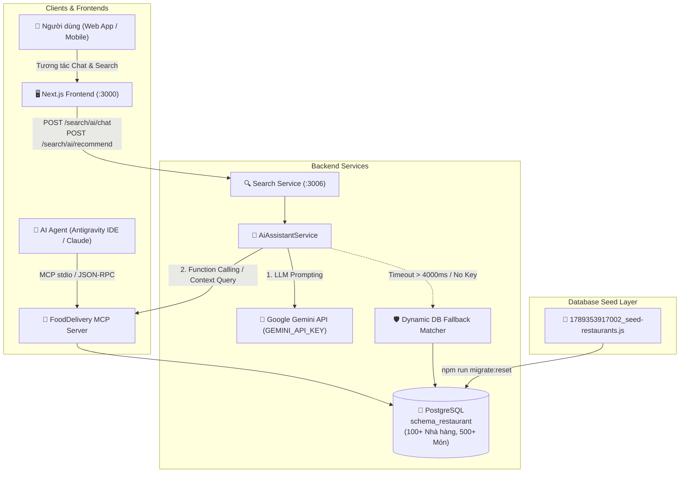

# Kế Hoạch Triển Khai: MCP Server (Model Context Protocol), Dữ Liệu Lớn 100+ Nhà Hàng & Tích Hợp AI Assistant Tra Cứu Thực Tế

> **Mã công việc (Task Code):** `mcp-server-and-large-dataset-seed`  
> **Trạng thái:** `[COMPLETED]`  
> **Tác giả:** `@planner` (Điều phối bởi `@orchestrator`)  
> **Nhánh phát triển:** `feature/issue-88-mcp-server-large-seed`  
> **GitHub Issue:** [#88](https://github.com/DuyBinh2003/FoodDelivery/issues/88)  
> **Tài liệu tham chiếu:** `docs/services/search-service.md`, `docs/services/restaurant-service.md`, `docs/architecture/`

---

## 1. Bối Cảnh & Mục Tiêu Nghiệp Vụ (Context & Business Objectives)

Hiện tại, hệ thống `search-service` đã có `AiAssistantService` hỗ trợ gợi ý món ăn và hội thoại đàm thoại thông minh. Tuy nhiên:
1. **Nguồn dữ liệu còn mang tính giả lập (Mocked In-Memory Catalog)**: Dữ liệu món ăn dùng để gợi ý và fallback đang được hardcode trong mảng `catalog: CatalogDish[]` (~10 món ăn mẫu), không liên kết với cơ sở dữ liệu thật của nền tảng.
2. **Bộ dữ liệu hạt giống (Seed Data) quá nhỏ**: File migration chỉ có 2 nhà hàng (*Phở Biên Hòa*, *Bún Bò Huế Đông Ba*) và một số ít món ăn, không đủ đại diện cho một nền tảng Food Delivery thực tế với nhu cầu tìm kiếm đa dạng theo cự ly, ngân sách, phân khúc và sở thích.
3. **Thiếu chuẩn kết nối ngữ cảnh dữ liệu hiện đại (Model Context Protocol - MCP)**: Chưa có MCP Server chuẩn hóa để các Agent AI (như Antigravity IDE, Claude Desktop, Cursor hoặc chính LLM của hệ thống) có thể truy vấn ngữ cảnh (Tools, Resources) trực tiếp từ database hệ thống một cách bảo mật, có kiểm soát qua API Key.

### Mục tiêu cốt lõi:
1. **Xây dựng FoodDelivery MCP Server (`backend/apps/mcp-server`)**:
   - Tuân thủ tiêu chuẩn Model Context Protocol (MCP) sử dụng `@modelcontextprotocol/sdk`.
   - Cung cấp bộ công cụ chuẩn (**MCP Tools**):
     - `search_dishes`: Tìm kiếm món ăn theo từ khóa, tags, khoảng giá, chế độ ăn kiêng (chay, healthy, món nước, cay/không cay).
     - `get_restaurants_nearby`: Tìm kiếm nhà hàng theo tọa độ GPS (lat, lng) và bán kính (radius_km).
     - `get_restaurant_menu`: Lấy chi tiết toàn bộ thực đơn kèm danh mục và tùy chọn (options/toppings) của một quán.
     - `ai_recommend_dishes`: Tìm kiếm và xếp hạng món ăn theo intent ngữ nghĩa của người dùng.
   - Hỗ trợ giao thức `stdio` (dành cho IDE / Local Agents) và HTTP/SSE endpoint nội bộ cho `search-service`.
2. **Nâng cấp `AiAssistantService` kết nối trực tiếp Nguồn Dữ Liệu Thật**:
   - Thay thế toàn bộ mảng hardcode `catalog` bằng truy vấn trực tiếp vào PostgreSQL `schema_restaurant` (thông qua TypeORM Repository / Search Read Repo).
   - Tích hợp Google Gemini LLM Provider (`gemini-1.5-flash` / `gemini-2.0-flash`) qua `GEMINI_API_KEY`.
   - Cơ chế Fallback an toàn (Graceful Degradation): Nếu không có `GEMINI_API_KEY` hoặc request LLM bị timeout/lỗi (> 4000ms), tự động fallback sang Dynamic Database Matching trên kho 100+ nhà hàng thật.
3. **Mở rộng Bộ Seed Data lên 100+ Nhà Hàng & Hàng Trăm Món Ăn Phong Phú**:
   - Ghi đè vào file migration `backend/migrations/restaurant-service/1789353917002_seed-restaurants.js`.
   - Tạo 100 nhà hàng với tọa độ GPS thực tế phân bổ khắp các quận TP.HCM (Quận 1, 3, 5, 7, 10, Bình Thạnh, Phú Nhuận, Tân Bình, Gò Vấp, Thủ Đức,...).
   - Hơn 500+ món ăn đa dạng thể loại: Cơm tấm, Phở, Bún bò, Bánh mì, Trà sữa, Cà phê, Đồ ăn vặt, Đồ nướng, Món chay, Đồ Hàn / Nhật, Fast Food, Tráng miệng.
   - Gán đầy đủ Tags, Options (Size, Topping, Độ ngọt, Mức đá), Giá cả thực tế (15.000đ - 180.000đ) và banner/ảnh từ S3/LocalStack.

---

## 2. Kiến Trúc Kỹ Thuật (Architecture & Flow)

---

## 3. Thiết Kế Kỹ Thuật Backend (Backend Specifications)

### 3.1. MCP Server Module (`backend/apps/mcp-server`)
- **Package**: `@modelcontextprotocol/sdk`.
- **Tools Định Nghĩa**:
  1. `search_dishes`:
     - Arguments: `{ keyword?: string, categoryId?: string, minPrice?: number, maxPrice?: number, tags?: string[], limit?: number }`
     - Returns: Danh sách món ăn chi tiết kèm giá, rating và tên quán.
  2. `get_restaurants_nearby`:
     - Arguments: `{ lat: number, lng: number, radiusKm?: number, limit?: number }`
     - Returns: Danh sách quán ăn có cự ly GPS tính theo công thức Haversine.
  3. `get_restaurant_menu`:
     - Arguments: `{ restaurantId: string }`
     - Returns: Toàn bộ danh mục món ăn, giá và các nhóm tùy chọn (Modifiers).
  4. `ai_recommend_dishes`:
     - Arguments: `{ intentPrompt: string, budget?: number, dietary?: string[] }`
     - Returns: Danh sách món ăn đề xuất dựa trên phân tích từ khóa và ranking rating/tags.

### 3.2. Cải Tiến `AiAssistantService` (`backend/apps/search-service`)
- **Loại bỏ hardcode**: Xóa mảng `private readonly catalog: CatalogDish[] = [...]`.
- **Tích hợp Dynamic Repository**:
  - Tiêm `SearchReadRepository` hoặc tạo query trực tiếp vào bảng `schema_restaurant.m_menu_item` và `schema_restaurant.m_restaurant`.
  - Hỗ trợ phân tích ngữ cảnh (ốm/cảm $\rightarrow$ tags `chao`, `sup`, `am-bung`; trưa $\rightarrow$ `com`, `bun-pho`; ăn chay $\rightarrow$ `mon-chay`).
- **Gemini LLM Integration**:
  - Đọc `process.env.GEMINI_API_KEY`.
  - System prompt ẩm thực Việt Nam có ràng buộc JSON schema chặt chẽ.
  - Timeout an toàn 4000ms với `AbortSignal.timeout(4000)`.

### 3.3. Tái Thiết Bộ Seed Data 100+ Nhà Hàng (`1789353917002_seed-restaurants.js`)
- **100 Nhà hàng**:
  - Gồm 10 phân nhóm ẩm thực lớn:
    1. Cơm & Cơm tấm Sài Gòn (12 quán)
    2. Phở & Món nước truyền thống (12 quán)
    3. Bún bò, Bún riêu, Bún chả (10 quán)
    4. Trà sữa, Trà trái cây & Đồ uống giải khát (12 quán)
    5. Cà phê rang xay & Bánh ngọt (10 quán)
    6. Món Chay & Thực dưỡng Healthy (10 quán)
    7. Ăn vặt đường phố, Bánh tráng, Gà rán (12 quán)
    8. Ẩm thực Hàn - Nhật - Thái (8 quán)
    9. Món nướng, Lẩu & Hải sản (8 quán)
    10. Cháo dinh dưỡng & Súp bồi bổ sức khỏe (6 quán)
  - Tọa độ GPS thật tại 12 quận huyện trọng điểm TP.HCM.
- **Hơn 500+ Món Ăn**:
  - Mỗi quán có từ 4 đến 8 món đặc trưng, đầy đủ mô tả, giá tiền, tags và nhóm options (Topping/Size).

---

## 4. Thiết Kế Giao Diện Người Dùng & Trải Nghiệm (Frontend UI/UX Implementation)

Tuân thủ **UI/UX Mandate** của `@planner`, việc mở rộng kho dữ liệu 100+ nhà hàng và MCP sẽ mang lại trải nghiệm đột phá trên giao diện người dùng:

1. **Trợ Lý AI Gợi Ý Trực Tiếp Trên Kho 100+ Quán (`AiAssistantWidget`)**:
   - Khi người dùng hỏi bất kỳ câu hỏi nào (*"tìm quán trà sữa quận 1 dưới 35k"*, *"bún bò gần đây mở cửa trưa"*, *"cơm chay thanh đạm quận 3"*), AI sẽ trả về **món ăn thật và quán thật từ 100+ nhà hàng vừa seed**.
   - Bấm "+ Thêm vào giỏ" trên `AiDishCard` đưa thẳng món ăn từ quán thật vào giỏ hàng.
   - Bấm "Xem quán" mở ngay trang thực đơn đầy đủ `/restaurant/[id]` với 100+ quán phong phú.
2. **Trang Thực Đơn & Khám Phá Quán Ăn ([/menu](http://localhost:3000/menu) & [/](http://localhost:3000))**:
   - Danh sách nhà hàng và món ăn hiển thị ngập tràn, sinh động với 100+ địa điểm, đa dạng danh mục (Phở, Cơm, Bún, Trà sữa, Chay, Đồ uống,...).
   - Bộ lọc Tag và Category lọc mượt mà theo 16+ tags phong phú.
3. **Thanh Trạng Thái MCP & Dữ Liệu Thực Tế**:
   - Thẻ thông tin nhỏ trong popup chat thông báo nguồn dữ liệu: *"Đang tra cứu từ mạng lưới 100+ nhà hàng FoodDelivery"* kèm biểu tượng tia sét/AI.

---

## 5. Danh Sách Tập Tin Tác Động (File Scope)

### Backend:
1. `backend/migrations/restaurant-service/1789353917002_seed-restaurants.js` (SỬA: Ghi đè bộ seed 100+ nhà hàng & 500+ món)
2. `backend/apps/mcp-server/` (MỚI: MCP Server độc lập cung cấp các tools MCP tiêu chuẩn)
   - `backend/apps/mcp-server/package.json`
   - `backend/apps/mcp-server/src/index.ts`
   - `backend/apps/mcp-server/src/tools/dishes.tool.ts`
   - `backend/apps/mcp-server/src/tools/restaurants.tool.ts`
3. `backend/apps/search-service/src/modules/search/services/ai-assistant.service.ts` (SỬA: Bỏ hardcode catalog, query DB thật, tích hợp Gemini API key)
4. `backend/apps/search-service/src/modules/search/repositories/search.read.repository.ts` (SỬA/BỔ SUNG: Truy vấn món ăn & nhà hàng động)
5. `backend/.env.example` & `backend/.env` (BỔ SUNG: Cấu hình `GEMINI_API_KEY`)

### Frontend:
1. `frontend/src/features/search/components/ai-assistant-widget.tsx` (CẬP NHẬT: Tối ưu UI hiển thị nguồn dữ liệu 100+ nhà hàng thật)
2. `frontend/src/features/search/tests/ai-assistant-ui.test.ts` (CẬP NHẬT: Test kịch bản dữ liệu mở rộng)

---

## 6. Kịch Bản Kiểm Thử Toàn Diện (Test Scenarios - 3 Nhánh Bắt Buộc)

### Nhánh 1: 🟢 Happy Path (Kịch bản hoạt động chuẩn)
1. **Chạy Migration Reset**:
   - Lệnh `npm run migrate:reset` thực thi thành công, tạo 100 nhà hàng và 500+ món ăn trong PostgreSQL `schema_restaurant`.
2. **MCP Server Tools**:
   - Gọi tool `search_dishes` với keyword "cơm tấm" $\rightarrow$ Trả về đúng danh sách món cơm tấm từ các quán thực tế trong DB.
   - Gọi tool `get_restaurants_nearby` với tọa độ Quận 1 $\rightarrow$ Trả về các quán ăn xung quanh kèm cự ly tính toán chuẩn.
3. **AI Assistant với Gemini API Key**:
   - Gửi prompt: "tôi muốn uống trà sữa ít đường quanh quận 1 dưới 40k".
   - AI phân tích intent, trích xuất dữ liệu từ 100+ nhà hàng thật, phản hồi đàm thoại tự nhiên và danh sách món chính xác.
4. **UI Frontend End-to-End**:
   - Người dùng bấm hỏi AI trên widget, AI trả về món ăn thật, bấm "+ Thêm" vào giỏ hàng thành công.

### Nhánh 2: 🟡 Edge Cases (Trường hợp biên & Ngưỡng)
1. **Fallback khi không cấu hình GEMINI_API_KEY hoặc LLM Timeout**:
   - Bỏ trống `GEMINI_API_KEY` hoặc ngắt mạng internet.
   - Hệ thống tự động chuyển sang Dynamic Database Matching trên kho 100+ nhà hàng thật, API vẫn trả lời 200 OK kèm món ăn chuẩn xác với `source: 'FALLBACK_RULE_BASED'`.
2. **Tìm kiếm tại khu vực không có nhà hàng trong bán kính hẹp (1km)**:
   - Tự động mở rộng bán kính tìm kiếm (3km - 5km) hoặc gợi ý các quán phổ biến nhất TP.HCM.
3. **Bộ lọc giá cực thấp (dưới 15k) hoặc cực cao (trên 500k)**:
   - Trả về danh sách món gần nhất với mức giá yêu cầu mà không báo lỗi rỗng.

### Nhánh 3: 🔴 Error & Rejection Flow (Luồng lỗi & Từ chối)
1. **Cơ sở dữ liệu tạm thời ngắt kết nối**:
   - Trả về ngoại lệ thân thiện, không làm sập tiến trình `search-service`.
2. **MCP Tool nhận tham số không hợp lệ**:
   - Truyền tọa độ GPS không hợp lệ (NaN hoặc vượt quá dải [-90, 90]) $\rightarrow$ MCP Tool bắt lỗi và trả về JSON-RPC Error rõ ràng.
3. **Giao diện người dùng khi mạng gián đoạn**:
   - Widget chat AI hiển thị hộp thông báo lỗi nhẹ nhàng và cung cấp nút "Thử lại".

---

## 7. Kế Hoạch Triển Khai Từng Bước (Implementation Steps)

1. **Bước 1**: Viết lại file seed `1789353917002_seed-restaurants.js` với 100 nhà hàng và 500+ món ăn đa dạng thể loại ẩm thực TP.HCM.
2. **Bước 2**: Chạy `npm run migrate:reset` để nạp dữ liệu sạch vào PostgreSQL và đồng bộ Elasticsearch/S3.
3. **Bước 3**: Xây dựng FoodDelivery MCP Server tại `backend/apps/mcp-server` với bộ tools chuẩn kết nối database.
4. **Bước 4**: Nâng cấp `AiAssistantService` trong `search-service` để truy vấn trực tiếp kho dữ liệu thật và tích hợp Gemini LLM Provider kèm Dynamic DB Fallback.
5. **Bước 5**: Viết unit tests Vitest 3 nhánh cho Backend và Frontend UI.
6. **Bước 6**: Chạy kiểm tra bộ tứ Local CI Gate: Lint, Typecheck, Test, Build.
7. **Bước 7**: Cập nhật tài liệu kiến trúc và hướng dẫn manual test trên UI.
