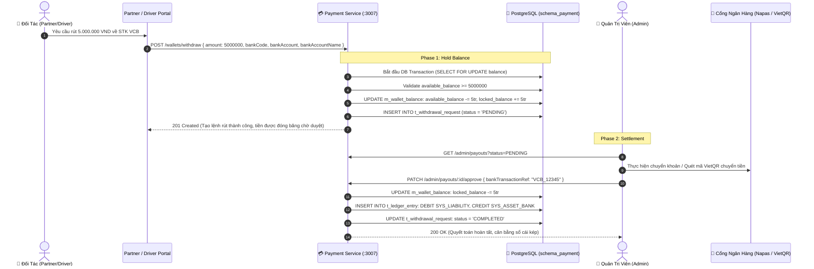

# 📋 Kế Hoạch Triển Khai: Hệ Thống Rút Tiền Ngân Hàng & Quyết Toán Đối Tác (Payout & Bank Withdrawal Engine)

`[DRAFT]` • **Issue liên kết:** #D4, #R5 • **Phân loại:** `platform` • **Ngày khởi tạo:** 2026-11-09

---

## 1. 🎯 Tổng Quan & Bài Toán Cần Giải Quyết

### 1.1. Hiện trạng & Điểm Nghẽn Nghiệp Vụ (The Unwithdrawable Balance Bottleneck)
- **Hiện trạng:**
  - `Payment Service` đã có Sổ cái kép và hạch toán ví cho Nhà hàng và Tài xế khi hoàn tất đơn hàng.
  - Tuy nhiên, **tiền chỉ nằm trong ví nội bộ** (`m_wallet_account`). Chưa có bất kỳ cơ chế nào cho phép Nhà hàng hoặc Tài xế rút doanh thu về tài khoản ngân hàng cá nhân/doanh nghiệp.
- **Rủi ro vận hành & pháp lý:**
  - Đối tác không thể nhận tiền thật, khiến nền tảng không thể đưa vào hoạt động thực tế.
  - Nếu cho phép rút tiền tùy tiện mà không có cơ chế **khóa số dư 2 pha (Two-Phase Lock)**, đối tác có thể tạo nhiều lệnh rút đồng thời (Race Condition Double-Withdrawal) dẫn tới thất thoát quỹ sàn.

### 1.2. Mục tiêu kỹ thuật
1. **Quản lý Thông Tin Thụ Hưởng Ngân Hàng (Bank Beneficiary Management)**:
   - Cho phép Nhà hàng & Tài xế liên kết tài khoản ngân hàng thụ hưởng (Tên ngân hàng, Số tài khoản, Tên chủ tài khoản in hoa không dấu) tra cứu mã BIN ngân hàng Việt Nam (VietQR chuẩn Napas 247).
2. **Cơ Chế Khóa Số Dư Hai Pha (Two-Phase Balance Lock & Hold)**:
   - Khi tạo lệnh rút: Trừ ngay lập tức `available_balance` và chuyển sang `locked_balance` (Số dư đóng băng).
   - Khi lệnh rút được duyệt và chuyển khoản thành công: Giảm `locked_balance` và ghi nhận bút toán kép DEBIT `SYS_LIABILITY_PARTNER` / CREDIT `SYS_ASSET_BANK`.
   - Nếu lệnh rút bị từ chối/thất bại: Hoàn trả từ `locked_balance` về `available_balance` nguyên vẹn.
3. **Cổng Phê Duyệt & Xuất Lệnh Chuyển Khoản Cho Admin (Batch Payout Workflow)**:
   - Admin Portal kiểm tra danh sách lệnh rút, hỗ trợ duyệt từng lệnh hoặc duyệt hàng loạt (Batch Approval) kèm xuất file đối soát (CSV/Excel) hoặc kết nối cổng chi hộ (Payout API).

---

## 2. 🔍 Khảo Sát Hiện Trạng Codebase

| File / Component | Hiện trạng | Hành động cần thực hiện |
| :--- | :--- | :--- |
| [`backend/apps/payment-service/src/modules/wallet`](file:///d:/code/FoodDelivery/backend/apps/payment-service) | Đã có API `/wallets/:id` và `/wallets/topup`. | Bổ sung API `POST /wallets/withdraw` và bảng `t_withdrawal_request`. |
| [`backend/apps/payment-service/src/modules/ledger`](file:///d:/code/FoodDelivery/backend/apps/payment-service) | Có các reference type `ORDER_SETTLEMENT`, `COD_DEDUCTION`. | Thêm reference type `WITHDRAWAL_HOLD` và `WITHDRAWAL_SETTLEMENT`. |
| [`frontend/src/features/partner`](file:///d:/code/FoodDelivery/frontend/src/features/partner) | Tab doanh thu chỉ hiển thị con số tĩnh. | Bổ sung Modal rút tiền, form nhập số tài khoản ngân hàng và lịch sử lệnh rút. |
| [`frontend/src/features/driver`](file:///d:/code/FoodDelivery/frontend/src/features/driver) | Tab ví chỉ hiển thị số dư khả dụng. | Bổ sung nút "Rút tiền về ngân hàng", xác thực OTP và danh sách giao dịch rút. |
| [`frontend/src/features/admin`](file:///d:/code/FoodDelivery/frontend/src/features/admin) | Chưa có trang quản lý Payout. | Xây dựng màn hình `/admin/payouts` duyệt lệnh rút tiền đối tác. |

---

## 3. 🛠️ Thiết Kế Chi Tiết & Giải Pháp Kỹ Thuật

### 3.1. Sơ Đồ Luồng Rút Tiền 2 Pha (Sequence Diagram)



### 3.2. Cấu Trúc Bảng Dữ Liệu (`schema_payment.t_withdrawal_request`)
```sql
CREATE TABLE schema_payment.t_withdrawal_request (
    id UUID PRIMARY KEY DEFAULT gen_random_uuid(),
    wallet_account_id UUID NOT NULL REFERENCES schema_payment.m_wallet_account(id),
    requester_id UUID NOT NULL,
    requester_type VARCHAR(20) NOT NULL CHECK (requester_type IN ('DRIVER', 'RESTAURANT')),
    amount NUMERIC(15, 2) NOT NULL CHECK (amount >= 50000), -- Rút tối thiểu 50.000 VND
    fee NUMERIC(15, 2) NOT NULL DEFAULT 0,
    net_amount NUMERIC(15, 2) NOT NULL,
    bank_code VARCHAR(20) NOT NULL, -- vd: VCB, TCB, MB, ACB
    bank_account_number VARCHAR(50) NOT NULL,
    bank_account_name VARCHAR(100) NOT NULL,
    status VARCHAR(20) NOT NULL DEFAULT 'PENDING' CHECK (status IN ('PENDING', 'APPROVED', 'REJECTED', 'PROCESSING')),
    rejection_reason TEXT,
    bank_transaction_ref VARCHAR(100),
    processed_by UUID,
    processed_at TIMESTAMP WITH TIME ZONE,
    created_at TIMESTAMP WITH TIME ZONE DEFAULT NOW()
);
```

### 3.3. Thiết Kế Trải Nghiệm Người Dùng Phía Frontend (Next.js UI/UX Integration)

1. **Phía Đối Tác / Tài Xế (`WithdrawModal`)**:
   - Thẻ hiển thị số dư: Phân tách rõ ràng giữa `Số dư khả dụng (Có thể rút)` và `Số dư đang chờ xử lý (Locked)`.
   - Form rút tiền:
     - Dropdown chọn ngân hàng (tích hợp logo danh sách hơn 50 ngân hàng Việt Nam Napas).
     - Ô nhập số tài khoản ngân hàng kèm tự động format.
     - Ô nhập số tiền cần rút kèm các nút chọn nhanh (`500k`, `1tr`, `2tr`, `Rút toàn bộ`).
     - Bảng tóm tắt phí rút tiền (ví dụ: Miễn phí rút) và số tiền thực nhận.
   - Nút `[Xác nhận rút tiền]` hiển thị spinner và vô hiệu hóa nút ngay lập tức để tránh bấm trùng lệnh.
2. **Phía Quản Trị Viên (`/admin/payouts`)**:
   - Bảng danh sách các yêu cầu rút tiền với bộ lọc theo trạng thái: `Tất cả`, `Chờ duyệt`, `Đã chi`, `Đã từ chối`.
   - Mỗi dòng yêu cầu hiển thị: Tên đối tác, Loại (Tài xế/Nhà hàng), Số tiền, Thông tin ngân hàng, và nút tiện ích `[Tạo mã QR VietQR Chuyển Khoản]`.
   - Modal phê duyệt: Nhập mã tham chiếu ngân hàng và xác nhận duyệt.
   - Modal từ chối: Nhập lý do (ví dụ: "Sai tên chủ tài khoản", "Số tài khoản không tồn tại") để hoàn tiền lại ví khả dụng cho đối tác.

---

## 4. 🧪 Kịch Bản Kiểm Thử 3 Nhánh (Testing Policy Compliance)

### 4.1. Nhánh 1: Happy Path (Dòng Chảy Chuẩn)
- **Kịch bản**: Nhà hàng có số dư khả dụng 10.000.000 VND, tạo lệnh rút 3.000.000 VND. Admin phê duyệt và nhập mã tham chiếu giao dịch.
- **Kỳ vọng**: 
  - Giai đoạn 1: `available_balance` giảm còn 7.000.000 VND, `locked_balance` tăng lên 3.000.000 VND. Trạng thái lệnh là `PENDING`.
  - Giai đoạn 2: Admin duyệt, `locked_balance` giảm 3.000.000 VND về 0. Trạng thái lệnh chuyển thành `COMPLETED`. Sổ cái kép ghi nhận 2 dòng DEBIT/CREDIT cân bằng tuyệt đối.

### 4.2. Nhánh 2: Edge Cases (Biên & Giới Hạn)
- **Kịch bản 1 (Tấn công rút kép đồng thời - Double-Withdrawal Race Condition)**: Đối tác gửi 2 request rút 8.000.000 VND trong cùng 1 mili-giây khi tài khoản chỉ có 10.000.000 VND.
- **Kỳ vọng**: Khóa bi quan `SELECT FOR UPDATE` trên bảng số dư khiến request 1 thành công khóa 8tr; request 2 thấy số dư khả dụng chỉ còn 2tr lập tức bị chặn với lỗi `400 Bad Request: Số dư khả dụng không đủ để thực hiện giao dịch`.
- **Kịch bản 2 (Rút dưới hạn mức tối thiểu)**: Gửi request rút 20.000 VND (hạn mức tối thiểu quy định là 50.000 VND).
- **Kỳ vọng**: DTO Validation ném `400 Bad Request: Số tiền rút tối thiểu là 50.000 VND`.

### 4.3. Nhánh 3: Error & Rejection Flow (Ngoại Lệ & Khắc Phục)
- **Kịch bản**: Admin từ chối lệnh rút vì thông tin tài khoản ngân hàng sai lệch.
- **Kỳ vọng**: 
  - Lệnh chuyển sang `REJECTED` lưu kèm lý do từ chối.
  - Số tiền 3.000.000 VND được chuyển ngược từ `locked_balance` về lại `available_balance` của đối tác.
  - Đối tác nhận được thông báo giải thích cụ thể trên giao diện.

---

## 5. ✅ Checklist Tiêu Chuẩn Cần Vượt Qua (Local CI Gate)

- [ ] **Linter**: `npm run lint` đạt 0 warnings, 0 errors.
- [ ] **Type Check**: `npx tsc --noEmit` đạt 0 errors (nghiêm cấm `any`).
- [ ] **Unit Tests (Vitest)**:
  - [ ] `payment-service/tests/withdrawal-two-phase-lock.spec.ts` pass 100%.
  - [ ] `payment-service/tests/withdrawal-rejection-refund.spec.ts` pass 100%.
  - [ ] `frontend/src/features/partner/tests/withdraw-modal.spec.ts` pass 100%.
  - [ ] `frontend/src/features/admin/tests/payout-approval-table.spec.ts` pass 100%.
- [ ] **Build Check**: `npm run build` thành công.
- [ ] **Traceability Header**: Đầy đủ `[Requirement/Issue]`, `[Branch: Happy|Edge|Error]`, `[Expected Output]`.

