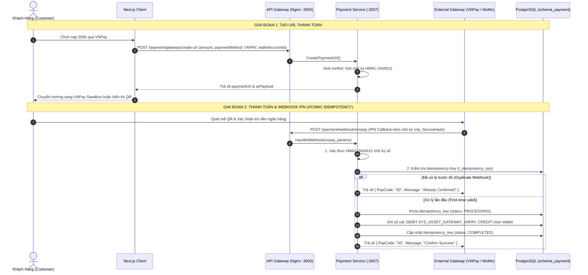

# Kế Hoạch Triển Khai: Tích Hợp Cổng Thanh Toán Trực Tuyến (VNPay / MoMo) & Webhook Idempotency

> **Mã công việc (Task Code):** `payment-gateway-webhook`  
> **Trạng thái:** `[IN_PROGRESS]`  
> **Tác giả:** `@planner` (Điều phối bởi `@orchestrator`)  
> **Nhánh phát triển:** `feature/issue-77-payment-gateway-webhook`  
> **GitHub Issue:** [#77](https://github.com/DuyBinh2003/FoodDelivery/issues/77)  
> **Tài liệu tham chiếu:** `docs/services/payment-service.md`, `docs/services/order-service.md`, `docs/architecture/fintech-ledger-accounting.md`

---

## 1. Bối Cảnh & Mục Tiêu Nghiệp Vụ (Context & Business Objectives)

Hiện tại, hệ thống đã hoàn thiện Sổ cái kép (Double-Entry Ledger) và giao dịch ví nội bộ / tiền mặt (COD). Để hỗ trợ người dùng nạp tiền vào ví hoặc thanh toán đơn hàng trực tiếp bằng phương thức thanh toán điện tử phổ biến tại Việt Nam (VNPay QR, Thẻ ATM nội địa, Thẻ quốc tế, Ví MoMo), Payment Service cần mở rộng khả năng giao tiếp với các Cổng thanh toán trực tuyến bên ngoài.

### Mục tiêu cốt lõi:
1. **Khởi tạo giao dịch thanh toán (Payment URL & QR Generation)**:
   - Cho phép khách hàng chọn cổng thanh toán (`VNPAY` hoặc `MOMO`).
   - Tạo mã tham chiếu giao dịch độc nhất và ký số bảo mật bằng thuật toán tiêu chuẩn (HMAC-SHA512 đối với VNPay, HMAC-SHA256 đối với MoMo).
   - Sinh đường dẫn thanh toán an toàn kèm thông tin QR Pay để chuyển hướng người dùng hoặc hiển thị trên ứng dụng di động/web.
2. **Xử lý Webhook / Instant Payment Notification (IPN Listener)**:
   - Tiếp nhận thông báo bất đồng bộ từ máy chủ VNPay / MoMo khi người dùng hoàn tất thanh toán.
   - Xác minh tính toàn vẹn và xuất xứ qua việc kiểm tra chữ ký số (Signature Verification). Từ chối 400 nếu chữ ký không khớp.
3. **Cơ chế Chống trùng lặp & Tấn công phát lại (Webhook Idempotency & Replay Attack Defense)**:
   - Sử dụng bảng `t_idempotency_key` trong `schema_payment`.
   - Đảm bảo khi cổng thanh toán bắn lại Webhook nhiều lần (do mạng lag hoặc retry policy), hệ thống chỉ hạch toán đúng 1 lần duy nhất, các lần sau phản hồi `Success` mà không tạo thêm bút toán trùng.
4. **Hạch toán dòng tiền vào Sổ cái kép (Double-Entry Settlement)**:
   - Tự động ghi nhận giao dịch:
     - `DEBIT SYS_ASSET_GATEWAY_VNPAY / SYS_ASSET_GATEWAY_MOMO` (Tài sản thanh khoản của sàn tại ngân hàng/cổng tăng).
     - `CREDIT m_wallet_account` người nhận (Nợ phải trả khách hàng tăng - trường hợp nạp ví) HOẶC thanh toán đơn hàng thành công (`PaymentIntent: SUCCEEDED`).

---

## 2. Kiến Trúc Kỹ Thuật & Sơ Đồ Luồng (Architecture & Flow)

---

## 3. Cấu Trúc Dữ Liệu & Ràng Buộc (Database & Security)

Hệ thống tận dụng cơ sở dữ liệu `schema_payment` hiện có:
- **`t_idempotency_key`**: Lưu trữ mã khóa duy nhất `gateway_{gateway_name}_{transaction_ref}`, trạng thái xử lý (`PROCESSING`, `SUCCEEDED`, `FAILED`) và response snapshot.
- **`m_wallet_account` & `m_wallet_balance`**: Tự động sinh tài khoản tài sản hệ thống `SYS_ASSET_GATEWAY_VNPAY`, `SYS_ASSET_GATEWAY_MOMO` loại `ASSET` để đối ứng với ví người dùng loại `LIABILITY`.
- **`t_ledger_transaction` & `t_ledger_entry`**: Lưu nhật ký bút toán kép bất biến (Append-Only).

---

## 4. Danh Sách API Triển Khai

| Phương thức | Đường dẫn | Phân quyền | Mô tả |
| :--- | :--- | :--- | :--- |
| `POST` | `/payment/gateway/create-url` | JwtAuthGuard | Tạo URL chuyển hướng thanh toán và dữ liệu QR Pay |
| `POST` | `/payment/webhooks/vnpay` | Public (Gateway Callback) | Webhook IPN tiếp nhận kết quả giao dịch từ VNPay |
| `POST` | `/payment/webhooks/momo` | Public (Gateway Callback) | Webhook IPN tiếp nhận kết quả giao dịch từ MoMo |
| `GET` | `/payment/webhooks/vnpay-return` | Public (Client Return) | URL người dùng chuyển hướng về sau khi thanh toán xong |
| `POST` | `/payment/webhooks/simulate` | Dev / Test Only | Mô phỏng webhook nạp tiền để kiểm thử tự động |

---

## 5. Kịch Bản Kiểm Thử 3 Nhánh (Vitest Test Suite)

Tất cả các ca kiểm thử được đặt tại `backend/apps/payment-service/src/modules/ledger/tests/payment-gateway-webhook.spec.ts` có gắn Traceability Header.

### Nhánh 1: Luồng chuẩn thành công (Happy Path)
- **HP-01**: Tạo URL thanh toán VNPay thành công (đúng format tham số, chữ ký HMAC-SHA512 hợp lệ, có mã QR).
- **HP-02**: Tạo URL thanh toán MoMo thành công (đúng format tham số, chữ ký HMAC-SHA256 hợp lệ).
- **HP-03**: Xử lý Webhook VNPay thành công: xác thực đúng chữ ký số, nạp tiền ví thành công và hạch toán đúng sổ cái kép.
- **HP-04**: Xử lý Webhook MoMo thành công: xác thực chữ ký và hoàn tất giao dịch.

### Nhánh 2: Các trường hợp biên (Edge Cases)
- **EC-01**: Webhook gửi trùng lặp nhiều lần (Idempotency check): lần thứ 2 trở đi không hạch toán thêm tiền, trả về `RspCode: 00` ngay lập tức.
- **EC-02**: Các tham số URL VNPay được sắp xếp bảng chữ cái (Alphabetical sorting) chuẩn trước khi hash chữ ký.
- **EC-03**: Giao dịch nạp số tiền lớn hoặc số tiền lẻ (ví dụ 10.000.000 VND).
- **EC-04**: Xử lý giao dịch VNPay trả về mã lỗi ngân hàng khách hủy (`vnp_ResponseCode !== '00'`) mà không làm hỏng dữ liệu sổ cái.

### Nhánh 3: Luồng lỗi & Từ chối vi phạm (Error / Rejection Flow)
- **ERR-01**: Webhook gửi chữ ký số sai hoặc bị giả mạo -> ném `BadRequestException` hoặc từ chối phản hồi.
- **ERR-02**: Tạo URL thanh toán với phương thức không được hỗ trợ -> ném `BadRequestException`.
- **ERR-03**: Tạo URL thanh toán với số tiền âm hoặc bằng 0 -> ném `BadRequestException`.
- **ERR-04**: Ví nhận tiền không tồn tại trong hệ thống -> ném `NotFoundException`.
- **ERR-05**: Webhook thiếu các trường bắt buộc (`orderId`, `amount`, `signature`) -> từ chối xử lý.

---

## 6. Bộ Tứ Kiểm Soát CI Nội Bộ (Local CI Gate)
1. **Linter**: `npm run lint` (0 warning, 0 error).
2. **Type Check**: `npx tsc -p apps/payment-service/tsconfig.json --noEmit` (0 error).
3. **Unit Tests**: `npm test` với Vitest (100% pass trên toàn bộ test suite).
4. **Build Check**: `npm run build` (Biên dịch thành công).
