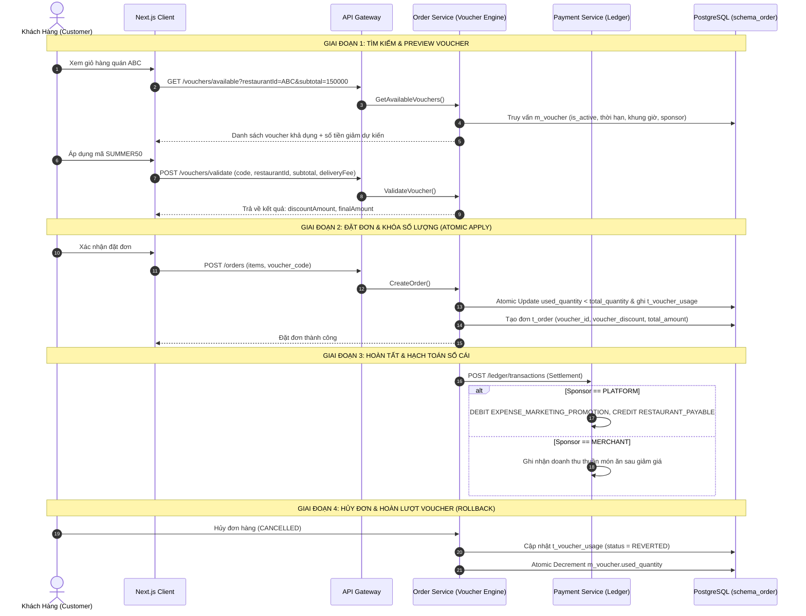

# Kế Hoạch Triển Khai: Hệ Thống Voucher & Khuyến Mại Đa Tầng (Platform vs Merchant) Tích Hợp Sổ Cái Kép

> **Mã công việc (Task Code):** `promotion-voucher-engine`  
> **Trạng thái:** `[IN_PROGRESS]`  
> **Tác giả:** `@planner` (Điều phối bởi `@orchestrator`)  
> **Nhánh phát triển:** `feature/issue-75-promotion-voucher-engine`  
> **GitHub Issue:** [#75](https://github.com/DuyBinh2003/FoodDelivery/issues/75)  
> **Tài liệu tham chiếu:** `docs/services/order-service.md`, `docs/services/payment-service.md`, `docs/business/business-roadmap.md`

---

## 1. Bối Cảnh & Mục Tiêu Nghiệp Vụ (Context & Business Objectives)

Hiện tại, hệ thống đã hỗ trợ tích điểm khách hàng thân thiết (Loyalty Points), nhưng chưa có hệ thống Mã giảm giá / Voucher đa tầng linh hoạt. Để kích cầu và tạo chiến dịch tiếp thị cho cả Sàn lẫn Đối tác Nhà hàng, cần xây dựng một Voucher Engine toàn diện với các mục tiêu:

### Mục tiêu cốt lõi:
1. **Đa dạng hình thức ưu đãi (Voucher Types)**:
   - `PERCENTAGE`: Giảm theo tỷ lệ phần trăm (kèm trần tối đa `max_discount_amount`).
   - `FIXED_AMOUNT`: Giảm số tiền cố định trực tiếp vào đơn hàng.
   - `FREE_SHIPPING`: Miễn phí hoặc giảm phí giao hàng (`delivery_fee`).
2. **Mô hình tài trợ đa tầng (Platform vs Merchant Funded)**:
   - `PLATFORM`: Voucher do Sàn phát hành và tài trợ 100% ngân sách marketing.
   - `MERCHANT`: Voucher do từng Nhà hàng riêng biệt tự phát hành để hút khách đến quán của mình.
3. **Kiểm soát chặt chẽ điều kiện áp dụng (Rule Engine)**:
   - Giá trị đơn hàng tối thiểu (`min_order_amount`).
   - Khung giờ vàng khuyến mãi (`start_hour` đến `end_hour`).
   - Giới hạn số lượt sử dụng toàn sàn (`total_quantity`) và giới hạn trên từng khách hàng (`max_usage_per_user`).
   - Thời hạn hiệu lực (`valid_from` đến `valid_to`).
4. **Đồng bộ Sổ cái kép (Double-Entry Ledger Accounting)**:
   - Phân bổ chính xác dòng tiền chiết khấu tài trợ vào Ledger của `payment-service`: Sàn chịu chi phí (`EXPENSE_MARKETING_PROMOTION`) hay Quán chịu khấu trừ.
5. **Cơ chế chống Race Condition & Hoàn Voucher (Concurrency & Rollback)**:
   - Kiểm soát số lượt voucher bằng Atomic counter / Database Lock, tránh vượt quá hạn mức khi nhiều khách cùng áp dụng cùng lúc.
   - Tự động hoàn lại lượt sử dụng voucher (`REVERTED`) khi đơn hàng bị hủy (`CANCELLED`).

---

## 2. Kiến Trúc Kỹ Thuật & Sơ Đồ Luồng (Architecture & Flow)

---

## 3. Cấu Trúc Dữ Liệu (Database Schema)

### 3.1. Bảng Master: `m_voucher` (`schema_order`)
| Tên cột | Kiểu dữ liệu | Ràng buộc | Diễn giải |
| :--- | :--- | :--- | :--- |
| `id` | UUID | PK, default uuidv4 | Mã định danh duy nhất |
| `code` | VARCHAR(50) | UNIQUE, NOT NULL | Mã code hiển thị (viết hoa, vd: `SUMMER50`) |
| `name` | VARCHAR(255) | NOT NULL | Tên chương trình ưu đãi |
| `description` | TEXT | NULLABLE | Mô tả chi tiết điều kiện áp dụng |
| `voucher_type` | VARCHAR(30) | NOT NULL | `PERCENTAGE` \| `FIXED_AMOUNT` \| `FREE_SHIPPING` |
| `sponsor_type` | VARCHAR(30) | NOT NULL | `PLATFORM` \| `MERCHANT` |
| `restaurant_id` | UUID | NULLABLE | Bắt buộc nếu sponsor_type = MERCHANT |
| `discount_value` | NUMERIC(15,2)| NOT NULL | Giá trị giảm (% hoặc số tiền VND) |
| `max_discount_amount`| NUMERIC(15,2)| NULLABLE | Trần giảm tối đa cho voucher PERCENTAGE |
| `min_order_amount` | NUMERIC(15,2)| DEFAULT 0 | Giá trị đơn tối thiểu áp dụng |
| `total_quantity` | INTEGER | NOT NULL | Tổng lượt phát hành toàn hệ thống |
| `used_quantity` | INTEGER | DEFAULT 0 | Số lượt đã sử dụng thành công |
| `max_usage_per_user`| INTEGER | DEFAULT 1 | Giới hạn số lần dùng của 1 khách hàng |
| `valid_from` | TIMESTAMPTZ | NOT NULL | Thời điểm bắt đầu có hiệu lực |
| `valid_to` | TIMESTAMPTZ | NOT NULL | Thời điểm hết hạn |
| `start_hour` | INTEGER | NULLABLE | Giờ vàng bắt đầu (0 - 23) |
| `end_hour` | INTEGER | NULLABLE | Giờ vàng kết thúc (0 - 23) |
| `is_active` | BOOLEAN | DEFAULT true | Trạng thái kích hoạt |
| `created_at` | TIMESTAMPTZ | DEFAULT NOW() | Thời gian tạo |
| `updated_at` | TIMESTAMPTZ | DEFAULT NOW() | Thời gian cập nhật |
| `is_deleted` | BOOLEAN | DEFAULT false | Soft delete flag |

### 3.2. Bảng Transaction: `t_voucher_usage` (`schema_order`)
| Tên cột | Kiểu dữ liệu | Ràng buộc | Diễn giải |
| :--- | :--- | :--- | :--- |
| `id` | UUID | PK, default uuidv4 | Mã dòng ghi nhận sử dụng |
| `voucher_id` | UUID | NOT NULL, FK | Khóa ngoại trỏ đến `m_voucher.id` |
| `order_id` | UUID | NOT NULL | Mã đơn hàng áp dụng |
| `customer_id` | UUID | NOT NULL | Mã khách hàng áp dụng |
| `discount_amount`| NUMERIC(15,2)| NOT NULL | Số tiền thực tế được giảm trừ |
| `status` | VARCHAR(30) | NOT NULL | `APPLIED` \| `REVERTED` |
| `applied_at` | TIMESTAMPTZ | DEFAULT NOW() | Thời điểm áp dụng |
| `reverted_at` | TIMESTAMPTZ | NULLABLE | Thời điểm hoàn lại (nếu đơn hủy) |

### 3.3. Cập nhật bảng `t_order` (`schema_order`)
- Bổ sung `voucher_id` (UUID nullable).
- Bổ sung `voucher_code` (VARCHAR(50) nullable).
- Bổ sung `voucher_discount` (NUMERIC(15,2) default 0).
- Cập nhật công thức tính: `total_amount = GREATEST(0, subtotal + delivery_fee - points_discount - voucher_discount)`.

---

## 4. Danh Sách API Cần Triển Khai

| Phương thức | Đường dẫn | Phân quyền | Mô tả |
| :--- | :--- | :--- | :--- |
| `POST` | `/vouchers` | Admin / Partner | Tạo mới Voucher (Admin tạo Platform, Partner tạo Merchant) |
| `GET` | `/vouchers` | Admin / Partner | Danh sách quản lý voucher theo bộ lọc |
| `GET` | `/vouchers/available` | Customer | Lấy danh sách voucher áp dụng được cho giỏ hàng |
| `POST` | `/vouchers/validate` | Customer | Kiểm tra và tính toán số tiền giảm giá trước khi đặt đơn |
| `POST` | `/internal/vouchers/apply` | Internal | Đặt gạch & ghi nhận lượt dùng khi tạo đơn hàng |
| `POST` | `/internal/vouchers/revert`| Internal | Hoàn lượt voucher khi đơn hàng bị hủy |

---

## 5. Kịch Bản Kiểm Thử 3 Nhánh (Vitest Test Suite)

Tất cả các ca kiểm thử được đặt tại `backend/apps/order-service/src/modules/orders/tests/voucher-engine.spec.ts` có gắn Traceability Header.

### Nhánh 1: Luồng chuẩn thành công (Happy Path)
- **HP-01**: Áp dụng Voucher `PERCENTAGE` hợp lệ (20%, trần 30.000đ, đơn 100.000đ -> giảm 20.000đ).
- **HP-02**: Áp dụng Voucher `FIXED_AMOUNT` hợp lệ (giảm 25.000đ cho đơn 80.000đ -> giảm 25.000đ).
- **HP-03**: Áp dụng Voucher `FREE_SHIPPING` hợp lệ (phí ship 15.000đ -> giảm 15.000đ phí giao hàng).
- **HP-04**: Hoàn lượt voucher thành công khi đơn hàng chuyển sang `CANCELLED` (chuyển trạng thái `REVERTED` và giảm `used_quantity`).

### Nhánh 2: Các trường hợp biên (Edge Cases)
- **EC-01**: Giá trị đơn hàng vừa chạm đúng ngưỡng tối thiểu `min_order_amount` (ví dụ đơn đúng 100.000đ với min 100.000đ).
- **EC-02**: Giảm giá phần trăm vượt quá trần `max_discount_amount` (ví dụ 50% của 200.000đ là 100.000đ nhưng trần là 40.000đ -> chỉ giảm đúng 40.000đ).
- **EC-03**: Voucher chỉ còn đúng 1 lượt sử dụng cuối cùng (`total_quantity - used_quantity = 1`) được áp dụng thành công.
- **EC-04**: Áp dụng voucher trong khung giờ vàng hợp lệ (ví dụ khung 11:00 - 14:00).
- **EC-05**: Số tiền giảm vượt quá tổng tiền giỏ hàng (khấu trừ tối đa bằng subtotal/delivery_fee, không để đơn hàng âm).

### Nhánh 3: Luồng lỗi & Từ chối vi phạm (Error / Rejection Flow)
- **ERR-01**: Mã voucher không tồn tại hoặc đã bị xóa mềm (`is_deleted = true`).
- **ERR-02**: Voucher chưa đến ngày bắt đầu (`valid_from`) hoặc đã quá hạn (`valid_to`).
- **ERR-03**: Áp dụng ngoài khung giờ vàng (ví dụ voucher khung trưa 11:00-13:00 nhưng áp dụng lúc 15:00).
- **ERR-04**: Đơn hàng chưa đạt giá trị tối thiểu `min_order_amount`.
- **ERR-05**: Voucher của Quán A (`sponsor_type = MERCHANT`) bị áp dụng sai cho đơn hàng của Quán B.
- **ERR-06**: Voucher đã hết sạch lượt toàn sàn (`used_quantity >= total_quantity`).
- **ERR-07**: Người dùng vượt quá giới hạn lượt sử dụng cá nhân (`max_usage_per_user`).

---

## 6. Bộ Tứ Kiểm Soát CI Nội Bộ (Local CI Gate)
1. **Linter**: `npm run lint` (0 warning, 0 error).
2. **Type Check**: `npx tsc -p apps/order-service/tsconfig.json --noEmit` (0 error).
3. **Unit Tests**: `npm test` với Vitest (100% pass trên toàn bộ test suite).
4. **Build Check**: `npm run build` (Biên dịch thành công).
